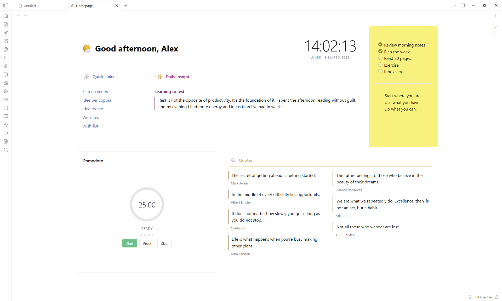
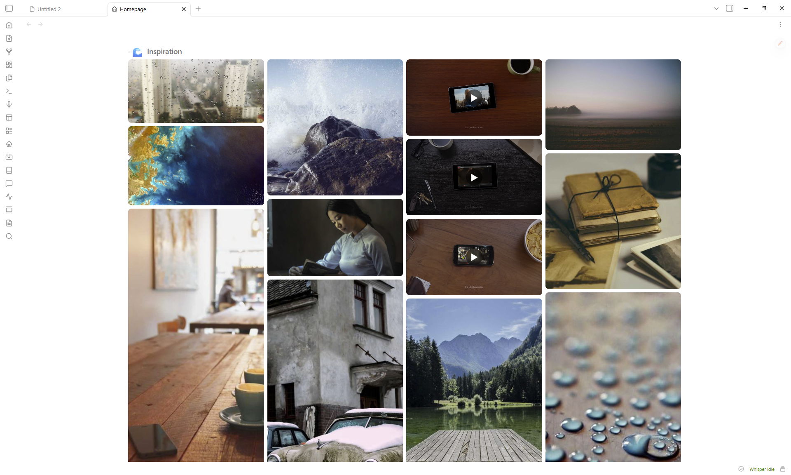

# Homepage Blocks

A composable, drag-and-drop homepage for [Obsidian](https://obsidian.md).



## Features

- **17 block types** -- greeting, clock, quotes, quick links, button grid, image gallery, video embed, embedded note, static text, HTML, bookmarks, recent files, pomodoro timer, spacer, random note, voice notes, vault search
- **Drag-and-drop layout** with 2D resize (column span + row height)
- **Accent colors** with adjustable intensity (5--100%) that tint the entire card, including interactive controls
- **Per-block styling** -- title, emoji, divider, padding, elevation, border, opacity, backdrop blur, gradients
- **Responsive layout** -- the grid drops columns in narrow panes (below 1024, 768 and 480 px), and blocks adapt their contents with CSS container queries
- **Full-screen lightbox** for gallery images with keyboard and swipe navigation
- **Collapsible blocks** -- click any header to collapse or expand it
- **Links that behave like Obsidian's** -- Ctrl/Cmd-click or middle-click opens a note in a new tab; a typed link to a note that does not exist shows a notice instead of creating an empty note
- **Follows renames** -- renaming a note or folder updates every block setting that names it (embedded note, gallery and voice-note folders, quick links, buttons, bookmarks, recent-files exclusions); a link typed by note name, such as `Plan` or `[[Plan#Goals|alias]]`, is updated when the old name no longer leads to a note
- **Sync-aware** -- a layout changed on another device (Obsidian Sync, iCloud, git, ...) is loaded as soon as it arrives, never over an edit session in progress. Blocks written by a newer version of the plugin are kept, not deleted, by an older one
- **51 language presets** for greeting salutations
- **Zero runtime dependencies** beyond [GridStack](https://gridstackjs.com/)

## Installation

Requires Obsidian 1.8.7 or later.

### From Community Plugins

1. Open **Settings > Community plugins > Browse**
2. Search for **Homepage Blocks**
3. Click **Install**, then **Enable**

### Manual

1. Download `main.js`, `manifest.json`, and `styles.css` from the [latest release](https://github.com/acaprino/obsidian-plugin-homepage/releases/latest)
2. Create `<vault>/.obsidian/plugins/homepage-blocks/`
3. Copy the three files into that folder
4. Enable the plugin in **Settings > Community plugins**

## Getting started

1. Click the **house icon** in the ribbon, or run `Open homepage` from the command palette.
2. Click the **pencil FAB** to enter edit mode.
3. **Add Block** inserts new blocks (up to 100). The **gear icon** opens settings, the **grip handle** reorders, and the **corner grip** resizes. In a pop-out window, drag and resize are off: use the arrow buttons on each block to reorder.
4. Click **Done** to exit edit mode.

## Block types

| Block | Description |
|-------|-------------|
| **Greeting** | Time-aware salutation with 51 language presets (the app language by default) and custom emoji per time slot or random pool |
| **Clock** | Live clock with optional seconds and date display |
| **Quotes** | Multi-column quotes pulled from tagged notes or entered manually |
| **Quick Links** | Auto-generated list from a folder (with optional glob patterns like `Projects/*.md` or `**/*-draft.md`), plus manual links |
| **Button Grid** | Emoji-labeled buttons that open notes or web links |
| **Image Gallery** | Grid or masonry layout from a vault folder, with lightbox |
| **Video Embed** | YouTube, Vimeo (unlisted videos and player, channel and group links too), Dailymotion -- supports YouTube playlists with shuffle |
| **Embedded Note** | Renders a vault note inline, scrolling inside its card or growing to fit; follows the note when it is renamed |
| **Static Text** | Freeform markdown with a quick-edit button |
| **HTML** | Custom HTML (sanitized for security) -- see [Using theme colors in HTML blocks](#using-theme-colors-in-html-blocks) |
| **Bookmarks** | Web links and vault notes in a grid. A URL of any safe scheme (`https:`, `obsidian:`, `mailto:`, ...) opens outside Obsidian, a bare domain such as `github.com` opens as `https:`, anything else as a vault note |
| **Recent Files** | Your most recently modified notes |
| **Pomodoro** | Configurable work/break timer; keeps running (or paused) while the homepage is closed or in edit mode |
| **Spacer** | Empty space for layout gaps |
| **Random Note** | Surfaces a random note from a tag filter, with excerpt preview |
| **Voice Notes** | Tap-to-record (or hold, with the pointer or Space/Enter) voice transcription via OpenAI Whisper or Google Gemini -- see [Voice Notes & privacy](#voice-notes--privacy) below |
| **Vault search** | In-block search over the vault's note names |



## Voice Notes & privacy

The **Voice Notes** block records audio in your browser and uploads it to a third-party transcription service. Before you record for the first time, the plugin asks you to confirm the upload per provider.

**What is sent and where:**

| Provider | Endpoint | Data sent | Authentication |
|----------|----------|-----------|----------------|
| **OpenAI Whisper** | `api.openai.com/v1/audio/transcriptions` | Raw audio blob + model + optional language hint | Your OpenAI API key in the `Authorization: Bearer ...` header |
| **Google Gemini** | `generativelanguage.googleapis.com/v1beta/models/...:generateContent` | Base64-encoded audio + a transcription prompt + optional language hint | Your Google AI API key in the `x-goog-api-key` header |

**API key storage:** the key is **encrypted at rest** (AES-GCM-256) in `<vault>/.obsidian/plugins/homepage-blocks/data.json` using a non-extractable key that stays on the device where you entered it (in the browser's IndexedDB). A synced `data.json` (Obsidian Sync, iCloud, Dropbox, git, ...) therefore carries only ciphertext that **other devices cannot decrypt**: there the block shows *API key unavailable on this device*, and the stored key is left untouched for the device that saved it. Entering a key on another device replaces the stored one for every device that shares that block; in **Separate** responsive mode, desktop and mobile blocks keep their own keys. Update the plugin on every device that syncs the vault: older versions clear a key they cannot read, which erases it for the other devices too. On the rare platform without WebCrypto, the plugin falls back to plaintext (with a refuse-to-downgrade guard that never overwrites existing ciphertext). Treat the key like any secret regardless, since the ciphertext still travels with your synced vault. When you **Export layout** the key is stripped from the exported JSON.

**Note template:** `{{transcript}}` is filled in only where it sits in plain text: its paragraph (the text since the last blank line before it) must hold no HTML, no link or image target, no reference definition and no CSS `url(`, and it must not be inside a `<style>` or `<svg>` element. Otherwise the template is ignored for that note, which then holds the transcript alone, so an imported template cannot send your dictation to a remote address. A template without `{{transcript}}` gets the transcript below it.

**Models:** the block settings offer each provider's current transcription models, with `gpt-transcribe` (OpenAI) and `gemini-3.8-flash` (Gemini) as defaults; the older OpenAI models are marked with their February 2027 retirement. Pick **Custom…** to type any other model ID the provider offers. A stored Gemini 2.0 model, which Google no longer serves, falls back to the default. When the provider refuses the model for your key, the notice says so.

**Size limit:** recording stops by itself, with a notice, just below the provider's upload limit: at 23 MB for OpenAI (limit 25 MB) and 13 MB for Gemini (limit 14.5 MB of audio, its 20 MB request limit less the base64 overhead), so the recording can still be sent.

**Failed transcriptions:** when a transcription fails, times out or returns no text (for Gemini, with the reason it gave), the recording is not lost, even if the homepage was closed or reloaded while it waited: the audio is saved in the destination folder next to a note that names the reason and embeds the audio, so you can listen to it or transcribe it again.

**Destination folder:** an existing folder is found whatever its letter case, and a missing one is created.

**Timeouts:** a transcription that has not answered after 120 seconds is reported as timed out.

**Revoking access:** to withdraw the upload confirmation on a device, use **Forget** next to *Upload consent* in the block settings. Delete the key from the provider's dashboard ([OpenAI](https://platform.openai.com/api-keys), [Google AI Studio](https://aistudio.google.com/app/apikey)) and clear the API key field in block settings on the device where you entered it.

**Mobile:** voice recording requires the platform's `MediaRecorder` + `navigator.mediaDevices` APIs. On platforms that don't expose them, the microphone is disabled and, once an API key is set, the block shows *Not available on this platform*.

If you do not want the Voice Notes feature, remove the Voice Notes block (the default layout includes one). Nothing is ever sent without an API key and your confirmation.

## Card styling

Every block shares these settings (open them with the gear icon in edit mode):

- **Header** -- custom label, emoji (picker), size (h1--h6), show/hide, divider, gap below the title, header bar
- **Body** -- padding, background on/off, background opacity, backdrop blur, two-color gradient with angle
- **Card** -- accent color (preset swatches or custom picker) with an intensity slider (5--100%), border (on/off, width, style, radius), elevation (shadow)
- **Content** -- the block's own settings

An accent color tints the header, background, border, divider, and all interactive controls (checkboxes, toggles, radio buttons) in one step. Text on an accented card switches between light and dark, and accent-colored titles and links fall back to the card's text color, whenever that is what keeps them readable, in both the light and the dark theme. Clock, Greeting and Spacer draw no header, so their Header tab has no title settings.

## Settings

Open **Settings > Homepage Blocks**:

| Setting | Description |
|---------|-------------|
| Open on startup | Opens the homepage automatically when Obsidian launches |
| Startup open mode | Controls how the homepage opens on startup -- keep existing tabs (new tab), replace the active tab, or close all tabs |
| Open when empty | Opens the homepage when no other tabs are open |
| Manual open mode | Controls how the homepage opens from ribbon/command -- keep existing tabs (new tab), replace the active tab, or close all tabs |
| Pin homepage tab | Prevents the homepage tab from being closed |
| Separate startup for mobile | Use independent startup settings on mobile (open-on-startup, open mode, pin, ...) instead of mirroring desktop |
| Default columns | Grid column count (2, 3, 4, or 5) |
| Responsive mode | **Unified** (one adaptive layout) or **Separate** (independent desktop + mobile layouts, with copy-to-mobile, which asks for confirmation and fits the desktop blocks to the mobile columns without overlaps) |
| Compact layout | Removes vertical gaps between blocks in view mode. Turned off, gaps are kept only until a block that sizes itself to its content (gallery, quotes, text, button grid, random note, a note set to grow) changes height, which packs the grid again |
| Hover highlight | Subtly lifts blocks on hover and reveals the collapse toggle |
| Show scroll bar | Shows or hides the homepage scroll bar (scrolling regions inside blocks keep theirs) |
| Reset to default layout | Restores the demo blocks of the layout this device shows -- the desktop layout, or in Separate mode on a phone the mobile layout -- and keeps every other setting, after a confirmation (**cannot be undone**) |
| Export layout | Copies your layout to the clipboard as JSON, without API keys and button custom CSS |
| Import layout | Replaces the whole layout, mobile layout and settings included, with a layout from the clipboard, after a confirmation. API keys, custom CSS, unknown settings and values of the wrong type are dropped, and numbers are clamped to the ranges the settings offer. The confirmation lists blocks that bring text which is rendered or written into notes (Static Text content, HTML, the Voice Notes template and folder) and bookmark, button and quick-link targets with a scheme other than `http:`/`https:` (such as `obsidian://`), and lets you **Import without content**, which drops those too |

### Commands

| Command | Action |
|---------|--------|
| `Open homepage` | Opens or focuses the homepage tab |
| `Toggle edit mode` | Switches the active homepage between edit and view mode (one homepage is edited at a time) |
| `Add block` | Opens the add-block picker on the active homepage |

`Toggle edit mode` and `Add block` are listed in the command palette only while a homepage is open.

## CSS customization

You can override layout variables in a [CSS snippet](https://help.obsidian.md/Extending+Obsidian/CSS+snippets). Set them on `.homepage-view`, where the plugin declares its layout tokens (a value on `:root` does not reach `--hp-padding` or `--hp-content-max-width`). The snippet applies at every pane width, on desktop and mobile alike; a block's own **Padding** setting still wins over `--hp-card-padding`:

```css
.homepage-view {
  --hp-padding: 24px;
  --hp-card-padding: 16px;
  --hp-content-max-width: 1400px;
}
```

## Using theme colors in HTML blocks

HTML that contains a `<style>` block is rendered as a document inside a sandboxed iframe for full CSS support with style isolation: scripts, fetches and frames are blocked by a Content Security Policy placed first in the document, while images, media and fonts may still load over `https:` (without a referrer). The document is scaled to fit its card; in a single-column layout the card grows to the document's height instead. HTML *without* a `<style>` block is a plain fragment, sanitized and rendered inline: `<style>`/`<script>`/`<iframe>` and other active tags are stripped, and so are `style` attributes, images, video, audio, SVG and canvas, and every link that is not `http:` or `https:`. To style your HTML, and to match your theme, use a `<style>` block with Obsidian's CSS variables: the plugin copies the values of the variables you use into the document each time the block is drawn, so your HTML matches the theme that is active then.

### Common theme variables

The table below lists the most useful variables. Use them as `var(--variable-name)` in the `<style>` block (or in `style` attributes of a document that has one).

| Category | Variable | Description |
|----------|----------|-------------|
| Background | `--background-primary` | Main app background |
| | `--background-secondary` | Card / panel background |
| | `--background-modifier-border` | Standard border color |
| Text | `--text-normal` | Primary text |
| | `--text-muted` | Secondary / dimmed text |
| | `--text-faint` | Even lighter text |
| | `--text-accent` | Accent-colored text |
| Accent | `--color-accent` | Theme accent (links, focus rings) |
| | `--interactive-accent` | Active control background |
| | `--interactive-accent-hover` | Hovered control background |
| Radius | `--radius-s` / `--radius-m` / `--radius-l` | Border radius presets |

### A themed card

This example builds a card that adapts to any theme:

```html
<style>
  .card {
    background: var(--background-secondary);
    color: var(--text-normal);
    padding: 16px;
    border-radius: var(--radius-m);
    border: 1px solid var(--background-modifier-border);
  }
  .card h3 { color: var(--color-accent); margin-top: 0; }
  .card p { color: var(--text-muted); }
</style>
<div class="card">
  <h3>Dashboard</h3>
  <p>This card follows the active theme.</p>
</div>
```

You can blend colors with `color-mix()` to create transparent or tinted variants:

```html
<style>
  .tint { background: color-mix(in srgb, var(--color-accent) 10%, transparent); }
</style>
<div class="tint">Subtle accent tint</div>
```

### Finding more variables

Open DevTools (`Ctrl+Shift+I`), inspect the `<body>` element, and filter the Computed tab for `--`. You will see every CSS variable the current theme defines.

## Support

Bug reports and feature requests: [GitHub Issues](https://github.com/acaprino/obsidian-plugin-homepage/issues)

## License

[MIT](LICENSE)
