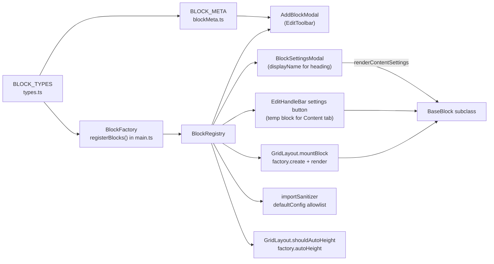
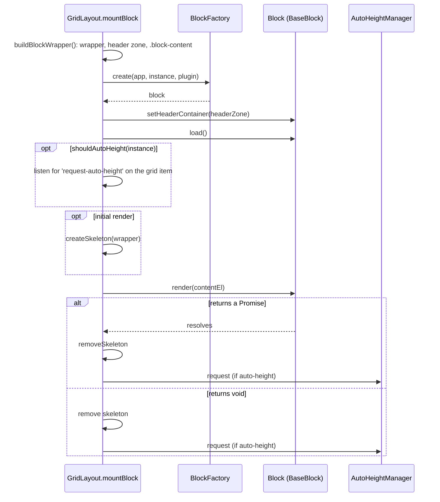
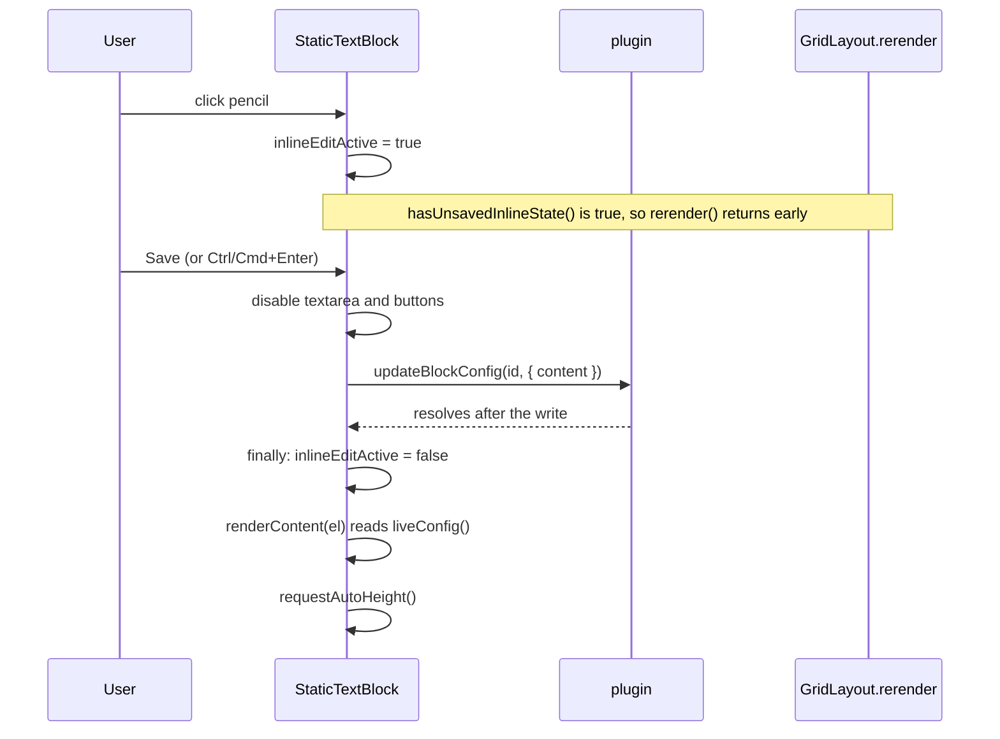
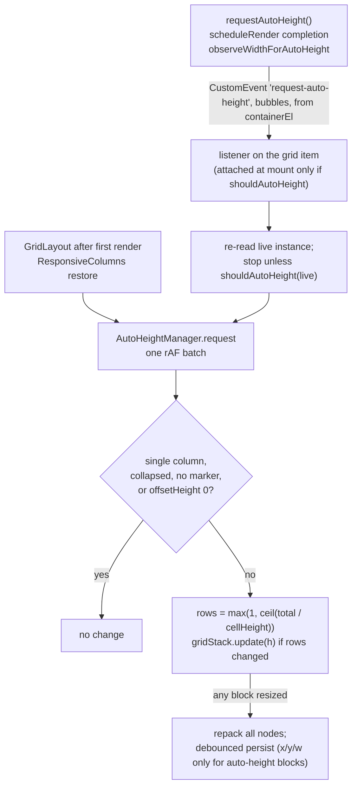

# Block API

This is the interface reference for block authors. It covers `BaseBlock`, `BlockFactory` and its `defaultConfig` contract, `BlockRegistry` and `BLOCK_META`, and ends with a step-by-step guide to adding a block type. It describes the code on disk (branch `xray-remediation`). Where a comment or `CLAUDE.md` says something else, the code is what is documented here, and the differences are listed at the end.

Related docs:

- [../architecture.md](../architecture.md): layers, module map, ownership.
- [../data-model.md](../data-model.md): `BlockInstance`, `LayoutConfig`, validation, migration.
- [../flows.md](../flows.md): load, save, import/export, settings flows.
- [../blocks.md](../blocks.md): what each of the 17 blocks does, including its config keys.
- [../styling.md](../styling.md): the shared `_` styling keys and CSS conventions.
- [plugin.md](plugin.md): `IHomepagePlugin` and the persistence chain.
- [grid.md](grid.md): `GridLayout`, `AutoHeightManager`, `LayoutPersister`.

---

## At a glance

| Piece | Where | Role |
|---|---|---|
| `BaseBlock` | `src/blocks/BaseBlock.ts:7` | Abstract base class for every block. Extends Obsidian `Component` |
| `BlockFactory` | `src/types.ts:90-103` | Describes one block type: name, default config, default size, auto-height flag, constructor |
| `registerBlocks()` | `src/main.ts:41-207` | Registers the 17 factories. Exported so tests can register the real ones |
| `BlockRegistry` | `src/BlockRegistry.ts:3-23` | Singleton `Map<BlockType, BlockFactory>` |
| `BLOCK_META` | `src/blockMeta.ts:3-21` | Icon and description per type, for the Add Block picker |
| `BLOCK_TYPES` | `src/types.ts:4-10` | The closed list of type ids. `BlockType` is derived from it (`:12`) |
| `AUTO_HEIGHT_ATTR` | `src/grid/AutoHeight.ts:13` | `'data-auto-height-content'`, the marker on the element whose height is measured |
| `sanitizeImportedConfig` | `src/utils/importSanitizer.ts:76-118` | Clipboard-import filter driven by `defaultConfig` |



---

## Block lifecycle

### Mounting

`GridLayout.mountBlock` (`src/GridLayout.ts:463-551`) builds the wrapper DOM and then, in view mode only, runs the steps below. In edit mode no block object is created. The grid draws a placeholder instead (`renderCompactPlaceholder`, `src/grid/BlockWrapper.ts:75-95`) and stores `block: null` (`src/GridLayout.ts:489-492`).



Cites: create `:500`, `setHeaderContainer` `:501`, `load()` `:502`, listener `:509-516`, skeleton `:518`, render `:523-528`, async branch `:529-541`, sync branch `:542-546`.

`el`, the element passed to `render`, is the wrapper's `.block-content` (`src/grid/BlockWrapper.ts:47`). The wrapper also carries:

- the classes `homepage-block-wrapper hp-block-<type>` (`:20`)
- the shared styling from `applyBlockStyling(wrapper, instance.config)` (`:29`)
- a header zone `.block-header-zone.hp-header-empty` holding the collapse chevron (`:36-43`)
- an optional `.block-header-divider` when `_showDivider === true` (`:44-46`)

### When a block object is created and destroyed

A block object lives for one mount. `render(el)` is called once per object. Every grid render first calls `teardown()`, which calls `unload()` on every block (`src/GridLayout.ts:314-316`), and then mounts new objects. These paths re-mount:

| Trigger | Path |
|---|---|
| View opened, or reloaded by the settings tab (import, reset, copy-to-mobile, compact-layout toggle: `src/settings/HomepageSettingTab.ts:283,321,357,429`) | `HomepageView.onOpen` / `reload` (`src/HomepageView.ts:23-55`, `:74-76`) |
| Edit mode entered or left | `GridLayout.setEditMode` → `render` (`src/GridLayout.ts:218`) |
| Add block (toolbar, empty-state button, or the `add-block` command, which also works in view mode) | `GridLayout.addBlock` → `rerender` (`:280-288`) |
| Column change, settings Save, duplicate, move up/down, removing the last block | `rerender` via `setColumns` (`:251`) or `EditHandleBar` → `triggerRerender` (`src/grid/EditHandleBar.ts:88,104,173,251`) |

These do **not** re-mount: `plugin.updateBlockConfig`, `plugin.saveLayout`, and responsive column changes. `ResponsiveColumnsManager` updates GridStack nodes in place (`src/grid/ResponsiveColumns.ts:106-200`).

Consequences:

- State kept on `this` (caches, the selected tab, timers) is lost on every re-mount. State that must survive, such as the Pomodoro timer, lives at module level and is keyed by block id (`src/blocks/PomodoroBlock.ts:18-25`).
- Register vault events, intervals and cleanups in `render()`, not in a function that runs again on every re-render. See [Pitfalls](#pitfalls-in-the-current-code).

### Render errors and the skeleton

- **Throw handling.** A synchronous throw from `render` is caught and turned into a rejected promise, so it takes the same path as a failed async render (`src/GridLayout.ts:517-522`). A rejection logs `[Homepage Blocks] Error rendering block <type>:` and replaces the content with the text `Error rendering block. Check console for details.` (`:531-535`).
- **Own error UI.** Blocks should catch their own errors and call `renderErrorHint` for a styled message (as `src/blocks/EmbeddedNoteBlock.ts:48-51` does). GridLayout's text is the fallback.
- **Skeleton.** It is created only on the initial render (`:518`). For an async render it stays until the promise settles (`:534`, `:538`), so a slow `render()` promise keeps the card covered. Resolve the promise when the first useful paint is done, not after background work.

---

## BaseBlock

`export abstract class BaseBlock extends Component` (`src/blocks/BaseBlock.ts:7`).

### Constructor and fields

`constructor(protected app: App, protected instance: BlockInstance, protected plugin: IHomepagePlugin)` (`:17-23`).

| Field | Visibility | Meaning |
|---|---|---|
| `app` | protected | Obsidian `App` |
| `instance` | protected | The `BlockInstance` this object was mounted from. It is a **snapshot**: it is never updated after mount. See [Reading config](#reading-config-instance-versus-liveconfig) |
| `plugin` | protected | `IHomepagePlugin` (`src/types.ts:105-141`). Blocks today use only `activeBlocks()` and `updateBlockConfig()`. See [plugin.md](plugin.md) |
| `containerEl` | protected, `HTMLElement \| null` | Set it to `el` in `render()`. Until it is set, a scheduled `fn` never runs and `requestAutoHeight` dispatches nothing, so the requests `observeWidthForAutoHeight` makes are dropped too (`:15`, `:133`, `:149`) |
| `_headerContainer`, `_scheduleTimer`, `_renderGen`, `_widthObserver`, `_widthRafId` | private | Internal state for the helpers below (`:8-12`) |

`TITLE_SIZE_RE = /^h[1-6]$/` is exported from the same file (`:5`). `BlockSettingsModal` and `importSanitizer` use it too.

### Member reference

| Member | Kind | You… | Summary | Line |
|---|---|---|---|---|
| `render(el)` | abstract, `void \| Promise<void>` | implement | Build the block into `.block-content` | `:25` |
| `renderContentSettings(body, draft)` | public, default no-op | override | Block-specific controls for the settings modal's Content tab | `:30` |
| `hasUnsavedInlineState()` | public, default `false` | override | Return `true` while unsaved inline UI would be lost by a re-mount | `:38-40` |
| `liveConfig()` | protected | call | The block's config as the layout holds it now | `:48-50` |
| `setHeaderContainer(el)` | public | don't call | GridLayout points header output at the header zone | `:53-55` |
| `renderHeader(el, title)` | protected | call | Render or remove the header label | `:60-81` |
| `renderErrorHint(el, message)` | protected | call | Empty `el` and show a ⚠ error state | `:89-94` |
| `scheduleRender(delayMs, fn)` | protected | call | Debounced re-render, then an auto-height request | `:129-145` |
| `requestAutoHeight()` | protected | call | Ask the grid to re-measure this block | `:148-150` |
| `observeWidthForAutoHeight(el)` | protected | call | Re-measure when `el` changes width | `:158-176` |
| `nextGeneration()` | protected | call | Start a render generation; returns its number | `:179-181` |
| `isStale(gen)` | protected | call | `true` once a newer generation has started | `:184-186` |
| `onunload()` | public | override with `super.onunload()` | Clears the schedule timer and the width observer | `:188-198` |

Inherited from `Component` and used by blocks: `registerEvent`, `registerInterval`, `registerDomEvent`, `register`. Use them for everything that must stop when the block unloads. Raw `setInterval` and `vault.on` are forbidden by `CLAUDE.md`.

### `render(el)`

- `el` is `.block-content`. CSS makes it a grid, `display: grid; grid-template-rows: 1fr`, and by default every direct child gets `overflow: hidden; min-height: 0` (`styles.css:2478-2487`). Some blocks override this for their children, for example greeting (`styles.css:2501-2504`).
- **Sync or async.**
  - Return a promise when there is async work. GridLayout then waits for it before removing the skeleton and measuring auto-height.
  - A sync render is queued for measurement as soon as it returns; the measurement runs in the next animation frame (`src/GridLayout.ts:536-540`, `src/grid/AutoHeight.ts:54-57`). Content written later is not re-measured unless the block asks for it. StaticText returns `void` and renders Markdown asynchronously, so its first measurement can come before the Markdown is in place (`src/blocks/StaticTextBlock.ts:36-44`).
- **Error handling.** Catch your own errors: `.catch(e => { console.error('[Homepage Blocks] …', e); this.renderErrorHint(el, '…'); })`.
- **Re-renders.** GridLayout never empties `el` for you on a re-render. The function passed to `scheduleRender` must call `el.empty()` itself. Classes added to `el` stay across re-renders, so toggle config-dependent classes rather than adding them (`src/blocks/EmbeddedNoteBlock.ts:64`).

### Headers: `renderHeader(el, title)`

The header renders into the header zone, outside `.block-content`, whenever GridLayout has set one (`src/blocks/BaseBlock.ts:62`). Behaviour, in order:

1. Reads `this.instance.config`, the snapshot, not `liveConfig()` (`:61`).
2. Label = `_titleLabel.trim()` when that is a non-blank string, otherwise `title` (`:63-65`).
3. Removes any `.block-header` left from an earlier render (`:69`). `el.empty()` does not reach the header zone.
4. Toggles `hp-header-empty` on the zone to `!show`, where `show = _showTitle !== false && !!label` (`:66`, `:72`). CSS collapses an empty zone to zero height (`styles.css:2419-2425`).
5. When shown, it adds the class `block-header-<hN>` if `_titleSize` matches `TITLE_SIZE_RE` (`:74-76`), prepends `span.block-header-emoji` when `_titleEmoji` is set (`:77-79`), then the label span (`:80`).

Rules:

- **Call it on every render path, before any early return.** A path that skips it leaves the previous header in place. For example, EmbeddedNote returns before `renderHeader` when its file is missing, so the old file name stays in the header (`src/blocks/EmbeddedNoteBlock.ts:66-81`).
- **Blocks that never call it get no header.** Their `_titleLabel`, `_titleEmoji` and `_titleSize` have no effect in view mode, and `_showTitle` only affects whether a collapsed block is drawn collapsed (`src/grid/BlockWrapper.ts:23`, `src/grid/CollapseToggle.ts:25`). Today that is `greeting`, `clock` and `spacer`. The edit-mode placeholder still shows `_titleLabel` or `displayName` (`src/grid/BlockWrapper.ts:82-89`).
- **Choose `title` deliberately.** It is the view-mode default. It is not `displayName` and not the `_titleLabel` seeded by `defaultConfig`, and today these drift apart. FolderLinks, for instance, has displayName and seeded label `Quick links` but falls back to the header `Folder links` (`src/main.ts:68-69`, `src/blocks/FolderLinksBlock.ts:112`).

### Empty and error states

- **`renderErrorHint(el, message)`** empties `el` and renders `div.block-empty-hint.block-error-hint > div.block-empty-hint-icon (⚠) + div.block-empty-hint-text` (`src/blocks/BaseBlock.ts:89-94`). The header zone is untouched.
- **Empty states.** Blocks build the same structure by hand, without `block-error-hint`: a `block-empty-hint` div holding an emoji icon div and a text div (`src/blocks/StaticTextBlock.ts:72-76`). The styles are at `styles.css:527-556`.

### Reading config: `instance` versus `liveConfig()`

`this.instance` is the object the block was mounted from. Layout writes replace block objects and never mutate them (`src/main.ts:506-508`), so after `plugin.updateBlockConfig` the layout holds a new object and `this.instance.config` still holds the old values.

`liveConfig()` returns `plugin.activeBlocks().find(b => b.id === instance.id)?.config ?? instance.config` (`src/blocks/BaseBlock.ts:48-50`).

| Situation | Read from |
|---|---|
| Values that only change through the settings modal. Save re-mounts the grid, so the snapshot is current | `this.instance.config` is fine |
| Values the block patches itself with `updateBlockConfig` (StaticText's `content`, EmbeddedNote's `filePath`) | `liveConfig()`, after the patch promise resolves |
| Values read inside long-lived handlers (vault events, intervals) that a self-patch may have changed | `liveConfig()` inside the handler (`src/blocks/EmbeddedNoteBlock.ts:17-19`) |

Both return a config object the layout holds, or held at mount, not a copy. Treat it as read-only: never mutate `config` or anything inside it in place. New blocks share their array defaults with the factory (see [defaultConfig](#the-defaultconfig-contract)).

`liveConfig()` searches only the active platform array (`mobileBlocks` when `Platform.isMobile` is true, phones and tablets alike, and the layout is in Separate mode; otherwise `blocks`; `src/main.ts:371-377`). When the id is not there, for example because the block was just removed, it falls back to the snapshot.

### Saving your own config: the inline-edit contract

To persist a change from view mode, call `plugin.updateBlockConfig(id, patch)`. The contract, from `src/types.ts:111-120` and `src/main.ts:490-510`:

1. It waits for the saves already queued (`:493`).
2. It reads the in-memory layout. If the id is gone from the active array, it logs `[Homepage Blocks] updateBlockConfig: block <id> no longer exists; config patch dropped` and resolves without writing (`:498-505`).
3. Otherwise it shallow-merges `{ ...b.config, ...patch }` into a new block object, then calls `saveActiveBlocks` → `saveLayout` (`:506-509`).
4. `saveLayout` sets `plugin.layout` synchronously and resolves once its queued write has run, or has been held back by the data-file guard. It never rejects: a failed write is logged and shows a Notice, once until a later save succeeds (`:424-458`).
5. **The grid is not re-rendered, and `this.instance` is not updated.** The block re-renders itself from `liveConfig()` once the promise resolves.
6. Only the active platform array is patched. In Separate mode the other array holds its own blocks under different ids (copy-to-mobile mints new ids, `src/settings/HomepageSettingTab.ts:276`), and a copy of this block there keeps its old value.

Do not build a blocks array yourself and call `saveLayout`. A blocks array read earlier can overwrite a drag that landed in between (`src/main.ts:483-489`).

The reference implementation is StaticText's pencil editor (`src/blocks/StaticTextBlock.ts:84-156`):



Rules taken from it:

- Set the unsaved flag when the editor opens and clear it only once the save has landed (`.finally`, `:131`). Until then an external `rerender()` cannot wipe the editor.
- Lock the inputs while the save is in flight (`:122-124`), so text typed meanwhile is not lost and Cancel cannot claim to undo a save already under way.
- Re-render from `liveConfig()`, never from `this.instance` (`:48`, `:85`).
- Cancel clears the flag and re-renders from `liveConfig()` (`:137-141`).

### Re-rendering: `scheduleRender`, `nextGeneration`, `isStale`

`scheduleRender(delayMs, fn)` (`src/blocks/BaseBlock.ts:129-145`):

- **Debounce.** There is one timer per block object. A new call clears the pending one, so the last `fn` wins. RandomNote's two triggers with different delays share this timer (`src/blocks/RandomNoteBlock.ts:29-30`).
- **Connection check.** When the timer fires it does nothing unless `containerEl?.isConnected`. It then calls `fn(containerEl)`.
- **After `fn`.** A sync `fn` is followed by `requestAutoHeight()` straight away. An async `fn` gets it after it resolves. A rejection is logged as `` [Homepage Blocks] <ClassName> re-render failed: `` and nothing else: no error hint is shown.
- **Throws.** A **synchronous throw** from `fn` is not caught and escapes the timer callback (`src/blocks/BaseBlock.ts:134`).
- **Unload.** The pending timer is cleared (`:189-192`).

`nextGeneration()` / `isStale(gen)` (`src/blocks/BaseBlock.ts:179-186`) is a per-object counter. Use it in every async render:

```ts
private async renderContent(el: HTMLElement): Promise<void> {
  const gen = this.nextGeneration();      // first line of every (re-)render
  el.empty();
  const data = await fetchData();         // any await…
  if (this.isStale(gen)) return;          // …is followed by this, before touching the DOM
  el.createDiv({ text: data });
}
```

A stale check placed after the last DOM write does nothing. StaticText's check at `src/blocks/StaticTextBlock.ts:81` is one.

Because the scheduled path only logs rejections, put the try/catch and `renderErrorHint` inside the content function if scheduled re-renders should show an error state too.

### Auto-height helpers

A block opts in when **both** of these hold:

1. **Factory flag.** Its factory has `autoHeight: true`.
2. **Marked element.** Its DOM has an element carrying `AUTO_HEIGHT_ATTR` (`'data-auto-height-content'`, `src/grid/AutoHeight.ts:13`).

`GridLayout.shouldAutoHeight(instance)` (`src/GridLayout.ts:116-127`) returns `false` without the flag, then applies these per-type opt-outs:

| Type | Auto-height when |
|---|---|
| `image-gallery` | `heightMode !== 'fixed'` |
| `quotes-list` | `heightMode !== 'wrap'` |
| `static-text` | `heightMode !== 'fixed'` |
| `embedded-note` | `heightMode === 'grow'` |
| any other flagged type (`button-grid`, `random-note`) | always |

How a request travels:



Details:

- **Listener lifetime.** The listener is attached at mount only when `shouldAutoHeight(instance)` is true, and it re-checks the live instance on every event (`src/GridLayout.ts:503-510`). A block mounted as not-auto-height ignores requests until it is re-mounted.
- **What is measured.** `measureAndResize` takes the **first** `[data-auto-height-content]` in the grid item (`src/grid/AutoHeight.ts:115`). Mark exactly one element. The marker may be `el` itself (RandomNote does this, `src/blocks/RandomNoteBlock.ts:122`).
- **Formula.** Header-zone height + wrapper padding + content height + gaps + 2 × margin + 4 px, divided by the cell height and rounded up, with a minimum of 1 row (`src/grid/AutoHeight.ts:131-158`). The block can grow or shrink.
- **No-ops.**
  - Single-column mode, where CSS sizes the blocks (`:66-69`).
  - Collapsed blocks (`:112-113`).
  - A missing marker or header zone, or a marker whose `offsetHeight` is 0 (`:117`, `:140`).
- **Persistence.** For auto-height blocks `LayoutPersister` writes only `x/y/w`, never `h`, and in a narrowed (responsive) layout it writes nothing for them (`src/grid/LayoutPersister.ts:86-106`). The stored `h` is whatever another path last wrote: `defaultSize.h` at creation, the last persisted height from a period when the block was not auto-height, or, when the block is expanded after a collapse, its `_expandedH`, the GridStack height read when it was collapsed (`src/grid/CollapseToggle.ts:65-76`).
- **Edit mode.** Auto-height blocks are drawn at 2 rows (`src/GridLayout.ts:19`, `:353`), and their vertical resize handles are hidden (`styles.css:2542-2545`).

`requestAutoHeight()` (`src/blocks/BaseBlock.ts:148-150`) dispatches the event from `containerEl`. Call it after content changes outside `scheduleRender`, as StaticText does after an inline save. It does nothing while `containerEl` is null.

`observeWidthForAutoHeight(el)` (`:158-176`):

- **One observer per block.** Calling it again disconnects the previous observer, so it is safe to call on every render with a fresh element.
- **What triggers a request.** It dispatches when the observed width is `> 0` and differs from the last width seen, throttled to one request per animation frame. `prevWidth` starts at 0, so the first non-zero callback also dispatches (`:164-172`).
- **Cleanup.** The observer is disconnected in `BaseBlock.onunload` (`:193-197`), not through `register()`.
- **When to use it.** Use it when content reflows with width: wrapping text, grids, multi-column lists. ButtonGrid, ImageGallery, QuotesList and RandomNote call it.

### Content settings: `renderContentSettings(body, draft)`

The shared `BlockSettingsModal` has four tabs: Header, Body, Card and Content. The first three edit the shared `_` keys (see [../styling.md](../styling.md)). The Content tab calls `block.renderContentSettings(body, draft)` (`src/modals/BlockSettingsModal.ts:401-412`).

- **Draft.** `draft` is `structuredClone(instance.config)` (`:51`). Mutate it in place. Shared and block keys live in the same object.
- **Save.** Save replaces the block's whole `config` with the draft (`src/grid/EditHandleBar.ts:99-104`), then re-mounts the grid. Before that, `commit()` resets `_accentColor` to `''` unless it held a colour when the modal opened or one was picked since, and resets `_gradientStart` and `_gradientEnd` to `''` unless both held valid hex colours when the modal opened or a gradient colour was set since (`src/modals/BlockSettingsModal.ts:55-58`, `:414-419`).
- **Cancel.** Cancel, Esc or X discard the draft.
- **Runs repeatedly.** It runs **each time the Content tab is shown**: `switchTab` empties the tab body and calls it again (`:121-134`). Build every control from `draft`, and keep no settings state on `this`.
- **Temporary block.** It runs on a **temporary block**. The settings button exists only on the edit-mode handle bar (`src/GridLayout.ts:548-550`), and edit mode stores `block: null` (`:492`). The handle bar therefore creates one with `factory.create(...)` (`src/grid/EditHandleBar.ts:106-113`) and calls `unload()` on it when the modal closes (`:117-131`). This object:
  - was never `load()`ed and never rendered, so `containerEl` is null and there is no header container;
  - must not register events or intervals;
  - must not depend on state that `render()` sets up.
- **No validation.** Nothing validates what you write into the draft. Clamp in the control handlers, and also coerce again at render (see [defaultConfig](#the-defaultconfig-contract)).
- **Unsetting a key.** `delete draft.key` unsets it, and the block falls back to its built-in default.
- **Empty body.** If `body` stays empty, the modal shows "This block has no content settings." (`src/modals/BlockSettingsModal.ts:406-411`).
- **Helpers.** Reusable controls: `createEmojiPicker` (`src/utils/emojiPicker.ts`), `FolderSuggestModal` (`src/utils/FolderSuggestModal.ts`), `enableDragReorder` (`src/utils/dragReorder.ts`). Usage examples are in [../blocks.md](../blocks.md).

### Unsaved inline state: `hasUnsavedInlineState()`

- **What it guards.** `GridLayout.rerender()` returns early while any live block returns `true` (`src/GridLayout.ts:292-301`). In view mode, `addBlock` is the reachable caller, through the `add-block` command. The other `rerender` callers run in edit mode, where there are no live blocks, unless keyboard focus reaches the hidden toolbar's controls in view mode ([grid.md](grid.md) §19, risk N).
- **What it does not guard.** It does **not** stop:
  - `setEditMode`, which renders directly (`:211-218`);
  - `HomepageView.reload` / `onOpen`;
  - the view closing.
  
  Unsaved inline state is lost on those paths.
- **Current overrides.** StaticText returns `true` while its editor is open. VaultSearch returns `true` while the trimmed query is non-empty (`src/blocks/VaultSearchBlock.ts:33-35`).

### Cleanup

- `BaseBlock.onunload` clears the `scheduleRender` timer and the width observer (`src/blocks/BaseBlock.ts:188-198`). A subclass that overrides `onunload` must call `super.onunload()`, as ImageGallery does (`src/blocks/ImageGalleryBlock.ts:215-216`).
- Everything registered through `registerEvent`, `registerInterval`, `registerDomEvent` or `register` is released by `unload()`.
- DOM appended outside `el` (overlays or dropdowns on `el.doc.body`) must be removed through `register(() => node.remove())`, as VaultSearch does (`src/blocks/VaultSearchBlock.ts:62-65`).
- For popout-window safety, `CLAUDE.md` requires `el.doc` / `el.win` / `activeDocument` instead of the bare `document`, and `window.setTimeout` / `window.requestAnimationFrame` for timers.

---

## BlockFactory

```ts
export interface BlockFactory {                                   // src/types.ts:90-103
  type: BlockType;
  displayName: string;
  defaultConfig: Record<string, unknown>;
  defaultSize: { w: number; h: number };
  autoHeight?: boolean;
  create(app: App, instance: BlockInstance, plugin: IHomepagePlugin): BaseBlock;
}
```

| Field | Used by | Notes |
|---|---|---|
| `type` | registry key; the `hp-block-<type>` wrapper class; the placeholder label | Must be a member of `BLOCK_TYPES` (compile-time) |
| `displayName` | Add Block picker (`src/EditToolbar.ts:266`); settings modal heading `Block settings — <displayName>` and preview default (`src/modals/BlockSettingsModal.ts:53,60`); edit-mode placeholder header (`src/grid/BlockWrapper.ts:82-84`) | Not the view-mode header; that is the `title` passed to `renderHeader` |
| `defaultConfig` | New blocks; clipboard-import allowlist and type check | See the next section |
| `defaultSize` | New blocks: `w = min(defaultSize.w, activeColumns())`, `h = defaultSize.h` (`src/EditToolbar.ts:194-195`) | In grid rows of 80 px and columns |
| `autoHeight` | `GridLayout.shouldAutoHeight` (`src/GridLayout.ts:118`), and through it measurement, persistence and edit-mode sizing | Needs a marked element too |
| `create` | `GridLayout.mountBlock` (view mode), `EditHandleBar` (temporary settings block) | Construct only; no DOM work, since the object may never be rendered |

### The `defaultConfig` contract

`defaultConfig` declares **every config key the block reads**, each with its default. A key with no default of its own is declared as `undefined` (`src/main.ts:36-40`, `src/types.ts:93-97`). It serves three purposes:

1. **Seed for new blocks.** The Add Block picker creates `config: { ...factory.defaultConfig }`, a **shallow** copy (`src/EditToolbar.ts:196`).
   - Array and object defaults (`links: []`, `items: []`) are shared by reference with the factory. That is safe only because nothing mutates config in place: the settings modal edits a `structuredClone`.
   - Keys declared `undefined` exist in memory but are not written to `data.json`, since JSON serialization omits `undefined` values.
2. **Import allowlist.** `sanitizeImportedConfig(type, config)` (`src/utils/importSanitizer.ts:76-118`) keeps a key that does not start with `_` only when the factory declares it as an own property **and** the imported value matches the declared default's type (`:111-115`). Anything else is stripped and counted in the import summary. A type with no registered factory has no declared keys, so all its non-`_` keys are stripped (`:80`).
3. **Type check** (`matchesDeclaredType`, `:18-27`):

| Declared default | Accepted import value |
|---|---|
| `undefined` or `null` | any string, number or boolean |
| array | any array; **elements are not checked** |
| object | a non-null, non-array object |
| number | a finite number |
| string / boolean | same `typeof` |

What the contract does **not** cover:

- **Other checks.** No ranges, no enum membership, no string length, and no array element shapes for block keys.
- **Load path.** The load path does not type-check config. `isValidBlockInstance` only requires `config` to be a non-array object (`src/validation.ts:225-237`), and `migrateBlockInstance` rewrites a few legacy keys, caps a numeric `button-grid` `columns` at 3 and drops `customCss` from other types (`:131-222`).

So `render` and `renderContentSettings` must treat every config value as `unknown` and coerce it. Existing blocks do this in two ways:

- **Clamp numbers.** `Math.max(1, Math.min(3, Math.floor(Number(columns) || 2)))` (`src/blocks/ButtonGridBlock.ts:28`).
- **Check enums against a table.** `clockStyle in CLOCK_STYLES` (`src/blocks/ClockBlock.ts:25`). The `in` operator also accepts inherited names such as `toString`; an own-property check (`Object.prototype.hasOwnProperty.call`, as `importSanitizer` does at `src/utils/importSanitizer.ts:7`) or a `Set` of values (`src/blocks/FolderLinksBlock.ts:21`, `:109`) is stricter.

Special keys:

- **Always stripped.** `apiKey` and `customCss` are stripped on import whether declared or not (`src/utils/importSanitizer.ts:10`, `:85-88`), and export deletes both (`src/settings/HomepageSettingTab.ts:376-383`). `voice-dictation` declares `apiKey: ''` so new blocks carry the slot. `button-grid` leaves `customCss` undeclared on purpose (`src/main.ts:78-80`).
- **`_` keys are not governed by `defaultConfig`.** On import they go through `SHARED_VALIDATORS` (`src/utils/importSanitizer.ts:41-63`). An unknown `_` key is kept if its value is a primitive and stripped otherwise (`:98-108`).
  - Block-specific keys must therefore **not** start with `_` (`src/types.ts:43-48`). Such a key would skip the declared-type check and be treated as shared styling.
  - A factory may still list `_` keys in `defaultConfig` to seed shared styling. Several seed `_titleLabel`. `spacer` seeds `_showTitle`, `_showBorder`, `_showBackground` and `_showHeaderAccent`, all `false` (`src/main.ts:172`).
- **Secrets.** Name a secret field `apiKey`. Encryption at rest is keyed on that field name for any block type (`src/utils/apiKeyLayout.ts:6-22`, `:48-93`), and the key is decrypted into memory on load (`:115-155`).
  - A key this device cannot decrypt stays ciphertext in memory. Test it with `isEncrypted(apiKey)` and treat a match as "no usable key", never sending it (`src/blocks/VoiceDictationBlock.ts:131-136`).
  - There is one `apiKey` per block.
  - Duplicate copies it (`src/grid/EditHandleBar.ts:80-84`). Copy-to-mobile blanks it (`src/settings/HomepageSettingTab.ts:272-273`).
  - The unreadable-key Notice names "the voice notes API key" (`src/main.ts:365`), and the transient-failure Notice names the "voice API key" (`src/main.ts:252`), so a second block type with `apiKey` would get misleading messages.

Keep the factory default and the block's own fallback identical. A block created from the default layout, or edited by hand, lacks keys and gets the fallback instead. Current drift:

| Block | Key | Factory default | Block fallback |
|---|---|---|---|
| greeting | `name` | `'World'` (`src/main.ts:48`) | `'bentornato'` (`src/blocks/GreetingBlock.ts:198,218`) |
| quotes-list | `maxItems` | `0` = all (`src/main.ts:90`) | `20` (`src/blocks/QuotesListBlock.ts:95`) |
| folder-links | header label | `_titleLabel: 'Quick links'` (`src/main.ts:69`) | `renderHeader(el, 'Folder links')` (`src/blocks/FolderLinksBlock.ts:112`) |
| button-grid | header label | `_titleLabel: 'Button grid'` (`src/main.ts:80`) | `renderHeader(el, 'Buttons')` (`src/blocks/ButtonGridBlock.ts:25`) |

`tests/utils/importSanitizer.test.ts:89-160` runs the sanitizer against the production factories (`registerBlocks()`) and checks that exported settings survive a round trip. Add a row there for every new block.

### Registered factories

These are registered in this order, which is also the order of the Add Block picker (`src/main.ts:44-206`). Keys marked \* are declared `undefined`. Behaviour of each block: [../blocks.md](../blocks.md).

| type | Class | displayName | defaultSize (w×h) | autoHeight | Calls `renderHeader` | Declared keys |
|---|---|---|---|---|---|---|
| `greeting` | `GreetingBlock` | Greeting | 1×3 | – | no | `name, showTime, showEmoji, emojiMode, emojiMorning*, emojiAfternoon*, emojiEvening*, emojiNight*, emojiPool, emojiDailySeed, salutationMode, salutationPreset, salutMorning*, salutAfternoon*, salutEvening*` |
| `clock` | `ClockBlock` | Clock / date | 1×3 | – | no | `showSeconds, showDate, clockStyle, format` |
| `folder-links` | `FolderLinksBlock` | Quick links | 1×3 | – | yes | `_titleLabel, folder, links, folderEmoji, linkAlign` |
| `button-grid` | `ButtonGridBlock` | Button grid | 1×5 | yes (always) | yes | `_titleLabel, columns, items` (+ `customCss`, read but undeclared) |
| `quotes-list` | `QuotesListBlock` | Quotes | 2×3 | yes (not `wrap`) | yes | `source, tag, quotes, _titleLabel, columns, maxItems, quoteStyle, fontStyle, customFont, dailySeed, showNoteTitle, heightMode, textAlign, verticalAlign, showAccentBar` |
| `image-gallery` | `ImageGalleryBlock` | Image gallery | 3×3 | yes (not `fixed`) | yes | `folder, _titleLabel, columns, maxItems, layout, heightMode` |
| `embedded-note` | `EmbeddedNoteBlock` | Embedded note | 1×3 | yes (`grow` only) | only when `showTitle` and the file exists | `filePath, showTitle, heightMode` |
| `static-text` | `StaticTextBlock` | Static text | 1×3 | yes (not `fixed`) | yes | `content, heightMode` |
| `html` | `HtmlBlock` | HTML block | 1×3 | – | yes | `html` |
| `video-embed` | `VideoEmbedBlock` | Video embed | 2×4 | – | yes | `url, shuffleOnLoad` |
| `bookmarks` | `BookmarkBlock` | Bookmarks | 2×3 | – | yes | `_titleLabel, items, columns, showDescriptions` |
| `recent-files` | `RecentFilesBlock` | Recent files | 1×4 | – | yes | `_titleLabel, maxItems, showTimestamp, excludeFolders` |
| `pomodoro` | `PomodoroBlock` | Pomodoro timer | 1×4 | – | yes | `_titleLabel, workMinutes, breakMinutes, longBreakMinutes, sessionsBeforeLong, soundType, autoStartCycle` |
| `spacer` | `SpacerBlock` | Spacer | 1×2 | – | no | `_showTitle, _showBorder, _showBackground, _showHeaderAccent` |
| `random-note` | `RandomNoteBlock` | Random note | 1×4 | yes (always) | yes | `_titleLabel, tag, dailySeed, imageProperty, titleProperty, showImage, showPreview` |
| `voice-dictation` | `VoiceDictationBlock` | Voice notes | 2×3 | – | yes | `folder, triggerMode, provider, apiKey, model, language, noteTemplate` |
| `vault-search` | `VaultSearchBlock` | Vault Search | 2×2 | – | yes | `placeholder` |

---

## BlockRegistry

`src/BlockRegistry.ts`, exported as the singleton `BlockRegistry` (`:23`).

| Method | Behaviour | Line |
|---|---|---|
| `register(factory)` | `Map.set` by `factory.type`. A second registration of the same type silently replaces the first | `:6-8` |
| `get(type)` | The factory, or `undefined` | `:10-12` |
| `getAll()` | All factories in insertion order | `:14-16` |
| `clear()` | Empties the map | `:18-20` |

- **Population.** `registerBlocks()` calls `clear()` first (`src/main.ts:42`) and runs at the start of `onload` (`src/main.ts:221`).
- **Consumers.**
  - `GridLayout.shouldAutoHeight` and `mountBlock` (`src/GridLayout.ts:117`, `:486`)
  - `EditHandleBar`'s settings button (`src/grid/EditHandleBar.ts:109`)
  - `BlockSettingsModal` (`src/modals/BlockSettingsModal.ts:52`)
  - `AddBlockModal` (`src/EditToolbar.ts:183`, `:253`)
  - `sanitizeImportedConfig` (`src/utils/importSanitizer.ts:80`)
- **Missing factory.** A block whose type has no factory is silently skipped at mount: the wrapper is already built, but it gets no content, no collapse toggle and, in edit mode, no placeholder or handle bar (`src/GridLayout.ts:480`, `:486-487`).
- **Tests.** Tests that need real factories call `registerBlocks()` (`tests/utils/importSanitizer.test.ts:90`). Tests with stubs call `BlockRegistry.clear()` and then `register(stub)` (`tests/EditToolbar.test.ts:9-15`, `:44-48`).

## BLOCK_META

`export const BLOCK_META: Record<BlockType, { icon: string; desc: string }>` (`src/blockMeta.ts:3-21`).

- **Compile-time completeness.** The `Record<BlockType, …>` type makes an entry mandatory for every member of `BLOCK_TYPES`: a missing one is a `tsc` error.
- **Only consumer.** `AddBlockModal` (`src/EditToolbar.ts:241-275`). Search matches the query against `` `${displayName} ${type} ${desc}` ``, lower-cased (`:251-259`). Each row shows `icon`, `displayName` and `desc`, with `'▪'` as the icon fallback (`:261-270`).
- **Not used elsewhere.** It appears in no other UI: not the settings modal, not the placeholder.

---

## Who writes a block's config

| Path | Code | Result |
|---|---|---|
| Add block | `src/EditToolbar.ts:186-199` | `{ ...defaultConfig }`, a shallow copy |
| Settings Save | `src/grid/EditHandleBar.ts:99-105` | The whole draft replaces `config`; grid re-mounts |
| Block self-patch | `src/main.ts:490-510` | `{ ...config, ...patch }` on the active platform array; no re-mount |
| Duplicate | `src/grid/EditHandleBar.ts:77-88` | `structuredClone` of the current block (including `apiKey`), new id |
| Import | `src/utils/importSanitizer.ts:121-136` | Each block's `config` filtered by `defaultConfig` and the shared validators |
| Copy desktop to mobile | `src/settings/HomepageSettingTab.ts:264-282` | Clone with new ids; `apiKey` set to `''` where present |
| Load | `src/validation.ts:131-237` | Legacy keys migrated, `button-grid` `columns` above 3 capped at 3, `customCss` dropped from other types (`:198-208`); `config` must be an object; other values unchecked |

Full flows: [../flows.md](../flows.md).

---

## Adding a new block type

The steps use a hypothetical `note-stats` block, which shows a note's word count and headings. The example exercises every contract above; it is not in the repository.

### 1. Add the type id

Append the id to `BLOCK_TYPES` (`src/types.ts:4-10`). `BlockType`, the validator's allowed set (`src/validation.ts:118`) and the `BLOCK_META` key type all derive from it. Until you finish step 4, `tsc` reports the missing `BLOCK_META` entry.

```ts
export const BLOCK_TYPES = [
  // …existing ids…
  'voice-dictation', 'vault-search', 'note-stats',
] as const;
```

A type id is permanent. `data.json` stores it, and a block whose type is not in `BLOCK_TYPES` is dropped on load: the file is copied to `data.json.invalid` (`data.json.invalid.<ms>` when that name is taken) and the user gets a Notice (`src/utils/loadRecovery.ts:54-63`, `:81-104`; `src/main.ts:237-242`; see [../data-model.md](../data-model.md)). To rename a type, keep accepting the old id through `migrateBlockInstance`, as `tag-grid` → `button-grid` does (`src/validation.ts:148`).

### 2. Write the block class

Create `src/blocks/NoteStatsBlock.ts`:

```ts
import { Setting, TFile } from 'obsidian';
import { BaseBlock } from './BaseBlock';
import { AUTO_HEIGHT_ATTR } from '../grid/AutoHeight';

const DEBOUNCE_MS = 300;
const DEFAULT_MAX_HEADINGS = 10;

export class NoteStatsBlock extends BaseBlock {
  render(el: HTMLElement): Promise<void> {
    this.containerEl = el;                        // enables scheduleRender / requestAutoHeight
    el.addClass('note-stats-block');

    // render() runs once per block object: register listeners here only.
    const trigger = () => this.scheduleRender(DEBOUNCE_MS, e => this.renderContent(e));
    this.registerEvent(this.app.vault.on('modify', f => {
      if (f.path === this.liveConfig().filePath) trigger();
    }));

    return this.renderContent(el);                // returned: skeleton + measurement wait for it
  }

  private async renderContent(el: HTMLElement): Promise<void> {
    const gen = this.nextGeneration();
    const cfg = this.liveConfig();
    // Every value is unknown: import checks only the JSON type, load checks nothing.
    const filePath = typeof cfg.filePath === 'string' ? cfg.filePath : '';
    const showHeadings = cfg.showHeadings !== false;
    const max = Math.max(1, Math.min(50, Math.floor(Number(cfg.maxHeadings)) || DEFAULT_MAX_HEADINGS));

    el.empty();
    this.renderHeader(el, 'Note stats');          // on every path, before any early return
    const body = el.createDiv({ cls: 'note-stats-body' });
    body.setAttribute(AUTO_HEIGHT_ATTR, '');      // the one measured element
    this.observeWidthForAutoHeight(body);         // headings wrap when the block narrows

    const file = this.app.vault.getAbstractFileByPath(filePath);
    if (!(file instanceof TFile)) {
      const hint = body.createDiv({ cls: 'block-empty-hint' });
      hint.createDiv({ cls: 'block-empty-hint-icon', text: '\u{1F4CA}' });
      hint.createDiv({ cls: 'block-empty-hint-text', text: 'No note selected. Set a note path in settings.' });
      return;
    }

    try {
      const text = await this.app.vault.read(file);
      if (this.isStale(gen)) return;              // a newer render owns el now
      const words = text.split(/\s+/).filter(Boolean).length;
      body.createDiv({ cls: 'note-stats-summary', text: `${words} words` });
      if (showHeadings) {
        const list = body.createEl('ul', { cls: 'note-stats-headings' });
        const headings = this.app.metadataCache.getFileCache(file)?.headings ?? [];
        for (const h of headings.slice(0, max)) list.createEl('li', { text: h.heading });
      }
    } catch (e) {
      // Inside the content function, so scheduled re-renders show the hint too.
      console.error('[Homepage Blocks] NoteStatsBlock failed to render:', e);
      if (!this.isStale(gen)) this.renderErrorHint(el, 'Couldn’t read this note.');
    }
  }

  // Runs on a temporary, never-rendered block, once per Content-tab visit:
  // read and write `draft` only.
  renderContentSettings(body: HTMLElement, draft: Record<string, unknown>): void {
    new Setting(body).setName('Note path').addText(t => t
      .setValue(typeof draft.filePath === 'string' ? draft.filePath : '')
      .onChange(v => { draft.filePath = v.trim(); }));
    new Setting(body).setName('Show headings').addToggle(t => t
      .setValue(draft.showHeadings !== false)
      .onChange(v => { draft.showHeadings = v; }));
    new Setting(body).setName('Headings shown').setDesc('1 to 50. Leave empty for 10.').addText(t => t
      .setPlaceholder(String(DEFAULT_MAX_HEADINGS))
      .setValue(typeof draft.maxHeadings === 'number' ? String(draft.maxHeadings) : '')
      .onChange(v => {
        const n = parseInt(v, 10);
        if (Number.isFinite(n)) draft.maxHeadings = Math.max(1, Math.min(50, n));
        else delete draft.maxHeadings;            // unset: the block falls back to 10
      }));
  }
}
```

Conventions this follows (`CLAUDE.md`, "What NOT to Do"):

- Build DOM with the Obsidian helpers (`createDiv`, `createEl`, `setText`). Never use `innerHTML`.
- Prefix `console.warn` / `console.error` messages with `[Homepage Blocks]`. Production builds strip `console.log` / `debug` / `info` / `trace` (`esbuild.config.mjs:18`).
- `@typescript-eslint/no-floating-promises` is an error (`eslint.config.mjs:43`): `void` or `.catch` every promise you don't return.
- `obsidianmd/no-static-styles-assignment` and `obsidianmd/ui/sentence-case` cannot be disabled by comment (`eslint.config.mjs:21-25`). Style through classes or `style.setProperty('--hp-…')` custom properties, and write UI strings in sentence case.

### 3. Register the factory

In `registerBlocks()` (`src/main.ts:41-207`):

```ts
import { NoteStatsBlock } from './blocks/NoteStatsBlock';
// …
BlockRegistry.register({
  type: 'note-stats',
  displayName: 'Note stats',
  // Every key the block reads. maxHeadings has no default of its own (the block falls back to 10).
  defaultConfig: { filePath: '', showHeadings: true, maxHeadings: undefined },
  defaultSize: { w: 1, h: 3 },
  autoHeight: true,
  create: (app, instance, plugin) => new NoteStatsBlock(app, instance, plugin),
});
```

- **Undeclared keys.** A key the block reads but does not declare is stripped from every clipboard import.
- **`undefined` declarations.** A key declared `undefined` accepts any string, number or boolean on import. That is why the block coerces `maxHeadings` with `Number()`.
- **Picker order.** Registration order is the order shown in the picker.

### 4. Add `BLOCK_META`

```ts
'note-stats': { icon: '\u{1F4CA}', desc: 'Word count and headings of one note' },
```

### 5. Wire auto-height (only if the content can outgrow its cell)

Two things are required, and one is optional:

- **Required:** `autoHeight: true` on the factory (step 3).
- **Required:** exactly one `AUTO_HEIGHT_ATTR` element per render (step 2).
- **Optional:** `observeWidthForAutoHeight` when the content reflows with width.

If the block has a height mode that turns auto-height off, add a branch to `GridLayout.shouldAutoHeight` (`src/GridLayout.ts:116-127`). Also leave the marker off in that mode, as StaticText does (`src/blocks/StaticTextBlock.ts:68-70`).

Do not rely on the stored `h` of an auto-height block: layout persists never update it (see [Auto-height helpers](#auto-height-helpers)).

### 6. Save config from view mode (only if needed)

If the block edits its own config outside the settings modal, follow [the inline-edit contract](#saving-your-own-config-the-inline-edit-contract):

1. Call `updateBlockConfig`.
2. Re-render from `liveConfig()` after it resolves.
3. Report `hasUnsavedInlineState()` while unsaved UI is open.

### 7. Add CSS

Add the styles to `styles.css` at the repo root, using Obsidian variables (`--text-muted`, `--background-secondary`, `--color-accent` …).

- **Wrapper hook.** The wrapper class `hp-block-<type>` lets you target the card without `:has()` (`src/grid/BlockWrapper.ts:18-20`).
- **Accent colour.** `--block-accent` is set on the wrapper when `_accentColor` holds a valid hex colour (`src/utils/blockStyling.ts:109-114`).

Conventions: [../styling.md](../styling.md).

```css
/* ── Note stats ─────────────────────────────── */
.note-stats-summary { color: var(--text-muted); }
.note-stats-headings { margin: 4px 0 0; padding-inline-start: 1.2em; }
```

### 8. Optional: default layout and migrations

- **Default layout.** To ship the block in the default layout, add an entry to `DEFAULT_LAYOUT_DATA` (`src/validation.ts:24-109`). Use a fixed id that matches `/^[a-zA-Z0-9_-]+$/`.
- **Renamed keys.** Migrate a renamed config key in `migrateBlockInstance` (`src/validation.ts:131-222`). The migration must be idempotent: delete the legacy key after reading it, and write the new key only while it is unset.

### 9. Test

Tests use vitest with happy-dom. `obsidian` is aliased to `tests/__mocks__/obsidian.ts` (`vitest.config.ts`), and `tests/setup.ts` installs the Obsidian DOM helpers and fake IndexedDB.

- **Mock `Component`.**
  - It mirrors Obsidian's lifecycle: `load()` runs `onload()` once; `unload()` does nothing unless the component was loaded, then unloads the children, runs the `register()` callbacks in reverse order and calls `onunload()` last. Call `block.load()` before `render()`, as `GridLayout.mountBlock` does, or `unload()` skips `onunload()`.
  - `registerEvent` is a no-op, and `registerInterval` just returns the id (`tests/__mocks__/obsidian.ts:63-95`).
- **Plugin double.** Pass a plugin double that implements what the block calls. `tests/blocks/StaticTextBlock.test.ts:7-25` has one with the real `updateBlockConfig` contract.
- **Auto-height in tests.** happy-dom never lays out, so its `ResizeObserver` never reports a width. Capture the callback and call it by hand (`tests/blocks/ButtonGridBlock.test.ts:6-22`).
- **Import round trip.** Add the type to the round-trip table in `tests/utils/importSanitizer.test.ts:117-128`.

```ts
it('shows the empty hint without a note', async () => {
  const instance: BlockInstance = { id: 'n1', type: 'note-stats', x: 0, y: 0, w: 1, h: 3, config: {} };
  const plugin = { activeBlocks: () => [instance] } as unknown as IHomepagePlugin;
  const app = { vault: { on: () => ({}), getAbstractFileByPath: () => null } } as unknown as App;
  const el = document.body.createDiv();
  await new NoteStatsBlock(app, instance, plugin).render(el);
  expect(el.querySelector('.block-empty-hint')).toBeTruthy();
});
```

### 10. Verify

```bash
npx tsc --noEmit     # zero errors required (strict: true)
npm test             # vitest run
npx eslint src       # obsidianmd rules; there is no npm lint script
```

`npm run build` writes the bundle to `main.js` at the repo root (`esbuild.config.mjs:19`). When the repo sits in a vault's plugins folder, that file is the plugin Obsidian loads.

### Checklist

| # | File | Change |
|---|---|---|
| 1 | `src/types.ts` | Id appended to `BLOCK_TYPES` |
| 2 | `src/blocks/<Name>Block.ts` | Class extending `BaseBlock` |
| 3 | `src/main.ts` | Import and `BlockRegistry.register({...})` in `registerBlocks()`; every read key declared |
| 4 | `src/blockMeta.ts` | Icon and description |
| 5 | `src/GridLayout.ts` | `shouldAutoHeight` branch, only for a `heightMode` opt-out |
| 6 | `styles.css` | Block styles |
| 7 | `src/validation.ts` | Optional default-layout entry; migrations for renamed keys or types |
| 8 | `tests/` | Block test; import round-trip row |
| 9 | `CLAUDE.md`, `docs/` | Block count (17 today), type list, auto-height list, Live Reactivity list |

---

## Pitfalls in the current code

Verified in code. Avoid repeating them in new blocks.

- **Registering inside a re-render accumulates cleanups.** QuotesList calls `this.register(...)` inside `loadAndRender`, which runs on every scheduled re-render (`src/blocks/QuotesListBlock.ts:214`).
- **Header left stale.** A render path that returns before `renderHeader` keeps the old header (`src/blocks/EmbeddedNoteBlock.ts:66-81`).
- **Only the first marker is measured.** While StaticText's inline editor is open, the hidden `.static-text-content` (`display: none`, `styles.css:3784`) is the first `[data-auto-height-content]` in document order. It measures 0, so the editor is not measured (`src/blocks/StaticTextBlock.ts:67-70`, `:90-99`; derived from the code, not tested).
- **Synchronous throws inside `scheduleRender`** are not caught (`src/blocks/BaseBlock.ts:134`). FolderLinks' `renderContent` is synchronous and runs on a timer (`src/blocks/FolderLinksBlock.ts:82`).
- **`renderHeader` reads the snapshot.** A block that changes its own `_` keys through `updateBlockConfig` would not see the new header until a re-mount (`src/blocks/BaseBlock.ts:61`).
- **Self-patches reach only the active platform array** (`src/main.ts:498-509`). EmbeddedNote's rename tracking therefore leaves the other platform's copy on the old path.
- **Content settings run on an unloaded object.** Anything registered from `renderContentSettings` is tied to a component that never ran `load()` (`src/grid/EditHandleBar.ts:106-131`).

## Where comments and `CLAUDE.md` disagree with the code

| Claim | Code |
|---|---|
| `BaseBlock.ts:156` docstring and `CLAUDE.md`: `observeWidthForAutoHeight` cleanup "registered automatically via `this.register()`" | Cleanup is in `BaseBlock.onunload` (`:193-197`); overriding `onunload` without `super.onunload()` leaks the observer |
| `BaseBlock.ts:164`: "0 skips the initial observe() callback" | The first callback with a non-zero width dispatches a request (`:167-172`) |
| `BaseBlock.ts:58`: `renderHeader` respects `_showTitle`, `_titleLabel`, `_titleEmoji` | It also applies `_titleSize` (`:74-76`) |
| `CLAUDE.md`: popout rule forbids bare `clearTimeout` and `requestAnimationFrame` (it does not name `cancelAnimationFrame`) | `BaseBlock.ts:162` and `:196` call the bare `cancelAnimationFrame`, while `:171` uses `window.cancelAnimationFrame` |
| `CLAUDE.md`, "Adding a New Block Type": async renders `.catch(e => { console.error(...); el.setText('...'); })` | Current blocks use `this.renderErrorHint(el, …)` (`src/blocks/EmbeddedNoteBlock.ts:48-51`) |
| `src/types.ts:100`: "GridLayout persists height specially" for auto-height blocks | `LayoutPersister` never writes their `h`, only `x/y/w` (`src/grid/LayoutPersister.ts:86-106`); while a block is auto-height, the only grid path that sets its `h` is expanding it after a collapse (`src/grid/CollapseToggle.ts:71-77`) |
| `CLAUDE.md` Lightbox: "on `document.body`" | The overlay goes on `activeDocument.body` (`src/blocks/ImageGalleryBlock.ts:34`, `:45`). Per-instance ownership (`myLightboxAc`, `:211`, `:215-222`) only decides which block closes it on unload; the lightbox itself is a module-level singleton, `activeLightbox` (`:17`), so opening one closes any other (`:39`) |
