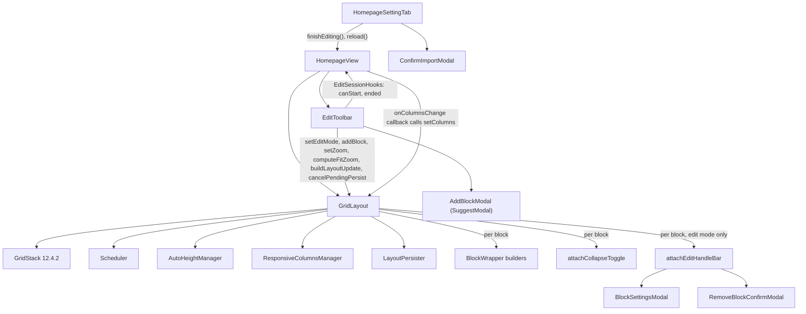
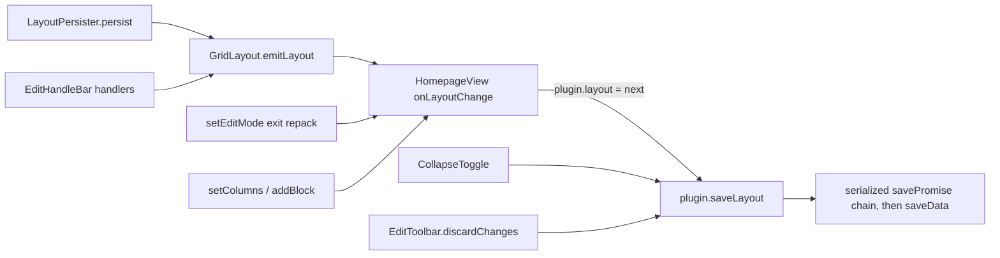
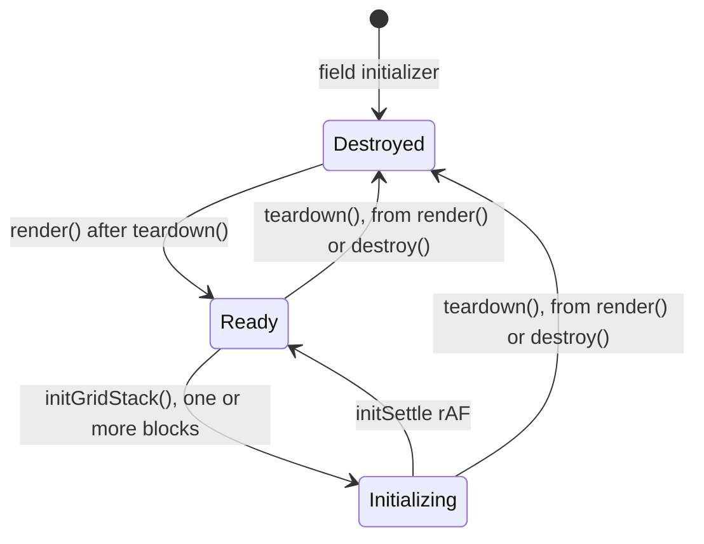
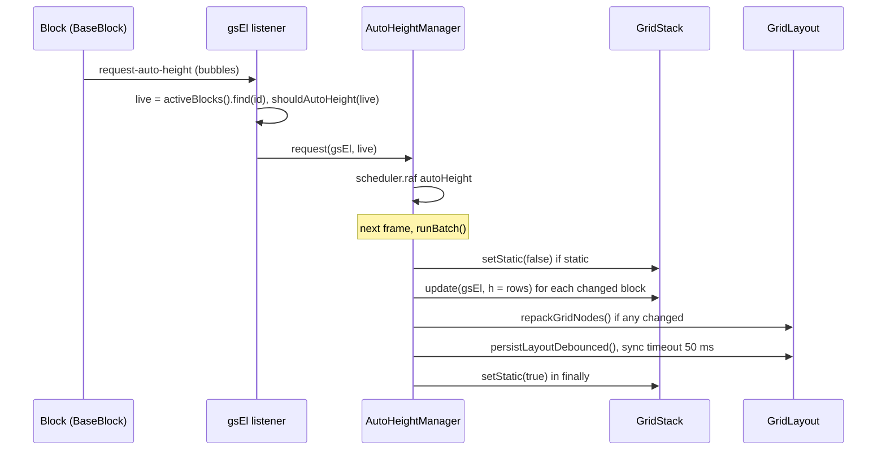

# Grid layer API

This is the interface reference for the layer between the Obsidian view and the blocks. It covers the view shell, `GridLayout` and its helper managers, the edit toolbar and the modals. It describes branch `xray-remediation` after the X-ray fixes of 2026-10-10. The bundled GridStack is 12.4.2 (`package.json`: `"gridstack": "^12.4.2"`).

Read first:
- [architecture](../architecture.md), for where this layer sits;
- [data model](../data-model.md), for `LayoutConfig`, `BlockInstance` and the `x/y/w/h` grid coordinates.

Related:
- [flows](../flows.md);
- [blocks](../blocks.md) and [block API](blocks.md), for `BaseBlock`;
- [styling](../styling.md), for the `_` style keys and the CSS hooks;
- [plugin API](plugin.md), for `saveLayout`, `activeBlocks()` and the other platform accessors.

Terms used below:

| Term | Meaning |
|---|---|
| active blocks / active columns | `plugin.activeBlocks()` / `plugin.activeColumns()`: the desktop or the mobile slice of the layout ([plugin API](plugin.md)) |
| canonical columns | The saved column count (`GridLayout.canonicalColumns`). |
| effective columns | The column count GridStack shows now (`GridLayout.effectiveColumns`). It is lower than canonical only in a narrow pane in view mode (§8). |
| emit | `GridLayout.emitLayout(layout)`, which calls the `onLayoutChange` callback that `HomepageView` passed in (§3.10). |
| auto-height block | A block for which `GridLayout.shouldAutoHeight(instance)` returns `true` (§3.9). |

## Contents

1. [Module map](#1-module-map)
2. [HomepageView](#2-homepageview)
3. [GridLayout](#3-gridlayout)
4. [Phase](#4-phase)
5. [Host interfaces](#5-host-interfaces)
6. [AutoHeightManager and `request-auto-height`](#6-autoheightmanager-and-request-auto-height)
7. [LayoutPersister](#7-layoutpersister)
8. [ResponsiveColumnsManager](#8-responsivecolumnsmanager)
9. [Packing](#9-packing)
10. [BlockWrapper builders](#10-blockwrapper-builders)
11. [CollapseToggle](#11-collapsetoggle)
12. [EditHandleBar](#12-edithandlebar)
13. [Scheduler keys](#13-scheduler-keys)
14. [Event reference](#14-event-reference)
15. [EditToolbar](#15-edittoolbar)
16. [Modals](#16-modals)
17. [Edit session summary](#17-edit-session-summary)
18. [Where docs and comments disagree with the code](#18-where-docs-and-comments-disagree-with-the-code)
19. [Risks observed in the code](#19-risks-observed-in-the-code)
20. [Test coverage](#20-test-coverage)

---

## 1. Module map

| File | Exports | Role |
|---|---|---|
| `src/HomepageView.ts` | `VIEW_TYPE`, `HomepageView` | `ItemView`. It builds one `GridLayout` and one `EditToolbar` per `onOpen`, and wires the toolbar's edit session to the other homepage views. |
| `src/GridLayout.ts` | `GridLayout` | GridStack lifecycle, render, edit mode, zoom, write routing. |
| `src/grid/phase.ts` | `Phase` (a const object and a type alias) | Lifecycle gate. |
| `src/grid/AutoHeight.ts` | `AUTO_HEIGHT_ATTR`, `AutoHeightHost`, `AutoHeightManager` | Measures content height and turns it into a GridStack row count. |
| `src/grid/LayoutPersister.ts` | `LayoutPersisterHost`, `LayoutPersister` | Diffs GridStack nodes against the `BlockInstance`s and writes the changes. |
| `src/grid/ResponsiveColumns.ts` | `ResponsiveColumnsHost`, `ResponsiveColumnsManager` | Maps the pane width to an effective column count. |
| `src/grid/packing.ts` | `packRows`, `repackEditLayout` | Pure y-packing. |
| `src/grid/BlockWrapper.ts` | `buildBlockWrapper`, `createSkeleton`, `removeSkeleton`, `renderCompactPlaceholder`, `renderEmptyState` | DOM builders. |
| `src/grid/CollapseToggle.ts` | `CollapseToggleHost`, `attachCollapseToggle` | Collapses a block from its header. |
| `src/grid/EditHandleBar.ts` | `EditHandleBarHost`, `attachEditHandleBar` | Per-block edit controls. `swapWithNeighbor` is module-private. |
| `src/EditToolbar.ts` | `EditToolbar`, `EditSessionHooks` | FAB, toolbar, Discard snapshot (blocks and column count) and the Add Block picker. `AddBlockModal` is not exported. |
| `src/modals/BlockSettingsModal.ts` | `BlockSettingsModal` | The shared tabbed settings modal. |
| `src/modals/RemoveBlockConfirmModal.ts` | `RemoveBlockConfirmModal` | Confirms a block removal. |
| `src/modals/ConfirmImportModal.ts` | `ConfirmImportModal`, `ImportChoice` | Confirms a clipboard import and lists its active content. Its only caller is the settings tab. |
| `src/utils/Scheduler.ts` | `Scheduler` | Named timeouts and rAFs, one instance per `GridLayout`. |



---

## 2. HomepageView

`src/HomepageView.ts::HomepageView extends ItemView` (`src/HomepageView.ts:8`). `main.ts` registers it with `registerView(VIEW_TYPE, leaf => new HomepageView(leaf, this))` (`src/main.ts:279`).

| Member | Behaviour | Cite |
|---|---|---|
| `VIEW_TYPE` | `'homepage-blocks'` | `src/HomepageView.ts:6` |
| `constructor(leaf, plugin: IHomepagePlugin)` | Private fields `grid: GridLayout \| null`, `toolbar: EditToolbar \| null` and `syncReload` (`false`). | `:9-16` |
| `getViewType()` / `getDisplayText()` / `getIcon()` | Return `VIEW_TYPE`, `'Homepage'` and `'home'`. | `:18-20` |
| `onOpen(): Promise<void>` | Builds the view (steps below). It is not `async`; it returns `Promise.resolve()`. | `:25-65` |
| `onClose()` | `grid.destroy()`, then `toolbar.destroy()`. The fields are not nulled. `toolbar.destroy()` ends an open edit session without Done or Discard (§15). | `:67-71` |
| `toggleEditMode()` | Forwards to `toolbar.toggleEditMode()`. The `toggle-edit-mode` command calls it on one homepage, chosen by `commandTarget` (`src/main.ts:218-222,287-291`). | `:74-76` |
| `openAddBlockModal()` | Forwards to `toolbar.openAddBlockModal()`. The `add-block` command calls it on the homepage being edited, else the active one, **in view mode as well as edit mode** (`src/main.ts:293-297`). | `:79-81` |
| `otherHomepages()` (private) | The other `HomepageView`s of `getLeavesOfType(VIEW_TYPE)`. | `:84-88` |
| `isEditing()` | `toolbar.isEditing()`, `false` without a toolbar. | `:91-93` |
| `finishEditing()` | `toolbar.finishEditing()`: leaves edit mode as Done does; nothing when not editing. | `:96-98` |
| `reload(fromSync = false)` | `finishEditing()`, then sets `syncReload = fromSync` and awaits `onOpen()`. | `:105-109` |
| `mapEditSnapshot(fn)` | `toolbar.mapSnapshot(fn)`: rewrites the Discard snapshot of an open session. Called by `HomepagePlugin.followRename` (`src/main.ts:480`). | `:112-114` |

`reload()` is called from three places:

| Caller | `fromSync` | Cite |
|---|---|---|
| `HomepageSettingTab.reloadOpenHomepages()`, after Responsive mode, Default columns, Mobile columns and Compact layout (through `applyLayoutChange`), Copy to mobile, Reset layout and a confirmed import | `false` | `src/settings/HomepageSettingTab.ts:45-51,66-70,292,364,452` |
| The `ended` hook of another view's edit session (Done, Discard, or its tab closed mid-edit) | `false` | `src/HomepageView.ts:55` |
| `HomepagePlugin.onExternalSettingsChange`, for every homepage view | `true` | `src/main.ts:544` |

**`onOpen` sequence** (`src/HomepageView.ts:25-65`):

1. Destroy the previous `grid` and `toolbar`, if any (`:27-28`).
2. Run `contentEl.empty()` and add the class `homepage-view` (`:31-32`).
3. Toggle `homepage-no-scrollbar` when `layout.showScrollbar === false`, and `homepage-hover-highlight` when `!!layout.hoverHighlight` (`:33-34`).
4. Build `onLayoutChange = newLayout => { plugin.layout = newLayout; void plugin.saveLayout(newLayout); }` (`:36-39`).
5. Build `new GridLayout(contentEl, app, plugin, onLayoutChange)` (`:41`). When `syncReload` is set, clear it and call `grid.holdDerivedPersist()` (`:42-45`, §3.2).
6. Build `new EditToolbar(contentEl, app, plugin, grid, cols => this.grid?.setColumns(cols), hooks)` (`:47-57`). The column callback reads the view's `grid` field when it fires, not the grid captured at construction. The `EditSessionHooks` are:
   - `canStart`: no other homepage view `isEditing()`;
   - `ended`: `void v.reload()` on every other homepage view, so they redraw the layout this session saved.
7. Reorder the DOM to FAB, toolbar, grid (`:60-61`). The order at creation was grid, FAB, toolbar: the `GridLayout` constructor runs before the `EditToolbar` constructor.
8. Call `grid.render(plugin.activeBlocks(), plugin.activeColumns(), true)` (`:63`). This is the only call site that passes `isInitial = true`.

**Reload or close during edit mode.**
- `reload()` first ends the session as Done (`finishEditing`): the in-flight positions are flushed, the exit repack runs, and the other views reload.
- Closing the tab runs `onClose`. The grid is destroyed first, then `toolbar.destroy()` sets `editMode = false` and calls `ended()` (`src/EditToolbar.ts:261-268`). `setEditMode(false)` is never called, so the session ends neither as Done nor as Discard:
  - the exit repack does not run;
  - the Discard snapshot is lost;
  - positions that `dragstop`/`resizestop` already wrote stay on disk;
  - teardown flushes only a pending `sync` timeout (§3.3);
  - the other homepage views reload, so they do not save their stale positions over these.

---

## 3. GridLayout

`src/GridLayout.ts::GridLayout`. One instance per `HomepageView.onOpen`.

### 3.1 Construction and fields

`constructor(containerEl, readonly app: App, readonly plugin: IHomepagePlugin, private onLayoutChange: (layout: LayoutConfig) => void)` (`src/GridLayout.ts:50-68`). The constructor:
- creates `div.homepage-grid.grid-stack` in `containerEl` (`:56`);
- sets `effectiveColumns = plugin.activeColumns()` (`:61`);
- builds the three managers, passing `this` (`:62-67`). `GridLayout` satisfies each `*Host` interface structurally (§5).

| Field | Visibility, default | Notes | Cite |
|---|---|---|---|
| `gridEl: HTMLElement` | public | The grid root. | `:26` |
| `gridStack: GridStack \| null` | public, `null` | `null` in the empty state and after teardown. | `:27` |
| `blocks: Map<string, { block: BaseBlock \| null; wrapper: HTMLElement }>` | public | `block` is `null` in edit mode, because placeholders have no instance. | `:31` |
| `scheduler: Scheduler` | `readonly` | Holds every timer key of §13. | `:32` |
| `editMode` | `false` | | `:33` |
| `effectiveColumns: number` | | | `:34` |
| `canonicalColumns` | `3` | Overwritten by `ResponsiveColumnsManager.setup()`. | `:35` |
| `phase: Phase` | `Phase.Destroyed` | See §4. | `:36` |
| `onRequestAddBlock: (() => void) \| null` | `null` | The empty-state CTA handler. `EditToolbar` sets it. | `:38` |
| `lastAddedBlockId: string \| null` | private | The scroll-into-view target for the next render. | `:40` |
| `derivedPersistHeld` | private, `false` | Set by `holdDerivedPersist()`, cleared by `setEditMode` (§3.2, §3.6). | `:42` |
| `autoHeight`, `responsiveColumns`, `persister` | private | The managers. | `:44-46` |

The module constant `COMPACT_EDIT_H = 2` (`:19`) is the row height of an auto-height block's edit-mode placeholder.

### 3.2 Public methods

| Method | Behaviour | Cite |
|---|---|---|
| `render(blocks, columns, isInitial = false)` | Full re-render (§3.3). | `:136-162` |
| `destroy()` | `responsiveColumns.destroy()`, then `teardown()`, then `gridEl.remove()`. | `:165-169` |
| `setEditMode(enabled, skipRepack = false, flushInFlight = true)` | Enters or exits edit mode (§3.6). | `:171-227` |
| `cancelPendingPersist()` | Cancels the `sync` timeout and clears queued auto-height requests. Used by Discard. | `:235-238` |
| `setColumns(n)` | Changes the column count (§3.7). | `:241-256` |
| `addBlock(instance)` | Appends a block (§3.7). | `:284-295` |
| `setZoom(scale)` / `computeFitZoom()` | Zoom (§3.8). | `:259-282` |
| `buildLayoutUpdate(blocks, extra?: { columns?: number })` | The write-routing funnel (§3.10). | `:587-601` |
| `shouldAutoHeight(instance)` | The auto-height predicate (§3.9). | `:118-129` |
| `getElement()` | Returns `gridEl`. | `:132-134` |
| `emitLayout(layout)` | Calls `onLayoutChange(layout)`. It is the host adapter for `LayoutPersister` and `EditHandleBar`. | `:76-78` |
| `triggerRerender()` | Calls the private `rerender()`, which carries the inline-state guard (§3.7). | `:85-87` |
| `setLastAddedBlockId(id)` | Sets the scroll-into-view target. | `:90-92` |
| `clearPendingResizes()` | Calls `autoHeight.clearPending()`. | `:98-100` |
| `requestAutoHeight(gsEl, instance)` | Calls `autoHeight.request(...)`. | `:103-105` |
| `packRows(items, columns, priority, reflow)` | Instance wrapper over `packing.ts::packRows`. All four parameters are required here. | `:108-115` |
| `holdDerivedPersist()` | Sets `derivedPersistHeld`. Until the next `setEditMode` call, `persistLayoutDebounced()` does nothing, so the positions the grid derives itself (view-mode auto-height measurement and repack) are not saved. `HomepageView` calls it on the grid that redraws a `data.json` synced from another device: measured heights depend on the pane width, and two running devices would otherwise keep rewriting and reloading each other's layout. | `:629-631` |
| `persistLayoutDebounced()` | Returns while `derivedPersistHeld` is set; otherwise calls `persister.persistDebounced()`. | `:634-637` |
| `repackGridNodes()` | Calls `persister.repackGridNodes(...)` with non-reflow `packRows`. | `:643-647` |

The private methods are:

| Method | Behaviour | Cite |
|---|---|---|
| `rerender()` | See §3.7. | `:299-308` |
| `teardown()` | See §3.3. | `:311-338` |
| `initGridStack()` | See §3.4. | `:340-459` |
| `mountBlock()` | See §3.5. | `:470-558` |
| `updateCompactSizeLabels()` | See §3.5. | `:564-573` |
| `persistLayout()` | Calls `persister.persist()`. | `:604-606` |
| `tryPersist(context)` | Runs `persistLayout()` in try/catch. On failure it logs `[Homepage Blocks] layout persist failed during <context>:` with only the error message. | `:614-620` |

### 3.3 `render` and `teardown`

`render(blocks, columns, isInitial)` (`:136-162`):

1. Calls `teardown()`, then sets `phase = Phase.Ready` (`:137-138`).
2. Sets `gridEl` to `role="list"` and `aria-label="Homepage blocks"` (`:140-141`).
3. When `isInitial`, adds `homepage-grid--animating` and schedules the `anim` timeout (500 ms) to remove it (`:143-148`).
4. Toggles the `edit-mode` class from `this.editMode` (`:150-154`).
5. With zero blocks, calls `renderEmptyState(gridEl, { editMode, onRequestAddBlock })` and returns. The phase stays `Ready` and `gridStack` stays `null` (`:156-159`).
6. Otherwise calls `initGridStack(blocks, columns, isInitial)` (`:161`).

`teardown()` (`:311-338`):

1. If a `sync` timeout is pending, cancels it and runs `tryPersist('teardown')` (`:314-317`). This persist runs only while the phase is still `Ready` (§7).
2. Sets `phase = Destroyed`, then runs `scheduler.cancelAll()` and `autoHeight.clearPending()` (`:318-320`).
3. Calls `unload()` on every live block and clears `blocks` (`:321-324`).
4. Runs `gridStack.removeAll(false)` and `gridStack.destroy(false)`, then sets `gridStack = null` (`:326-330`).
5. Removes `hp-dragging` and empties `gridEl` (`:332-333`).
6. Removes `viewport-fit`, the `--hp-grid-transform` property and `hp-zoomed` (`:335-337`). As a result, **every re-render clears the zoom** (§19).

### 3.4 `initGridStack(blocks, columns, isInitial)`

`src/GridLayout.ts:340-459`:

1. Sets `phase = Phase.Initializing`. This suppresses `dragstop`/`resizestop` persistence while GridStack runs `load()` (`:341-345`).
2. Builds the widget items without content, because GridStack would set content through `innerHTML` (`:347-365`). Each item has:
   - `id`, `x`, `y`;
   - `w: Math.min(instance.w, columns)` and `maxW: columns`;
   - `h`:
     - `COMPACT_EDIT_H` when `editMode && shouldAutoHeight(instance)`;
     - otherwise `renderH`: in view mode `viewModeHeight(instance)`, which is 1 for a collapsed block, `_expandedH` (when that is a positive number) for a block that is `collapsed` but has `_showTitle === false` (it never renders collapsed), and `instance.h` otherwise (`src/grid/CollapseToggle.ts:16-28`). In edit mode a collapsed block with a visible title keeps `instance.h` (`:350-353`).
   - no `sizeToContent` (deliberately omitted, `:361-363`), no `minW` and no `minH`.
3. When `editMode || plugin.layout.compactLayout`, runs `packRows(items, columns, plugin.activeLayoutPriority())` (`:371-373`). It mutates the item copies only, never the `BlockInstance`s.
4. Sets `effectiveColumns = columns` and toggles `hp-single-column` for `columns === 1` (`:375-376`).
5. Runs `GridStack.init(options, gridEl)` (options below), then `gridStack.load(items)` (`:378-392`).
6. Calls `mountBlock(instance, i, isInitial)` for each block (`:396-398`).
7. When `columns === 1`, re-appends the `.grid-stack-item` children sorted by node `y`, then `x` (`:402-412`).
8. Registers the GridStack events `dragstart`, `dragstop` and `resizestop` (§14) (`:422-435`).
9. Calls `responsiveColumns.setup(viewEl, columns)`, where `viewEl` is `gridEl.closest('.homepage-view')` when that is an `HTMLElement`, else `null` (`:437-438`).
10. If `lastAddedBlockId` is set, clears it, adds `block-just-added` to that item's wrapper and calls `scrollIntoView({ behavior: 'smooth', block: 'nearest' })` (`:441-449`).
11. Schedules the `initSettle` rAF, which sets `phase = Ready` unless the phase is `Destroyed` (`:455-458`).

GridStack options (`:378-390`):

| Option | Value |
|---|---|
| `column` | `columns` |
| `cellHeight` | `80` |
| `margin` | `8` |
| `float` | `true` |
| `animate` | `true` |
| `staticGrid` | `!editMode` |
| `removable` | `false` |
| `handleClass` | `'block-move-handle'` (the drag handle is built by `EditHandleBar`) |
| `resizable` | `{ handles: 'e,s,se' }` |

GridStack compensates for the zoom `transform` itself (`:414-415`).

### 3.5 `mountBlock(instance, i, isInitial)`

`src/GridLayout.ts:470-558`:

1. Finds the item `[gs-id="<CSS.escape(id)>"]` and returns if it is missing. Sets `role="listitem"` on it and toggles `is-auto-height` (`:471-480`).
2. Finds `.grid-stack-item-content`. On the initial render only, it computes the stagger delay as `[0,50,100,140,170,195,215,230][i] ?? 240` ms (`:486`).
3. Calls `buildBlockWrapper` (§10) and finds `.block-header-zone` and `.block-content` (`:487-491`). Returns if no factory is registered for the type (`:493-494`).
4. **Edit mode:** calls `renderCompactPlaceholder(headerZone, contentEl, factory, instance)` and then `blocks.set(id, { block: null, wrapper })` (`:496-499`).
5. **View mode** (`:500-549`):
   1. Runs `factory.create(app, instance, plugin)`, then `block.setHeaderContainer(headerZone)`, then `block.load()`, all before `render`.
   2. For an auto-height block, adds a `request-auto-height` listener on the item element (§6.1).
   3. Creates a skeleton overlay only when `isInitial`.
   4. Runs `block.render(contentEl)` in try/catch. A synchronous throw is converted to `Promise.reject` (`:524-529`), so one failing block does not abort the loop.
   5. **Promise result, resolved:** `removeSkeleton`, then `requestAutoHeight` if the block is auto-height.
   6. **Promise result, rejected:** `removeSkeleton`, then `console.error('[Homepage Blocks] Error rendering block <type>:', e)`, then the content text becomes `'Error rendering block. Check console for details.'`.
   7. **Synchronous result:** removes the skeleton at once, then calls `requestAutoHeight` if the block is auto-height.
   8. Calls `blocks.set(id, { block, wrapper })`.
6. Always calls `attachCollapseToggle(this, gsEl, instance, headerZone)`. In edit mode it also calls `attachEditHandleBar(this, wrapper, instance)` (`:552-557`).

`updateCompactSizeLabels()` (`:564-573`) rewrites every `.block-compact-size` to `` `${node.w ?? 1}×${node.h ?? 1}` `` from the live GridStack node. It runs after `resizestop`.

### 3.6 `setEditMode(enabled, skipRepack = false, flushInFlight = true)`

`src/GridLayout.ts:171-227`:

1. Returns if the phase is `Destroyed` (`:172`).
2. Clears `derivedPersistHeld`: a deliberate mode switch saves measured positions as usual again (`:173-174`).
3. **Entering, with a `sync` timeout pending:** cancels it and runs `tryPersist('entering edit mode')`. A pending view-mode persist then runs against the view-mode columns before they are forced to canonical (`:179-182`).
4. **`flushInFlight && editMode && gridStack && phase === Ready`:** runs `tryPersist('edit-mode exit')` (`:191-193`). This is also true when entering, if the grid was already in edit mode. **Discard must pass `flushInFlight = false`**, or the flush would re-persist the positions being discarded (`:187-190`).
5. **Exiting without `skipRepack`:** computes `repackEditLayout(activeBlocks(), canonicalColumns, activeLayoutPriority())`, then `onLayoutChange(buildLayoutUpdate(repacked))` (`:194-203`).
6. Sets `this.editMode = enabled`. On entry, forces `effectiveColumns = canonicalColumns` (`:206-211`).
7. Calls `gridStack?.setStatic(!enabled)` (`:212-214`).
8. Calls `render(activeBlocks(), activeColumns())` directly. This deliberately bypasses the `hasUnsavedInlineState` guard in `rerender()` (`:215-222`).
9. On exit, calls `setZoom(1)` (`:223-226`).

### 3.7 `setColumns`, `addBlock`, `rerender`

**`setColumns(n)`** (`:241-256`):
1. Returns if the phase is `Destroyed`.
2. In edit mode, with a grid in phase `Ready`, runs `tryPersist('column change')` to flush an in-flight drag.
3. Maps the active blocks to `w: Math.min(b.w, n)`. **`x` is not clamped.**
4. Emits `buildLayoutUpdate(newBlocks, { columns: n })`, then calls `rerender()`.

**`addBlock(instance)`** (`:284-295`):
1. Returns if the phase is `Destroyed`.
2. Sets `y = max(b.y + b.h)` over the active blocks.
3. Appends the block and sets `lastAddedBlockId`.
4. Emits, then calls `render(activeBlocks(), activeColumns())` directly, not `rerender()`. Like `setEditMode`, a deliberate user action draws even while a block holds unsaved input; an open Static Text draft is saved as its block unloads (`:291-294`).

**`rerender()`** (private, `:299-308`) returns without rendering when any live block reports `hasUnsavedInlineState() === true`. Otherwise it calls `render(activeBlocks(), activeColumns())`. In edit mode every `blocks` entry holds `block: null`, so the guard never blocks there. Its callers are `setColumns` and `triggerRerender()` (the handle-bar writes, §12).

### 3.8 Zoom

**`setZoom(scale)`** (`:259-271`):
- It is a no-op unless `gridEl.isConnected`.
- A non-finite scale, or one `<= 0`, is treated as 1.
- For `scale >= 1` it removes `--hp-grid-transform`, `hp-zoomed` and `viewport-fit`.
- Otherwise it sets `--hp-grid-transform: scale(<s>)` and adds `hp-zoomed` and `viewport-fit`.

While the grid has `hp-zoomed`, CSS applies `transform: var(--hp-grid-transform, none)` with `transform-origin: top center` (`styles.css:3787-3791`).

**`computeFitZoom()`** (`:274-282`) returns 1 if:
- the grid is disconnected;
- the parent `clientHeight` is `<= 0`;
- or the content `scrollHeight` fits in that height.

Otherwise it returns `viewportH / contentH`, snapped to 0.05 and clamped to **[0.75, 1]**. The toolbar slider allows 0.1 to 1 (§15).

### 3.9 `shouldAutoHeight(instance)`

`src/GridLayout.ts:118-129`:
- It returns `false` unless `BlockRegistry.get(type)?.autoHeight` is set.
- It reads `heightMode` as a string, or `''` when it is not one.

| Type | Returns `true` when |
|---|---|
| `image-gallery` | `heightMode !== 'fixed'` |
| `quotes-list` | `heightMode !== 'wrap'` |
| `static-text` | `heightMode !== 'fixed'` |
| `embedded-note` | `heightMode === 'grow'` |
| any other type with `autoHeight: true` | always |

The factories flagged `autoHeight: true` are:

| Factory | Cite |
|---|---|
| `button-grid` | `src/main.ts:82` |
| `quotes-list` | `src/main.ts:95` |
| `image-gallery` | `src/main.ts:104` |
| `embedded-note` | `src/main.ts:113` |
| `static-text` | `src/main.ts:122` |
| `random-note` | `src/main.ts:182` |

### 3.10 Write routing

**`buildLayoutUpdate(blocks, extra?)`** (`:587-601`) returns `{ ...plugin.layout }` with the blocks routed by `plugin.isMobileActive()`:

| `isMobileActive()` | Blocks go to | `extra.columns`, if set, goes to |
|---|---|---|
| `true` | `mobileBlocks` | `mobileColumns` |
| `false` | `blocks` | `columns` |

It never routes `layoutPriority`. Every grid write builds its `LayoutConfig` through this method.

| Writer | Delivered through | Cite |
|---|---|---|
| `LayoutPersister.persist` | `host.emitLayout` | `src/grid/LayoutPersister.ts:122` |
| `setEditMode` exit repack | `onLayoutChange` (direct) | `src/GridLayout.ts:202` |
| `setColumns` | `onLayoutChange` (with `{ columns }`) | `:254` |
| `addBlock` | `onLayoutChange` | `:290` |
| EditHandleBar: duplicate, settings save, remove, move up/down | `host.emitLayout` | `src/grid/EditHandleBar.ts:87,103,172,178,196,250` |
| `CollapseToggle` | `plugin.saveLayout` (direct) | `src/grid/CollapseToggle.ts:81` |
| `EditToolbar.discardChanges` | `plugin.layout = …`, then `plugin.saveLayout`; with `{ columns: columnsSnapshot }` | `src/EditToolbar.ts:113-119` |



`plugin.saveLayout` also assigns `this.layout = layout` synchronously (`src/main.ts:436`), before it queues the disk write. Every path therefore updates the in-memory layout before it returns, and the next `activeBlocks()` read sees the change. The rest of the persistence chain is covered in [plugin API](plugin.md).

---

## 4. Phase

`src/grid/phase.ts:7-13`:

```ts
export const Phase = { Destroyed: 0, Initializing: 1, Ready: 2 } as const;
export type Phase = (typeof Phase)[keyof typeof Phase];
```

`Phase` is a const object with a same-named type alias. It is not a TypeScript `enum`.



| Transition | Cite |
|---|---|
| Initial `Destroyed` | `src/GridLayout.ts:36` |
| `teardown()` sets `Destroyed` | `:318` |
| `render()` sets `Ready` | `:138` |
| `initGridStack()` sets `Initializing` | `:345` |
| `initSettle` rAF sets `Ready` (skipped if `Destroyed`) | `:455-458` |
| The empty state stays `Ready` with `gridStack === null` | `:156-159` |

Gates:

| Code | Requires | Cite |
|---|---|---|
| `setEditMode`, `setColumns`, `addBlock` | not `Destroyed` | `src/GridLayout.ts:172,242,285` |
| In-flight flushes in `setEditMode` / `setColumns` | `Ready` | `:191,247` |
| `dragstop` / `resizestop` persist | `Ready` and `editMode` | `:427,432` |
| `LayoutPersister.persist` | `Ready` and a `gridStack` | `src/grid/LayoutPersister.ts:59` |
| `persistDebounced` callback | not `Destroyed` | `src/grid/LayoutPersister.ts:132` |
| `AutoHeightManager.runBatch` | not `Destroyed`, and a `gridStack` | `src/grid/AutoHeight.ts:61` |
| ResizeObserver callback | not `Destroyed`, a `gridStack`, and not `editMode` | `src/grid/ResponsiveColumns.ts:63-64` |

A persist attempted during `Initializing` is dropped. For example, a teardown flush in the first frame after a render writes nothing.

---

## 5. Host interfaces

Each helper declares a narrow host interface. `GridLayout` satisfies each one structurally and passes `this` (`src/GridLayout.ts:62-67,552,556`). The managers keep `host` as a live reference and re-read its fields on every call (`src/grid/AutoHeight.ts:41-46`). No other module imports these interfaces.

| Interface | Members | Cite |
|---|---|---|
| `AutoHeightHost` | readonly `scheduler`, `phase`, `gridStack`, `effectiveColumns`; `repackGridNodes()`, `persistLayoutDebounced()` | `src/grid/AutoHeight.ts:20-27` |
| `LayoutPersisterHost` | readonly `gridStack`, `phase`, `plugin`, `effectiveColumns`, `canonicalColumns`, `editMode`, `scheduler`; `shouldAutoHeight(i)`, `buildLayoutUpdate(blocks, extra?)`, `emitLayout(layout)` | `src/grid/LayoutPersister.ts:11-23` |
| `ResponsiveColumnsHost` | readonly `scheduler`, `plugin`, `gridEl`, `phase`, `gridStack`, `editMode`; **writable** `effectiveColumns`, `canonicalColumns`; `shouldAutoHeight(i)`, `requestAutoHeight(gsEl, i)`, `clearPendingResizes()`, `packRows(items, columns, priority, reflow)` | `src/grid/ResponsiveColumns.ts:14-32` |
| `EditHandleBarHost` | readonly `app`, `plugin`, `gridStack`, `gridEl`, `blocks`; `buildLayoutUpdate`, `emitLayout`, `triggerRerender()`, `setLastAddedBlockId(id)`, `shouldAutoHeight(i)` | `src/grid/EditHandleBar.ts:15-29` |
| `CollapseToggleHost` | readonly `editMode`, `gridStack`, `plugin`; `buildLayoutUpdate` | `src/grid/CollapseToggle.ts:9-14` |

`ResponsiveColumnsManager` is the only helper that assigns host fields: it sets `effectiveColumns` and `canonicalColumns`. `EditHandleBar` mutates host state in one other way: on a confirmed remove it deletes the block's entry from the `host.blocks` map (`src/grid/EditHandleBar.ts:165-169`).

---

## 6. AutoHeightManager and `request-auto-height`

`src/grid/AutoHeight.ts`. `AUTO_HEIGHT_ATTR = 'data-auto-height-content'` (`:13`) marks the in-block element whose `offsetHeight` drives the row count. How a block opts in is covered in [block API](blocks.md).

| Member | Behaviour | Cite |
|---|---|---|
| `constructor(host: AutoHeightHost)` | | `:46` |
| `request(gsEl, instance)` | Stores `pending[instance.id] = { gsEl, instance }` (the latest request per block wins) and schedules the `autoHeight` rAF. | `:54-57` |
| `clearPending()` | Empties the queue. | `:49-51` |
| `runBatch()` (private) | See below. | `:59-97` |
| `measureAndResize(gsEl, instance)` (private) | Returns `true` if the row count changed. | `:103-168` |

**`runBatch()`**:

1. Returns if the phase is `Destroyed` or there is no grid.
2. If `effectiveColumns === 1`, clears the queue and returns. In single-column mode the CSS flex layout sizes the blocks (`:66-69`).
3. Snapshots and clears the queue. If the grid is static, lifts it with `setStatic(false)` for the whole batch (`:71-76`).
4. Calls `measureAndResize` for each entry. If any row count changed, calls `host.repackGridNodes()` and then `host.persistLayoutDebounced()`. This repack runs whatever `compactLayout` is set to (`:84-91`).
5. In `finally`, restores `setStatic(true)` (`:92-96`).

**`measureAndResize`** skips (returns `false`) when:
- the element is disconnected;
- the wrapper has `block-collapsed` (`:112-113`);
- `[data-auto-height-content]` or `.block-header-zone` is missing (`:115-117`);
- the measured content height is `<= 0` (`:140`).

Otherwise it measures:
1. It adds `hp-no-transition` and `hp-auto-rows` (`grid-template-rows: max-content !important`, `styles.css:3796-3797`) to `.block-content`.
2. It reads the `offsetHeight` of the content element and of the header zone.
3. It removes the classes and forces a reflow (`:124-138`).

It then computes the row count (`:142-158`):

```
pad    = wrapper paddingTop + paddingBottom   (24 without a wrapper)
gap    = wrapper computed gap                  (0 when not a number)
gapCount = 2 with .block-header-divider, else 1
margin = gridStack.opts.margin if number, else 8
totalH = headerH + pad + contentH + gap * gapCount + margin * 2 + 4   // 4 = SAFETY_BUFFER
rows   = max(1, ceil(totalH / gridStack.getCellHeight()))
```

It compares `rows` with `node.h ?? instance.h`. When they differ, it calls `gridStack.update(gsEl, { h: rows })` (`:160-166`).

In edit mode, CSS hides the `s` and `se` resize handles of `.is-auto-height` items (`styles.css:2542-2545`), so these blocks resize horizontally only.

### 6.1 The `request-auto-height` event

| Aspect | Value |
|---|---|
| Name | `'request-auto-height'`, a string literal in two places in `src/` (`src/blocks/BaseBlock.ts:158`, `src/GridLayout.ts:512`). There is no shared constant, unlike `AUTO_HEIGHT_ATTR`. |
| Type | `CustomEvent` with `bubbles: true` and no `detail`. |
| Dispatched by | `BaseBlock.requestAutoHeight()` on the block's `containerEl` (`src/blocks/BaseBlock.ts:157-159`). |
| When | After a `scheduleRender` callback returns, or after its promise resolves; not after a failure (sync throw or rejection, which shows an error hint instead), and not when `containerEl` is disconnected, since the callback then does not run (`BaseBlock.ts:130-154`). From the rAF of `observeWidthForAutoHeight` (`BaseBlock.ts:167-185`). By a subclass calling it directly. |
| Listener | On the `.grid-stack-item` (`gsEl`) of auto-height blocks, view mode only, added in `mountBlock` (`src/GridLayout.ts:510-517`). The event reaches it by bubbling from the content element. |
| Listener behaviour | Re-reads the live instance from `activeBlocks()` and re-checks `shouldAutoHeight(live)`. When both hold, calls `requestAutoHeight(gsEl, live)`. |

Measurements are also queued without the event:
- by `mountBlock` after the first render (`src/GridLayout.ts:536,546`);
- by `ResponsiveColumnsManager.restoreCanonicalLayout` (`src/grid/ResponsiveColumns.ts:171`);
- by `ResponsiveColumnsManager.packForNarrowLayout` when the new count is above 1 (`src/grid/ResponsiveColumns.ts:195-201`).



---

## 7. LayoutPersister

`src/grid/LayoutPersister.ts::LayoutPersister`, `constructor(host: LayoutPersisterHost)`.

**`persist()`** (`:57-123`):

1. Requires a `gridStack` and phase `Ready` (`:59`).
2. Computes `isResponsive = effectiveColumns !== canonicalColumns` (`:69`). In edit mode this is always false, because edit mode keeps effective equal to canonical (§3.6, §8).
3. Fast skip: returns when `isResponsive` holds and every active block is auto-height (`:73-75`).
4. Builds `posMap` from `gridStack.getGridItems()`, keyed by `gs-id` (`:77-92`):
   - `w = min(node.w ?? 1, effectiveColumns)`
   - `x = min(node.x ?? 0, max(0, effectiveColumns - w))`
   - `y = node.y ?? 0`
   - `h = node.h ?? 1`
5. Diffs `posMap` against the active blocks (below), and writes nothing when no block changed (`:100-108`). A block missing from `posMap` is left unchanged.
6. Emits `host.emitLayout(host.buildLayoutUpdate(newBlocks))` (`:122`).

A block **keeps its stored `h`** (`keepH`) when it is auto-height, or when its node does not show the stored height. The module-private `nodeShowsStoredHeight(b, editMode)` (`:31-34`) is `true` for an expanded block, and for a collapsed block only in edit mode with a visible title. Everywhere else a collapsed block is drawn at `viewModeHeight` (one row, or `_expandedH` with a hidden title), and writing that node height back would overwrite the expanded `h`.

| Mode | Block kind | Counts as changed when | Fields written | Cite |
|---|---|---|---|---|
| responsive | `keepH` (auto-height, or collapsed outside edit mode) | never | none | `:104`, `:114-117` |
| responsive | other (fixed-height) | `b.h !== pos.h` | `h` | `:104`, `:114-117` |
| canonical | `keepH` | `x`, `y` or `w` differ | `x`, `y`, `w` (never `h`) | `:105`, `:118` |
| canonical | other (fixed-height) | any of `x`, `y`, `w`, `h` differ | `x`, `y`, `w`, `h` | `:106`, `:118` |

A collapsed fixed-height block resized in edit mode, where it is drawn at its stored height, has its new `h` saved.

Other members:

| Member | Behaviour | Cite |
|---|---|---|
| `persistDebounced()` | Schedules the `sync` timeout (50 ms), which calls `persist()` unless the phase is `Destroyed`. `GridLayout.persistLayoutDebounced` skips it while `derivedPersistHeld` is set (§3.2). | `:130-134` |
| `repackGridNodes(packRows)` | Collects `{ el, x, y, w, h }` from the GridStack nodes and calls `packRows(items, effectiveColumns, activeLayoutPriority())`. Inside `batchUpdate()`, it applies **only `y`** through `gridStack.update(el, { y })`. | `:146-161` |
| `isResponsive()` | `effectiveColumns !== canonicalColumns`. **It has no caller** in `src/` or `tests/`. | `:137-139` |

Callers of `persist()`:

| Caller | Cite |
|---|---|
| `dragstop` and `resizestop` | `src/GridLayout.ts:428,433` |
| Edit-mode entry, via `tryPersist` | `src/GridLayout.ts:181` |
| Edit-mode exit, via `tryPersist` | `src/GridLayout.ts:192` |
| Column change, via `tryPersist` | `src/GridLayout.ts:248` |
| Teardown flush, via `tryPersist` | `src/GridLayout.ts:316` |
| The debounced path from `AutoHeightManager` | `src/grid/AutoHeight.ts:90` |

---

## 8. ResponsiveColumnsManager

`src/grid/ResponsiveColumns.ts::ResponsiveColumnsManager`, `constructor(host: ResponsiveColumnsHost)`.

`COLUMN_BREAKPOINTS = { single: 480, double: 768, triple: 1024 }` (`:10`). The module-private `computeEffectiveColumns(width, canonical)` (`:38-43`) maps the width as follows:

| Width (px) | Effective columns |
|---|---|
| `< 480` | 1 |
| `< 768` | `min(2, canonical)` |
| `< 1024` | `min(3, canonical)` |
| otherwise | `canonical` |

The width measured is that of the `.homepage-view` element (`src/GridLayout.ts:437-438`), not the grid's. The grid is capped by `max-width: var(--hp-content-max-width)` (`styles.css:51`), which is 1400px (`styles.css:9`). The CSS container queries on `.homepage-view` are separate from these breakpoints ([styling](../styling.md)).

**`setup(viewEl, userCols)`** (`:56-93`) runs on every `initGridStack`:

1. Always sets `canonicalColumns = userCols`. Returns if `viewEl` is `null` (`:57-58`).
2. Creates the ResizeObserver lazily, one per manager. It survives re-renders and observes the first `viewEl` it was given (`:60-76`). Its callback:
   - ignores `Destroyed`, no grid, and edit mode;
   - reads `contentBoxSize[0].inlineSize`, falling back to `contentRect.width`, and ignores a width of 0: a background tab is hidden with `display: none`, which is not a narrow pane (`:66-69`);
   - calls `apply(next)` when the column count differs from `effectiveColumns`.
3. In edit mode, sets `effectiveColumns = userCols` and returns (`:82-85`).
4. When `viewEl.clientWidth` is 0 (rendered while hidden), keeps the columns the grid was built with and returns (`:86-88`).
5. Otherwise sets `effectiveColumns = computeEffectiveColumns(viewEl.clientWidth, userCols)` and calls `apply` when that differs from `userCols` (`:89-92`). This first read uses `clientWidth`, while the observer reads the content-box size.

**`destroy()`** disconnects the observer (`:96-99`). Only `GridLayout.destroy` calls it (`src/GridLayout.ts:166`).

**`apply(next)`** (`:105-145`):

1. Sets `effectiveColumns = next`.
2. Cancels the `autoHeight` rAF and the `sync` timeout, and clears the pending auto-height requests.
3. Turns GridStack's animation off (`setAnimation(false)`), so no width is still in its 0.3 s transition when the auto-height requests of `restoreCanonicalLayout` are measured on the next frame (`:117-122`).
4. Toggles `hp-single-column` for `next === 1`.
5. Calls `gridStack.column(next, 'none')`.
6. Calls `restoreCanonicalLayout` when `next === canonicalColumns`, otherwise `packForNarrowLayout`.
7. In `finally`: reads `gridEl.offsetWidth`, which commits the new geometry with no transition, then restores the previous animation setting (`:137-144`).

| Path | Behaviour | Cite |
|---|---|---|
| `restoreCanonicalLayout` | Inside `batchUpdate`, sets each item to its saved `x`, `y`, `w: min(b.w, next)` and `maxW: next`. Fixed-height blocks also get `h: viewModeHeight(b)`. It then calls `requestAutoHeight` for each auto-height block. | `:153-172` |
| `packForNarrowLayout` | Clamps `w` and `x` from the live nodes and runs `packRows(…, reflow = true)`. Inside `batchUpdate`, it applies `w`, `x`, `y` and `maxW`. When `next > 1` it then calls `requestAutoHeight` for each auto-height block, at the new width: `apply()` has cancelled the measurements queued before the change. One column needs none, because CSS sizes the blocks. When `next === 1` it re-appends the DOM sorted by `(y, x)`. | `:175-211` |

In single-column mode, CSS turns the grid into a flex column and overrides GridStack's inline `top`, `left`, `width` and `height` with `!important` (`styles.css:2972-3010`). While the pane is narrowed, a view-mode persist writes only fixed-height `h` values (§7).

---

## 9. Packing

`src/grid/packing.ts` is pure: it has no DOM and no instance state (`:3-7`).

**`packRows<T extends { x?, y?, w?, h? }>(items: T[], columns: number, _priority: LayoutPriority = 'row', reflow = false): void`** (`:21-99`):
- It mutates `items` in place.
- `safeCols = max(1, columns)`.
- `_priority` is reserved and ignored (`:19`). `LayoutPriority` is `'row'` only (`src/types.ts:25`).

| Mode | Algorithm | Cite |
|---|---|---|
| `reflow = true` (greedy) | Sorts the `items` array itself by `(y, x)`. For each item it sets `w = min(w, cols)`, picks the leftmost `x` whose maximum column height over the span is lowest (strict `<`), sets `y` to that height, and raises those columns to `y + h`. | `:27-51` |
| `reflow = false` (row groups) | Groups items by their exact input `y` and takes the groups in ascending `y`, items by `x`. The group's `rowY` is the maximum column height over the clamped spans of all its members. Every member is placed at `rowY` with clamped `w` and `x`. Column heights rise to `max(current, rowY + h)`. Members of one group whose x-ranges overlap are **not** separated. | `:53-98` |

**`repackEditLayout(blocks, columns, priority = 'row'): BlockInstance[]`** (`:107-111`) shallow-copies each block, runs `packRows` (row groups) and returns the new array. The input is not mutated.

| Caller | Mode | Cite |
|---|---|---|
| `initGridStack` (edit mode, or `compactLayout`) | row groups, on the widget items | `src/GridLayout.ts:372` |
| `GridLayout.repackGridNodes`, reached from `AutoHeightManager` | row groups, on the live nodes; only `y` is applied | `src/GridLayout.ts:643-647` |
| `ResponsiveColumnsManager.packForNarrowLayout` | greedy (`reflow = true`) | `src/grid/ResponsiveColumns.ts:184` |
| `setEditMode` exit, through `repackEditLayout` | row groups, on the `BlockInstance`s | `src/GridLayout.ts:197` |
| `fitBlocksToColumns` (Copy to mobile, a mobile Reset) | greedy (`reflow = true`), on `structuredClone` copies of the blocks | `src/utils/layoutReset.ts:36-40` |

---

## 10. BlockWrapper builders

`src/grid/BlockWrapper.ts` holds pure DOM builders: no GridStack and no persistence (`:5-14`).

**`buildBlockWrapper(container, instance, animDelayMs?)`** (`:17-49`) builds this tree:

```
div.homepage-block-wrapper.hp-block-<type>[.block-collapsed]   data-block-id=<id>
│   applyBlockStyling(wrapper, config); --hp-card-anim-delay: <n>ms when a delay is given
├── div.block-header-zone.hp-header-empty   role=button tabindex=0 aria-expanded
│   └── span.block-collapse-chevron[.is-collapsed]   aria-hidden=true
├── div.block-header-divider      (only when config._showDivider === true)
└── div.block-content
```

`block-collapsed` is applied when `instance.collapsed && config._showTitle !== false` (`:23`). `EditHandleBar` later inserts `div.block-handle-bar` before the header zone (§12). `BaseBlock.renderHeader` and `renderCompactPlaceholder` clear `hp-header-empty` when they render a header (`src/blocks/BaseBlock.ts:72`, `src/grid/BlockWrapper.ts:86`).

| Function | Behaviour | Cite |
|---|---|---|
| `createSkeleton(wrapper)` | Adds `div.hp-skeleton-overlay` with three `div.hp-skeleton-line` and returns it. | `:52-58` |
| `removeSkeleton(el, scheduler)` | No-op if `el` is null or disconnected. Otherwise adds `hp-skeleton-overlay--out` and removes the element after the `skeleton-<n>` timeout of 200 ms. `n` comes from a module-level counter (`skeletonSeq`). | `:61-72` |
| `renderCompactPlaceholder(headerZone, contentEl, factory, instance)` | See below. | `:75-95` |
| `renderEmptyState(gridEl, { editMode, onRequestAddBlock })` | See below. | `:98-117` |

**`renderCompactPlaceholder`**:
- The header label is `_titleLabel` when it is a non-empty string (not trimmed), else `factory.displayName`.
- It removes `hp-header-empty` and builds `div.block-header` with an optional `em.block-header-emoji` and a label span. It ignores `_showTitle`, so every placeholder shows a header.
- The content is `div.block-compact-info` with `span.block-compact-type` (`instance.type`) and `span.block-compact-size` (`` `${instance.w}×${instance.h}` ``).

**`renderEmptyState`**:
- It empties `gridEl` and builds `div.homepage-empty-state` with an icon (U+1F3E0) and the title "Your homepage is empty".
- The description in edit mode is "Click the button below to add your first block."; in view mode it is "Click the pencil button in the top-right corner to start adding blocks.", pointing at the FAB, since the toolbar is hidden in view mode (`:106-112`).
- `button.homepage-empty-cta` "Add your first block" is added only when `editMode && onRequestAddBlock`.

---

## 11. CollapseToggle

**`attachCollapseToggle(host, gsEl, instance, headerZone)`** (`src/grid/CollapseToggle.ts:41-88`) is attached to every block in both modes (`src/GridLayout.ts:552`).

| Aspect | Behaviour | Cite |
|---|---|---|
| Triggers | `click` on the header zone; `keydown` Enter or Space (`preventDefault()`, then toggle). | `:84-87` |
| Edit mode | The handler calls `stopPropagation()` and returns. CSS also sets `pointer-events: none` on the header zone and hides the chevron in edit mode (`styles.css:2432-2435,2548`). | `:52-53` |
| DOM | Flips `block-collapsed` on the wrapper and `is-collapsed` on the chevron, and updates `aria-expanded`. | `:54-57` |
| Collapse | Reads `liveH = gsNode.h ?? instance.h`, calls `gridStack.update(gsEl, { h: 1 })`, and writes `{ collapsed: true, _expandedH: liveH }`. **The stored `h` is not changed**; view mode draws a collapsed block one row high anyway (`viewModeHeight`, `:16-28`). | `:63-69` |
| Expand | Reads `origH` from the live block's `_expandedH` when that is a number `>= 1`, falling back to `instance.h`. Calls `update(gsEl, { h: origH })` and writes `{ collapsed: false, h: origH }`. `_expandedH` is left in place. Load and import already keep only a finite `_expandedH >= 1`, rounded (`src/validation.ts:281-285`). | `:70-79` |
| Save | `void host.plugin.saveLayout(host.buildLayoutUpdate(newBlocks))`, not `emitLayout`. It does not lift `staticGrid` and requests no auto-height measurement after expanding. | `:81` |

A block with `_showTitle === false` never renders collapsed (`src/grid/BlockWrapper.ts:23`). Its header zone collapses to height 0 through `hp-header-empty` (`styles.css:2419-2425`), but it keeps `tabindex="0"`.

---

## 12. EditHandleBar

**`attachEditHandleBar(host, wrapper, instance)`** (`src/grid/EditHandleBar.ts:41-213`) builds `div.block-handle-bar` and inserts it before `.block-header-zone` (`:209-212`). Every button handler calls `stopPropagation()`.

| Element | Icon | `aria-label` | Action | Cite |
|---|---|---|---|---|
| `div.block-move-handle` | `grip-vertical` | "Drag to reorder" (also the `title`) | GridStack drag handle (`handleClass`) | `:49-52` |
| `button.block-move-up-btn` | `chevron-up` | "Move block up" | `swapWithNeighbor(host, instance, 'up')` | `:55-61` |
| `button.block-move-down-btn` | `chevron-down` | "Move block down" | `swapWithNeighbor(host, instance, 'down')` | `:63-69` |
| `button.block-duplicate-btn` | `copy` | "Duplicate block" | Duplicate | `:72-89` |
| `button.block-settings-btn` | `settings` | "Block settings" | Settings | `:92-133` |
| `button.block-remove-btn` | `x` | "Remove block" | Remove | `:136-206` |

**Duplicate** (`:77-88`):
1. Reads `current` from `activeBlocks()`.
2. Builds `{ ...structuredClone(current), id: newId(), y: current.y + current.h }`. The whole config is deep-copied, `apiKey` included.
3. Appends the clone, calls `setLastAddedBlockId`, emits and re-renders.

**Settings** (`:95-133`):
1. Requires a `host.blocks` entry.
2. In edit mode `entry.block` is `null`, so it creates a temporary block with `factory.create(app, instance, plugin)`. The temporary block is built from the render-time `instance` and is never `load()`ed.
3. Opens `new BlockSettingsModal(app, instance, block, cfg => { teardownTempBlock(); onSave(cfg); })`.
4. `onSave` **replaces the whole config**: `activeBlocks().map(b => b.id === id ? { ...b, config } : b)`, then emits and re-renders (`:99-105`).
5. `modal.onClose` is wrapped so the temporary block is also unloaded on Cancel, Esc or X (`:115-131`).

**Remove** (`:139-206`):
1. A `data-remove-pending` attribute stops a second click from opening a second confirm while one is open.
2. The confirm label is the trimmed `_titleLabel`, falling back to **`instance.type`**.
3. On confirm:
   1. Clears the flag.
   2. Inside `batchUpdate()`, calls `removeWidget(gsItem)` and then `compact()`; `batchUpdate(false)` runs in `finally`.
   3. Unloads the block's entry and deletes it from `host.blocks`.
4. Then one of three writes:
   - **No block remains:** emits `[]` and re-renders into the empty state.
   - **No GridStack:** emits the remaining blocks.
   - **Otherwise:** builds `posMap` from the GridStack nodes (unclamped). It writes `x`, `y`, `w` for auto-height blocks and all four fields for fixed ones, and emits **without re-rendering**.
5. `onClose` is wrapped to clear the pending flag on cancel.

**`swapWithNeighbor(host, instance, direction)`** (`:222-252`) is module-private:
1. The neighbour is the nearest block before (`'up'`) or after (`'down'`) in `(y, x)` reading order among the active blocks.
2. The two blocks swap `x` and `y`. Each new `x` is clamped to `max(0, activeColumns() - w)`. `w` and `h` are not swapped.
3. It emits and re-renders.

---

## 13. Scheduler keys

`Scheduler` (`src/utils/Scheduler.ts:5-40`) keeps named timeouts and rAFs. Scheduling a name again cancels the previous callback under that name.

| Method | Cite |
|---|---|
| `timeout(name, ms, fn)` | `:9-12` |
| `raf(name, fn)` | `:14-18` |
| `cancelTimeout(name)` | `:20-23` |
| `hasTimeout(name)` | `:25-27` |
| `cancelRaf(name)` | `:29-32` |
| `cancelAll()` | `:34-39` |

It uses `window.setTimeout` and `window.requestAnimationFrame`. There is one instance per grid, `GridLayout.scheduler`; the helpers reach it through `host.scheduler`.

| Key | Kind | Delay | Set by | Cancelled or checked by |
|---|---|---|---|---|
| `anim` | timeout | 500 ms | `GridLayout.render`, initial render only (`src/GridLayout.ts:145`) | `cancelAll` in `teardown` (`:319`) |
| `initSettle` | rAF | next frame | `GridLayout.initGridStack` (`:455`) | `cancelAll` |
| `autoHeight` | rAF | next frame | `AutoHeightManager.request` (`src/grid/AutoHeight.ts:56`) | `ResponsiveColumnsManager.apply` (`src/grid/ResponsiveColumns.ts:114`), `cancelAll` |
| `sync` | timeout, trailing debounce | 50 ms | `LayoutPersister.persistDebounced` (`src/grid/LayoutPersister.ts:131`), not scheduled while `derivedPersistHeld` is set | `GridLayout.setEditMode` (`:179-180`), `cancelPendingPersist` (`:236`), `teardown` flush (`:314-315`), `ResponsiveColumnsManager.apply` (`src/grid/ResponsiveColumns.ts:115`), `cancelAll` |
| `skeleton-<n>` | timeout | 200 ms | `removeSkeleton` (`src/grid/BlockWrapper.ts:70-71`) | `cancelAll` |

Timers in this layer that the Scheduler does not track:

| Timer | Cite |
|---|---|
| The fit-zoom `window.requestAnimationFrame` on edit entry | `src/EditToolbar.ts:76-80` |
| The Cancel-button focus `window.setTimeout(…, 0)` | `src/modals/RemoveBlockConfirmModal.ts:22` |

Block-side timers (`scheduleRender`, `observeWidthForAutoHeight`) belong to `BaseBlock`; see [block API](blocks.md).

---

## 14. Event reference

| Event | Source, listener | Effect | Cite |
|---|---|---|---|
| GridStack `dragstart` | grid | Adds `hp-dragging`, which dims the siblings (`styles.css:2678`). | `src/GridLayout.ts:422-424` |
| GridStack `dragstop` | grid | Removes `hp-dragging`. Calls `persistLayout()` when `Ready && editMode`. | `:425-429` |
| GridStack `resizestop` | grid | Calls `persistLayout()` and `updateCompactSizeLabels()` when `Ready && editMode`. | `:431-435` |
| DOM `request-auto-height` | block `containerEl` → item `gsEl` | Queues a measurement (§6.1). | `:512-516` |
| ResizeObserver on `.homepage-view` | `ResponsiveColumnsManager` | May call `apply(next)`. | `src/grid/ResponsiveColumns.ts:62-76` |
| Header zone `click`, `keydown` Enter/Space | `CollapseToggle` | Toggles collapse (view mode). | `src/grid/CollapseToggle.ts:84-87` |
| Handle-bar button `click` | `EditHandleBar` | Move up, move down, duplicate, settings, remove. | `src/grid/EditHandleBar.ts:58-206` |
| Empty-state CTA `click` | `renderEmptyState` | `onRequestAddBlock()`. | `src/grid/BlockWrapper.ts:115` |
| FAB `click`, `keydown` Enter/Space | `EditToolbar` | `toggleEditMode()`. | `src/EditToolbar.ts:40-43` |
| Column `<select>` `change` | `EditToolbar` | `onColumnsChange(Number(value))`, which calls `grid.setColumns`. | `:161-163` |
| Zoom range `input` | `EditToolbar` | Sets `zoomScale`, updates the label, calls `grid.setZoom`. | `:174-178` |
| Settings tab `click`, `keydown` Enter/Space | `BlockSettingsModal` | `switchTab(id)`. | `src/modals/BlockSettingsModal.ts:98-102` |

---

## 15. EditToolbar

`src/EditToolbar.ts::EditToolbar`, `constructor(containerEl, app, plugin, grid: GridLayout, onColumnsChange: (n: number) => void, session: EditSessionHooks = { canStart: () => true, ended: () => {} })` (`:26-49`).

**`EditSessionHooks`** (`:9-14`) is how an edit session coordinates with the other homepage views. `HomepageView` passes both hooks (§2):

| Hook | Contract | Called by |
|---|---|---|
| `canStart(): boolean` | `false` while another homepage view is being edited: two sessions would overwrite each other's saves. | `toggleEditMode` on entry |
| `ended(): void` | The session is over; the other views redraw the layout just saved. | `toggleEditMode` on exit (Done), `discardChanges`, `destroy()` while editing |

| Field | Default | Cite |
|---|---|---|
| `toolbarEl`, `fabEl` | built in the constructor | `:17-18` |
| `editMode` | `false` | `:19` |
| `zoomScale` | `1` | `:20` |
| `blocksSnapshot: BlockInstance[] \| null` | `null` | `:22` |
| `columnsSnapshot: number \| null` | `null` | `:24` |
| `openModal: AddBlockModal \| null` | `null` | `:204` |
| `destroyed` | `false` | `:206` |

**Constructor DOM:**
- **FAB:** `div.homepage-edit-fab`, `role="button"`, `tabindex="0"`, `aria-label="Enter edit mode"`, `pencil` icon. Click or Enter/Space calls `toggleEditMode()` (`:35-43`).
- **Toolbar:** `div.homepage-toolbar`, `role="toolbar"`, `aria-label="Homepage toolbar"`, then `renderToolbar()` (`:45-48`).

**`renderToolbar()`** (private, `:144-196`) empties and rebuilds the toolbar. It renders these controls in every mode:

| # | Control | Details |
|---|---|---|
| 1 | `div.toolbar-edit-indicator.is-visible` | Text "Editing". |
| 2 | `select.toolbar-col-select` | `aria-label="Number of columns"`. Options `[1, 2, 3]` when `plugin.isMobileActive()`, else `[2, 3, 4, 5]`, labelled `"<n> col"`. `activeColumns()` is preselected. |
| 3 | `input[type=range].toolbar-zoom-slider` | `min 0.1`, `max 1`, `step 0.05`, value `zoomScale`, `aria-label="Zoom level"`. Its label shows `Math.round(scale*100)%` (`:249-251`). |
| 4 | `button.toolbar-add-btn` | "+ Add block". Calls `openAddBlockModal()`. |
| 5 | `button.toolbar-discard-btn` | "✕ discard". Calls `discardChanges()`. |
| 6 | `button.toolbar-edit-btn.toolbar-btn-active` | "✓ done". Calls `toggleEditMode()`. |

It also sets `grid.onRequestAddBlock = () => this.openAddBlockModal()` (`:195`). In view mode the toolbar is hidden by `max-height: 0; opacity: 0; overflow: hidden`, and it shows only with `.is-visible` (`styles.css:2233-2262`).

**`syncVisibility()`** (private, `:135-142`) toggles:
- `is-hidden` on the FAB (`display: none`);
- `is-visible` on the toolbar;
- `hp-toolbar-open` on the closest `.homepage-view`. With this class the view itself scrolls (`styles.css:2266-2274`), so the toolbar, which is `position: sticky; top: 0` while `.is-visible` (`styles.css:2259-2260`), sticks to its top.

| Method | Behaviour | Cite |
|---|---|---|
| `toggleEditMode()` | **Entering while `session.canStart()` is false:** shows the Notice "The homepage is already being edited in another tab." and returns. Otherwise flips `editMode`. **On exit:** clears both snapshots and sets `zoomScale = 1`. Then calls `grid.setEditMode(editMode)`. **On entry:** after that call, `blocksSnapshot = structuredClone(plugin.activeBlocks())` and `columnsSnapshot = plugin.activeColumns()`. The snapshot therefore includes what the switch wrote (a flushed view-mode persist, a Static Text draft saved on unload). Then `syncVisibility()` and `renderToolbar()`. On entry it also runs an unguarded `window.requestAnimationFrame` that sets `zoomScale = grid.computeFitZoom()`, calls `grid.setZoom` and runs `renderToolbar()` again. **On exit** it finally calls `session.ended()`. Done and the FAB both call this method. | `:52-83` |
| `mapSnapshot(fn)` | Replaces `blocksSnapshot` with `fn(blocksSnapshot)` while a session is open. `HomepagePlugin.followRename` uses it (through `HomepageView.mapEditSnapshot`) so that Discard restores the renamed note path. | `:86-88` |
| `isEditing()` | Returns `editMode`. | `:91-93` |
| `finishEditing()` | Calls `toggleEditMode()` when in edit mode, which ends the session as Done (flush, repack, `ended()`). | `:96-98` |
| `discardChanges()` (private) | Returns unless in edit mode. Calls `grid.cancelPendingPersist()` first. If a snapshot exists, builds `restored = grid.buildLayoutUpdate(blocksSnapshot, { columns: columnsSnapshot })` (the column count only when it was taken), sets `plugin.layout = restored` synchronously, runs `void plugin.saveLayout(restored)` and clears both snapshots. Then sets `editMode = false` and `zoomScale = 1`, calls `grid.setEditMode(false, /*skipRepack*/ true, /*flushInFlight*/ false)`, `syncVisibility()`, `renderToolbar()` and `session.ended()`. | `:101-133` |
| `openAddBlockModal()` | Closes any previous `openModal` and opens a new `AddBlockModal` (see the steps below this table). | `:209-247` |
| `getElement()` / `getFabElement()` | Return the toolbar and the FAB. | `:253-259` |
| `destroy()` | Sets `destroyed = true`. **While in edit mode** (the tab closed mid-session) sets `editMode = false` and calls `session.ended()`: the session's drags are already in the layout, and the other views must redraw it rather than save their stale positions over it. Then closes `openModal`, sets `grid.onRequestAddBlock = null`, and removes the FAB and the toolbar. | `:261-276` |

When a block is picked in the Add Block modal:
1. The callback returns if `this.destroyed`. It checks the toolbar rather than `openModal` because `SuggestModal` closes before it reports the pick, and off phones `onClose` runs synchronously (`:213-220`).
2. It builds `{ id: newId(), type, x: 0, y: 0, w: min(defaultSize.w, activeColumns()), h: defaultSize.h, config: structuredClone(factory.defaultConfig) }`. The config is a deep copy, so nested defaults (`items: []`, `links: []`) are not shared with the registry. `y` is recomputed by `addBlock`.
3. It calls `grid.addBlock(instance)`, which always renders (§3.7).

`onClose` is wrapped to clear `openModal` (`:240-244`).

**`AddBlockModal extends SuggestModal<BlockFactory>`** (module-private, `:286-320`):

| Member | Behaviour |
|---|---|
| Constructor | Placeholder "Search blocks…"; modal class `add-block-suggest` (`:292-293`). |
| `getSuggestions(q)` | An empty query returns `BlockRegistry.getAll()` in registration order. Otherwise it keeps the factories whose lower-cased `"${displayName} ${type} ${BLOCK_META[type].desc}"` contains the trimmed, lower-cased query: a plain substring match (`:296-304`). |
| `renderSuggestion` | `el.add-block-suggestion` holds `span.add-block-suggestion-icon` (the `BLOCK_META` icon, or ▪) and `div.add-block-suggestion-text`, which contains `-name` and an optional `-desc` (`:306-315`). |
| `onChooseSuggestion(f)` | Calls `onSelect(f.type)` (`:317-319`). |

---

## 16. Modals

### 16.1 BlockSettingsModal

`src/modals/BlockSettingsModal.ts::BlockSettingsModal extends Modal`, `constructor(app, instance: BlockInstance, block: BaseBlock, onSave: (config: Record<string, unknown>) => void)` (`:37-44`). Its only caller is `EditHandleBar` (§12).

**`onOpen()`** (`:46-119`):

1. Adds the class `hp-block-settings-modal`.
2. Sets `draft = structuredClone(instance.config)`, from the **render-time** `instance`.
3. Sets `defaultTitle` to `factory.displayName`, or to `type`.
4. `accentDirty` starts true when `_accentColor` is a non-empty string. `gradDirty` starts true when both `_gradientStart` and `_gradientEnd` match `HEX_COLOR_RE` (`/^#[0-9a-fA-F]{6}$/`, `src/utils/blockStyling.ts:6`).
5. Renders the heading "Block settings — `<defaultTitle>`".
6. Renders a live preview, `div.settings-preview-card.homepage-block-wrapper`. `refreshPreview` (`:73-86`):
   - applies the label (not trimmed) and the emoji;
   - applies `block-header-<h1..h6>` when `_titleSize` matches `TITLE_SIZE_RE` (`src/blocks/BaseBlock.ts:5`);
   - hides the header zone when `_showTitle === false`, and the divider unless `_showDivider === true` (`hp-hidden`);
   - runs `applyBlockStyling(previewCard, draft)`.
7. Renders the tab bar (`role="tablist"`). Each tab is `div.hp-settings-tab` with `role="tab"` and `tabIndex = 0`, and activates on click or Enter/Space. There is no `aria-controls`, no `tabpanel` role and no arrow-key handling.
8. Renders `div.hp-settings-tabbody`, the Save (CTA) and Cancel buttons, and calls `switchTab('header')`.

**`switchTab(id)`** (`:121-134`) toggles `is-active` and `aria-selected`, empties the body and renders the tab from `draft`. Values survive tab switches because they live in the draft.

Shared `_` keys. The slider bounds come from `STYLE_RANGES` (`src/utils/blockStyling.ts:13-23`); the steps and the shown defaults are hard-coded in the modal. Rendering semantics: [styling](../styling.md).

| Tab | Key | Control | Range, step / options | Shown when unset | Cite |
|---|---|---|---|---|---|
| Header | `_titleLabel` | text, "Leave blank for the default." | placeholder "Default title" | `''` | `:137-144` |
| Header | `_titleEmoji` | emoji picker; clearing sets `''` | placeholder ＋ | `''` | `:146-153` |
| Header | `_showTitle` | toggle | on unless `=== false` | on | `:155-160` |
| Header | `_titleSize` | dropdown | `''` (Default), `h1`–`h6`; an invalid value becomes `''` | `''` | `:162-170` |
| Header | `_showDivider` | toggle | on only if `=== true` | off | `:172-178` |
| Header | `_titleGap` | slider | 0–48, step 2 | 0 | `:180-188` |
| Header | `_showHeaderAccent` | toggle "Show header bar" | on unless `=== false` | on | `:190-196` |
| Body | `_cardPadding` | slider | −48–48, step 4 | 0 | `:200-208` |
| Body | `_showBackground` | toggle | on unless `=== false` | on | `:210-216` |
| Body | `_bgOpacity` | slider | 0–100, step 5 | 100 | `:218-226` |
| Body | `_backdropBlur` | slider | 0–20, step 1 | 0 | `:228-236` |
| Body | `_gradientStart`, `_gradientEnd` | colour pickers; a change sets `gradDirty` | seeds `#667eea`, `#764ba2` | — | `:247-267` |
| Body | `_gradientAngle` | slider | 0–360, step 15 | 135 | `:269-276` |
| Body | — | "Clear gradient": sets both colours to `''` and `gradDirty = false`, and resets the pickers | | | `:278-288` |
| Card | `_accentColor` | colour picker plus an `x` button "Clear accent color"; 11 `button.accent-preset-swatch` (`type="button"`, `aria-label="Accent <hex>"`, `--hp-swatch-bg`) | picker default `#888888` | `''` | `:292-329` |
| Card | `_accentIntensity` | slider, plus an extra `input` listener on `sliderEl` | 5–100, step 5 | 15 | `:331-343` |
| Card | `_showBorder` | toggle | on unless `=== false` | on | `:347-353` |
| Card | `_borderWidth` | slider | 0–4, step 1 | 0 | `:355-363` |
| Card | `_borderStyle` | dropdown | `''`, `solid`, `dashed`, `dotted` | `''` | `:365-374` |
| Card | `_borderRadius` | slider | 0–24, step 2 | 0 | `:376-384` |
| Card | `_elevation` | dropdown `'0'`–`'3'` (None, Subtle, Medium, Elevated), stored as `Number(v)` | 0–3 | 0 | `:388-398` |

The preset colours are `#c0392b #e67e22 #f1c40f #ffef3a #27ae60 #16a085 #2980b9 #8e44ad #e84393 #6c5ce7 #636e72` (`ACCENT_PRESETS`, `:23-26`).

**Content tab** (`:401-412`): calls `block.renderContentSettings(body, draft)`. When the body stays empty, it writes "This block has no content settings.".

**Commit semantics:**

| Action | Behaviour | Cite |
|---|---|---|
| Save | `commit()`: sets `_accentColor = ''` if not `accentDirty`, and `_gradientStart = _gradientEnd = ''` if not `gradDirty`. Then calls `onSave(draft)` and `close()`. Save therefore always writes these keys. An accent that was a non-empty string at open is kept even if untouched. The gradient pair is written as `''` unless both colours were 6-digit hex at open or a gradient picker was changed, so a lone start or end colour is cleared even if untouched. | `:414-419` |
| Cancel | `close()`. The draft is dropped. | `:115` |
| `onClose()` | Empties `contentEl`. | `:421` |

The caller replaces the block's **whole** `config` with the draft (§12).

### 16.2 RemoveBlockConfirmModal

`src/modals/RemoveBlockConfirmModal.ts::RemoveBlockConfirmModal extends Modal`, `constructor(app, onConfirm: () => void, blockLabel?: string)` (`:5`).

| Part | Content | Cite |
|---|---|---|
| Heading | "Remove block?" | `:12` |
| Body | `This will remove the “<label>” block from your homepage.`, or "this block" without a label. | `:13-14` |
| Buttons | **Cancel** first, styled `setCta()` and focused through `window.setTimeout(…, 0)`. **Remove** (`setWarning()`) calls `onConfirm()`, then `close()`. | `:17-29` |
| `onClose()` | Empties `contentEl`. | `:32` |

### 16.3 ConfirmImportModal

`src/modals/ConfirmImportModal.ts::ConfirmImportModal extends Modal`, `constructor(app, summary: string, active: ActiveContent[], onChoice: (choice: ImportChoice) => void | Promise<void>)` (`:12-20`), with `type ImportChoice = 'all' | 'without-content'` (`:4`). It is not part of the grid flow. Its only caller is the clipboard import in the settings tab, which passes the summary and `findActiveContent(safe)` (`src/settings/HomepageSettingTab.ts:449`). `ActiveContent` (`{ blockType, title, key, excerpt }`) comes from `src/utils/importSanitizer.ts:157-170`: every non-empty `content` of a Static Text block, `html` of an HTML block, and `noteTemplate` or `folder` of a Voice Notes block, in either block array, with the excerpt cut to 80 characters.

| Part | Content | Cite |
|---|---|---|
| Heading | "Import layout?" | `:25` |
| Body | `This replaces your current layout with the imported one (<summary>). This can’t be undone.` | `:26` |
| Active content, when any | A paragraph saying these blocks bring text that is rendered on the homepage or written into new notes, then `ul.hp-import-active-list` with one item per value: `<title> (<key>)` in `strong`, then the excerpt in `code` | `:27-38` |
| Buttons | **Import all** (`setWarning()`; labelled **Import** when nothing is active) chooses `'all'`. **Import without content**, shown only with active content, chooses `'without-content'`. **Cancel** calls `close()`. | `:39-44` |
| `choose(choice)` | Runs `void Promise.resolve(onChoice(choice)).catch(...)`, logging a rejection as `[Homepage Blocks] Import failed:` with only the error message, then `close()`. The modal has closed by then and has no UI left. | `:47-52` |
| `onClose()` | Empties `contentEl`. | `:54` |

`'without-content'` makes the caller save `withoutActiveContent(safe)`, which resets every active-content key to its factory default (`src/utils/importSanitizer.ts:173-183`).

---

## 17. Edit session summary

Step-by-step narratives are in [flows](../flows.md). This table lists what each exit does to the layout.

| Step | Enter (FAB, command, Enter/Space on the FAB) | Done (also `finishEditing`, `reload()`) | Discard | Close the tab mid-edit |
|---|---|---|---|---|
| Other views | refused with a Notice while another view edits (`canStart`) | reloaded (`ended`) | reloaded (`ended`) | reloaded (`ended`, from `EditToolbar.destroy`) |
| Snapshot | `structuredClone(activeBlocks())` and `activeColumns()`, taken after `setEditMode(true)` | cleared | blocks and columns restored through `buildLayoutUpdate`, saved | lost |
| Pending `sync` | flushed (`GridLayout.ts:179-182`) | — | cancelled (`cancelPendingPersist`) | flushed by `teardown` if `Ready` |
| Live GridStack positions | — | flushed (`:191-193`) | **not** flushed (`flushInFlight = false`) | not flushed |
| Repack | — | `repackEditLayout` with the real `h`, emitted (`:194-203`) | skipped (`skipRepack = true`) | none |
| Columns | effective forced to canonical | the view re-derives them from the pane width (§8) | the session's starting count restored, then as Done | — |
| Zoom | fit zoom in a rAF (`EditToolbar.ts:76-80`) | `setZoom(1)` | `setZoom(1)` | — |

Only one homepage view edits at a time. The `toggle-edit-mode` command acts on one view (`commandTarget`, `src/main.ts:218-222`), and a second view's FAB is refused while the first is editing. A settings change that moves where a session writes (responsive mode, column counts, compact layout, Copy to mobile, Reset, Import) ends open sessions as Done first (`HomepageSettingTab.finishEditSessions`, `src/settings/HomepageSettingTab.ts:59-63`). An external `data.json` change is not loaded while a view edits (§2, [flows](../flows.md) §12).

While editing:
- `dragstart` adds `hp-dragging`;
- `dragstop` and `resizestop` persist immediately (§7);
- the handle bar writes through `emitLayout` (§12);
- column changes flush, clamp `w`, emit and re-render (§3.7).

**What Discard reverts.** Discard restores the snapshot of the blocks and the column count. It reverts:
- positions and sizes;
- blocks added, duplicated or removed;
- per-block config saved through the gear modal, because the config lives inside the `BlockInstance`;
- a column-count change made with the toolbar select, written to `columns` or `mobileColumns` by `buildLayoutUpdate(snapshot, { columns })` (`src/EditToolbar.ts:113-116`).

Other layout-level fields (startup and display settings, `layoutPriority`, the other platform's blocks) are not in the snapshot, because `buildLayoutUpdate` spreads the current layout (`src/GridLayout.ts:592`). An embedded note renamed during the session is followed in the snapshot too (`mapSnapshot`, §15).

---

## 18. Where docs and comments disagree with the code

**CLAUDE.md:**

| Claim | Code |
|---|---|
| Lists `swapWithNeighbor` among the `EditHandleBar.ts` exports. | It is module-private (`src/grid/EditHandleBar.ts:222`). |
| Calls `phase.ts` the "`Phase` enum". | It is an `as const` object plus a type alias (`src/grid/phase.ts:7-13`). |
| Block Settings Flow: "Save replaces the block's whole config with the draft". | True, but incomplete. `commit()` also forces `_accentColor` and/or the gradient keys to `''` when they were not "dirty" (`src/modals/BlockSettingsModal.ts:415-416`). The draft starts from the render-time `instance.config` (`:51`). |
| `compactLayout`: "AutoHeightManager still row-packs and persists every block after an auto-height change". | The repack happens only when a measurement changed a row count (`src/grid/AutoHeight.ts:88-91`) and never in single-column mode (`:66-69`). In a narrowed pane the persist writes only fixed-height `h` (`src/grid/LayoutPersister.ts:104,114-117`). On a grid redrawn from a synced `data.json` nothing is persisted until the next edit-mode switch (`holdDerivedPersist`, §3.2). |
| Code comment "not the full layout — settings changes must survive" (`src/EditToolbar.ts:65`). | Per-block settings saved during the session are reverted (§17), and so is the column count. Only the other layout-level fields survive. |

**README.md:**

| Claim | Code |
|---|---|
| README:10, "2D resize (column span + row height)". | Auto-height blocks resize horizontally only (`styles.css:2542-2545`). |
| README:15, "click any header to collapse or expand it". | This works in view mode only (`src/grid/CollapseToggle.ts:53`) and only for blocks with a visible title (`src/grid/BlockWrapper.ts:23`). Enter and Space also work. |
| README:41-42 name **Add Block** and **Done**. | The rendered labels are "+ Add block", "✓ done" and "✕ discard" (`src/EditToolbar.ts:181-192`). Discard is not mentioned in the README. |

**Code comments:**

| Comment | Code |
|---|---|
| "Horizontal-only resize in edit mode" (`src/GridLayout.ts:387`). | The handles are `'e,s,se'` (`:389`), so fixed-height blocks resize vertically. |
| AddBlockModal "free fuzzy filtering" (`src/EditToolbar.ts:282`). | `getSuggestions` is a substring match (`:296-304`). |
| "Add Block button (only in edit mode)" (`src/EditToolbar.ts:180`). | The button is always rendered and is hidden together with the toolbar. |
| Fixed 2026-09-28: the comment that called a collapsed block's stored `h` "the collapsed `1` row" was removed; the rule now lives in `viewModeHeight` (`src/grid/CollapseToggle.ts:16-28`). | `CollapseToggle` still never writes `h: 1` (`src/grid/CollapseToggle.ts:67-69`), and `LayoutPersister` never writes a collapsed block's display height back (§7). |
| The `LayoutPersister` docblock lists its callers as "dragstop/resizestop/teardown" (`:42`). | The callers are listed in §7. |
| `HomepageView.toggleEditMode` is "called from keyboard shortcut command" (`src/HomepageView.ts:73`). | The command sets no default hotkey (`src/main.ts:287-291`). |

---

## 19. Risks observed in the code

These come from reading the code and were not reproduced at runtime.

| ID | Risk | Evidence |
|---|---|---|
| A | **The animating class can stick.** A render within 500 ms of the initial render (for example entering edit mode quickly) runs `teardown()` → `scheduler.cancelAll()`, which drops the `anim` timer. Nothing else removes `homepage-grid--animating`. Every later render then replays `hp-card-enter` on all cards, with delay 0. | `src/GridLayout.ts:143-148,319`; `styles.css:149-152` |
| B | **Zoom desync.** Every re-render clears the zoom styles: column change, add, duplicate, move, settings save, removing the last block. `EditToolbar.zoomScale` and the slider keep the old value, and nothing re-applies it. | `src/GridLayout.ts:335-337`; `src/EditToolbar.ts:20,166-178` |
| C | **Fixed 2026-09-28.** A collapsed block used to be drawn at its full stored `h` after a reopen or a widen-back, because collapsing never writes `h: 1`. The render and `restoreCanonicalLayout` now take the view-mode height from `viewModeHeight`, one row for a collapsed block, and `LayoutPersister` no longer writes that one row back over `h` (§7). Still open: expanding requests no auto-height measurement, so an auto-height block keeps `_expandedH` rows until its next request (§11). | `src/grid/CollapseToggle.ts:16-28`; `src/GridLayout.ts:350-353`; `src/grid/ResponsiveColumns.ts:165`; `src/grid/LayoutPersister.ts:31-34` |
| D | **Unguarded fit-zoom rAF.** The rAF does not check `editMode` or `destroyed`. Two toggles within one frame could zoom the view-mode grid. A destroy before the frame would re-install `grid.onRequestAddBlock` through `renderToolbar()`. | `src/EditToolbar.ts:76-80,195` |
| E | **Fixed 2026-09-27.** The Discard snapshot used to be taken before `setEditMode(true)` flushed a pending view-mode `sync` persist, so Discard also reverted that write. It is now taken after the switch. | `src/EditToolbar.ts:63,69-70`; `src/GridLayout.ts:179-182` |
| F | **Closing the tab mid-edit** skips both Done and Discard: no exit repack, and the snapshot is lost. The other views reload. `reload()` ends the session as Done instead (§2, §17). | `src/HomepageView.ts:67-71,105-109`; `src/EditToolbar.ts:261-268` |
| H | **Two width sources.** The first read uses `viewEl.clientWidth`, which includes padding; the observer uses the content-box inline size. They differ by the element's horizontal padding, and near a breakpoint that can give different column counts. The plugin's own CSS sets no padding on `.homepage-view`, so this matters only if other CSS pads it. | `src/grid/ResponsiveColumns.ts:67,90`; `styles.css:6-41` |
| I | **Inconsistent placeholder size label.** The first label shows the saved `instance.w×instance.h`. After any resize it shows the live node size, which is `h = 2` for auto-height placeholders. | `src/grid/BlockWrapper.ts:94`; `src/GridLayout.ts:564-573` |
| J | **Label inconsistencies.** The remove-confirm label falls back to `instance.type`, while the placeholder and the preview use `displayName`. `_titleLabel` is trimmed in `BaseBlock.renderHeader` but not in the placeholder or the preview. | `src/grid/EditHandleBar.ts:146-148`; `src/grid/BlockWrapper.ts:82-84`; `src/modals/BlockSettingsModal.ts:53,75`; `src/blocks/BaseBlock.ts:63-65` |
| L | **Overlaps within a row group.** `packRows` does not separate items that share a `y` and overlap horizontally. A swap can produce such a pair, and GridStack's collision handling is left to resolve it. | `src/grid/packing.ts:70-87`; `src/grid/EditHandleBar.ts:241-249` |
| M | **`setColumns` clamps `w` but not `x`.** A block can then extend past the last column until `initGridStack` clamps it for display, or `LayoutPersister` writes the clamped node position at the next persist. | `src/GridLayout.ts:250-253,358`; `src/grid/LayoutPersister.ts:84-86` |
| N | **The hidden toolbar stays in the DOM.** It is hidden with `max-height`, `opacity` and `overflow`, not `display: none` or `inert`, so its controls are likely still reachable by keyboard in view mode. | `styles.css:2233-2251` |
| O | **Dead code.** `LayoutPersister.isResponsive()` has no caller. | `src/grid/LayoutPersister.ts:137-139` |

Fixed on 2026-10-10 and removed from this list: G (a grid narrowed at render dropped the auto-height measurements queued before the change, §8) and K (Add Block shared the factory's nested default arrays, §15).

---

## 20. Test coverage

| File | Covers |
|---|---|
| `tests/grid/GridLayout.render.test.ts` | Empty state and CTA (`:66-93`); wrapper DOM (`:95-137`); collapsed blocks after a reload (`:139-163`); edit placeholders (`:165-180`); `destroy` (`:182-194`); `buildLayoutUpdate` routing (`:196-214`); a block whose render throws (`:216-243`); AP-1, a pending view-mode persist on edit entry (`:245-267`); REG-1, Discard's `flushInFlight = false` (`:269-304`); `addBlock` while a block holds unsaved input (`:306-`). |
| `tests/grid/LayoutPersister.test.ts` | Collapsed blocks keep their stored `h` in view mode; a resize in edit mode is saved; an expanded fixed-height block still saves `h` (`:40-61`). |
| `tests/grid/ResponsiveColumns.test.ts` | Hidden tabs (width 0), collapsed blocks across a narrow and widen, animation restored after a column change, and the auto-height re-request after narrowing (`:77-`). |
| `tests/grid/packing.test.ts` | `packRows` (both modes) and `repackEditLayout`. |
| `tests/EditToolbar.test.ts` | The Add Block pick on desktop, on phones, with its own copy of nested defaults, and after `destroy()` (`:58-100`); Discard keeps a Static Text draft and restores the column count (`:102-158`); edit sessions across views: `canStart`, `ended` after Done, Discard and a tab closed mid-edit (`:160-`). |
| `tests/modals/ConfirmImportModal.test.ts` | The plain Import button, and the active-content list with Import without content. |
| `tests/main.test.ts` | `onExternalSettingsChange`, `followRename` (also in an edit snapshot), a synced redraw that does not write back its measured positions, and `commandTarget` (`:151-`). |
| `tests/settings/HomepageSettingTab.test.ts` | Builds a `HomepageView` to test the display toggles, the redraw after a column change, the edit session ended before a responsive-mode change, and the import error labels. |

No direct tests cover:
- `AutoHeightManager`;
- `CollapseToggle`;
- `EditHandleBar`;
- `BlockSettingsModal`;
- `RemoveBlockConfirmModal`.
