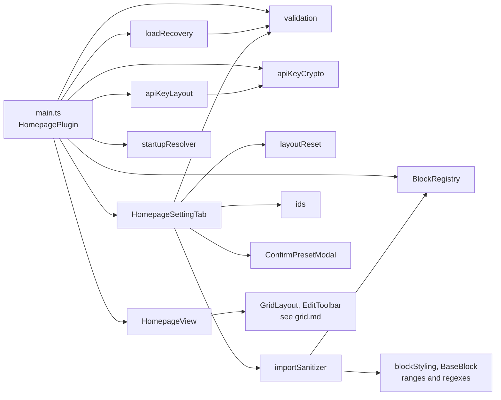
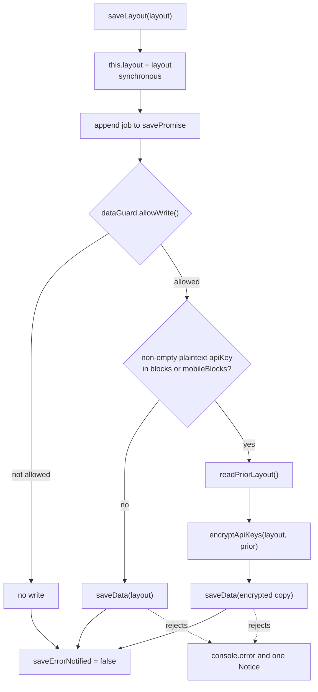
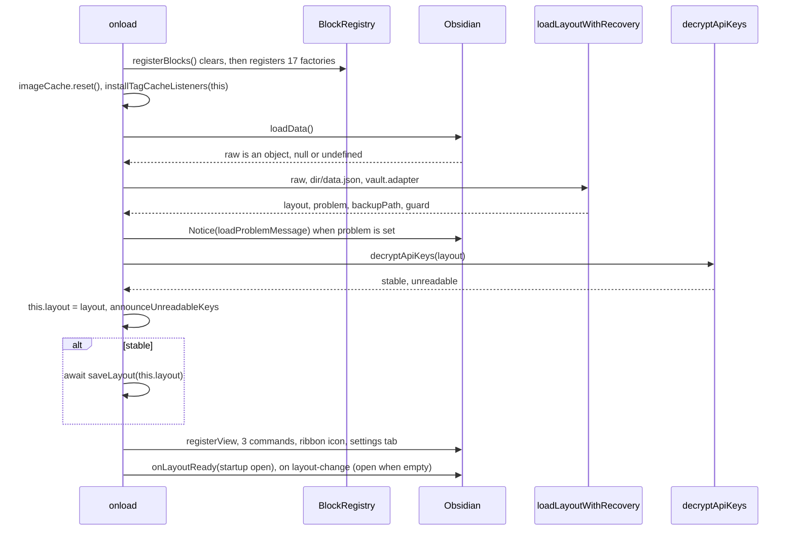

# Plugin core API

This page is the interface reference for the plugin core. It covers the `IHomepagePlugin` contract, the `HomepagePlugin` class, the registered view, the commands and the ribbon action, and the settings tab. It also covers the pure helper modules that load, save, encrypt, import and reset the layout.

It documents branch `xray-remediation` as it is on disk: commit 8dff07e plus uncommitted changes, including the untracked `src/utils/apiKeyLayout.ts` and `src/utils/loadRecovery.ts`. Every path is relative to the repository root.

Related pages:
- [architecture](../architecture.md): the layering and why the interface exists.
- [data model](../data-model.md): the fields of `LayoutConfig` and `BlockInstance`, and the default layout.
- [flows](../flows.md): end-to-end walkthroughs.
- [blocks](../blocks.md) and [block API](blocks.md): factories, `BaseBlock` and each block's config.
- [grid API](grid.md): `GridLayout`, `buildLayoutUpdate` and the grid managers.
- [styling](../styling.md): the `_` styling keys and `STYLE_RANGES`.

---

## 1. Module map

| Module | Role | Exports |
|---|---|---|
| `src/types.ts` | Shared types and the plugin contract | `BLOCK_TYPES`, `BlockType`, `OpenMode`, `LayoutPriority`, `ResponsiveMode`, `BlockInstance`, `LayoutConfig`, `BlockFactory`, `IHomepagePlugin` |
| `src/main.ts` | Plugin class and block registration | `registerBlocks`, `default HomepagePlugin` |
| `src/HomepageView.ts` | The `ItemView` | `VIEW_TYPE`, `HomepageView` |
| `src/settings/HomepageSettingTab.ts` | Settings UI | `HomepageSettingTab` |
| `src/BlockRegistry.ts` | Map from block type to factory | `BlockRegistry` (singleton) |
| `src/validation.ts` | Defaults, migration, validation | `isOpenMode`, `isLayoutPriority`, `isResponsiveMode`, `DEFAULT_LAYOUT_DATA`, `getDefaultLayout`, `MAX_BLOCKS`, `migrateBlockInstance`, `isValidBlockInstance`, `validateBlocks`, `validateLayout` |
| `src/utils/loadRecovery.ts` | Load-time recovery and the write guard | `DataFileAdapter`, `LoadProblem`, `LoadOutcome`, `loadLayoutWithRecovery`, `DataFileGuard`, `loadProblemMessage`, `fileName` |
| `src/utils/apiKeyCrypto.ts` | AES-GCM with a per-device key, on one string | `isEncrypted`, `EncryptResult`, `encryptStringEx`, `encryptString`, `DecryptResult`, `decryptStringEx`, `decryptString`, `_resetDeviceKeyCache` |
| `src/utils/apiKeyLayout.ts` | Key encryption applied to a whole layout | `persistableLayout`, `encryptApiKeys`, `UnreadableKeys`, `decryptApiKeys`, `unreadableKeyNotice` |
| `src/utils/importSanitizer.ts` | Allowlist for clipboard imports | `sanitizeImportedConfig`, `sanitizeImportedLayout` |
| `src/utils/layoutReset.ts` | Builds the reset layout | `MOBILE_LAYOUT_FIELDS`, `STARTUP_FIELDS`, `buildResetLayout` |
| `src/utils/startupResolver.ts` | Resolves startup settings per platform | `ResolvedStartup`, `mobileStartupActive`, `resolveStartup` |
| `src/utils/ids.ts` | Block ids | `newId` |



---

## 2. `IHomepagePlugin`

`IHomepagePlugin` is declared at `src/types.ts:105-141`. It exists to break a circular import: the blocks (`src/blocks/BaseBlock.ts:20`), `HomepageView`, `GridLayout`, `EditToolbar`, the `src/grid/` modules `CollapseToggle`, `EditHandleBar`, `LayoutPersister` and `ResponsiveColumns`, and the settings tab all depend on this interface, never on the class.

`HomepagePlugin` is its only implementation in `src` (`src/main.ts:217`). The settings tab types its host as `Plugin & IHomepagePlugin` (`src/settings/HomepageSettingTab.ts:15`) because `PluginSettingTab`'s constructor takes a `Plugin` and `flashButton` calls `Plugin.register`. The interface has no `openHomepage` and no `register`.

### 2.1 Members

| Member | Signature | Contract | Implementation |
|---|---|---|---|
| `app` | `App` | The Obsidian app. | Inherited from `Plugin` |
| `layout` | `LayoutConfig` | The in-memory layout, and the authority on ordering. It holds a plaintext `apiKey` wherever this device could decrypt it (§7.4). It is writable: `saveLayout` assigns it synchronously, and `HomepageView`'s `onLayoutChange` (`src/HomepageView.ts:35`) and edit-mode Discard (`src/EditToolbar.ts:82`) also assign it directly before they save. | `src/main.ts:218`, initialised to `getDefaultLayout()` until `onload` replaces it |
| `saveLayout` | `(layout: LayoutConfig) => Promise<void>` | §2.2 | `src/main.ts:424-458` |
| `saveActiveBlocks` | `(blocks: BlockInstance[]) => Promise<void>` | Puts `blocks` into `mobileBlocks` when `isMobileActive()`, otherwise into `blocks`, then calls `saveLayout`. | `src/main.ts:476-481` |
| `updateBlockConfig` | `(id: string, patch: Record<string, unknown>) => Promise<void>` | §2.3 | `src/main.ts:490-510` |
| `isMobileActive` | `() => boolean` | `Platform.isMobile && layout.responsiveMode === 'separate'` | `src/main.ts:371-373` |
| `activeBlocks` | `() => BlockInstance[]` | Returns `layout.mobileBlocks` when `isMobileActive()`, otherwise `layout.blocks`. It returns the live array, not a copy. | `src/main.ts:375-377` |
| `activeColumns` | `() => number` | Returns `mobileColumns` or `columns`, by the same test. | `src/main.ts:379-381` |
| `activeLayoutPriority` | `() => LayoutPriority` | Returns `mobileLayoutPriority` or `layoutPriority`. The value is always `'row'` today (`src/types.ts:16-25`). | `src/main.ts:383-385` |
| `isMobileStartupActive` | `() => boolean` | `mobileStartupActive(layout, Platform.isMobile)`, which is `Platform.isMobile && layout.separateStartup`. Nothing in `src` calls it. | `src/main.ts:394-396` |
| `activeOpenOnStartup` | `() => boolean` | `resolveStartup(layout, Platform.isMobile).openOnStartup` | `src/main.ts:398-400` |
| `activeOpenMode` | `() => OpenMode` | `….openMode` | `src/main.ts:402-404` |
| `activeManualOpenMode` | `() => OpenMode` | `….manualOpenMode` | `src/main.ts:406-408` |
| `activeOpenWhenEmpty` | `() => boolean` | `….openWhenEmpty` | `src/main.ts:410-412` |
| `activePin` | `() => boolean` | `….pin` | `src/main.ts:414-416` |

The accessors use two independent gates:

| Gate | Predicate | Selects |
|---|---|---|
| Layout | `isMobileActive()`: `Platform.isMobile && responsiveMode === 'separate'` | `blocks`/`mobileBlocks`, `columns`/`mobileColumns`, `layoutPriority`/`mobileLayoutPriority` |
| Startup | `isMobileStartupActive()`: `Platform.isMobile && separateStartup` | The five startup fields (§7.7) |

Grid and toolbar code reads through the layout accessors. Startup sites in `main.ts` read through the startup accessors. The settings tab reads the raw fields, because it renders both halves explicitly.

### 2.2 `saveLayout(layout)`

1. Assigns `this.layout = layout` synchronously, before the first `await` (`src/main.ts:425`). Accessors called right after `saveLayout`, without awaiting it, already see the new state. The Pin toggle relies on this (`src/settings/HomepageSettingTab.ts:195-201`).
2. Appends one job to the private promise chain `savePromise` (`src/main.ts:428-456`). Jobs run strictly in call order. Each job writes the `layout` argument it was given, not `this.layout` at run time, so the layout of the last call is what ends up on disk.
3. The job runs these steps:
   1. Consults `dataGuard.allowWrite()`. When that call produced a backup, it shows a 12 s Notice: "the original data.json was saved as `<file>`; saving resumes". When the write is not allowed, the job returns without writing.
   2. Builds the copy to write with `persistableLayout(layout, readPriorLayout)` (§7.4).
   3. Calls `this.saveData(persistable)` (`src/main.ts:439-440`).
4. The promise resolves once its own job settles, and **it never rejects**. The chain's rejection handler logs `[Homepage Blocks] Failed to save layout: <message>`, with the message only, and shows an 8 s Notice once until the next successful save (`src/main.ts:443-455`). A write held back by the guard counts as a success. Callers cannot detect a failed write from the promise.

`readPriorLayout()` (`src/main.ts:467-474`, private) returns the raw result of `loadData()`, unvalidated. It returns `null` when that result is not a plain object or when the read throws. Its only use is the refuse-to-downgrade lookup in `encryptApiKeys`.



**Caller rule.** Build the next layout from `plugin.layout` or `activeBlocks()` at the moment of the call. Never build it from a value read before an `await`. Every save assigns the in-memory layout synchronously, so it always holds the latest drag (`src/main.ts:483-489`). Grid code routes block arrays through `GridLayout.buildLayoutUpdate`, which is covered in [grid.md](grid.md). The other `saveLayout` callers are these:
- `HomepageView`'s `onLayoutChange` (`src/HomepageView.ts:34-37`)
- edit-mode Discard (`src/EditToolbar.ts:83`)
- `CollapseToggle` (`src/grid/CollapseToggle.ts:80`)
- the settings tab (§6)
- inside the plugin, the load-time resave in `onload` (`src/main.ts:259`) and `saveActiveBlocks` (`src/main.ts:480`)

### 2.3 `updateBlockConfig(id, patch)`

The contract is in the doc comment at `src/types.ts:111-120`. The implementation does the following:

1. Awaits `savePromise`, so every save queued before this call lands first (`src/main.ts:492-497`). The `try/catch` around that await is defensive only, because the chain never rejects.
2. Reads `activeBlocks()` at that moment. The read includes any `saveLayout` called in the meantime, since those assign `layout` synchronously.
3. If `id` is not in the **active** platform array, it logs `[Homepage Blocks] updateBlockConfig: block <id> no longer exists; config patch dropped` and resolves without saving (`src/main.ts:498-505`). A block that sits in the inactive platform array counts as missing.
4. Otherwise it builds a new block with `config: { ...b.config, ...patch }`. The merge is shallow: a nested object or array in the patch replaces the whole value. Other blocks keep their identity. It then awaits `saveActiveBlocks(next)` (`src/main.ts:506-509`).
5. The calling block's `this.instance` is never updated. Read the saved values back with `BaseBlock.liveConfig()` (`src/blocks/BaseBlock.ts::liveConfig`) after the promise resolves. See [block API](blocks.md).

The callers are `src/blocks/StaticTextBlock.ts:130` and `src/blocks/EmbeddedNoteBlock.ts:42`. `saveActiveBlocks` has no other production caller; the `GridLayout` test mock also implements it (`tests/grid/GridLayout.render.test.ts:36`).

---

## 3. `HomepagePlugin` (`src/main.ts`)

`export default class HomepagePlugin extends Plugin implements IHomepagePlugin` (`src/main.ts:217`).

### 3.1 Surface beyond the interface

| Member | Signature | Notes |
|---|---|---|
| `onload` | `async onload(): Promise<void>` | §3.2 |
| `onunload` | `onunload(): void` | §3.3 |
| `openHomepage` | `async openHomepage(mode: OpenMode = 'retain'): Promise<void>` | §3.4. Public, but not part of `IHomepagePlugin`. |
| `announceUnreadableKeys` | `private (unreadable: UnreadableKeys, layout: LayoutConfig): void` | §7.4 |
| `readPriorLayout` | `private (): Promise<LayoutConfig \| null>` | §2.2 |
| `savePromise`, `saveErrorNotified`, `dataGuard` | private fields | `src/main.ts:420-422` |
| `registerBlocks` | module export, `(): void` | §3.5 |
| `UNREADABLE_KEYS_STORAGE_KEY` | module constant, `'hp-unreadable-api-keys'` | `src/main.ts:215` |

### 3.2 `onload()` sequence



1. `registerBlocks()` runs first (`src/main.ts:221`).
2. `imageCache.reset()` re-arms a module singleton that a previous `onunload` may have destroyed (`src/main.ts:226`).
3. `installTagCacheListeners(this)` clears the tag cache and registers `vault` `delete`/`rename` and `metadataCache` `changed` handlers (`src/main.ts:230`, `src/utils/tags.ts::installTagCacheListeners`).
4. The data path is `normalizePath(dir + '/data.json')`, where `dir` is `manifest.dir`, or `<configDir>/plugins/<manifest.id>` when `manifest.dir` is unset (`src/main.ts:234-236`).
5. `loadLayoutWithRecovery` validates and backs up the file (§7.2). If it reports a problem, a `blocks-dropped` problem also logs a `console.warn`, and every problem shows a 12 s Notice with `loadProblemMessage` (`src/main.ts:237-242`). `this.dataGuard` is set from the result (`src/main.ts:245`).
6. `decryptApiKeys(validated)` runs, and `this.layout = validated` is assigned (`src/main.ts:249-250`). When the decrypt is not `stable`, a 10 s Notice says the voice API key could not be loaded and will be retried at the next restart. `announceUnreadableKeys` then runs (§7.4).
7. **When the decrypt is stable, the validated layout is saved at once (`src/main.ts:258-260`), so every normal launch rewrites `data.json`.** Because `validateLayout` returns exactly the 21 known fields, this save drops any other top-level key (§7.1). When the decrypt is unstable, the save is skipped.
8. The view, commands, ribbon, settings tab and workspace hooks are registered only after the awaits above (`src/main.ts:262-331`).

The plugin does not implement `onExternalSettingsChange`, which exists in Obsidian 1.5.7 and later; nothing in `src` references it. The layout is read once per load. If sync changes `data.json` while the plugin runs, this device's next save writes its own in-memory layout over that change.

### 3.3 `onunload()`

It calls `imageCache.destroy()`, `clearPomodoroState()`, `closeSharedAudioCtx()`, `abortActiveLightbox()` and `_resetDeviceKeyCache()` (`src/main.ts:334-343`). The last call drops only the cached `CryptoKey` reference; the IndexedDB record stays. `onunload` does not detach homepage leaves. Obsidian's `Component` lifecycle cleans up everything registered through `register*`.

### 3.4 `openHomepage(mode = 'retain')`

| Situation | Action |
|---|---|
| A leaf of type `homepage-blocks` exists | That leaf is used as it is, without `setViewState` (`src/main.ts:514-518`). |
| `'replace-all'` | Reuses `getMostRecentLeaf(workspace.rootSplit)`, falling back to `getLeaf('tab')` (`src/main.ts:519-525`). |
| `'replace-last'` | `getLeaf(false)` |
| `'retain'` | `getLeaf('tab')` |

A new leaf gets `setViewState({ type: VIEW_TYPE, active: true })` (`src/main.ts:532`). With `'replace-all'`, every other leaf of `workspace.rootSplit` is then detached, whether the homepage was new or already open (`src/main.ts:536-542`); the homepage leaf is chosen first because a main area emptied by detaching has no tab group, and `getLeaf(true)` then throws "No tab group found.". Finally it calls `revealLeaf(leaf)`, then `setPinned(true)` if `activePin()`; the method never unpins (`src/main.ts:544-546`).

The callers and the mode each one passes:

| Caller | Mode passed |
|---|---|
| `open-homepage` command, ribbon icon | `activeManualOpenMode()` |
| `onLayoutReady` | `activeOpenMode()` |
| Open-when-empty handler | Always `'retain'` |

### 3.5 `registerBlocks()`

`export function registerBlocks(): void` (`src/main.ts:41-207`) calls `BlockRegistry.clear()` and then registers the 17 factories. `onload` calls it, and so do the tests that need the real factories, such as `tests/utils/importSanitizer.test.ts:90`.

Contract (`src/main.ts:36-40`, `src/types.ts:93-97`):
- Each `defaultConfig` declares every config key its block reads. A key with no default of its own is declared as `undefined`.
- `defaultConfig` seeds new blocks, and it is the import allowlist (§7.5).
- Button-grid's `customCss` is deliberately left undeclared (`src/main.ts:78-79`).

New blocks get a shallow copy, `{ ...factory.defaultConfig }` (`src/EditToolbar.ts:196`). An array default such as `items: []` is therefore shared by reference with the factory's `defaultConfig` until that block's `config` is replaced (the settings modal edits a `structuredClone` draft, `src/modals/BlockSettingsModal.ts:51`) or the layout is next loaded from disk.

| `type` | `displayName` | `defaultSize` (w×h) | `autoHeight` |
|---|---|---|---|
| `greeting` | Greeting | 1×3 | |
| `clock` | Clock / date | 1×3 | |
| `folder-links` | Quick links | 1×3 | |
| `button-grid` | Button grid | 1×5 | yes |
| `quotes-list` | Quotes | 2×3 | yes |
| `image-gallery` | Image gallery | 3×3 | yes |
| `embedded-note` | Embedded note | 1×3 | yes |
| `static-text` | Static text | 1×3 | yes |
| `html` | HTML block | 1×3 | |
| `video-embed` | Video embed | 2×4 | |
| `bookmarks` | Bookmarks | 2×3 | |
| `recent-files` | Recent files | 1×4 | |
| `pomodoro` | Pomodoro timer | 1×4 | |
| `spacer` | Spacer | 1×2 | |
| `random-note` | Random note | 1×4 | yes |
| `voice-dictation` | Voice notes | 2×3 | |
| `vault-search` | Vault Search | 2×2 | |

Each factory's `defaultConfig` is listed in [blocks.md](../blocks.md).

`BlockRegistry` (`src/BlockRegistry.ts`) is a singleton that wraps `Map<BlockType, BlockFactory>`:

| Method | Signature | Behaviour |
|---|---|---|
| `register` | `(factory: BlockFactory): void` | Adds the factory. A second factory for the same type silently replaces the first. |
| `get` | `(type: BlockType): BlockFactory \| undefined` | Returns the factory for a type. |
| `getAll` | `(): BlockFactory[]` | Returns the factories in registration order. |
| `clear` | `(): void` | Removes every factory. |

---

## 4. Registered view: `HomepageView` (`src/HomepageView.ts`)

The view type is `VIEW_TYPE = 'homepage-blocks'` (`src/HomepageView.ts:6`). It is registered as `registerView(VIEW_TYPE, leaf => new HomepageView(leaf, this))` (`src/main.ts:262`), and its constructor is `(leaf: WorkspaceLeaf, plugin: IHomepagePlugin)`.

| Method | Behaviour |
|---|---|
| `getViewType()` | `'homepage-blocks'` |
| `getDisplayText()` | `'Homepage'` |
| `getIcon()` | `'home'` |
| `onOpen(): Promise<void>` | Steps listed below |
| `onClose()` | Destroys the grid and the toolbar. |
| `toggleEditMode(): void` | Delegates to `EditToolbar.toggleEditMode`. |
| `openAddBlockModal(): void` | Delegates to `EditToolbar.openAddBlockModal`. |
| `reload(): Promise<void>` | Re-runs `onOpen`. The settings tab calls it after it changes what is rendered. |

`onOpen()` does the following:
1. Destroys any previous grid and toolbar and empties `contentEl`.
2. Adds the class `homepage-view`. Toggles `homepage-no-scrollbar` when `showScrollbar === false`, and `homepage-hover-highlight` when `hoverHighlight` is set.
3. Builds `GridLayout` with `onLayoutChange = l => { plugin.layout = l; void plugin.saveLayout(l) }`, and `EditToolbar` with that grid and a column callback, `columns => grid.setColumns(columns)`. It inserts the toolbar and the floating edit button before the grid element.
4. Calls `grid.render(activeBlocks(), activeColumns(), true)` (`src/HomepageView.ts:23-55`).

The internals are in [grid.md](grid.md).

---

## 5. Commands, ribbon and workspace hooks

| Kind | Id or icon | Name | Action | Source |
|---|---|---|---|---|
| Command | `open-homepage` | Open homepage | `openHomepage(activeManualOpenMode())` | `src/main.ts:264-268` |
| Command | `toggle-edit-mode` | Toggle edit mode | Calls `toggleEditMode()` on **every** `HomepageView` leaf | `src/main.ts:270-281` |
| Command | `add-block` | Add block | Calls `openAddBlockModal()` on **every** `HomepageView` leaf | `src/main.ts:283-294` |
| Ribbon | `home` | Open homepage | `openHomepage(activeManualOpenMode())` | `src/main.ts:296` |

No command declares a default hotkey. Every command uses a plain `callback`, so all three stay available in the palette even when no homepage is open. `toggle-edit-mode` and `add-block` then do nothing.

**Startup open.** `workspace.onLayoutReady` sets a local `layoutReady = true` and calls `openHomepage(activeOpenMode())` if `activeOpenOnStartup()` (`src/main.ts:300-306`). Obsidian runs an `onLayoutReady` callback immediately when the layout is already ready (`node_modules/obsidian/obsidian.d.ts`, `onLayoutReady`). Enabling the plugin mid-session with Open on startup turned on therefore opens the homepage too.

**Open when empty** (`src/main.ts:308-331`) is a `workspace.on('layout-change')` handler that is active only when `layoutReady && activeOpenWhenEmpty()`. It works like this:
1. It debounces through `window.setTimeout(…, 500)`. The pending timer is cleared on unload through `this.register`.
2. It returns if a homepage leaf exists, or if its own last auto-open was less than 2000 ms ago.
3. It walks `iterateRootLeaves`. If every root leaf's view type is `'empty'`, it calls `openHomepage('retain')`. The configured open modes never apply to this path.

---

## 6. Settings tab: `HomepageSettingTab` (`src/settings/HomepageSettingTab.ts`)

It is declared as `class HomepageSettingTab extends PluginSettingTab`, with the constructor `(app: App, plugin: Plugin & IHomepagePlugin)`, and it is added at `src/main.ts:298`. `display()` empties the container and renders four sections in order: startup, layout, display, and export / import (`src/settings/HomepageSettingTab.ts:29-36`).

Private helpers:
- `reloadOpenHomepages()` awaits `view.reload()` on every `HomepageView` leaf (`src/settings/HomepageSettingTab.ts:45-51`).
- `flashButton(btn, label, original, ms = 2000)` swaps a button label, then restores it on a timeout. Every call adds another `plugin.register(clearTimeout)` cleanup, and those cleanups pile up for the lifetime of the plugin (`src/settings/HomepageSettingTab.ts:54-58`).

`OPEN_MODE_LABELS` (`src/settings/HomepageSettingTab.ts:18-22`):

| Value | Label |
|---|---|
| `retain` | Keep existing tabs (new tab) |
| `replace-last` | Replace active tab |
| `replace-all` | Close all tabs |

Every control writes through `saveLayout({ ...plugin.layout, …patch })`, except Reset and Import, which save a whole layout, and Export, which saves nothing. The table below lists each control in render order.

| Heading | Control | Field(s) written | Shown when | After the save |
|---|---|---|---|---|
| (none) | Separate startup for mobile (toggle) | `separateStartup` | always | `display()` |
| Desktop startup (only when `separateStartup`) | Open on startup (toggle) | `openOnStartup` | always | `display()` |
| | Startup open mode (dropdown) | `openMode` | this half's open-on-startup is on | nothing |
| | Open when empty (toggle) | `openWhenEmpty` | always | nothing |
| | Manual open mode (dropdown) | `manualOpenMode` | always | nothing |
| | Pin homepage tab (toggle) | `pin` | always | `leaf.setPinned(plugin.activePin())` on every homepage leaf, which can pin or unpin |
| Mobile startup | The same five controls, on `mobile*` fields | `mobileOpenOnStartup`, `mobileOpenMode`, `mobileOpenWhenEmpty`, `mobileManualOpenMode`, `mobilePin` | `separateStartup` | as above |
| Layout | Responsive mode (dropdown) | `responsiveMode` | always | `display()`. Open views are not reloaded. |
| Desktop layout (only when `separate`) | Default columns (2–5) | `columns` | always | Nothing: open views are not reloaded, and stored `x`/`w` are not re-clamped (`validateBlocks` clamps them at the next load) |
| Mobile layout | Mobile columns (1–3) | `mobileColumns` | `separate` | nothing |
| | Copy desktop layout to mobile (button) | `mobileBlocks` | `separate` | Reloads open homepages and flashes "Copied!" |
| | Mobile blocks (info row) | none | `separate` | none |
| (none: under the previous heading) | Show scrollbar (toggle) | `showScrollbar` | always | Toggles `homepage-no-scrollbar` on each view's `contentEl` |
| | Compact layout (toggle) | `compactLayout` | always | Awaits the save, then reloads open homepages |
| | Hover highlight (toggle) | `hoverHighlight` | always | Toggles `homepage-hover-highlight` on each view's `contentEl` |
| | Reset to default layout (warning button) | Whole layout, from `buildResetLayout` (§7.6) | always | Reloads open homepages. It does not call `display()`. |
| Export / import | Export layout (button) | none (writes the clipboard) | always | Flashes a label |
| | Import layout (button) | Whole layout | always | Opens a confirm modal, then saves, reloads and flashes a label |

Notes on the startup toggle:
- **Separate startup for mobile** (`src/settings/HomepageSettingTab.ts:65-103`) never changes a stored `mobile*` value, whether it is turned on or off.
  - Turning it on when all five `mobile*` values already equal their desktop counterparts copies desktop into mobile. That copy changes nothing, since the values are already equal.
  - Turning it on when the values have diverged sets only `separateStartup`.
  - Validation already seeds missing `mobile*` fields from the desktop values (§7.1).

Notes on export and import:
- **Export** (`src/settings/HomepageSettingTab.ts:365-391`):
  1. Without `navigator.clipboard.writeText`, it flashes "Clipboard unavailable".
  2. It calls `structuredClone(plugin.layout)`, which is the in-memory, plaintext layout.
  3. It deletes `config.apiKey` and `config.customCss` from every block in both arrays.
  4. It writes `JSON.stringify(…, null, 2)` to the clipboard and flashes "Copied!", or "Copy failed" on an error.

  The export carries every startup and display setting.
- **Import** (`src/settings/HomepageSettingTab.ts:393-436`):
  1. Without `readText`, it flashes "Clipboard unavailable".
  2. It runs `JSON.parse`. On a throw it flashes "Invalid JSON".
  3. It calls `validateLayout(parsed, () => corrupt = true)`, and a corrupt result flashes "Not a layout". `onBlocksDropped` is not passed, so invalid blocks are dropped without any report. A clipboard that holds `null` or `{}` passes validation and offers the **default layout**.
  4. It runs `sanitizeImportedLayout` (§7.5).
  5. It builds the summary `"<n> block(s): <unique types>"`, where n counts **desktop blocks only**. It adds " · stripped N unsafe / unknown field(s)" when fields were stripped. It adds " · your saved API key will be removed" when any current block in either array has a non-empty `apiKey`, a foreign ciphertext included.
  6. It opens a `ConfirmPresetModal` whose name is `Import (<summary>)`. On confirm it calls `saveLayout(safe)`, reloads the homepages and flashes "Imported!".

  The import replaces the whole `LayoutConfig`, startup and display settings included, and keeps the imported block ids.
- **`ConfirmPresetModal`** (`src/modals/ConfirmPresetModal.ts`) still uses the wording of the presets feature that was removed:
  - heading "Load preset?"
  - body `This will replace your current layout with the "<name>" preset. This cannot be undone.`
  - buttons "Load preset" and "Cancel"

  A rejection from `onConfirm` is logged as `[Homepage Blocks] Preset apply failed:`.
- **Copy desktop layout to mobile** (`src/settings/HomepageSettingTab.ts:259-286`) runs `structuredClone(layout.blocks)` and builds each mobile block this way:
  - `id` is re-minted with `newId()`.
  - `w` becomes `min(w, mobileColumns)`, and `x` is clamped the same way `validateBlocks` clamps it.
  - `config.apiKey` becomes `''` when present.
  - `y`, `h`, `collapsed`, `_expandedH` and the rest of `config`, `customCss` included, are copied unchanged.

---

## 7. Pure helper modules

### 7.1 `src/validation.ts`

| Export | Signature | Contract |
|---|---|---|
| `isOpenMode` | `(v: unknown) => v is OpenMode` | A string in `{'replace-all','replace-last','retain'}` |
| `isLayoutPriority` | `(v: unknown) => v is LayoutPriority` | A string in `{'row'}`. An old `'column'` value fails and falls back to `'row'`. |
| `isResponsiveMode` | `(v: unknown) => v is ResponsiveMode` | A string in `{'unified','separate'}` |
| `DEFAULT_LAYOUT_DATA` | `LayoutConfig` | Template (`src/validation.ts:24-109`). Its comment calls it immutable, but it is not frozen. Never mutate it. |
| `getDefaultLayout` | `() => LayoutConfig` | Returns `structuredClone(DEFAULT_LAYOUT_DATA)`, safe to mutate |
| `MAX_BLOCKS` | `100` | Per-array cap applied by `validateBlocks` |
| `migrateBlockInstance` | `(b: Record<string, unknown>) => Record<string, unknown>` | Rewrites legacy shapes. It is idempotent. It returns a shallow copy, **but mutates the input's nested `config` in place**. |
| `isValidBlockInstance` | `(b: unknown) => b is BlockInstance` | A shape check with no logging |
| `validateBlocks` | `(raw: unknown, columns: number, defaults: BlockInstance[], onInvalidDropped?: (count: number) => void) => BlockInstance[]` | Migrates, filters, caps, de-duplicates and clamps |
| `validateLayout` | `(raw: unknown, onTopLevelCorruption?: (raw: unknown) => void, onBlocksDropped?: (count: number) => void) => LayoutConfig` | Validates every field |

**`validateLayout`** (`src/validation.ts:295-393`). Stated contract: `validateLayout(validateLayout(x))` deep-equals `validateLayout(x)`. The plugin resaves the result on every load (`src/validation.ts:282-284`).

It first handles the top level:
- `null` or `undefined` returns the defaults and fires no callback.
- A non-object, or an array, fires `onTopLevelCorruption` and returns the defaults.
- A `blocks` or `mobileBlocks` field that is present, not `null` and not an array also fires `onTopLevelCorruption`, and that array is replaced by its default.

It then resolves each field:

| Field(s) | Kept when | Otherwise |
|---|---|---|
| `columns` | A number in `[2,3,4,5]` | `3` |
| `mobileColumns` | A number in `[1,2,3]` | `1` |
| `layoutPriority`, `mobileLayoutPriority` | `isLayoutPriority` | `'row'` |
| `responsiveMode` | `isResponsiveMode` | `'unified'` |
| `openOnStartup`, `openWhenEmpty`, `pin`, `separateStartup` | A boolean | `false` |
| `openMode`, `manualOpenMode` | `isOpenMode` | `'retain'` |
| `mobileOpenOnStartup`, `mobileOpenMode`, `mobileManualOpenMode`, `mobileOpenWhenEmpty`, `mobilePin` | Their own guard | The **resolved desktop counterpart** (`src/validation.ts:341-358`) |
| `showScrollbar` | A boolean | `!hideScrollbar` when legacy `hideScrollbar` is a boolean, else `true` |
| `compactLayout`, `hoverHighlight` | A boolean | `true` |
| `blocks` | `validateBlocks(r.blocks, columns, defaults.blocks, count)` | A missing or non-array value gives the **8 demo blocks** |
| `mobileBlocks` | `validateBlocks(r.mobileBlocks, mobileColumns, [], count)` | `[]` |

- Invalid-block counts from both arrays are summed and reported once, through `onBlocksDropped` (`src/validation.ts:379-383`).
- The returned literal names exactly the 21 `LayoutConfig` fields. Every other top-level key, legacy `hideScrollbar` included, is dropped.

**`validateBlocks`** (`src/validation.ts:249-276`) runs these steps in order:
1. A non-array input returns `defaults`.
2. `migrateBlockInstance` runs on every entry.
3. Entries are filtered with `isValidBlockInstance`, and `onInvalidDropped(count)` fires when any were removed.
4. The result is capped at `MAX_BLOCKS`. The cap is not reported.
5. Ids are de-duplicated, and the first occurrence wins. This is not reported.
6. Positions are clamped: `w = min(w, columns)` and `x = min(x, max(0, columns - w))`. **Only `x` and `w` are clamped.** `y` and `h` have no upper bound, and nothing enforces integers.
7. Unknown top-level block fields survive, through the `{ ...b }` spread.

**`isValidBlockInstance`** (`src/validation.ts:225-237`) requires all of these:
- `id` is a string matching `/^[a-zA-Z0-9_-]+$/`.
- `type` is in `BLOCK_TYPES`.
- `x` and `y` are finite and ≥ 0.
- `w` and `h` are finite and ≥ 1.
- `config` is a non-null, non-array object.

`collapsed` and `_expandedH` are not checked.

**`migrateBlockInstance`** (`src/validation.ts:131-222`) applies these rewrites in order:

| # | Rewrite |
|---|---|
| 1 | `col→x = max(0, col-1)`, `row→y = max(0, row-1)`, `colSpan→w`, `rowSpan→h`, each only when the target is not already a number. `col`, `row`, `colSpan`, `rowSpan` and `newRow` are then deleted. |
| 2 | `type: 'tag-grid'` becomes `'button-grid'`. |
| 3 | The remaining steps run only when `config` is an object. A primitive `config` skips them, and `isValidBlockInstance` later drops the block. |
| 4 | `_transparent: true` sets `_showBorder` and `_showBackground` to `false` where they are unset, then `_transparent` is deleted. `_transparent: false` stays. |
| 5 | `_hideTitle`, `_hideBorder`, `_hideBackground` and `_hideHeaderAccent`: a value of `true` sets the matching `_showX: false` when that key is unset. The `_hideX` key is always deleted. |
| 6 | On `quotes-list`, `hideAccentBar: true` becomes `showAccentBar: false` when unset. `hideAccentBar` is deleted. |
| 7 | On `voice-dictation`, a string `whisperApiKey` becomes `apiKey` when `apiKey` is falsy, and a string `whisperLanguage` becomes `language` likewise. Both old keys are deleted. |
| 8 | On `button-grid`, a `columns` value above 3 is set to `3`. |
| 9 | `customCss` is deleted from every type except `button-grid`. |
| 10 | A string `title` becomes `_titleLabel` when `title` is non-empty and `_titleLabel` is falsy. An empty `title` on `html` or `static-text` sets `_showTitle: false` when unset. `title` is then deleted. |

### 7.2 `src/utils/loadRecovery.ts`

```ts
interface DataFileAdapter { exists(path): Promise<boolean>; read(path): Promise<string>; write(path, data): Promise<void> }
type LoadProblem = { kind: 'unreadable' } | { kind: 'unusable' } | { kind: 'blocks-dropped'; count: number }
interface LoadOutcome { layout: LayoutConfig; problem: LoadProblem | null; backupPath: string | null; guard: DataFileGuard }
function loadLayoutWithRecovery(raw: unknown, dataPath: string, adapter: DataFileAdapter): Promise<LoadOutcome>
class DataFileGuard { constructor(adapter, dataPath, pending: boolean); allowWrite(): Promise<{ allowed: boolean; backupPath: string | null }> }
function loadProblemMessage(problem: LoadProblem, backupPath: string | null): string
function fileName(path: string): string   // last '/' segment
```

**`loadLayoutWithRecovery`** (`src/utils/loadRecovery.ts:41-64`). Per the module comment, Obsidian's `loadData()` returns `null` for a missing file and `undefined` for a file it cannot read or parse (`src/utils/loadRecovery.ts:30-36`).

| `raw` | File check | Outcome |
|---|---|---|
| `null` | Not made | `validateLayout(null)` gives the defaults, with no problem |
| `undefined` | `exists()` returns `false` | Defaults, with no problem (first install) |
| `undefined` | `exists()` returns `true` or throws; the re-read fails or does not parse | Problem `unreadable`; defaults |
| `undefined` | The re-read parses, as after a transient lock | The parsed value is validated normally |
| Anything else | Not made | `validateLayout(raw)`, which can report `unusable` (§7.1 top level) or `blocks-dropped` |

- **Only the first problem found is reported** (`found[0]`).
- With no problem, the guard is created open (`pending = false`).
- With a problem, the private `backupDataFile` copies the file's **text** verbatim, not a re-serialized value, because validation migrates configs in place. The copy goes to `<dataPath>.invalid`, or to `<dataPath>.invalid.<Date.now()>` when that name exists. When `exists()` throws, the base name is used. A failed copy is logged as `[Homepage Blocks] Failed to back up data.json` and returns `null` (`src/utils/loadRecovery.ts:81-104`).
- The guard is created **pending** when the copy failed. `.gitignore` covers `data.json.invalid*`.

**`DataFileGuard.allowWrite()`** (`src/utils/loadRecovery.ts:121-135`) decides as follows:

| State | Result |
|---|---|
| Not pending | `{ allowed: true, backupPath: null }` |
| Pending, and `data.json` no longer exists | Clears `pending` and returns allowed. A throwing `exists()` counts as "still there". |
| Pending; a quiet retry of the backup fails (not logged) | `{ allowed: false, backupPath: null }` |
| Pending; the retry succeeds | Clears `pending` and returns `{ allowed: true, backupPath }` |

**`loadProblemMessage`** (`src/utils/loadRecovery.ts:139-149`) returns `Homepage blocks: <what><backup>`.

`<what>` depends on the problem:
- `unreadable`: "data.json could not be read, so the default layout was loaded."
- `unusable`: "data.json does not hold a usable layout, so the default blocks were loaded."
- `blocks-dropped`: "N invalid block(s) couldn't be loaded and were removed."

`<backup>` depends on whether a copy exists:
- With a copy: " The original file was saved as `<name>`."
- Without one: " The original file could not be backed up, so nothing will be saved until it can be; data.json is kept as it is."

### 7.3 `src/utils/apiKeyCrypto.ts`

The module keeps one per-device key and encrypts one string at a time. Its storage and wire format:

| Item | Value | Source |
|---|---|---|
| IndexedDB database | `homepage-blocks-kv`, version 1 | `src/utils/apiKeyCrypto.ts:31`, `:45` |
| Object store | `keys` | `:32` |
| Record | `apiKeyDeviceKey`, holding the `CryptoKey` itself | `:33` |
| Key | AES-GCM 256, **non-extractable**, usages `encrypt` and `decrypt` | `:101-105` |
| Wire format | `enc:v1:<base64 iv>:<base64 ciphertext>`, with a 12-byte random IV per call | `:34`, `:169-171` |
| Cache | Module-level `cachedKey` | `:36` |

The database name is a constant with no vault component.

The private `loadDeviceKey()` returns `{ key, transient }` (`src/utils/apiKeyCrypto.ts:87-119`). It works like this:
1. It returns the cached key when there is one.
2. Without WebCrypto (`window.crypto.subtle.generateKey`) or `indexedDB`, it returns `{ null, transient: false }`, which is permanent.
3. Otherwise it reads the IndexedDB record. It reuses a stored key, or generates, stores and caches a new one.
4. Any exception returns `{ null, transient: true }` and logs `[Homepage Blocks] device key unavailable (transient)`.

It has **no shared in-flight promise**. Concurrent first-use calls on a device with no stored key can therefore each generate and store a key; the last record written wins. `encryptApiKeys` makes such concurrent calls through `Promise.all` when two or more blocks hold a plaintext key. A ciphertext made with an overwritten key cannot be decrypted on this device at the next launch, and it is then kept, not cleared (§7.4), unless a later save in the same session rewrote it: every save re-encrypts a plaintext key held in memory with the cached key. This comes from reading the code; it has not been reproduced.

| Export | Signature | Outcomes |
|---|---|---|
| `isEncrypted` | `(value: string) => boolean` | `typeof value === 'string' && value.startsWith('enc:v1:')` |
| `EncryptResult` | `{ ok: true; value } \| { ok: false; reason: 'fallback-plaintext' \| 'crypto-error'; value; transient }` | |
| `encryptStringEx` | `(plaintext: string) => Promise<EncryptResult>` | `''` or already encrypted: `ok`, value unchanged. No WebCrypto: `fallback-plaintext`, `transient: false`, plus `console.warn` "WebCrypto unavailable — apiKey will be stored in plaintext on disk". Key load threw: `fallback-plaintext`, `transient: true`. `encrypt()` threw: `crypto-error`, `transient: true`, plus `console.error`. Success: `ok` with the new ciphertext. |
| `encryptString` | `(plaintext: string) => Promise<string>` | `encryptStringEx(...).value`. Used only by tests. |
| `DecryptResult` | `{ ok: true; plaintext } \| { ok: false; reason: 'no-key' \| 'corrupt'; transient }` | |
| `decryptStringEx` | `(value: string) => Promise<DecryptResult>` | Not `enc:v1:`, `''` included: `ok`, value as is. No key: `no-key` with the key load's `transient`. No `:` after the prefix, or a base64 or AES-GCM failure: `corrupt`, `transient: false`. |
| `decryptString` | `(value: string) => Promise<string \| null>` | Plaintext, or `null` on any failure. Used only by tests. |
| `_resetDeviceKeyCache` | `() => void` | Sets `cachedKey = null`. It is labelled a test hook but also runs in `onunload` (`src/main.ts:342`). |

Outside the core, `VoiceDictationBlock` imports `isEncrypted` to treat a ciphertext as "no usable key on this device" (`src/blocks/VoiceDictationBlock.ts:131`, `:282`, `:578`).

### 7.4 `src/utils/apiKeyLayout.ts`

This module applies key encryption to a whole layout. It selects fields by name: any block config field called `apiKey`, in both arrays. Today only `voice-dictation` declares one.

| Export | Signature |
|---|---|
| `persistableLayout` | `(layout: LayoutConfig, readPrior: () => Promise<LayoutConfig \| null>) => Promise<LayoutConfig>` |
| `encryptApiKeys` | `(layout: LayoutConfig, priorOnDisk: LayoutConfig \| null) => Promise<LayoutConfig>` |
| `UnreadableKeys` | `{ blocks: string[]; mobileBlocks: string[] }`: block ids per array |
| `decryptApiKeys` | `(layout: LayoutConfig) => Promise<{ stable: boolean; unreadable: UnreadableKeys }>` |
| `unreadableKeyNotice` | `(unreadable: UnreadableKeys, renderedArray: keyof UnreadableKeys, recorded: unknown) => { notify: boolean; record: string[] }` |

**`persistableLayout`** (`src/utils/apiKeyLayout.ts:31-37`) returns **the same object** when no block in either array holds a non-empty plaintext `apiKey`, and it does not call `readPrior` in that case. Otherwise it returns `encryptApiKeys(layout, await readPrior())`.

A device that decrypted its own key holds plaintext in memory. On that device every save therefore reads `data.json` and re-encrypts with a fresh IV, drags and auto-height writes included. The comments at `src/main.ts:436-438` and `src/utils/apiKeyLayout.ts:25-27` say the skip covers every drag; that is true only while no readable key is in memory.

**`encryptApiKeys`** (`src/utils/apiKeyLayout.ts:48-93`) returns a new layout with new `blocks` and `mobileBlocks` arrays, and processes both arrays concurrently. A block whose key it writes gets new block and config objects; every other block is the same object as in the input. The prior value is looked up by block id, in the **same** array of `priorOnDisk`.

| Key in memory | `encryptStringEx` | Prior on disk | Written |
|---|---|---|---|
| Not a string, `''`, or ciphertext | Not called | — | Unchanged |
| Plaintext | `ok` | — | New ciphertext |
| Plaintext | Failed (any kind) | Ciphertext | The prior ciphertext (refuse-to-downgrade) |
| Plaintext | Failed, `transient` | None or plaintext | `''`. Memory keeps the plaintext and the next save retries. If the session ends first, the disk copy stays blank. |
| Plaintext | Failed, permanent (no WebCrypto) | None or plaintext | Plaintext |

**`decryptApiKeys`** (`src/utils/apiKeyLayout.ts:115-155`) runs sequentially: `blocks` first, then `mobileBlocks`. **It reassigns `layout.blocks` and `layout.mobileBlocks` on the object passed in**, and `onload` relies on this (`src/main.ts:249-250`). The arrays are new. A decrypted block gets new block and config objects; every other block is kept as the same object.

| Stored key | `decryptStringEx` | In memory afterwards | Reported |
|---|---|---|---|
| Not a string, `''`, or plaintext | Not called | Unchanged | — |
| Ciphertext | `ok` | Plaintext | — |
| Ciphertext | `no-key`, `transient` | Ciphertext, kept | `stable = false` |
| Ciphertext | `no-key` permanent, or `corrupt` | Ciphertext, **kept** | Id pushed to `unreadable[array]` |

A key this device cannot read is never cleared. Clearing it would erase the key on every synced device at the next save. At 8dff07e the key was cleared.

**`unreadableKeyNotice`** (`src/utils/apiKeyLayout.ts:168-176`) returns two values:
- `record` is the list of unreadable ids for `renderedArray`.
- `notify` is true when `record` holds an id that is not in `recorded`, the string ids stored at the previous launch.

It is keyed by block id rather than ciphertext, because the owning device re-encrypts with a new IV at every save.

`HomepagePlugin.announceUnreadableKeys` (`src/main.ts:350-367`) uses it this way:
1. It picks the rendered array: `mobileBlocks` when `Platform.isMobile && responsiveMode === 'separate'`, otherwise `blocks`.
2. It loads `hp-unreadable-api-keys` through `app.loadLocalStorage`, which is vault-scoped.
3. It saves `record`, or `null` when `record` is empty. Both storage calls are wrapped in try/catch.
4. On `notify`, it shows a 12 s Notice: "the voice notes API key can't be read on this device… It was kept as it is; entering a key here replaces it."

A launch where the key was only transiently unavailable reports no unreadable ids, so it clears the record. The Notice then shows again at the next launch.

How `apiKey` moves through each flow:

| Flow | What happens to `apiKey` | Source |
|---|---|---|
| Load | Decrypted in memory where possible. Foreign ciphertext is kept. No resave when unstable. | `src/main.ts:249-260` |
| Save | Plaintext is encrypted into a copy, and memory stays plaintext. | `src/main.ts:436-440` |
| Export | Deleted | `src/settings/HomepageSettingTab.ts:376-383` |
| Import | Stripped by `ALWAYS_STRIPPED` | `src/utils/importSanitizer.ts:10` |
| Copy to mobile | Set to `''` when present; ids re-minted | `src/settings/HomepageSettingTab.ts:272-276` |
| Duplicate block | Copied by `structuredClone` under a new id | `src/grid/EditHandleBar.ts:80-84` |
| Several devices | One slot per block: entering a key on any device replaces it for every device that shares the block. In Separate mode the two arrays hold distinct blocks. Every device decrypts both arrays but reports only the one it renders. | §7.4 |

### 7.5 `src/utils/importSanitizer.ts`

```ts
function sanitizeImportedConfig(blockType: BlockType, config: Record<string, unknown>): { config: Record<string, unknown>; stripped: string[] }
function sanitizeImportedLayout(layout: LayoutConfig): { layout: LayoutConfig; strippedCount: number }
```

Preconditions:
- `layout` is `validateLayout` output, because both arrays are mapped directly.
- `BlockRegistry` is populated. With an empty registry every declared set is `{}`, so every non-`_` key is stripped.

**`sanitizeImportedConfig`** (`src/utils/importSanitizer.ts:76-118`) checks each own entry of `config` against these rules, in order:

| Key | Rule |
|---|---|
| `apiKey`, `customCss` | Always stripped (`ALWAYS_STRIPPED`, `:10`) |
| A `_` key with an own entry in `SHARED_VALIDATORS` | The validator's result is kept. A result of `undefined` strips the key. |
| Any other `_` key | Kept if the value is a string, number or boolean; otherwise stripped |
| A non-`_` key that the factory's `defaultConfig` declares as an own property | Kept if `matchesDeclaredType(value, declared)`; otherwise stripped |
| Anything else | Stripped |

The own-property checks (`hasOwn`, `:7`) keep inherited names such as `__proto__` from matching.

`matchesDeclaredType` (`src/utils/importSanitizer.ts:18-27`) works like this:

| Declared default | Accepted value |
|---|---|
| `undefined` or `null` | A string, number or boolean |
| An array | Any array. **Element contents are not checked.** |
| An object | A non-null, non-array object |
| A number | A finite number |
| Anything else | A value of the same `typeof` |

`SHARED_VALIDATORS` (`src/utils/importSanitizer.ts:41-63`):

| Key(s) | Rule |
|---|---|
| `_titleLabel` | A string, truncated to 200 characters |
| `_titleEmoji` | A string, truncated to 16 characters |
| `_showTitle`, `_showDivider`, `_showHeaderAccent`, `_showBorder`, `_showBackground` | A boolean |
| `_titleSize` | Matches `TITLE_SIZE_RE = /^h[1-6]$/` (`src/blocks/BaseBlock.ts:5`) |
| `_borderStyle` | One of `VALID_BORDER_STYLES` |
| `_accentColor`, `_gradientStart`, `_gradientEnd` | `''` or `HEX_COLOR_RE` |
| The nine ranged keys | Clamped by `clampStyle` to `STYLE_RANGES`; see [styling](../styling.md) |

**`sanitizeImportedLayout`** (`src/utils/importSanitizer.ts:121-136`) rewrites only `config`, in both arrays, and sums the stripped counts. Block-level fields are **not** sanitized: `collapsed`, `_expandedH` and any extra top-level key survive, through the `validateBlocks` spread.

### 7.6 `src/utils/layoutReset.ts`

```ts
const MOBILE_LAYOUT_FIELDS = ['mobileBlocks', 'mobileColumns', 'mobileLayoutPriority'] as const
const STARTUP_FIELDS = ['openOnStartup', 'openMode', 'manualOpenMode', 'openWhenEmpty', 'pin', 'separateStartup',
  'mobileOpenOnStartup', 'mobileOpenMode', 'mobileManualOpenMode', 'mobileOpenWhenEmpty', 'mobilePin'] as const
function buildResetLayout(current: LayoutConfig, fresh: LayoutConfig, isMobileActive: boolean): LayoutConfig
```

`fresh` is expected to be `getDefaultLayout()`, and `isMobileActive` is `plugin.isMobileActive()`. The function is pure: it builds a new object through spreads (`src/utils/layoutReset.ts:61-83`).

| `current.responsiveMode` | `isMobileActive` | Expression | Net effect |
|---|---|---|---|
| Not `'separate'` | Any | `{ ...fresh, ...mobile(current), ...startup(current) }` | `blocks`, `columns` and `layoutPriority` are reset. `showScrollbar`, `compactLayout` and `hoverHighlight` are **also reset** to their defaults. The mobile slice and startup settings are kept. |
| `'separate'` | `true` | `{ ...current, ...mobile(fresh) }` | `mobileBlocks: []`, `mobileColumns: 1`, `mobileLayoutPriority: 'row'`, so the mobile layout ends up **empty** rather than holding demo blocks. Everything else is kept. |
| `'separate'` | `false` | `{ ...fresh, ...mobile(current), ...startup(current) }` | As in the first row, and in addition **`responsiveMode` becomes `'unified'`**, because it comes from `fresh`. The kept mobile slice goes dormant. |

The doc comment says only "the layout slice (blocks / columns / priority)" is reset (`src/utils/layoutReset.ts:52-54`), and the setting's description says "Restore all blocks to the default layout". Neither covers the display flags or `responsiveMode`. `tests/utils/layoutReset.test.ts` asserts neither.

### 7.7 `src/utils/startupResolver.ts`

```ts
interface ResolvedStartup { openOnStartup: boolean; openMode: OpenMode; manualOpenMode: OpenMode; openWhenEmpty: boolean; pin: boolean }
function mobileStartupActive(layout: LayoutConfig, isMobile: boolean): boolean   // isMobile && layout.separateStartup
function resolveStartup(layout: LayoutConfig, isMobile: boolean): ResolvedStartup
```

`resolveStartup` returns each `mobile*` field when `mobileStartupActive` is true, and the desktop field otherwise (`src/utils/startupResolver.ts:28-37`). Contract: with `separateStartup` false, every resolved value equals the desktop field (`:8-13`). Both functions are pure and take the platform as a parameter. The plugin passes `Platform.isMobile`.

### 7.8 `src/utils/ids.ts`

`newId(): string` returns `window.crypto.randomUUID()` when it exists, otherwise `'hp-' + Math.random().toString(36).slice(2) + Date.now().toString(36)` (`src/utils/ids.ts:5-9`). Both forms satisfy the id rule of `isValidBlockInstance`.

The callers are:
- the add-block modal (`src/EditToolbar.ts:187`)
- duplicate (`src/grid/EditHandleBar.ts:82`)
- copy to mobile (`src/settings/HomepageSettingTab.ts:276`)

---

## 8. Device state, Notices and log lines

State stored per device, outside `data.json`:

| Store | Key | Holds | Written by |
|---|---|---|---|
| IndexedDB | `homepage-blocks-kv` / `keys` / `apiKeyDeviceKey` | The non-extractable AES-GCM key | `loadDeviceKey` |
| localStorage (vault-scoped via `App`) | `hp-unreadable-api-keys` | Block ids already reported as unreadable | `announceUnreadableKeys` |

Notices raised by the core:

| When | Duration | Text begins | Source |
|---|---|---|---|
| Load problem | 12 s | `Homepage blocks: data.json …` / `N invalid block(s) …` | `src/main.ts:241` |
| Decrypt unstable at load | 10 s | `Homepage blocks: voice API key could not be loaded right now.` | `src/main.ts:252` |
| A new unreadable key | 12 s | `Homepage blocks: the voice notes API key can't be read on this device` | `src/main.ts:365` |
| A held write made the backup | 12 s | `Homepage blocks: the original data.json was saved as` | `src/main.ts:433` |
| Save failed (once until a success) | 8 s | `Homepage blocks: failed to save layout.` | `src/main.ts:453` |

Console lines, all prefixed `[Homepage Blocks]`:

| Level | Message | Source |
|---|---|---|
| warn | `N invalid block(s) were dropped from the layout on load` | `src/main.ts:239` |
| warn | `updateBlockConfig: block <id> no longer exists; config patch dropped` | `src/main.ts:503` |
| error | `Failed to save layout:` followed by the error message only | `src/main.ts:450` |
| error | `Failed to back up data.json` | `src/utils/loadRecovery.ts:100` (logged at load only) |
| error | `device key unavailable (transient)` | `src/utils/apiKeyCrypto.ts:116` |
| warn | `WebCrypto unavailable — apiKey will be stored in plaintext on disk` | `src/utils/apiKeyCrypto.ts:163` |
| error | `API key encryption failed — key left unencrypted this save, will retry` | `src/utils/apiKeyCrypto.ts:178` |
| error | `Preset apply failed:` | `src/modals/ConfirmPresetModal.ts::ConfirmPresetModal.onOpen` |

---

## 9. Where comments and CLAUDE.md disagree with the code

| Claim | Where | What the code does |
|---|---|---|
| `saveLayout(layout)` calls `this.saveData(layout)` | CLAUDE.md, Layout Persistence | It checks the guard, runs `persistableLayout`, then calls `saveData(persistable)`. The written object is an encrypted copy whenever a plaintext key is in memory (`src/main.ts:431-440`). |
| `validateLayout` "clamps positions" | CLAUDE.md | Only `x` and `w` are clamped. `y`, `h` and `_expandedH` are unbounded, `collapsed` is unchecked, and no integer check exists (`src/validation.ts:225-237`, `:271-275`). |
| The skip "covers every drag and auto-height persist" | `src/main.ts:436-438`, `src/utils/apiKeyLayout.ts:25-27` | False on a device holding a readable key: every save reads `data.json` and re-encrypts (§7.4). |
| `decryptApiKeys` does not mutate its input | `src/utils/apiKeyLayout.ts:111-113` | It reassigns `layout.blocks` and `layout.mobileBlocks` on the argument (`:152-153`), as its own first line says (`:102`). Only a decrypted block gets new objects; the others are reused unchanged. |
| Reset touches only blocks, columns and priority | `src/utils/layoutReset.ts:52-54`, the setting's description | It also resets the three display flags, and on a desktop reset in Separate mode it sets `responsiveMode` back to `'unified'` (§7.6). |
| `_resetDeviceKeyCache` is a test hook | `src/utils/apiKeyCrypto.ts:249` | It also runs in production `onunload` (`src/main.ts:342`). |
| The voice block sits on "Row 3 (y: 8)" | `src/validation.ts:94` | `default-quotes` covers rows 6–8 of columns 0–1, and `default-voice-dictation` starts at row 8 in the same columns. The template has overlapping coordinates. |
| The confirm dialog belongs to presets | The class name and dialog strings of `src/modals/ConfirmPresetModal.ts` | Its only caller is clipboard import (`src/settings/HomepageSettingTab.ts:427`); the class comment acknowledges this. |
| `migrateBlockInstance` (idempotent) | CLAUDE.md | Idempotent, but it mutates the nested `config` of its input (`src/validation.ts:152-154`). `loadRecovery` backs up file text for that reason (`src/utils/loadRecovery.ts:38-39`). |

Interface members with no or one production caller:
- `isMobileStartupActive()` has no caller.
- `saveActiveBlocks()` is called only by `updateBlockConfig`.

---

## 10. Tests covering this surface

Run the tests with `npm test`, which runs vitest. `tests/__mocks__/obsidian.ts` mocks the host.

| Test file | Subject |
|---|---|
| `tests/validation.test.ts` | Type guards, `isValidBlockInstance`, `migrateBlockInstance`, `validateBlocks`, `validateLayout` including the separate-startup defaults |
| `tests/utils/loadRecovery.test.ts` | `loadLayoutWithRecovery` (unreadable, missing, transient lock, unusable, blocks dropped), `DataFileGuard`, `loadProblemMessage` |
| `tests/utils/apiKeyCrypto.test.ts` | `isEncrypted`, the encrypt and decrypt round trip, tampered and malformed ciphertext, and a thrown `encrypt()` classified as transient |
| `tests/utils/apiKeyLayout.test.ts` | Two simulated devices sharing a `data.json`, `persistableLayout`, `unreadableKeyNotice` |
| `tests/utils/importSanitizer.test.ts` | `sanitizeImportedConfig` against the real factories (via `registerBlocks()`), style ranges, `sanitizeImportedLayout` |
| `tests/utils/layoutReset.test.ts` | The three `buildResetLayout` branches and the field-partition constants. Does not assert `responsiveMode` or the display flags. |
| `tests/utils/startupResolver.test.ts` | The gate-off and gate-on contracts of `resolveStartup` |
| `tests/utils/ids.test.ts` | `newId` |
| `tests/settings/HomepageSettingTab.test.ts` | Show scrollbar and Hover highlight apply to an open homepage without a reload |
