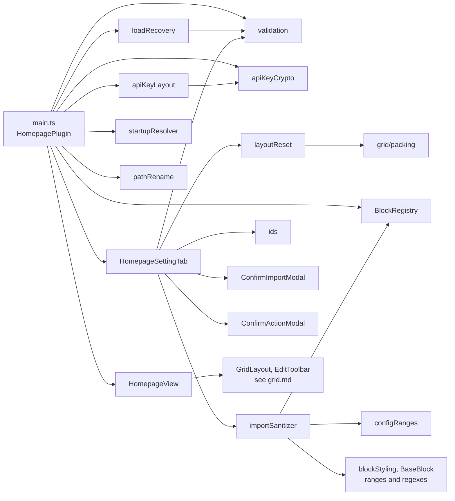
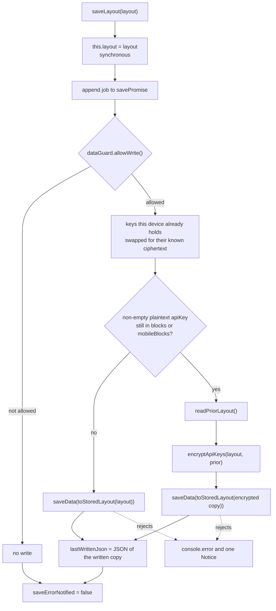
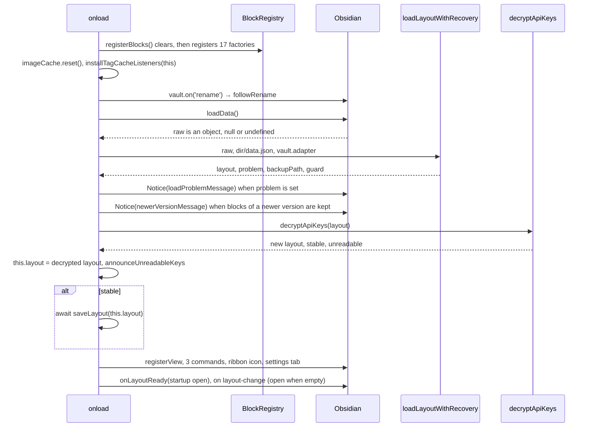

# Plugin core API

This page is the interface reference for the plugin core. It covers the `IHomepagePlugin` contract, the `HomepagePlugin` class, the registered view, the commands and the ribbon action, and the settings tab. It also covers the pure helper modules that load, save, encrypt, import and reset the layout.

It documents branch `xray-remediation` after the X-ray fixes of 2026-10-10. Every path is relative to the repository root.

Related pages:
- [architecture](../architecture.md): the layering and why the interface exists.
- [data model](../data-model.md): the fields of `LayoutConfig` and `BlockInstance`, and the default layout.
- [flows](../flows.md): end-to-end walkthroughs.
- [blocks](../blocks.md) and [block API](blocks.md): factories, `BaseBlock` and each block's config.
- [grid API](grid.md): `GridLayout`, `buildLayoutUpdate` and the grid managers.
- [styling](../styling.md): the `_` styling keys and `STYLE_RANGES`.

---

## 1. Module map

| Module | Role | Exports |
|---|---|---|
| `src/types.ts` | Shared types and the plugin contract | `BLOCK_TYPES`, `BlockType`, `OpenMode`, `LayoutPriority`, `ResponsiveMode`, `BlockInstance`, `PreservedData`, `LayoutConfig`, `BlockFactory`, `IHomepagePlugin` |
| `src/main.ts` | Plugin class, block registration, command target and command availability | `registerBlocks`, `commandTarget`, `homepageCommand`, `default HomepagePlugin` |
| `src/HomepageView.ts` | The `ItemView` | `VIEW_TYPE`, `HomepageView` |
| `src/modals/ConfirmImportModal.ts` | The import confirmation | `ImportChoice`, `ConfirmImportModal` |
| `src/modals/ConfirmActionModal.ts` | The confirmation before Reset layout and Copy to mobile | `ConfirmActionModal` |
| `src/settings/HomepageSettingTab.ts` | Settings UI | `HomepageSettingTab` |
| `src/BlockRegistry.ts` | Map from block type to factory | `BlockRegistry` (singleton) |
| `src/validation.ts` | Defaults, migration, validation, the stored form of a layout | `isOpenMode`, `isLayoutPriority`, `isResponsiveMode`, `DEFAULT_LAYOUT_DATA`, `getDefaultLayout`, `MAX_BLOCKS`, `migrateBlockInstance`, `isValidBlockInstance`, `validateBlocks`, `validateLayout`, `toStoredLayout` |
| `src/utils/loadRecovery.ts` | Load-time recovery and the write guard | `DataFileAdapter`, `LoadProblem`, `LoadOutcome`, `loadLayoutWithRecovery`, `DataFileGuard`, `loadProblemMessage`, `newerVersionMessage`, `fileName` |
| `src/utils/apiKeyCrypto.ts` | AES-GCM with a per-device key, on one string, and the ciphertext memo | `isEncrypted`, `EncryptResult`, `encryptStringEx`, `encryptString`, `DecryptResult`, `decryptStringEx`, `decryptString`, `knownCiphertextFor`, `rememberCiphertext`, `_resetDeviceKeyCache` |
| `src/utils/apiKeyLayout.ts` | Key encryption applied to a whole layout | `persistableLayout`, `encryptApiKeys`, `UnreadableKeys`, `decryptApiKeys`, `unreadableKeyNotice` |
| `src/utils/importSanitizer.ts` | Allowlist for clipboard imports, and the active content an import brings | `sanitizeImportedConfig`, `sanitizeImportedLayout`, `ActiveContent`, `findActiveContent`, `withoutActiveContent` |
| `src/utils/configRanges.ts` | Bounds of numeric block settings | `CONFIG_RANGES`, `clampConfigNumber`, `rangedNumber` |
| `src/utils/layoutReset.ts` | Builds the reset layout and fits block copies to a column count | `DESKTOP_LAYOUT_FIELDS`, `MOBILE_LAYOUT_FIELDS`, `fitBlocksToColumns`, `buildResetLayout`, `dropPreserved` |
| `src/utils/startupResolver.ts` | Resolves startup settings per platform | `ResolvedStartup`, `mobileStartupActive`, `resolveStartup` |
| `src/utils/ids.ts` | Block ids | `newId` |
| `src/utils/pathRename.ts` | Block config paths rewritten for a renamed file or folder (used by `followRename`) | `renamePath`, `renameLink`, `followRenameInBlock` |
| `src/utils/voiceNote.ts` | Voice-note folder, file names and content (used by VoiceDictation) | `sanitizeVoiceFolder`, `uniqueFilePath`, `buildNoteContent` |
| `src/utils/voiceProviders.ts` | Transcription models and limits per provider (used by VoiceDictation) | `TranscriptionProvider`, `PROVIDER_MODELS`, `DEFAULT_MODELS`, `effectiveModel`, `PROVIDER_MAX_BYTES`, `PROVIDER_STOP_BYTES`, `geminiEmptyReason` |
| `src/utils/timeout.ts` | Stop awaiting slow work | `RequestTimeoutError`, `withTimeout` |
| `src/utils/pomodoroTimer.ts` | Wall-clock Pomodoro model (used by PomodoroBlock) | `PomodoroPhase`, `PomodoroSettings`, `PomodoroState`, `initialState`, `remainingMs`, `startOrPause`, `skip`, `advance` |
| `src/utils/openTarget.ts` | Opening a held file, a typed note link or a link target from a block | `openFile`, `onOpenClick`, `cleanLinkText`, `openNoteLink`, `openLinkTarget` |
| `src/utils/folderPath.ts` | Typed folder settings as vault paths | `normalizeFolderPath`, `isInFolder` |
| `src/utils/noteContent.ts` | A note's text as Obsidian shows it (used by Quotes and Random note) | `noteBlocks`, `parseNoteInsight`, `noteQuote`, `notePreview` |
| `src/utils/tags.ts` | Tag matching and the tag-to-files cache | `cacheHasTag`, `normalizeTag`, `installTagCacheListeners`, `getFilesWithTag` |
| `src/utils/accentContrast.ts` | Text colours of an accented card, by contrast (used by `applyBlockStyling`) | `ThemeName`, `contrastRatio`, `AccentColors`, `accentColors` |
| `src/grid/blockLimit.ts` | The 100-block limit for Add block and Duplicate | `canAddBlock` |



---

## 2. `IHomepagePlugin`

`IHomepagePlugin` is declared at `src/types.ts:105-141`. It exists to break a circular import: the blocks (`src/blocks/BaseBlock.ts:20`), `HomepageView`, `GridLayout`, `EditToolbar`, the `src/grid/` modules `CollapseToggle`, `EditHandleBar`, `LayoutPersister` and `ResponsiveColumns`, and the settings tab all depend on this interface, never on the class.

`HomepagePlugin` is its only implementation in `src` (`src/main.ts:230`). The settings tab types its host as `Plugin & IHomepagePlugin` (`src/settings/HomepageSettingTab.ts:15`) because `PluginSettingTab`'s constructor takes a `Plugin` and `flashButton` calls `Plugin.register`. The interface has no `openHomepage` and no `register`.

### 2.1 Members

| Member | Signature | Contract | Implementation |
|---|---|---|---|
| `app` | `App` | The Obsidian app. | Inherited from `Plugin` |
| `layout` | `LayoutConfig` | The in-memory layout, and the authority on ordering. It holds a plaintext `apiKey` wherever this device could decrypt it (§7.4). It is writable: `saveLayout` assigns it synchronously, and `HomepageView`'s `onLayoutChange` (`src/HomepageView.ts:37`) and edit-mode Discard (`src/EditToolbar.ts:118`) also assign it directly before they save. `onExternalSettingsChange` assigns it without a save (§3.6). | `src/main.ts:231`, initialised to `getDefaultLayout()` until `onload` replaces it |
| `saveLayout` | `(layout: LayoutConfig) => Promise<void>` | §2.2 | `src/main.ts:450-487` |
| `saveActiveBlocks` | `(blocks: BlockInstance[]) => Promise<void>` | Puts `blocks` into `mobileBlocks` when `isMobileActive()`, otherwise into `blocks`, then calls `saveLayout`. | `src/main.ts:582-587` |
| `updateBlockConfig` | `(id: string, patch: Record<string, unknown>) => Promise<void>` | §2.3 | `src/main.ts:596-620` |
| `isMobileActive` | `() => boolean` | `Platform.isMobile && layout.responsiveMode === 'separate'` | `src/main.ts:379-381` |
| `activeBlocks` | `() => BlockInstance[]` | Returns `layout.mobileBlocks` when `isMobileActive()`, otherwise `layout.blocks`. It returns the live array, not a copy. | `src/main.ts:383-385` |
| `activeColumns` | `() => number` | Returns `mobileColumns` or `columns`, by the same test. | `src/main.ts:387-389` |
| `activeLayoutPriority` | `() => LayoutPriority` | Returns `mobileLayoutPriority` or `layoutPriority`. The value is always `'row'` today (`src/types.ts:16-25`). | `src/main.ts:391-393` |
| `isMobileStartupActive` | `() => boolean` | `mobileStartupActive(layout, Platform.isMobile)`, which is `Platform.isMobile && layout.separateStartup`. Nothing in `src` calls it. | `src/main.ts:402-404` |
| `activeOpenOnStartup` | `() => boolean` | `resolveStartup(layout, Platform.isMobile).openOnStartup` | `src/main.ts:406-408` |
| `activeOpenMode` | `() => OpenMode` | `….openMode` | `src/main.ts:410-412` |
| `activeManualOpenMode` | `() => OpenMode` | `….manualOpenMode` | `src/main.ts:414-416` |
| `activeOpenWhenEmpty` | `() => boolean` | `….openWhenEmpty` | `src/main.ts:418-420` |
| `activePin` | `() => boolean` | `….pin` | `src/main.ts:422-424` |

The accessors use two independent gates:

| Gate | Predicate | Selects |
|---|---|---|
| Layout | `isMobileActive()`: `Platform.isMobile && responsiveMode === 'separate'` | `blocks`/`mobileBlocks`, `columns`/`mobileColumns`, `layoutPriority`/`mobileLayoutPriority` |
| Startup | `isMobileStartupActive()`: `Platform.isMobile && separateStartup` | The five startup fields (§7.7) |

Grid and toolbar code reads through the layout accessors. Startup sites in `main.ts` read through the startup accessors. The settings tab reads the raw fields, because it renders both halves explicitly.

### 2.2 `saveLayout(layout)`

1. Assigns `this.layout = layout` synchronously, before the first `await` (`src/main.ts:452`). Accessors called right after `saveLayout`, without awaiting it, already see the new state. The Pin toggle relies on this (`src/settings/HomepageSettingTab.ts:211-220`).
2. Appends one job to the private promise chain `savePromise` (`src/main.ts:455-485`). Jobs run strictly in call order. Each job writes the `layout` argument it was given, not `this.layout` at run time, so the layout of the last call is what ends up on disk.
3. The job runs these steps:
   1. Consults `dataGuard.allowWrite()`. When that call produced a backup, it shows a 12 s Notice: "the original data.json was saved as `<file>`; saving resumes". When the write is not allowed, the job returns without writing.
   2. Builds the copy to write with `persistableLayout(layout, readPriorLayout)` (§7.4).
   3. Passes it through `toStoredLayout` (§7.1), which puts the data of a newer plugin version (`layout.preserved`) back where that version reads it, and drops the `preserved` key itself.
   4. Calls `this.saveData(stored)`, then stores `JSON.stringify(stored)` in the private `lastWrittenJson`, which `onExternalSettingsChange` compares to recognize this device's own write (`src/main.ts:467-469`).
4. The promise resolves once its own job settles, and **it never rejects**. The chain's rejection handler logs `[Homepage Blocks] Failed to save layout: <message>`, with the message only, and shows an 8 s Notice once until the next successful save (`src/main.ts:471-484`). A write held back by the guard counts as a success. Callers cannot detect a failed write from the promise.

`readPriorLayout()` (`src/main.ts:573-580`, private) returns the raw result of `loadData()`, unvalidated. It returns `null` when that result is not a plain object or when the read throws. Its only use is the refuse-to-downgrade lookup in `encryptApiKeys`.



**Caller rule.** Build the next layout from `plugin.layout` or `activeBlocks()` at the moment of the call. Never build it from a value read before an `await`. Every save assigns the in-memory layout synchronously, so it always holds the latest drag (`src/main.ts:589-595`). Grid code routes block arrays through `GridLayout.buildLayoutUpdate`, which is covered in [grid.md](grid.md). The other `saveLayout` callers are these:
- `HomepageView`'s `onLayoutChange` (`src/HomepageView.ts:36-39`)
- edit-mode Discard (`src/EditToolbar.ts:119`)
- `CollapseToggle` (`src/grid/CollapseToggle.ts:81`)
- the settings tab (§6)
- inside the plugin, the load-time resave in `onload` (`src/main.ts:292`), `followRename` (`src/main.ts:504`, §3.6) and `saveActiveBlocks` (`src/main.ts:586`)

### 2.3 `updateBlockConfig(id, patch)`

The contract is in the doc comment at `src/types.ts:111-120`. The implementation does the following:

1. Awaits `savePromise`, so every save queued before this call lands first (`src/main.ts:598-603`). The `try/catch` around that await is defensive only, because the chain never rejects.
2. Reads `activeBlocks()` at that moment. The read includes any `saveLayout` called in the meantime, since those assign `layout` synchronously.
3. If `id` is not in the **active** platform array, it logs `[Homepage Blocks] updateBlockConfig: block <id> no longer exists; config patch dropped` and resolves without saving (`src/main.ts:604-611`). A block that sits in the inactive platform array counts as missing.
4. Otherwise it builds a new block with `config: { ...b.config, ...patch }`. The merge is shallow: a nested object or array in the patch replaces the whole value. Other blocks keep their identity.
5. It applies the same patch to the Discard snapshot of every open edit session (`HomepageView.mapEditSnapshot`, `src/main.ts:615-618`). The patch was made in view mode; a session that started while it waited took its snapshot without it, and a Discard would otherwise revert it (M52). It then awaits `saveActiveBlocks(next)` (`:619`).
6. The calling block's `this.instance` is never updated. Read the saved values back with `BaseBlock.liveConfig()` (`src/blocks/BaseBlock.ts::liveConfig`) after the promise resolves. See [block API](blocks.md).

The callers are `src/blocks/StaticTextBlock.ts:132` and `src/blocks/EmbeddedNoteBlock.ts:44`. The EmbeddedNote call is the fallback for a rename the plugin's own listener missed; `followRename` (§3.6) normally rewrites `filePath` first. `saveActiveBlocks` has no other production caller; the `GridLayout` test mock also implements it (`tests/grid/GridLayout.render.test.ts:36`).

---

## 3. `HomepagePlugin` (`src/main.ts`)

`export default class HomepagePlugin extends Plugin implements IHomepagePlugin` (`src/main.ts:230`).

### 3.1 Surface beyond the interface

| Member | Signature | Notes |
|---|---|---|
| `onload` | `async onload(): Promise<void>` | §3.2 |
| `onunload` | `onunload(): void` | §3.3 |
| `openHomepage` | `async openHomepage(mode: OpenMode = 'retain'): Promise<void>` | §3.4. Public, but not part of `IHomepagePlugin`. |
| `followRename` | `async followRename(oldPath: string, newPath: string): Promise<void>` | §3.6. Public; called by the vault `rename` listener. |
| `onExternalSettingsChange` | `async onExternalSettingsChange(): Promise<void>` | §3.6. An Obsidian `Plugin` hook. |
| `announceUnreadableKeys` | `private (unreadable: UnreadableKeys, layout: LayoutConfig): void` | §7.4 |
| `targetHomepage` | `private (forAdd: boolean): HomepageView \| null` | `commandTarget(homepageViews(), getActiveViewOfType(HomepageView), forAdd)` (`src/main.ts:389-391`), §5 |
| `homepageViews` | `private (): HomepageView[]` | Every open `HomepageView` (`src/main.ts:517-521`) |
| `dataFilePath` | `private (): string` | `normalizePath(dir + '/data.json')` (`src/main.ts:508-511`) |
| `readPriorLayout` | `private (): Promise<LayoutConfig \| null>` | §2.2 |
| `savePromise`, `saveErrorNotified`, `dataGuard`, `lastWrittenJson` | private fields | `src/main.ts:444-448, 514` |
| `registerBlocks` | module export, `(): void` | §3.5 |
| `commandTarget` | module export, `<V extends { isEditing(): boolean }>(views: V[], active: V \| null, forAdd: boolean) => V \| null` | §5 (`src/main.ts:219-223`) |
| `homepageCommand` | module export, `<V>(target: () => V \| null, run: (view: V) => void) => (checking: boolean) => boolean` | §5 (`src/main.ts:229-236`) |
| `UNREADABLE_KEYS_STORAGE_KEY` | module constant, `'hp-unreadable-api-keys'` | `src/main.ts:242` |

### 3.2 `onload()` sequence



1. `registerBlocks()` runs first (`src/main.ts:234`).
2. `imageCache.reset()` re-arms a module singleton that a previous `onunload` may have destroyed (`src/main.ts:239`).
3. `installTagCacheListeners(this)` clears the tag cache and registers `vault` `delete`/`rename` and `metadataCache` `changed` handlers (`src/main.ts:243`, `src/utils/tags.ts::installTagCacheListeners`).
4. A vault `rename` listener calls `followRename(oldPath, file.path)` (`src/main.ts:262`, §3.6). It is registered before any block exists, so a mounted block's own listener, which runs later, already finds the new path in `liveConfig()`.
5. The data path is `dataFilePath()`: `normalizePath(dir + '/data.json')`, where `dir` is `manifest.dir`, or `<configDir>/plugins/<manifest.id>` when `manifest.dir` is unset (`src/main.ts:508-511`).
6. `loadLayoutWithRecovery` validates and backs up the file (§7.2). If it reports a problem, a `blocks-dropped` problem also logs a `console.warn`, and every problem shows a 12 s Notice with `loadProblemMessage` (`src/main.ts:268-273`). When the layout holds blocks of a newer version, kept in `preserved`, a second 12 s Notice shows `newerVersionMessage` (`:274-275`, §7.2). `this.dataGuard` is set from the result (`src/main.ts:278`).
7. `decryptApiKeys(validated)` runs, and `this.layout` takes the new layout it returns (`src/main.ts:282-283`). When the decrypt is not `stable`, a 10 s Notice says the voice API key could not be loaded and will be retried at the next restart. `announceUnreadableKeys` then runs (§7.4).
8. **When the decrypt is stable, the layout is saved at once (`src/main.ts:291-293`), so every normal launch rewrites `data.json`.** `validateLayout` returns the 21 known fields, with unknown top-level fields and blocks of unknown types moved into `preserved`, and `validateBlocks` rebuilds each known block from its known fields. This save therefore drops unknown fields of known blocks and legacy `hideScrollbar`, and writes the preserved data back unchanged (§7.1). When the decrypt is unstable, the save is skipped.
9. The view, commands, ribbon, settings tab and workspace hooks are registered only after the awaits above (`src/main.ts:295-350`).

After load, a `data.json` changed by another device is picked up by `onExternalSettingsChange` (§3.6).

### 3.3 `onunload()`

It calls `imageCache.destroy()`, `clearPomodoroState()`, `closeSharedAudioCtx()`, `abortActiveLightbox()` and `_resetDeviceKeyCache()` (`src/main.ts:353-362`). The last call drops only the cached `CryptoKey` reference, any device-key load in progress and the ciphertext memo (§7.3); the IndexedDB record stays. `onunload` does not detach homepage leaves. Obsidian's `Component` lifecycle cleans up everything registered through `register*`.

### 3.4 `openHomepage(mode = 'retain')`

| Situation | Action |
|---|---|
| A leaf of type `homepage-blocks` exists | That leaf is used as it is, without `setViewState` (`src/main.ts:624-628`). |
| `'replace-all'` | Reuses `getMostRecentLeaf(workspace.rootSplit)`, falling back to `getLeaf('tab')` (`src/main.ts:629-635`). |
| `'replace-last'` | `getLeaf(false)` |
| `'retain'` | `getLeaf('tab')` |

A new leaf gets `setViewState({ type: VIEW_TYPE, active: true })` (`src/main.ts:642`). With `'replace-all'`, every other leaf of `workspace.rootSplit` is then detached, whether the homepage was new or already open (`src/main.ts:646-652`); the homepage leaf is chosen first because a main area emptied by detaching has no tab group, and `getLeaf(true)` then throws "No tab group found.". Finally it calls `revealLeaf(leaf)` and `setActiveLeaf(leaf, { focus: true })`, then `setPinned(true)` if `activePin()`; the method never unpins (`src/main.ts:654-659`). `revealLeaf` only shows the leaf: without `setActiveLeaf`, Ctrl+W closed the tab that was active before, now hidden behind the homepage (M64).

The callers and the mode each one passes:

| Caller | Mode passed |
|---|---|
| `open-homepage` command, ribbon icon | `activeManualOpenMode()` |
| `onLayoutReady` | `activeOpenMode()` |
| Open-when-empty handler | Always `'retain'` |

### 3.5 `registerBlocks()`

`export function registerBlocks(): void` (`src/main.ts:42-208`) calls `BlockRegistry.clear()` and then registers the 17 factories. `onload` calls it, and so do the tests that need the real factories, such as `tests/utils/importSanitizer.test.ts:90`.

Contract (`src/main.ts:36-40`, `src/types.ts:93-97`):
- Each `defaultConfig` declares every config key its block reads. A key with no default of its own is declared as `undefined`.
- `defaultConfig` seeds new blocks, and it is the import allowlist (§7.5).
- Button-grid's `customCss` is deliberately left undeclared (`src/main.ts:78-79`).

New blocks get a deep copy, `structuredClone(factory.defaultConfig)` (`src/EditToolbar.ts:234-235`), so a nested default such as `items: []` is never shared with the factory. A numeric key with a settings range is also listed in `CONFIG_RANGES` (§7.9): an import clamps it, and the block reads it through `rangedNumber`.

| `type` | `displayName` | `defaultSize` (w×h) | `autoHeight` |
|---|---|---|---|
| `greeting` | Greeting | 1×3 | |
| `clock` | Clock / date | 1×3 | |
| `folder-links` | Quick links | 1×3 | |
| `button-grid` | Button grid | 1×5 | yes |
| `quotes-list` | Quotes | 2×3 | yes |
| `image-gallery` | Image gallery | 3×3 | yes |
| `embedded-note` | Embedded note | 1×3 | yes |
| `static-text` | Static text | 1×3 | yes |
| `html` | HTML block | 1×3 | |
| `video-embed` | Video embed | 2×4 | |
| `bookmarks` | Bookmarks | 2×3 | |
| `recent-files` | Recent files | 1×4 | |
| `pomodoro` | Pomodoro timer | 1×4 | |
| `spacer` | Spacer | 1×2 | |
| `random-note` | Random note | 1×4 | yes |
| `voice-dictation` | Voice notes | 2×3 | |
| `vault-search` | Vault search | 2×2 | |

Each factory's `defaultConfig` is listed in [blocks.md](../blocks.md).

`BlockRegistry` (`src/BlockRegistry.ts`) is a singleton that wraps `Map<BlockType, BlockFactory>`:

| Method | Signature | Behaviour |
|---|---|---|
| `register` | `(factory: BlockFactory): void` | Adds the factory. A second factory for the same type silently replaces the first. |
| `get` | `(type: BlockType): BlockFactory \| undefined` | Returns the factory for a type. |
| `getAll` | `(): BlockFactory[]` | Returns the factories in registration order. |
| `clear` | `(): void` | Removes every factory. |

### 3.6 Renames and external changes

**`followRename(oldPath, newPath)`** (`src/main.ts:494-510`) maps every block of `blocks` and `mobileBlocks` through `followRenameInBlock(b, oldPath, newPath, resolves)` (§7.13), with `resolves(name)` true when `metadataCache.getFirstLinkpathDest(name, '')` finds a note (`src/main.ts:495-497`). It updates every path the block's config names for a renamed file **or folder**, with new block and config objects, and returns an unconcerned block as the same object. It first rewrites the Discard snapshot of every open edit session (`HomepageView.mapEditSnapshot`), so a Discard restores the new paths too. It saves only when a block changed, and then reloads every open homepage view that is not being edited (`view.reload()`, `src/main.ts:504-509`): a mounted block reads its render-time `instance.config`, so without the redraw a Gallery, Quick links, Voice notes, Recent files, Button grid or Bookmarks block kept the old path. A view in edit mode draws placeholders and keeps its rewritten snapshot. Because it does not depend on a mounted block, a rename is followed in edit mode and with no homepage open. The vault `rename` listener that calls it is registered in `onload` before any block (`src/main.ts:262`). Before M55 and M22 only the Embedded note `filePath` was followed: a renamed folder left Gallery, Quick links and Voice notes "not found", and a click on a typed note link created an empty note at the old path.

**`onExternalSettingsChange()`** (`src/main.ts:532-564`) is the `Plugin` hook Obsidian calls when `data.json` changes on disk from outside, typically through a sync client. It works like this:
1. It awaits `savePromise`, notes `saveSeq` (every `saveLayout` call increments it), then calls `loadData()` (`:533-535`).
2. `null` (the file was deleted) returns: the next save writes the file again (`:536`).
3. A value whose `JSON.stringify` equals `lastWrittenJson` is this device's own last save and returns (`:537`). `undefined` (an unreadable file) skips this test. `lastWrittenJson` is the stored form, preserved data included (§2.2), so the comparison still holds when the file carries data of a newer version.
4. `loadLayoutWithRecovery(raw, dataFilePath(), adapter)` runs as at load (§7.2). On a problem it sets `dataGuard` from the result, logs `[Homepage Blocks] data.json changed on disk but holds no usable layout; the loaded layout was kept`, shows a 12 s Notice that names the backup when there is one, and returns (`:538-545`). Unlike `onload`, it shows no `newerVersionMessage`.
5. When any homepage view is in edit mode, it shows a 10 s Notice, "the layout changed on another device. Leaving edit mode keeps the layout shown here.", and returns (`:546-550`).
6. It runs `decryptApiKeys` on the loaded layout (`:551`). If `saveSeq` changed meanwhile, a local save ran during the read; that write lands after the synced file and wins, so it returns without loading (`:555`).
7. Otherwise it cancels each view's queued position save (`HomepageView.cancelPendingPersist`), assigns the result to `this.layout` without saving, shows the load-time Notice when the key store was transiently unavailable, announces unreadable keys as `onload` does, and awaits `view.reload(true)` on every homepage view (`:557-563`). `reload(true)` makes the new grid hold back the positions it derives in view mode until the next edit-mode switch (`GridLayout.holdDerivedPersist`, [grid.md](grid.md)), so two devices with different pane widths do not keep rewriting each other's file.

The sequence is drawn in [flows.md](../flows.md) §12.

---

## 4. Registered view: `HomepageView` (`src/HomepageView.ts`)

The view type is `VIEW_TYPE = 'homepage-blocks'` (`src/HomepageView.ts:6`). It is registered as `registerView(VIEW_TYPE, leaf => new HomepageView(leaf, this))` (`src/main.ts:279`), and its constructor is `(leaf: WorkspaceLeaf, plugin: IHomepagePlugin)`.

| Method | Behaviour |
|---|---|
| `getViewType()` | `'homepage-blocks'` |
| `getDisplayText()` | `'Homepage'` |
| `getIcon()` | `'home'` |
| `onOpen(): Promise<void>` | Steps listed below |
| `onClose()` | Destroys the grid and the toolbar. |
| `toggleEditMode(): void` | Delegates to `EditToolbar.toggleEditMode`. |
| `openAddBlockModal(): void` | Delegates to `EditToolbar.openAddBlockModal`. |
| `isEditing(): boolean` | True while this view's toolbar is in edit mode. |
| `finishEditing(): void` | Leaves edit mode as Done does (repack, persist); nothing when not editing. |
| `reload(fromSync = false): Promise<void>` | Calls `finishEditing()`, then re-runs `onOpen`. With `fromSync`, the new grid gets `holdDerivedPersist()` (§3.6). Callers: the settings tab after it changes what is rendered, the other views when an edit session ends, `followRename` after a changed rename (views not being edited), and `onExternalSettingsChange` with `true`. |
| `mapEditSnapshot(fn): void` | Rewrites the Discard snapshot of an open edit session (`followRename`, `updateBlockConfig`). |

`onOpen()` does the following:
1. Destroys any previous grid and toolbar and empties `contentEl`.
2. Adds the class `homepage-view`. Toggles `homepage-no-scrollbar` when `showScrollbar === false`, and `homepage-hover-highlight` when `hoverHighlight` is set.
3. Builds `GridLayout` with `onLayoutChange = l => { plugin.layout = l; void plugin.saveLayout(l) }`, and calls `holdDerivedPersist()` on it when the reload came from a sync.
4. Builds `EditToolbar` with that grid, a column callback, `columns => grid.setColumns(columns)`, and the `EditSessionHooks`: `canStart` is false while another homepage view is editing, and `ended` reloads every other homepage view, so they redraw the layout the session saved. It inserts the toolbar and the floating edit button before the grid element.
5. Calls `grid.render(activeBlocks(), activeColumns(), true)` (`src/HomepageView.ts:25-65`).

The internals are in [grid.md](grid.md).

---

## 5. Commands, ribbon and workspace hooks

| Kind | Id or icon | Name | Action | Source |
|---|---|---|---|---|
| Command | `open-homepage` | Open homepage | `openHomepage(activeManualOpenMode())` (`callback`) | `src/main.ts:297-301` |
| Command | `toggle-edit-mode` | Toggle edit mode | `toggleEditMode()` on one homepage, `targetHomepage(false)` (`checkCallback`) | `src/main.ts:303-307` |
| Command | `add-block` | Add block | `openAddBlockModal()` on one homepage, `targetHomepage(true)` (`checkCallback`) | `src/main.ts:309-313` |
| Ribbon | `home` | Open homepage | `openHomepage(activeManualOpenMode())` | `src/main.ts:315` |

**Which homepage a command acts on.** `commandTarget(views, active, forAdd)` (`src/main.ts:219-223`) returns, for Toggle edit mode, the active homepage view, else the one being edited, else the first open one. For Add block it returns the view being edited whatever is active, since a block added to another view would be dropped by that session's Discard. Acting on every view put each of them in edit mode, and their saves overwrote each other. A second edit session is refused anyway: `EditToolbar.toggleEditMode` shows "The homepage is already being edited in another tab." while another view edits ([grid.md](grid.md)).

No command declares a default hotkey. `open-homepage` uses a plain `callback` and is always offered. `toggle-edit-mode` and `add-block` use a `checkCallback` built by `homepageCommand(target, run)` (`src/main.ts:229-236`): with `checking` it returns whether `target()` finds a homepage view, so the palette offers them only while a homepage is open; otherwise it runs `run(view)` on that view (M69). Before, both stayed in the palette with no homepage open and did nothing there.

**Startup open.** `workspace.onLayoutReady` sets a local `layoutReady = true` and calls `openHomepage(activeOpenMode())` if `activeOpenOnStartup()` (`src/main.ts:319-325`). Obsidian runs an `onLayoutReady` callback immediately when the layout is already ready (`node_modules/obsidian/obsidian.d.ts`, `onLayoutReady`). Enabling the plugin mid-session with Open on startup turned on therefore opens the homepage too.

**Open when empty** (`src/main.ts:327-350`) is a `workspace.on('layout-change')` handler that is active only when `layoutReady && activeOpenWhenEmpty()`. It works like this:
1. It debounces through `window.setTimeout(…, 500)`. The pending timer is cleared on unload through `this.register`.
2. It returns if a homepage leaf exists, or if its own last auto-open was less than 2000 ms ago.
3. It walks `iterateRootLeaves`. If every root leaf's view type is `'empty'`, it calls `openHomepage('retain')`. The configured open modes never apply to this path.

---

## 6. Settings tab: `HomepageSettingTab` (`src/settings/HomepageSettingTab.ts`)

It is declared as `class HomepageSettingTab extends PluginSettingTab`, with the constructor `(app: App, plugin: Plugin & IHomepagePlugin)`, and it is added at `src/main.ts:317`. `display()` empties the container and renders four sections in order: startup, layout, display, and export / import (`src/settings/HomepageSettingTab.ts:29-36`).

Private helpers:
- `reloadOpenHomepages()` awaits `view.reload()` on every `HomepageView` leaf (`src/settings/HomepageSettingTab.ts:45-51`). `reload()` ends an edit session as Done first.
- `finishEditSessions()` calls `finishEditing()` on every `HomepageView` leaf (`src/settings/HomepageSettingTab.ts:60-64`). A setting that moves where a session writes (responsive mode, column count) or replaces the layout must not run under a session: its Done or Discard would then write the session's blocks into the other platform's array.
- `applyLayoutChange(patch)` ends open sessions, saves `{ ...plugin.layout, ...patch }` and reloads the open homepages (`src/settings/HomepageSettingTab.ts:67-71`).
- `flashButton(btn, label, original, ms = 2000)` swaps a button label, then restores it on a timeout. Every call adds another `plugin.register(clearTimeout)` cleanup, and those cleanups pile up for the lifetime of the plugin (`src/settings/HomepageSettingTab.ts:73-77`).

`OPEN_MODE_LABELS` (`src/settings/HomepageSettingTab.ts:18-22`):

| Value | Label |
|---|---|
| `retain` | Keep existing tabs (new tab) |
| `replace-last` | Replace active tab |
| `replace-all` | Close all tabs |

Every control writes through `saveLayout({ ...plugin.layout, …patch })`, directly or through `applyLayoutChange`, except Reset and Import, which save a whole layout, and Export, which saves nothing. Copy to mobile, Reset and Import call `finishEditSessions()` before they save. Copy to mobile and Reset run only once a `ConfirmActionModal` is confirmed (below); Import has `ConfirmImportModal`. The table below lists each control in render order.

| Heading | Control | Field(s) written | Shown when | After the save |
|---|---|---|---|---|
| (none) | Separate startup for mobile (toggle) | `separateStartup` | always | `display()` |
| Desktop startup (only when `separateStartup`) | Open on startup (toggle) | `openOnStartup` | always | `display()` |
| | Startup open mode (dropdown) | `openMode` | this half's open-on-startup is on | nothing |
| | Open when empty (toggle) | `openWhenEmpty` | always | nothing |
| | Manual open mode (dropdown) | `manualOpenMode` | always | nothing |
| | Pin homepage tab (toggle) | `pin` | always | `leaf.setPinned(plugin.activePin())` on every homepage leaf, which can pin or unpin |
| Mobile startup | The same five controls, on `mobile*` fields | `mobileOpenOnStartup`, `mobileOpenMode`, `mobileOpenWhenEmpty`, `mobileManualOpenMode`, `mobilePin` | `separateStartup` | as above |
| Layout | Responsive mode (dropdown) | `responsiveMode` | always | `applyLayoutChange` (ends edit sessions, reloads open homepages), then `display()` |
| Desktop layout (only when `separate`) | Default columns (2–5) | `columns` | always | `applyLayoutChange`. Stored `x`/`w` are not re-clamped; render clamps `w`, and `validateBlocks` clamps both at the next load. |
| Mobile layout | Mobile columns (1–3) | `mobileColumns` | `separate` | `applyLayoutChange` |
| | Copy desktop layout to mobile (button) | `mobileBlocks`, after the confirmation "Replace the mobile layout?" | `separate` | Reloads open homepages and flashes "Copied!" |
| | Mobile blocks (info row) | none | `separate` | none |
| Display | Show scrollbar (toggle) | `showScrollbar` | always | Toggles `homepage-no-scrollbar` on each view's `contentEl` |
| | Compact layout (toggle) | `compactLayout` | always | `applyLayoutChange` |
| | Hover highlight (toggle) | `hoverHighlight` | always | Toggles `homepage-hover-highlight` on each view's `contentEl` |
| | Reset to default layout (warning button) | The half of the layout this device shows, from `buildResetLayout` (§7.6), after the confirmation "Reset the layout?" | always | Reloads open homepages. It does not call `display()`. |
| Export / import | Export layout (button) | none (writes the clipboard) | always | Flashes a label |
| | Import layout (button) | Whole layout | always | Opens `ConfirmImportModal`, then saves, reloads and flashes a label |

Notes on the startup toggle:
- **Separate startup for mobile** (`src/settings/HomepageSettingTab.ts:84-122`) never changes a stored `mobile*` value, whether it is turned on or off.
  - Turning it on when all five `mobile*` values already equal their desktop counterparts copies desktop into mobile. That copy changes nothing, since the values are already equal.
  - Turning it on when the values have diverged sets only `separateStartup`.
  - Validation already seeds missing `mobile*` fields from the desktop values (§7.1).

Notes on export and import:
- **Export** (`src/settings/HomepageSettingTab.ts:384-412`):
  1. Without `navigator.clipboard.writeText`, it flashes "Clipboard unavailable".
  2. It calls `structuredClone(plugin.layout)`, which is the in-memory, plaintext layout, and deletes `preserved`, the data of a newer version (`:395-396`): an import drops it anyway.
  3. It deletes `config.apiKey` and `config.customCss` from every block in both arrays.
  4. It writes `JSON.stringify(…, null, 2)` to the clipboard and flashes "Copied!", or "Copy failed" on an error.

  The export carries every startup and display setting.
- **Import** (`src/settings/HomepageSettingTab.ts:414-471`). Each step names its own failure:
  1. Without `readText`, or when reading the clipboard throws, it flashes "Clipboard unavailable" (`:419-431`).
  2. It runs `JSON.parse`. On a throw it flashes "Invalid JSON" (`:432-438`).
  3. It calls `validateLayout(parsed, () => corrupt = true)`, and a corrupt result flashes "Not a layout" (`:439-447`). `onBlocksDropped` is not passed, so invalid blocks and blocks past `MAX_BLOCKS` are dropped without any report. A clipboard that holds `null` or `{}` passes validation and offers the **default layout**.
  4. It runs `sanitizeImportedLayout` (§7.5), which also clamps numeric settings to `CONFIG_RANGES` and drops `preserved`: blocks of unknown types and unknown top-level fields are not imported.
  5. It builds the summary `"<n> block(s): <unique types>"`, where n counts **desktop blocks only**. It adds " · stripped N unsafe / unknown field(s)" when fields were stripped. It adds " · your saved API key will be removed" when any current block in either array has a non-empty `apiKey`, a foreign ciphertext included.
  6. It opens `ConfirmImportModal(app, summary, findActiveContent(safe), onChoice)`. On a choice it calls `finishEditSessions()`, saves `safe` ("Import all") or `withoutActiveContent(safe)` ("Import without content"), reloads the homepages and flashes "Imported!" (`:463-468`).

  The import replaces the whole `LayoutConfig`, startup and display settings included, and keeps the imported block ids. The current layout's `preserved` data is not kept.
- **`ConfirmImportModal`** (`src/modals/ConfirmImportModal.ts:12-55`) has the heading "Import layout?" and the text "This replaces your current layout with the imported one (`<summary>`). This can't be undone." When the import brings active content (§7.5) it lists each value as **title (key)**: excerpt, and offers "Import all" (warning style), "Import without content" and "Cancel"; otherwise "Import" and "Cancel". A choice calls `onChoice` and closes the modal; a rejection of an async `onChoice` is logged as `[Homepage Blocks] Import failed:` with the message only (`:47-52`).
- **`ConfirmActionModal`** (`src/modals/ConfirmActionModal.ts:8-38`, constructor `(app, { title, message, confirm }, onConfirm)`) guards Copy to mobile and Reset (M7). It shows the title as a heading, the message, and "Cancel" (call-to-action style) before the warning-style confirm button. Cancel takes the focus on open, so a stray Enter or Space dismisses the dialog. Confirming runs `onConfirm` and closes the modal; a rejection is logged as `[Homepage Blocks] Action failed:` with the message only (`:28-33`).
  - Copy to mobile: "Replace the mobile layout?", "This replaces the mobile layout, with all its blocks and their content, with a copy of the desktop layout. This can't be undone.", button "Copy" (`src/settings/HomepageSettingTab.ts:283-287`).
  - Reset: "Reset the layout?", naming "the mobile" or "the desktop" layout by `isMobileActive()` and saying other settings stay, button "Reset" (`:361-365`).
- **Copy desktop layout to mobile** (`src/settings/HomepageSettingTab.ts:279-300`), once confirmed, calls `finishEditSessions()`, then saves `{ ...dropPreserved(layout, 'mobileBlocks'), mobileBlocks }` (§7.6), so the preserved mobile blocks of a newer version go with the mobile layout they belonged to. `fitBlocksToColumns(layout.blocks, mobileColumns, newId)` (§7.6) builds each mobile block this way:
  - `id` is re-minted with `newId()`.
  - `w` becomes `min(w, mobileColumns)`, and `x` and `y` come from packing the copies, so no two share a cell.
  - `config.apiKey` becomes `''` when present.
  - `h`, `collapsed`, `_expandedH` and the rest of `config`, `customCss` included, are copied unchanged.

---

## 7. Pure helper modules

### 7.1 `src/validation.ts`

| Export | Signature | Contract |
|---|---|---|
| `isOpenMode` | `(v: unknown) => v is OpenMode` | A string in `{'replace-all','replace-last','retain'}` |
| `isLayoutPriority` | `(v: unknown) => v is LayoutPriority` | A string in `{'row'}`. An old `'column'` value fails and falls back to `'row'`. |
| `isResponsiveMode` | `(v: unknown) => v is ResponsiveMode` | A string in `{'unified','separate'}` |
| `DEFAULT_LAYOUT_DATA` | `LayoutConfig` | Template (`src/validation.ts:24-104`). Its comment calls it immutable, but it is not frozen. Never mutate it. Its Quick actions button grid has `items: []` (M95). |
| `getDefaultLayout` | `() => LayoutConfig` | Returns `structuredClone(DEFAULT_LAYOUT_DATA)`, safe to mutate |
| `MAX_BLOCKS` | `100` | Per-array cap applied by `validateBlocks`, and checked by `canAddBlock` before Add block and Duplicate (§7.13) |
| `migrateBlockInstance` | `(b: Record<string, unknown>) => Record<string, unknown>` | Rewrites legacy shapes. It is idempotent. It returns a shallow copy, **but mutates the input's nested `config` in place**. |
| `isValidBlockInstance` | `(b: unknown) => b is BlockInstance` | A shape check with no logging |
| `validateBlocks` | `(raw: unknown, columns: number, defaults: BlockInstance[], onInvalidDropped?: (count: number) => void, onUnknownType?: (block: Record<string, unknown>) => void) => BlockInstance[]` | Hands blocks of unknown types to `onUnknownType`, then migrates, filters, caps, de-duplicates, clamps and rebuilds each block from its known fields |
| `validateLayout` | `(raw: unknown, onTopLevelCorruption?: (raw: unknown) => void, onBlocksDropped?: (count: number) => void) => LayoutConfig` | Validates every field, and keeps the data of a newer version in `preserved` |
| `toStoredLayout` | `(layout: LayoutConfig) => Record<string, unknown>` | The layout as `data.json` stores it: without `preserved`, with preserved blocks appended to their arrays and preserved fields at the top level (a current field of the same name wins) (`src/validation.ts:462-471`) |

**`validateLayout`** (`src/validation.ts:329-432`). Stated contract: `validateLayout(validateLayout(x))` deep-equals `validateLayout(x)`. The plugin resaves the result on every load (`src/validation.ts:316-318`).

It first handles the top level:
- `null` or `undefined` returns the defaults and fires no callback.
- A non-object, or an array, fires `onTopLevelCorruption` and returns the defaults.
- A `blocks` or `mobileBlocks` field that is present, not `null` and not an array also fires `onTopLevelCorruption`, and that array is replaced by its default.

It then resolves each field:

| Field(s) | Kept when | Otherwise |
|---|---|---|
| `columns` | A number in `[2,3,4,5]` | `3` |
| `mobileColumns` | A number in `[1,2,3]` | `1` |
| `layoutPriority`, `mobileLayoutPriority` | `isLayoutPriority` | `'row'` |
| `responsiveMode` | `isResponsiveMode` | `'unified'` |
| `openOnStartup`, `openWhenEmpty`, `pin`, `separateStartup` | A boolean | `false` |
| `openMode`, `manualOpenMode` | `isOpenMode` | `'retain'` |
| `mobileOpenOnStartup`, `mobileOpenMode`, `mobileManualOpenMode`, `mobileOpenWhenEmpty`, `mobilePin` | Their own guard | The **resolved desktop counterpart** (`src/validation.ts:353-370`) |
| `showScrollbar` | A boolean | `!hideScrollbar` when legacy `hideScrollbar` is a boolean, else `true` |
| `compactLayout`, `hoverHighlight` | A boolean | `true` |
| `blocks` | `validateBlocks(r.blocks, columns, defaults.blocks, count)` | A missing or non-array value gives the **8 demo blocks** |
| `mobileBlocks` | `validateBlocks(r.mobileBlocks, mobileColumns, [], count)` | `[]` |

- Dropped-block counts from both arrays (invalid blocks and blocks past `MAX_BLOCKS`) are summed and reported once, through `onBlocksDropped` (`src/validation.ts:413-418`).
- The returned literal names the 21 `LayoutConfig` fields (`:420-427`). Legacy `hideScrollbar` is dropped. Any other top-level key goes to `preserved.fields`, and each array's well-formed blocks of unknown types to `preserved.blocks` / `preserved.mobileBlocks`; `preserved` is set only when one of them is non-empty (`:428-430`). `readPreserved` (`:442-455`) collects the fields, those outside `KNOWN_LAYOUT_KEYS` (the template's keys, `hideScrollbar` and `preserved`, `:435`), and reads back the `preserved` of an in-memory layout, which keeps the contract above. These are blocks and fields a newer plugin version wrote: they are not drawn, and `toStoredLayout` writes them back on every save (M58; [data model](../data-model.md) §2.5).

**`validateBlocks`** (`src/validation.ts:260-310`) runs these steps in order:
1. A non-array input returns `defaults`.
2. With `onUnknownType`, each block that `isUnknownTypeBlock` accepts (`:238-249`; judged on a migrated copy of the block and its `config`, so `tag-grid` is a known `button-grid` and the stored block is not changed: a non-empty string `type` outside `BLOCK_TYPES` and outside `RETIRED_BLOCK_TYPES` = `{'insight'}` (`:252`), otherwise a valid block) is passed to it as stored and removed. Without the callback such a block fails step 4.
3. `migrateBlockInstance` runs on every remaining entry.
4. Entries are filtered with `isValidBlockInstance`.
5. The result is capped at `MAX_BLOCKS`. `onInvalidDropped(count)` fires with the invalid entries plus the blocks past the cap, when there are any (`:279-282`, M8).
6. Ids are de-duplicated, and the first occurrence wins. This is not reported.
7. Positions are clamped: `w = min(w, columns)` and `x = min(x, max(0, columns - w))`. **Only `x` and `w` are clamped.** `y` and `h` have no upper bound, and nothing enforces integers.
8. Each block is rebuilt from `id`, `type`, `x`, `y`, `w`, `h` and `config`. `collapsed` is kept only when it is `true`; `_expandedH` only when it is a finite number ≥ 1, and then rounded. Every other top-level block field is dropped (`src/validation.ts:293-309`).

**`isValidBlockInstance`** (`src/validation.ts:225-237`) requires all of these:
- `id` is a string matching `/^[a-zA-Z0-9_-]+$/`.
- `type` is in `BLOCK_TYPES`.
- `x` and `y` are finite and ≥ 0.
- `w` and `h` are finite and ≥ 1.
- `config` is a non-null, non-array object.

`collapsed` and `_expandedH` are not checked here; `validateBlocks` filters them afterwards (step 8).

**`migrateBlockInstance`** (`src/validation.ts:131-222`) applies these rewrites in order:

| # | Rewrite |
|---|---|
| 1 | `col→x = max(0, col-1)`, `row→y = max(0, row-1)`, `colSpan→w`, `rowSpan→h`, each only when the target is not already a number. `col`, `row`, `colSpan`, `rowSpan` and `newRow` are then deleted. |
| 2 | `type: 'tag-grid'` becomes `'button-grid'`. |
| 3 | The remaining steps run only when `config` is an object. A primitive `config` skips them, and `isValidBlockInstance` later drops the block. |
| 4 | `_transparent: true` sets `_showBorder` and `_showBackground` to `false` where they are unset, then `_transparent` is deleted. `_transparent: false` stays. |
| 5 | `_hideTitle`, `_hideBorder`, `_hideBackground` and `_hideHeaderAccent`: a value of `true` sets the matching `_showX: false` when that key is unset. The `_hideX` key is always deleted. |
| 6 | On `quotes-list`, `hideAccentBar: true` becomes `showAccentBar: false` when unset. `hideAccentBar` is deleted. |
| 7 | On `voice-dictation`, a string `whisperApiKey` becomes `apiKey` when `apiKey` is falsy, and a string `whisperLanguage` becomes `language` likewise. Both old keys are deleted. |
| 8 | On `button-grid`, a `columns` value above 3 is set to `3`. |
| 9 | `customCss` is deleted from every type except `button-grid`. |
| 10 | A string `title` becomes `_titleLabel` when `title` is non-empty and `_titleLabel` is falsy. An empty `title` on `html` or `static-text` sets `_showTitle: false` when unset. `title` is then deleted. |

### 7.2 `src/utils/loadRecovery.ts`

```ts
interface DataFileAdapter { exists(path): Promise<boolean>; read(path): Promise<string>; write(path, data): Promise<void> }
type LoadProblem = { kind: 'unreadable' } | { kind: 'unusable' } | { kind: 'blocks-dropped'; count: number }
interface LoadOutcome { layout: LayoutConfig; problem: LoadProblem | null; backupPath: string | null; guard: DataFileGuard }
function loadLayoutWithRecovery(raw: unknown, dataPath: string, adapter: DataFileAdapter): Promise<LoadOutcome>
class DataFileGuard { constructor(adapter, dataPath, pending: boolean); allowWrite(): Promise<{ allowed: boolean; backupPath: string | null }> }
function loadProblemMessage(problem: LoadProblem, backupPath: string | null): string
function newerVersionMessage(layout: LayoutConfig): string | null
function fileName(path: string): string   // last '/' segment
```

**`loadLayoutWithRecovery`** (`src/utils/loadRecovery.ts:41-64`). Per the module comment, Obsidian's `loadData()` returns `null` for a missing file and `undefined` for a file it cannot read or parse (`src/utils/loadRecovery.ts:30-36`).

| `raw` | File check | Outcome |
|---|---|---|
| `null` | Not made | `validateLayout(null)` gives the defaults, with no problem |
| `undefined` | `exists()` returns `false` | Defaults, with no problem (first install) |
| `undefined` | `exists()` returns `true` or throws; the re-read fails or does not parse | Problem `unreadable`; defaults |
| `undefined` | The re-read parses, as after a transient lock | The parsed value is validated normally |
| Anything else | Not made | `validateLayout(raw)`, which can report `unusable` (§7.1 top level) or `blocks-dropped` |

- **Only the first problem found is reported** (`found[0]`).
- With no problem, the guard is created open (`pending = false`).
- With a problem, the private `backupDataFile` copies the file's **text** verbatim, not a re-serialized value, because validation migrates configs in place. The copy goes to `<dataPath>.invalid`, or to `<dataPath>.invalid.<Date.now()>` when that name exists. When `exists()` throws, the base name is used. A failed copy is logged as `[Homepage Blocks] Failed to back up data.json` and returns `null` (`src/utils/loadRecovery.ts:81-104`).
- The guard is created **pending** when the copy failed. `.gitignore` covers `data.json.invalid*`.

**`DataFileGuard.allowWrite()`** (`src/utils/loadRecovery.ts:121-135`) decides as follows:

| State | Result |
|---|---|
| Not pending | `{ allowed: true, backupPath: null }` |
| Pending, and `data.json` no longer exists | Clears `pending` and returns allowed. A throwing `exists()` counts as "still there". |
| Pending; a quiet retry of the backup fails (not logged) | `{ allowed: false, backupPath: null }` |
| Pending; the retry succeeds | Clears `pending` and returns `{ allowed: true, backupPath }` |

**`loadProblemMessage`** (`src/utils/loadRecovery.ts:139-150`) returns `Homepage blocks: <what><backup>`.

`<what>` depends on the problem:
- `unreadable`: "data.json could not be read, so the default layout was loaded."
- `unusable`: "data.json does not hold a usable layout, so the default blocks were loaded."
- `blocks-dropped`: "N block(s) couldn't be loaded (invalid, or past the limit of 100) and were removed." Since M8 the count includes the blocks past `MAX_BLOCKS`, so a hand-edited file with more than 100 blocks is reported and backed up like a file with invalid ones.

`<backup>` depends on whether a copy exists:
- With a copy: " The original file was saved as `<name>`."
- Without one: " The original file could not be backed up, so nothing will be saved until it can be; data.json is kept as it is."

**`newerVersionMessage`** (`src/utils/loadRecovery.ts:155-158`) returns "Homepage blocks: N block(s) need a newer version of the plugin. They are kept and not shown.", with N the preserved blocks of both arrays, or `null` when there are none. `onload` shows it as a 12 s Notice.

### 7.3 `src/utils/apiKeyCrypto.ts`

The module keeps one per-device key and encrypts one string at a time. Its storage and wire format:

| Item | Value | Source |
|---|---|---|
| IndexedDB database | `homepage-blocks-kv`, version 1 | `src/utils/apiKeyCrypto.ts:31`, `:45` |
| Object store | `keys` | `:32` |
| Record | `apiKeyDeviceKey`, holding the `CryptoKey` itself | `:33` |
| Key | AES-GCM 256, **non-extractable**, usages `encrypt` and `decrypt` | `:110-114` |
| Wire format | `enc:v1:<base64 iv>:<base64 ciphertext>`, with a 12-byte random IV per call | `:34`, `:178-180` |
| Cache | Module-level `cachedKey`, and `inflightKey` for a load in progress | `:36-38` |
| Ciphertext memo | Module-level `knownCiphertext`: plaintext → the ciphertext this device last produced or read for it under the current device key | `:45` |

The database name is a constant with no vault component.

The memo (M57) lets a save write an unchanged key with the same ciphertext instead of a fresh IV, which changed `data.json` at every save and made each save a new synced version. `encryptStringEx` itself still draws a fresh IV on every call; the memo lives outside it, in `apiKeyLayout` (§7.4).

The private `loadDeviceKey()` returns `{ key, transient }` (`src/utils/apiKeyCrypto.ts:89-98`). It works like this:
1. It returns the cached key when there is one.
2. Without WebCrypto (`window.crypto.subtle.generateKey`) or `indexedDB`, it returns `{ null, transient: false }`, which is permanent.
3. Otherwise it returns the load in progress, `inflightKey`, or starts one: `readOrCreateDeviceKey()` (`:101-127`), and `inflightKey` clears itself when that settles (`:96`).
4. `readOrCreateDeviceKey` reads the IndexedDB record. It reuses a stored key, or generates, stores and caches a new one.
5. Any exception returns `{ null, transient: true }` and logs `[Homepage Blocks] device key unavailable (transient)`.

Concurrent first-use calls, such as the `Promise.all` in `encryptApiKeys` when several blocks hold a plaintext key, therefore share one load: one key is generated and stored, and every ciphertext of that save decrypts after a restart (`tests/utils/apiKeyCrypto.test.ts:94-95`).

| Export | Signature | Outcomes |
|---|---|---|
| `isEncrypted` | `(value: string) => boolean` | `typeof value === 'string' && value.startsWith('enc:v1:')` |
| `EncryptResult` | `{ ok: true; value } \| { ok: false; reason: 'fallback-plaintext' \| 'crypto-error'; value; transient }` | |
| `encryptStringEx` | `(plaintext: string) => Promise<EncryptResult>` | `''` or already encrypted: `ok`, value unchanged. No WebCrypto: `fallback-plaintext`, `transient: false`, plus `console.warn` "WebCrypto unavailable — apiKey will be stored in plaintext on disk". Key load threw: `fallback-plaintext`, `transient: true`. `encrypt()` threw: `crypto-error`, `transient: true`, plus `console.error`. Success: `ok` with the new ciphertext. |
| `encryptString` | `(plaintext: string) => Promise<string>` | `encryptStringEx(...).value`. Used only by tests. |
| `DecryptResult` | `{ ok: true; plaintext } \| { ok: false; reason: 'no-key' \| 'corrupt'; transient }` | |
| `decryptStringEx` | `(value: string) => Promise<DecryptResult>` | Not `enc:v1:`, `''` included: `ok`, value as is. No key: `no-key` with the key load's `transient`. No `:` after the prefix, or a base64 or AES-GCM failure: `corrupt`, `transient: false`. |
| `decryptString` | `(value: string) => Promise<string \| null>` | Plaintext, or `null` on any failure. Used only by tests. |
| `knownCiphertextFor` | `(plaintext: string) => string \| null` | The memoized ciphertext for `plaintext`, or `null` (`:48-50`) |
| `rememberCiphertext` | `(plaintext: string, ciphertext: string) => void` | Records a ciphertext made or read under the current device key (`:53-55`) |
| `_resetDeviceKeyCache` | `() => void` | Sets `cachedKey` and `inflightKey` to `null` and clears the ciphertext memo (`:279-283`). It runs in `onunload` (`src/main.ts:361`), and tests call it to start a new session. |

Outside the core, `VoiceDictationBlock` imports `isEncrypted` to treat a ciphertext as "no usable key on this device" (`src/blocks/VoiceDictationBlock.ts:196`, `:403`, `:716`, `:783`). Its settings capture another device's ciphertext once, when they open, so a provider switch that redraws them, or clearing the field, keeps that key (M56).

### 7.4 `src/utils/apiKeyLayout.ts`

This module applies key encryption to a whole layout. It selects fields by name: any block config field called `apiKey`, in both arrays. Today only `voice-dictation` declares one.

| Export | Signature |
|---|---|
| `persistableLayout` | `(layout: LayoutConfig, readPrior: () => Promise<LayoutConfig \| null>) => Promise<LayoutConfig>` |
| `encryptApiKeys` | `(layout: LayoutConfig, priorOnDisk: LayoutConfig \| null) => Promise<LayoutConfig>` |
| `UnreadableKeys` | `{ blocks: string[]; mobileBlocks: string[] }`: block ids per array |
| `decryptApiKeys` | `(layout: LayoutConfig) => Promise<{ layout: LayoutConfig; stable: boolean; unreadable: UnreadableKeys }>` |
| `unreadableKeyNotice` | `(unreadable: UnreadableKeys, renderedArray: keyof UnreadableKeys, recorded: unknown) => { notify: boolean; record: string[] }` |

**`persistableLayout`** (`src/utils/apiKeyLayout.ts:31-38`) first replaces every plaintext `apiKey` that the ciphertext memo knows with that ciphertext (`withKnownCiphertext`, private, `:45-58`), returning the same object when none was replaced. It then returns that layout when no block in either array still holds a non-empty plaintext `apiKey`, without calling `readPrior`. Otherwise it returns `encryptApiKeys(layout, await readPrior())`.

A device that decrypted its own key holds plaintext in memory, but `decryptApiKeys` recorded the ciphertext it read, so its saves write that same ciphertext and skip the read of `data.json`, drags and auto-height writes included (M57). A key typed this session is encrypted once, by the first save after it; `encryptApiKeys` records the result (`:106`), and later saves reuse it. The comments at `src/main.ts:463-465` and `src/utils/apiKeyLayout.ts:25-27` (the skip covers every drag) now hold.

**`encryptApiKeys`** (`src/utils/apiKeyLayout.ts:69-115`) returns a new layout with new `blocks` and `mobileBlocks` arrays, and processes both arrays concurrently. A block whose key it writes gets new block and config objects; every other block is the same object as in the input. The prior value is looked up by block id, in the **same** array of `priorOnDisk`.

| Key in memory | `encryptStringEx` | Prior on disk | Written |
|---|---|---|---|
| Not a string, `''`, or ciphertext | Not called | — | Unchanged |
| Plaintext | `ok` | — | New ciphertext, recorded in the memo |
| Plaintext | Failed (any kind) | Ciphertext | The prior ciphertext (refuse-to-downgrade) |
| Plaintext | Failed, `transient` | None or plaintext | `''`. Memory keeps the plaintext and the next save retries. If the session ends first, the disk copy stays blank. |
| Plaintext | Failed, permanent (no WebCrypto) | None or plaintext | Plaintext |

**`decryptApiKeys`** (`src/utils/apiKeyLayout.ts:136-175`) runs sequentially: `blocks` first, then `mobileBlocks`. It returns `{ layout, stable, unreadable }`, where `layout` is `{ ...input, blocks, mobileBlocks }` with new arrays, and it does not modify the object passed in. A decrypted block gets new block and config objects; every other block is kept as the same object. `onload` and `onExternalSettingsChange` assign the returned layout (`src/main.ts:283, 558`).

| Stored key | `decryptStringEx` | In memory afterwards | Reported |
|---|---|---|---|
| Not a string, `''`, or plaintext | Not called | Unchanged | — |
| Ciphertext | `ok` | Plaintext; the ciphertext is recorded in the memo (`:150`) | — |
| Ciphertext | `no-key`, `transient` | Ciphertext, kept | `stable = false` |
| Ciphertext | `no-key` permanent, or `corrupt` | Ciphertext, **kept** | Id pushed to `unreadable[array]` |

A key this device cannot read is never cleared. Clearing it would erase the key on every synced device at the next save.

**`unreadableKeyNotice`** (`src/utils/apiKeyLayout.ts:188-196`) returns two values:
- `record` is the list of unreadable ids for `renderedArray`.
- `notify` is true when `record` holds an id that is not in `recorded`, the string ids stored at the previous launch.

It is keyed by block id rather than ciphertext, because the owning device makes a new ciphertext whenever the key is entered again.

`HomepagePlugin.announceUnreadableKeys` (`src/main.ts:353-370`) uses it this way:
1. It picks the rendered array: `mobileBlocks` when `Platform.isMobile && responsiveMode === 'separate'`, otherwise `blocks`.
2. It loads `hp-unreadable-api-keys` through `app.loadLocalStorage`, which is vault-scoped.
3. It saves `record`, or `null` when `record` is empty. Both storage calls are wrapped in try/catch.
4. On `notify`, it shows a 12 s Notice: "the voice notes API key can't be read on this device… It was kept as it is; entering a key here replaces it."

A launch where the key was only transiently unavailable reports no unreadable ids, so it clears the record. The Notice then shows again at the next launch.

How `apiKey` moves through each flow:

| Flow | What happens to `apiKey` | Source |
|---|---|---|
| Load | Decrypted in memory where possible. Foreign ciphertext is kept. No resave when unstable. | `src/main.ts:266-277` |
| External change of `data.json` | Decrypted as at load, without a resave | `src/main.ts:534-545` |
| Save | Plaintext is encrypted into a copy, or replaced by the ciphertext this device already holds for it; memory stays plaintext. | `src/main.ts:463-469` |
| Export | Deleted | `src/settings/HomepageSettingTab.ts:397-404` |
| Import | Stripped by `ALWAYS_STRIPPED` | `src/utils/importSanitizer.ts:11` |
| Copy to mobile | Set to `''` when present; ids re-minted | `src/settings/HomepageSettingTab.ts:294-295` |
| Reset | The reset half's blocks are replaced by default blocks, which hold no key; the other half keeps its keys | `src/utils/layoutReset.ts:53-67` |
| Duplicate block | Copied by `structuredClone` under a new id | `src/grid/EditHandleBar.ts:80-84` |
| Several devices | One slot per block: entering a key on any device replaces it for every device that shares the block. In Separate mode the two arrays hold distinct blocks. Every device decrypts both arrays but reports only the one it renders. | §7.4 |

### 7.5 `src/utils/importSanitizer.ts`

```ts
function sanitizeImportedConfig(blockType: BlockType, config: Record<string, unknown>): { config: Record<string, unknown>; stripped: string[] }
function sanitizeImportedLayout(layout: LayoutConfig): { layout: LayoutConfig; strippedCount: number }
interface ActiveContent { blockType: BlockType; title: string; key: string; excerpt: string }
function findActiveContent(layout: LayoutConfig): ActiveContent[]
function withoutActiveContent(layout: LayoutConfig): LayoutConfig
```

Preconditions:
- `layout` is `validateLayout` output, because both arrays are mapped directly.
- `BlockRegistry` is populated. With an empty registry every declared set is `{}`, so every non-`_` key is stripped.

**`sanitizeImportedConfig`** (`src/utils/importSanitizer.ts:76-118`) checks each own entry of `config` against these rules, in order:

| Key | Rule |
|---|---|
| `apiKey`, `customCss` | Always stripped (`ALWAYS_STRIPPED`, `:11`) |
| A `_` key with an own entry in `SHARED_VALIDATORS` | The validator's result is kept. A result of `undefined` strips the key. |
| Any other `_` key | Kept if the value is a string, number or boolean; otherwise stripped |
| A non-`_` key that the factory's `defaultConfig` declares as an own property | Kept if `matchesDeclaredType(value, declared)`; otherwise stripped. A kept number goes through `clampConfigNumber(blockType, key, value)` (§7.9, `:112`). |
| Anything else | Stripped |

The own-property checks (`hasOwn`, `:8`) keep inherited names such as `__proto__` from matching.

`matchesDeclaredType` (`src/utils/importSanitizer.ts:20-26`) works like this:

| Declared default | Accepted value |
|---|---|
| `undefined` or `null` | A string only (M61): every such key holds text, and an imported number reached Greeting's `.trim()` as a TypeError every second |
| An array | Any array. **Element contents are not checked.** |
| An object | A non-null, non-array object |
| A number | A finite number |
| Anything else | A value of the same `typeof` |

`SHARED_VALIDATORS` (`src/utils/importSanitizer.ts:40-62`):

| Key(s) | Rule |
|---|---|
| `_titleLabel` | A string, truncated to 200 characters |
| `_titleEmoji` | A string, truncated to 16 characters |
| `_showTitle`, `_showDivider`, `_showHeaderAccent`, `_showBorder`, `_showBackground` | A boolean |
| `_titleSize` | Matches `TITLE_SIZE_RE = /^h[1-6]$/` (`src/blocks/BaseBlock.ts:5`) |
| `_borderStyle` | One of `VALID_BORDER_STYLES` |
| `_accentColor`, `_gradientStart`, `_gradientEnd` | `''` or `HEX_COLOR_RE` |
| The nine ranged keys | Clamped by `clampStyle` to `STYLE_RANGES` (`_cardPadding` is 0–48 since M106, so a negative padding imports as 0); see [styling](../styling.md) |

**`sanitizeImportedLayout`** (`src/utils/importSanitizer.ts:121-137`) rewrites only `config`, in both arrays, sums the stripped counts, and deletes `preserved` (M58): blocks of unknown types and unknown top-level fields cannot be checked, and an import is untrusted. Block-level fields are not touched here: `validateBlocks` has already reduced each block to its known fields and a well-formed `collapsed`/`_expandedH` (§7.1).

**Active content.** `ACTIVE_CONTENT_KEYS` (`src/utils/importSanitizer.ts:144-148`) names the config keys whose text the plugin renders as Markdown or HTML, or writes into new notes: `static-text` `content`, `html` `html`, `voice-dictation` `noteTemplate` and `folder`. Imported, that text comes from whoever made the layout. `LINK_LISTS` (`:155-159`) adds the link lists whose entries open on a click: `bookmarks` `items[].url`, `button-grid` `items[].link`, `folder-links` `links[].path`. An entry counts when its value has a scheme other than `http`/`https` (`isOtherSchemeLink`, `:162-166`): `obsidian://` can overwrite a note, and an OS handler can run a program.
- `findActiveContent(layout)` (`:174-198`) returns one entry per non-empty value and per other-scheme link, desktop blocks first, then mobile: the block type, its title (`_titleLabel`, else the factory's `displayName`), the key and an excerpt with whitespace collapsed, cut at 80 characters with `…`.
- `withoutActiveContent(layout)` (`:201-220`) returns a copy in which every active-content value is set to its factory default when that default is a string, else `''`, and every other-scheme link is cleared with its entry kept: a Button grid `link` becomes `undefined` (a button is valid without one), a `url` or `path` becomes `''`.

The settings tab passes the first to `ConfirmImportModal` and saves the second for "Import without content" (§6).

### 7.6 `src/utils/layoutReset.ts`

```ts
const DESKTOP_LAYOUT_FIELDS = ['blocks', 'columns', 'layoutPriority'] as const
const MOBILE_LAYOUT_FIELDS = ['mobileBlocks', 'mobileColumns', 'mobileLayoutPriority'] as const
function fitBlocksToColumns(blocks: BlockInstance[], columns: number, mintId?: () => string): BlockInstance[]
function buildResetLayout(current: LayoutConfig, fresh: LayoutConfig, isMobileActive: boolean): LayoutConfig
function dropPreserved(layout: LayoutConfig, half: 'blocks' | 'mobileBlocks'): LayoutConfig
```

**`fitBlocksToColumns`** (`src/utils/layoutReset.ts:31-40`) returns a `structuredClone` of `blocks`, with a new id from `mintId` on each copy when it is given, packed by `packRows(copies, columns, 'row', true)` (`src/grid/packing.ts:21-51`). That reflow mode sorts the copies by `y`, then `x`, clamps each `w` to `columns` and places each copy at the leftmost position where it sits highest, so no two copies share a cell. Its callers are Copy to mobile (with `newId`) and the phone branch of `buildResetLayout` (without, so the default ids are kept).

**`buildResetLayout`** (`src/utils/layoutReset.ts:53-67`): `fresh` is expected to be `getDefaultLayout()`, and `isMobileActive` is `plugin.isMobileActive()`. The function is pure and does not modify its inputs. It starts from `current` and replaces one half:

| `isMobileActive` | Expression | Net effect |
|---|---|---|
| `true` (a phone in Separate mode) | `{ ...dropPreserved(current, 'mobileBlocks'), mobileBlocks: fitBlocksToColumns(fresh.blocks, fresh.mobileColumns), mobileColumns: fresh.mobileColumns, mobileLayoutPriority: fresh.mobileLayoutPriority }` | The mobile half holds the demo blocks fitted to 1 column, with their `default-*` ids. Everything else is kept. |
| `false` (every other device, either mode) | `{ ...dropPreserved(current, 'blocks'), ...pickFields(structuredClone(fresh), DESKTOP_LAYOUT_FIELDS) }` | `blocks`, `columns` and `layoutPriority` are reset. Startup, display, `responsiveMode` and the mobile half are kept. |

A field outside both lists survives every reset without being listed (`src/utils/layoutReset.ts:4-9`). **`dropPreserved(layout, half)`** (`:74-77`) returns `layout` without the preserved blocks of a newer version kept for that half (M58), or `layout` itself when there are none: a reset or Copy to mobile replaces the half "with all its blocks", and kept blocks would come back at their old cells on the newer device. Preserved fields and the other half's preserved blocks stay. The setting's description says "Restore all blocks to the default layout", without saying that only the half this device shows is reset. `tests/utils/layoutReset.test.ts:40-118` covers the three cases, the inputs staying unchanged, `fitBlocksToColumns` and the field lists.

### 7.7 `src/utils/startupResolver.ts`

```ts
interface ResolvedStartup { openOnStartup: boolean; openMode: OpenMode; manualOpenMode: OpenMode; openWhenEmpty: boolean; pin: boolean }
function mobileStartupActive(layout: LayoutConfig, isMobile: boolean): boolean   // isMobile && layout.separateStartup
function resolveStartup(layout: LayoutConfig, isMobile: boolean): ResolvedStartup
```

`resolveStartup` returns each `mobile*` field when `mobileStartupActive` is true, and the desktop field otherwise (`src/utils/startupResolver.ts:28-37`). Contract: with `separateStartup` false, every resolved value equals the desktop field (`:8-13`). Both functions are pure and take the platform as a parameter. The plugin passes `Platform.isMobile`.

### 7.8 `src/utils/ids.ts`

`newId(): string` returns `window.crypto.randomUUID()` when it exists, otherwise `'hp-' + Math.random().toString(36).slice(2) + Date.now().toString(36)` (`src/utils/ids.ts:5-9`). Both forms satisfy the id rule of `isValidBlockInstance`.

The callers are:
- the add-block modal (`src/EditToolbar.ts:225`)
- duplicate (`src/grid/EditHandleBar.ts:82`)
- copy to mobile, through `fitBlocksToColumns` (`src/settings/HomepageSettingTab.ts:289`)

### 7.9 `src/utils/configRanges.ts`

```ts
const CONFIG_RANGES: Partial<Record<BlockType, Record<string, { min: number; max: number }>>>
function clampConfigNumber(type: BlockType, key: string, value: number): number
function rangedNumber(type: BlockType, config: Record<string, unknown>, key: string, fallback: number): number
```

`CONFIG_RANGES` (`src/utils/configRanges.ts:10-21`) holds the bounds the settings controls offer:

| Type | Key: range |
|---|---|
| `button-grid`, `bookmarks` | `columns`: 1–3 |
| `quotes-list` | `columns`: 1–3, `maxItems`: 0–500 |
| `image-gallery` | `columns`: 2–7, `maxItems`: 0–500 |
| `recent-files` | `maxItems`: 5–20 |
| `pomodoro` | `workMinutes`: 1–60, `breakMinutes`: 1–30, `longBreakMinutes`: 1–60, `sessionsBeforeLong`: 2–8 |

- `clampConfigNumber` (`:25-30`) rounds `value` and clamps it to the range of `type`/`key`. A key without a range, or an inherited name such as `__proto__`, passes through unchanged.
- `rangedNumber` (`:32-36`) returns `config[key]` clamped when it is a finite number, else `fallback`. Pomodoro, Quotes and Recent files read their ranged settings through it.
- `sanitizeImportedConfig` applies `clampConfigNumber` to every kept number (§7.5). Load does not: a stored value outside its range stays in `data.json` and is clamped where it is read.

### 7.10 `src/utils/voiceNote.ts`

```ts
function sanitizeVoiceFolder(folder: string): string | null
function uniqueFilePath(dir: string, base: string, ext: string, exists: (path: string) => boolean): string
function buildNoteContent(template: string, transcript: string): { content: string; templateIgnored: boolean }
```

- **`sanitizeVoiceFolder`** (`src/utils/voiceNote.ts:10-23`) strips leading slashes and `~`, a drive prefix such as `C:`, NUL bytes and backslashes from `folder`, splits it into segments and returns `null` when any segment is `..`. Otherwise it returns the normalized folder, `''` for the vault root.
- **`uniqueFilePath`** (`:29-34`) returns `<dir>/<base>.<ext>`, or `<base>.<ext>` at the root, numbered `<base> 2.<ext>`, `<base> 3.<ext>`, … while `exists` reports the name taken (two notes in one second lost the second, R10). The block uses it for the note (`md`) and, when a transcription fails, for the kept audio file. The block resolves the sanitized folder itself, matching each segment to an existing folder whatever its letter case (M18, [blocks.md](../blocks.md) `voice-dictation`).
- **`buildNoteContent`** (`:70-77`) returns the transcript alone for an empty template, and the template, a blank line and the transcript for a template without `{{transcript}}`. Otherwise every `{{transcript}}` must sit in plain text (`inPlainText`, `:58-67`): the Markdown block that holds it (the text since the last blank line) must contain no `<`, no `](`, no `]:` and no `url(`, and it must not sit inside an open `<style>` or `<svg>` element. If one placeholder fails, the template is ignored and the note holds the transcript alone, with `templateIgnored: true`. This keeps an imported template from putting the transcript into a URL that is fetched when the note opens.

The block that uses them is described in [blocks.md](../blocks.md) (`voice-dictation`).

### 7.11 `src/utils/timeout.ts`

`withTimeout<T>(promise: Promise<T>, ms: number): Promise<T>` (`src/utils/timeout.ts:8-16`) settles with `promise`, or rejects with a `RequestTimeoutError` (`:2`) once `ms` have passed. A non-`Error` rejection is wrapped in an `Error`. The work itself is not cancelled; `requestUrl` cannot be. VoiceDictation wraps both transcription requests with a 120 s limit.

### 7.12 `src/utils/pomodoroTimer.ts`

A pure model of the Pomodoro timer (`src/utils/pomodoroTimer.ts`). A `PomodoroState` holds `phase` (`'idle' | 'work' | 'break' | 'longBreak'`), `running`, `endsAt` (epoch ms, for a running phase), `remainingMs` (for a paused or idle one), `totalMs` and `completedSessions` (`:16-23`).

| Function | Behaviour |
|---|---|
| `initialState(s)` | Idle, with a full work phase left (`:32-34`) |
| `remainingMs(st, now)` | `max(0, endsAt - now)` when running, else `remainingMs` (`:36-38`) |
| `startOrPause(st, s, now)` | Idle starts work; running pauses and keeps the time left; paused resumes from it (`:41-45`) |
| `skip(st, s, now)` | Moves to the next phase now; nothing when idle (`:60-62`) |
| `advance(st, s, now)` | Completes, in turn, every phase that ended by `now`, and returns the new state with the count `completed` (`:69-77`) |

After work comes a break, or a long break every `sessionsBeforeLong` sessions; both run on only with `autoStartCycle`. After a long break the cycle ends: work waits for Start, with the session count reset. The block that uses it is described in [blocks.md](../blocks.md) (`pomodoro`).

### 7.13 Helpers added by the review fixes of 2026-10-10

These modules serve the blocks and the grid rather than the core; each is pure or nearly so and has its own test file under `tests/utils/` or `tests/grid/`.

**`src/utils/pathRename.ts`** (M55, M22), used by `followRename` (§3.6):
- `renamePath(value, oldPath, newPath)` (`:10-15`) returns the rewritten value, or `null` when the rename does not concern it: `value` is `oldPath` itself, `oldPath` without `.md` when a note was renamed (link text often omits it), or lies inside the renamed folder (`oldPath + '/'` prefix). Matching is exact in letter case.
- `renameLink(value, oldPath, newPath, resolves)` (`:25-39`) rewrites a typed note link (`Plan`, `Projects/Plan`, `[[Plan#Goals|alias]]`), keeping its brackets, heading and alias, or returns `null`. The path part goes through `renamePath`; a bare name (no `/`) equal to the old note's name also follows when `resolves(name)` is false, that is when the name no longer reaches another note, as Obsidian's own link update would see it.
- `followRenameInBlock(b, oldPath, newPath, resolves = () => false)` (`:72-102`) returns `b` with new config objects for the keys it changed, or `b` itself: `embedded-note` `filePath`; `image-gallery` and `voice-dictation` `folder`; `folder-links` `folder`; through `renameLink`, `folder-links` `links[].path`, `button-grid` `items[].link` and `bookmarks` `items[].url`, the last two skipped when the value has a URL scheme; `recent-files` `excludeFolders`, each comma-separated entry, with its spacing kept.

**`src/grid/blockLimit.ts`**: `canAddBlock(blocks)` (`:9-13`) returns `true` below `MAX_BLOCKS`; otherwise it shows the Notice "Homepage blocks: a homepage holds at most 100 blocks." and returns `false`. `GridLayout.addBlock` (`src/GridLayout.ts:361`) and the Duplicate button (`src/grid/EditHandleBar.ts:81`) check it, since a block past the limit would be saved and then dropped at the next load (M8).

**`src/utils/voiceProviders.ts`** (M15, M19, M63), used by VoiceDictation:

| Export | Value or behaviour |
|---|---|
| `PROVIDER_MODELS` (`:8-19`) | The models offered per provider. OpenAI: `gpt-transcribe`, and `whisper-1`, `gpt-4o-transcribe`, `gpt-4o-mini-transcribe`, labelled as retiring in February 2027. Gemini: `gemini-3.8-flash`, `gemini-3.5-flash-lite`. The settings add a "Custom…" choice for any other id. |
| `DEFAULT_MODELS` (`:21-24`) | `gpt-transcribe` (Whisper), `gemini-3.8-flash` (Gemini) |
| `effectiveModel(provider, model)` (`:30-32`) | The configured model, or the default when it is empty or one of the retired Gemini 2.0 ids (`RETIRED_MODELS`, `:27`) |
| `PROVIDER_MAX_BYTES` (`:39-42`) | The largest recording sent, in decimal bytes: 25,000,000 for OpenAI (its upload limit), 14,500,000 for Gemini (a 20 MB inline request, and base64 grows the audio by 4/3). A larger blob is not sent. |
| `PROVIDER_STOP_BYTES` (`:49-52`) | Where recording stops: 23,000,000 (OpenAI) and 13,000,000 (Gemini), below the send limit, because the recorder still delivers its last chunk after the stop; a stop at the limit itself made every auto-stopped recording too large to send. |
| `geminiEmptyReason(json)` (`:60-67`) | Why a Gemini answer holds no text: `blocked: <reason>`, `stopped: <finishReason>` when it is not `STOP`, else `no speech recognised` |

**`src/utils/openTarget.ts`** (M21-M23, M65, M66), used by every block that opens something:
- `openFile(app, file, evt?)` (`:13-15`) opens a `TFile` the block already holds with `workspace.getLeaf(Keymap.isModEvent(evt)).openFile(file)`, not `openLinkText`, which parsed the path as link text: a `#` in a name opened another note or created an empty one. Ctrl/Cmd or a middle click opens a new tab, with Alt a split.
- `onOpenClick(el, fn)` (`:18-21`) runs `fn` on `click` and on a middle-button `auxclick`.
- `cleanLinkText(raw)` (`:24-31`) trims a typed link and strips `[[ ]]` and an `|alias`.
- `openNoteLink(app, raw, evt?)` (`:38-48`) resolves the cleaned link with `parseLinktext` and `metadataCache.getFirstLinkpathDest(path, '')`, and opens the file with its subpath as `eState`. A link that resolves to no note shows "Homepage blocks: no note named “`<path>`”." instead of creating an empty note.
- `openLinkTarget(app, raw, evt?)` (`:62-83`), for Bookmarks and Button grid: a dangerous URL (`isDangerousUrl`) shows "Homepage blocks: blocked an unsafe link."; any other value with a scheme (`https:`, `obsidian:`, `mailto:`, …) opens with `window.open(…, '_blank', 'noopener,noreferrer')`; a value that resolves to a note opens it; a domain without a scheme (`github.com/owner`, not a file name such as `Plan.md`) opens as `https://`; anything else goes to `openNoteLink`, so a miss is a Notice.

**`src/utils/folderPath.ts`** (M67, M68): `normalizeFolderPath(raw)` (`:7-10`) trims a typed folder setting, drops slashes around it and normalizes it (`''` for the root), so `Photos/` and `/Photos` are found; `isInFolder(path, folder)` (`:13-15`) is true when `path` lies inside `folder` in any letter case, and never for the root. Folder links, Gallery and Recent files' exclusions use them.

**`src/utils/noteContent.ts`** (M44, M45, M88, M89), one extractor for Quotes and Random note, line-based, so it works without a metadata cache:
- `noteBlocks(content, cache)` (`:21-59`) returns the note's paragraphs as plain-text lines, as Obsidian shows them: after the frontmatter, without `%%` and HTML comments, code fences, math blocks, headings, tables, whole-line inline fields and rules; each line loses blockquote and callout markers, list and task markers, embeds, bracketed fields, a trailing block id and leading tags, and a link shows its alias or target. A line that starts with a tag (`#quote text`) is text, not a heading. `**bold**` and inline tags stay for the Quotes renderer.
- `parseNoteInsight(content, cache)` (`:94-97`) returns `{ heading, body }`: the heading only when the note starts with one (the caller otherwise uses the file name), and the body as the joined paragraphs.
- `noteQuote(content, cache, maxChars = 280)` (`:113-119`) returns the first paragraph in full, capped at 280 characters with `…`, and a last line that starts with `—`, `–` or `--` apart as `author`.
- `notePreview(content, cache, maxChars = 200)` (`:122-125`) returns the first paragraph without `**`/`*` emphasis, cut at 200 characters.

**`src/utils/tags.ts`** (M43): `cacheHasTag(cache, tag)` (`:9-15`) matches as Obsidian's tag search does, through `getAllTags(cache)`: in any letter case, with a `Tags:` or `tag:` frontmatter key, and counting nested tags (`#quotes/stoic` has `#quotes`). `getFilesWithTag` keys its cache by the lower-cased tag (`:100-110`).

**`src/utils/accentContrast.ts`** (M50, M51, M107, M108), used by `applyBlockStyling`: `accentColors(accent, pct, opaque, theme, headerAccent = true)` (`:81-107`) computes the card background the stylesheet mixes (`color-mix(in srgb, …)`) against Obsidian's default theme colours (`#f6f6f6`/`#222222` light, `#262626`/`#dadada` dark), and picks by WCAG contrast (`contrastRatio`, `:48-51`) whether the card text flips, whether accent-coloured text and the header title fall back to the card text below 4.5:1 (the title is measured against the returned `headerBg`: the header zone, the accent at 22% over the card, or the card itself when `headerAccent` is false; `applyBlockStyling` passes `_showHeaderAccent !== false`), and which text (white or `#1a1a1a`) sits on controls filled with the raw accent. A hidden, translucent or gradient background keeps the theme's text. A community theme far from the default colours gets approximate choices. The classes it drives are listed in [styling](../styling.md).

---

## 8. Device state, Notices and log lines

State stored per device, outside `data.json`:

| Store | Key | Holds | Written by |
|---|---|---|---|
| IndexedDB | `homepage-blocks-kv` / `keys` / `apiKeyDeviceKey` | The non-extractable AES-GCM key | `loadDeviceKey` |
| localStorage (vault-scoped via `App`) | `hp-unreadable-api-keys` | Block ids already reported as unreadable | `announceUnreadableKeys` |
| Same | `hp-voice-consent` | Upload consent per provider (`true`, or `false` after **Forget**) | `VoiceDictationBlock` (see [blocks.md](../blocks.md)) |

Notices raised by the core:

| When | Duration | Text begins | Source |
|---|---|---|---|
| Load problem | 12 s | `Homepage blocks: data.json …` / `N block(s) couldn't be loaded (invalid, or past the limit of 100) …` | `src/main.ts:272` |
| Blocks of a newer version kept at load | 12 s | `Homepage blocks: N block(s) need a newer version of the plugin. They are kept and not shown.` | `src/main.ts:275` |
| Decrypt unstable at load | 10 s | `Homepage blocks: voice API key could not be loaded right now.` | `src/main.ts:285` |
| A new unreadable key | 12 s | `Homepage blocks: the voice notes API key can't be read on this device` | `src/main.ts:384` |
| A held write made the backup | 12 s | `Homepage blocks: the original data.json was saved as` | `src/main.ts:460` |
| Save failed (once until a success) | 8 s | `Homepage blocks: failed to save layout.` | `src/main.ts:482` |
| An external `data.json` change holds no usable layout | 12 s | `Homepage blocks: data.json changed on disk but could not be used, so the current layout was kept.` | `src/main.ts:543` |
| An external change arrives during an edit session | 10 s | `Homepage blocks: the layout changed on another device. Leaving edit mode keeps the layout shown here.` | `src/main.ts:548` |
| A second edit session is started | default | `The homepage is already being edited in another tab.` | `src/EditToolbar.ts:55` |
| Add block or Duplicate at 100 blocks | default | `Homepage blocks: a homepage holds at most 100 blocks.` | `src/grid/blockLimit.ts:11` |
| Edit mode entered in a pop-out window (drag and resize stay off there) | default | `Dragging and resizing blocks don’t work in a pop-out window. Use the arrow buttons on each block to reorder them.` | `src/GridLayout.ts:260` |
| A typed note link that resolves to no note | default | `Homepage blocks: no note named “<path>”.` | `src/utils/openTarget.ts:44` |
| A Bookmarks or Button grid target with a dangerous scheme | default | `Homepage blocks: blocked an unsafe link.` | `src/utils/openTarget.ts:66` |

The voice block's own Notices (the recording cap, a failed transcription and where its audio was kept) are listed in [blocks.md](../blocks.md) (`voice-dictation`): "Recording stopped near the N MB limit of the transcription service." (`src/blocks/VoiceDictationBlock.ts:489`), N being the send limit in decimal MB,, and for a failed transcription a 10 s Notice with the reason ("Transcription timed out.", the model "is not available to this API key", "No transcript (…)", "The recording is larger than the transcription service accepts.", or "Transcription failed."), followed by "The recording was saved as `<file>`." when the audio and a note were kept (`:580`). The recording is kept even when the block was closed or re-rendered during the request.

Reset layout and Copy to mobile ask first through `ConfirmActionModal` (§6), a dialog rather than a Notice.

Console lines, all prefixed `[Homepage Blocks]`:

| Level | Message | Source |
|---|---|---|
| warn | `N block(s) were dropped from the layout on load (invalid, or past the block limit)` | `src/main.ts:270` |
| warn | `data.json changed on disk but holds no usable layout; the loaded layout was kept` | `src/main.ts:541` |
| warn | `updateBlockConfig: block <id> no longer exists; config patch dropped` | `src/main.ts:609` |
| error | `Failed to save layout:` followed by the error message only | `src/main.ts:479` |
| error | `Failed to back up data.json` | `src/utils/loadRecovery.ts:100` (logged at load only) |
| error | `device key unavailable (transient)` | `src/utils/apiKeyCrypto.ts:142` |
| warn | `WebCrypto unavailable — apiKey will be stored in plaintext on disk` | `src/utils/apiKeyCrypto.ts:189` |
| error | `API key encryption failed — key left unencrypted this save, will retry` | `src/utils/apiKeyCrypto.ts:204` |
| error | `Import failed:` followed by the error message only | `src/modals/ConfirmImportModal.ts:49` |
| error | `Action failed:` followed by the error message only (a confirmed Reset or Copy to mobile that rejected) | `src/modals/ConfirmActionModal.ts:30` |
| error | `VoiceDictation could not keep the recording:` followed by the error message only (the audio of a failed transcription could not be saved) | `src/blocks/VoiceDictationBlock.ts:576` |

---

## 9. Where comments and CLAUDE.md disagree with the code

| Claim | Where | What the code does |
|---|---|---|
| `saveLayout(layout)` calls `this.saveData(layout)` | CLAUDE.md, Layout Persistence | It checks the guard, runs `persistableLayout` and `toStoredLayout`, then calls `saveData(stored)` and records `lastWrittenJson`. The written object is a copy with encrypted keys whenever a plaintext key is in memory, and carries the preserved data of a newer version (`src/main.ts:458-469`). |
| `validateLayout` "clamps positions" | CLAUDE.md | Only `x` and `w` are clamped. `y` and `h` are unbounded, `_expandedH` has only a lower bound of 1, and no integer check exists for positions (`src/validation.ts:220-232`, `:293-309`). |
| The skip "covers every drag and auto-height persist" | `src/main.ts:463-465`, `src/utils/apiKeyLayout.ts:25-27` | True since M57 once this device holds the key's ciphertext in its memo; the first save after a key is typed still reads `data.json` and encrypts (§7.4). |
| The setting "Restore all blocks to the default layout" | Description of Reset to default layout (`src/settings/HomepageSettingTab.ts:359`) | Only the half this device shows is reset (§7.6); the confirmation dialog says which half. |
| The voice block sits on "Row 3 (y: 8)" | `src/validation.ts:89` | `default-quotes` covers rows 6–8 of columns 0–1, and `default-voice-dictation` starts at row 8 in the same columns. The template has overlapping coordinates. |
| `migrateBlockInstance` (idempotent) | CLAUDE.md | Idempotent, but it mutates the nested `config` of its input (`src/validation.ts:152-154`). `loadRecovery` backs up file text for that reason (`src/utils/loadRecovery.ts:38-39`). |

Interface members with no or one production caller:
- `isMobileStartupActive()` has no caller.
- `saveActiveBlocks()` is called only by `updateBlockConfig`.

---

## 10. Tests covering this surface

Run the tests with `npm test`, which runs vitest. `tests/__mocks__/obsidian.ts` mocks the host.

| Test file | Subject |
|---|---|
| `tests/main.test.ts` | `openHomepage` modes and the active leaf, `onExternalSettingsChange` (new layout, own save, edit session, unusable file, deleted file), `followRename` in both arrays and in a Discard snapshot, folder settings and typed links, `updateBlockConfig` and an open Discard snapshot, the backup guard and write order of the save chain, synced reloads that hold derived persists, `commandTarget`, `homepageCommand` |
| `tests/validation.test.ts` | Type guards, `isValidBlockInstance`, `migrateBlockInstance`, `validateBlocks` (including the `collapsed`/`_expandedH` rules, the reported `MAX_BLOCKS` drop and the id dedup on both arrays), `validateLayout` including the separate-startup defaults, preserved data of a newer version and `toStoredLayout` |
| `tests/utils/loadRecovery.test.ts` | `loadLayoutWithRecovery` (unreadable, missing, transient lock, unusable, blocks dropped), `DataFileGuard`, `loadProblemMessage`, `newerVersionMessage` |
| `tests/utils/apiKeyCrypto.test.ts` | `isEncrypted`, the encrypt and decrypt round trip, tampered and malformed ciphertext, a thrown `encrypt()` classified as transient, and one device key under parallel first use |
| `tests/utils/apiKeyLayout.test.ts` | Two simulated devices sharing a `data.json`, `persistableLayout` (an unchanged key keeps its ciphertext without a read), refuse-to-downgrade, the transient drop, mobile-only encryption, a device key reloaded from IndexedDB, `unreadableKeyNotice`, `decryptApiKeys` leaving its input alone |
| `tests/utils/pathRename.test.ts`, `tests/utils/openTarget.test.ts`, `tests/utils/folderPath.test.ts`, `tests/utils/noteContent.test.ts`, `tests/utils/tags.test.ts`, `tests/utils/voiceProviders.test.ts`, `tests/utils/accentContrast.test.ts` | The helpers of §7.13 |
| `tests/utils/importSanitizer.test.ts` | `sanitizeImportedConfig` against the real factories (via `registerBlocks()`), style ranges, config ranges, `sanitizeImportedLayout`, active content |
| `tests/utils/configRanges.test.ts` | `clampConfigNumber` and `rangedNumber` |
| `tests/utils/layoutReset.test.ts` | `buildResetLayout` in Unified mode, on desktop and on a phone in Separate mode, inputs left unchanged, `fitBlocksToColumns`, and the field-partition constants |
| `tests/utils/voiceNote.test.ts`, `tests/utils/timeout.test.ts`, `tests/utils/pomodoroTimer.test.ts` | The voice-note path and template rules, `withTimeout`, the Pomodoro model |
| `tests/modals/ConfirmImportModal.test.ts` | The import confirmation choices |
| `tests/utils/startupResolver.test.ts` | The gate-off and gate-on contracts of `resolveStartup` |
| `tests/utils/ids.test.ts` | `newId` |
| `tests/settings/HomepageSettingTab.test.ts` | Show scrollbar and Hover highlight apply to an open homepage without a reload; a column change redraws open homepages; a responsive-mode change ends an edit session first; the confirmations before Reset and Copy to mobile; the import error labels; the export scrub of API keys and custom CSS in both arrays |
