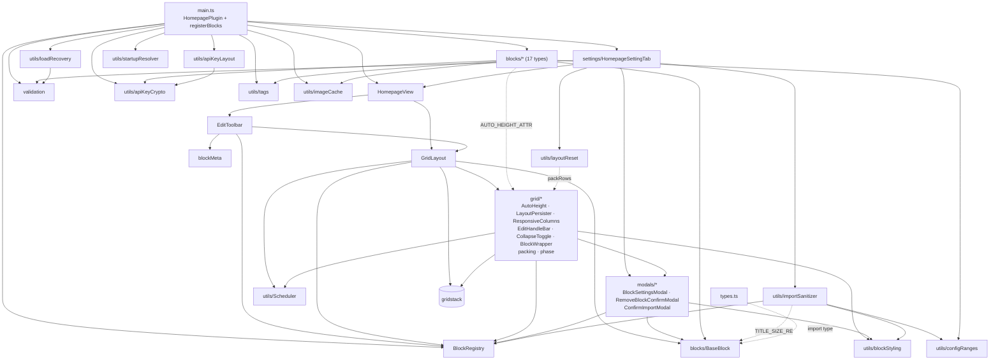
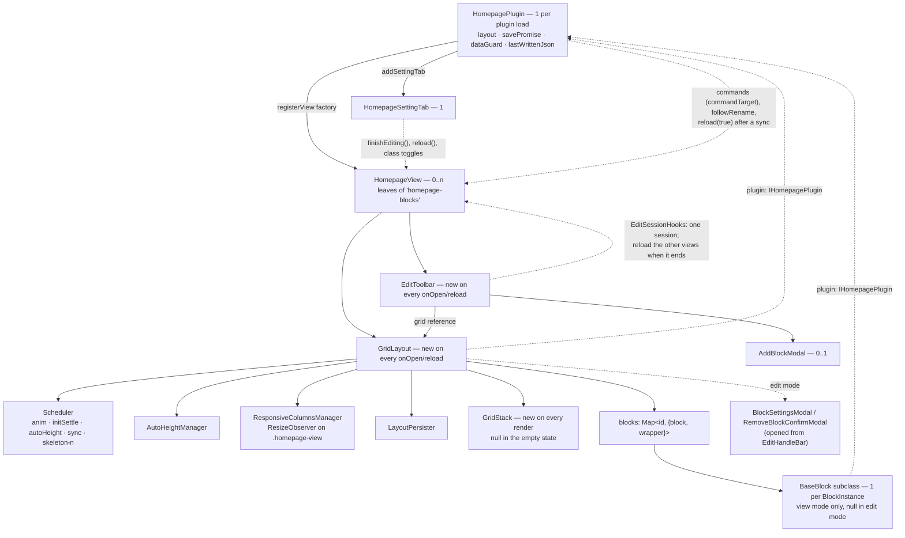
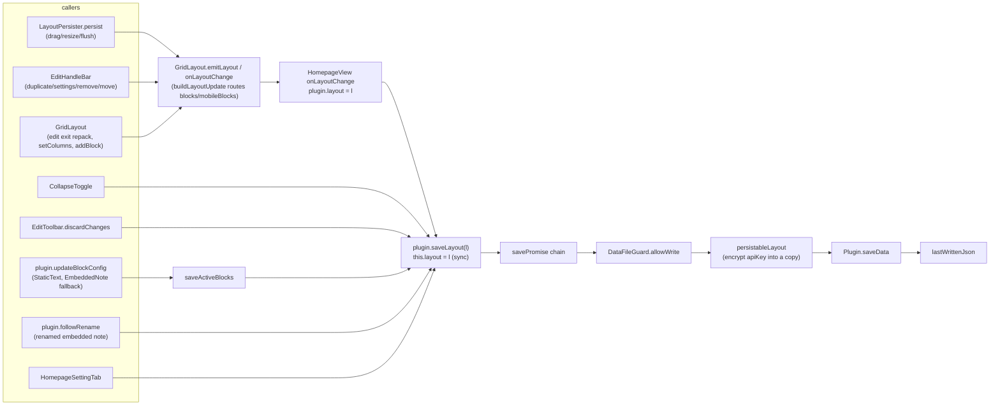

# Architecture

This page maps the codebase of **Homepage Blocks**, an Obsidian plugin (`manifest.json`: id `homepage-blocks`, version 1.4.0, `minAppVersion` 1.8.7, `isDesktopOnly: false`).

The plugin registers one custom view, `HomepageView` (`VIEW_TYPE = 'homepage-blocks'`, `src/HomepageView.ts:6`). The view renders a GridStack 12 grid of configurable **blocks**: clock, quotes, gallery, embedded note, voice notes, and 12 more. The whole layout is one `LayoutConfig` object. It lives in memory on the plugin and is persisted to the plugin's `data.json`.

Stack:
- TypeScript (`strict`)
- the Obsidian DOM API
- `gridstack`, the only runtime dependency (`package.json:27-29`)

esbuild bundles everything into `main.js`. There is no UI framework, and nothing in `src/` references Dataview.

## Documentation set

The index, with a reading order per task, is [README.md](README.md).

| Doc | Covers |
|---|---|
| [architecture.md](architecture.md) | This page: layers, module map, dependencies, runtime objects, state, where to add code |
| [data-model.md](data-model.md) | `LayoutConfig`, `BlockInstance`, defaults, validation, migration, `data.json`, API-key encryption, and the field-level rules of export, import, copy to mobile and reset |
| [flows.md](flows.md) | Load, save, startup/open modes, render, edit mode (Done, Discard, one session at a time), Add Block, block settings, auto-height, responsive columns, collapse, inline edit, export/import, external `data.json` changes |
| [blocks.md](blocks.md) | The 17 block types: config keys, rendering, reactivity, limits |
| [styling.md](styling.md) | `styles.css`, design tokens, shared `_` styling keys, container queries, snippet theming |
| [api/plugin.md](api/plugin.md) | `HomepagePlugin`, `IHomepagePlugin`, settings tab, persistence API |
| [api/blocks.md](api/blocks.md) | `BaseBlock`, `BlockFactory`, `BlockRegistry`, block helpers |
| [api/grid.md](api/grid.md) | `GridLayout`, `src/grid/*`, `EditToolbar`, modals |

---

## 1. Layers

Dependencies point downward. The table lists what each layer imports from the layers below it. Modules also import siblings in their own layer: `emojiPicker` → `emojis`, `loadRecovery` → `validation`, `apiKeyLayout` → `apiKeyCrypto`, `importSanitizer` → `BlockRegistry`/`blockStyling`/`configRanges`, every block → `BaseBlock`, `GridLayout` → `grid/*`, `EditHandleBar` → `modals/*`, `HomepageView` → `EditToolbar`. Section 1.1 lists the upward edges plus two notable downward ones.

| # | Layer | Modules | Imports from |
|---|---|---|---|
| 0 | Contracts | `types.ts`, `grid/phase.ts` | `obsidian` (the `App` type) |
| 1 | Leaf helpers (import nothing outside layers 0–1) | `utils/Scheduler`, `ids`, `urls`, `dailySeed`, `responsiveGrid`, `dragReorder`, `emojis`, `emojiPicker`, `noteContent`, `configRanges`, `voiceNote`, `timeout`, `pomodoroTimer`, `grid/packing` | 0, `obsidian` (`moment`, `normalizePath`, the `CachedMetadata` type) |
| 2 | Domain and shared services | `validation`, `BlockRegistry`, `blockMeta`, `utils/loadRecovery`, `apiKeyCrypto`, `apiKeyLayout`, `importSanitizer`, `layoutReset` (imports `grid/packing`), `startupResolver`, `blockStyling`, `tags`, `imageCache`, `FolderSuggestModal` | 0–1, `obsidian` |
| 3 | Blocks | `blocks/BaseBlock.ts` and 17 subclasses | 0–2, `obsidian` |
| 4 | Grid and modals | `GridLayout.ts`, `grid/*` (except `packing`, `phase`), `modals/*` | 0–3, `obsidian`, `gridstack` |
| 5 | View | `HomepageView.ts`, `EditToolbar.ts` | 0–4, `obsidian` |
| 6 | Plugin shell | `main.ts`, `settings/HomepageSettingTab.ts` | everything |

### 1.1 Edges that cross the layering

- **`types.ts` → `blocks/BaseBlock`.** This import is type-only: `import type { BaseBlock }` (`src/types.ts:2`). `BlockFactory.create` uses it as its return type.
- **Blocks → `grid/AutoHeight::AUTO_HEIGHT_ATTR`.** Six blocks import only this constant: ButtonGrid, EmbeddedNote, ImageGallery, QuotesList, RandomNote and StaticText.
- **`utils/importSanitizer` → `blocks/BaseBlock::TITLE_SIZE_RE`** (`src/utils/importSanitizer.ts:4`).
- **`settings/HomepageSettingTab` → `HomepageView`.** The settings tab uses the view class for `instanceof` checks, `finishEditing()`, `reload()` and live class toggles (`src/settings/HomepageSettingTab.ts:2, 59-63`).
- **`utils/layoutReset` → `grid/packing::packRows`** (`src/utils/layoutReset.ts:2`): `fitBlocksToColumns` packs the copies it makes for Copy to mobile and a phone reset.
- **`main.ts` → module-level cleanup functions in two blocks:**
  - `clearPomodoroState` and `closeSharedAudioCtx` (`src/blocks/PomodoroBlock.ts:26,31`)
  - `abortActiveLightbox` (`src/blocks/ImageGalleryBlock.ts:23`)
- **Nothing under `src/` imports `main.ts`.** Blocks, the view, the grid and the settings tab reach the plugin only through `IHomepagePlugin` (`src/types.ts:105-141`). The settings tab types its host as `Plugin & IHomepagePlugin` (`src/settings/HomepageSettingTab.ts:15`). The only importer of `main.ts` is a test: `tests/utils/importSanitizer.test.ts:6` imports `registerBlocks`.

---

## 2. Module map

`src/` holds 61 files and 11,455 lines. The stylesheet `styles.css` sits at the repo root (3,874 lines) and is covered in [styling.md](styling.md).

### Plugin shell

| File | Lines | Role |
|---|---|---|
| `src/main.ts` | 621 | Contains `registerBlocks()` (`:41-207`), which registers the 17 factories, and `commandTarget` (`:218-222`), which picks the homepage a command acts on. Also contains `HomepagePlugin` (`:230`), which handles load, recovery and decryption, commands, ribbon, the startup and open-when-empty hooks, the `IHomepagePlugin` accessors, the serialized save chain, `followRename` for renamed embedded notes (`:470-483`) and `onExternalSettingsChange` for a `data.json` changed by another device (`:510-531`). |
| `src/types.ts` | 141 | Defines `BLOCK_TYPES`, `BlockType`, `OpenMode`, `LayoutPriority`, `ResponsiveMode`, `BlockInstance`, `LayoutConfig`, `BlockFactory` and `IHomepagePlugin`. |
| `src/settings/HomepageSettingTab.ts` | 458 | The settings UI: startup (desktop and mobile), layout, display, reset, clipboard export and import, and copying the desktop layout to mobile. A layout setting goes through `applyLayoutChange`, which ends open edit sessions (`finishEditSessions`) and reloads the open homepages. |

### View

| File | Lines | Role |
|---|---|---|
| `src/HomepageView.ts` | 115 | The `ItemView`. Each `onOpen` builds a new `GridLayout` and `EditToolbar`, wires `onLayoutChange` to `plugin.saveLayout`, and passes the toolbar the `EditSessionHooks` that allow one edit session across views and reload the other views when it ends. `reload(fromSync)` ends an edit session as Done, then re-runs `onOpen`. |
| `src/EditToolbar.ts` | 320 | The pencil FAB and the edit toolbar (columns, zoom, "+ Add block", "✕ discard", "✓ done"). Exports `EditSessionHooks`. Holds the Discard snapshot of the blocks and the column count. Defines the private `AddBlockModal` (`:286`). |
| `src/blockMeta.ts` | 21 | `BLOCK_META`: icon and description per block type, for the add-block picker. |

### Grid

| File | Lines | Role |
|---|---|---|
| `src/GridLayout.ts` | 650 | Owns the GridStack lifecycle: render and teardown, `mountBlock`, edit mode, column changes, zoom, `addBlock`, write routing (`buildLayoutUpdate`, `:587`), and `holdDerivedPersist` (`:629`), which stops a grid redrawn after a sync from saving the positions it measures. |
| `src/grid/phase.ts` | 13 | `Phase`: a `const` object (`Destroyed` 0, `Initializing` 1, `Ready` 2) plus a type alias. It is not a TS `enum`. `LayoutPersister.persist` and the `dragstop`/`resizestop` handlers run only in `Ready`; `setEditMode`, `setColumns` and `addBlock` do nothing once `Destroyed`. The collapse toggle and the `EditHandleBar` writes do not check it. |
| `src/grid/AutoHeight.ts` | 169 | `AUTO_HEIGHT_ATTR` and `AutoHeightManager`. Measures marked content once per animation frame (rAF-batched) and calls `gridStack.update({h})`. |
| `src/grid/LayoutPersister.ts` | 162 | Reads GridStack nodes, diffs them against the active blocks, and emits the changed positions. Keeps the stored `h` of auto-height blocks and of collapsed blocks drawn at a display height (`nodeShowsStoredHeight`). Has a 50 ms debounced variant and re-packs the live nodes' `y`. |
| `src/grid/ResponsiveColumns.ts` | 212 | A `ResizeObserver` on `.homepage-view` that lowers the effective column count below 480, 768 and 1024 px, and asks auto-height blocks to measure again after narrowing. View mode only. |
| `src/grid/packing.ts` | 111 | Pure `packRows` (mutates in place) and `repackEditLayout` (returns a copy). |
| `src/grid/BlockWrapper.ts` | 117 | DOM builders for the card wrapper, skeleton overlay, edit-mode placeholder and empty state. |
| `src/grid/CollapseToggle.ts` | 88 | Header collapse and expand in view mode, by click, Enter or Space. Collapsing saves `collapsed: true` and `_expandedH`; expanding saves `collapsed: false` and `h`, restored from `_expandedH` when it is a number ≥ 1. |
| `src/grid/EditHandleBar.ts` | 252 | The edit-mode handle bar: grip, up/down, duplicate, settings, remove. `swapWithNeighbor` is module-private. |

### Modals

| File | Lines | Role |
|---|---|---|
| `src/modals/BlockSettingsModal.ts` | 422 | Four tabs (Header, Body, Card, Content) over a `structuredClone` draft of the config. Save replaces the whole config. |
| `src/modals/RemoveBlockConfirmModal.ts` | 33 | The "Remove block?" confirmation. |
| `src/modals/ConfirmImportModal.ts` | 55 | Confirms a clipboard import. Lists the imported active content (`findActiveContent`) and offers "Import all", "Import without content" and "Cancel" (`ImportChoice`). |

### Registry, validation, persistence policy

| File | Lines | Role |
|---|---|---|
| `src/BlockRegistry.ts` | 23 | Singleton `BlockRegistryClass` wrapping `Map<BlockType, BlockFactory>`, with `register`, `get`, `getAll` and `clear`. |
| `src/validation.ts` | 405 | `DEFAULT_LAYOUT_DATA`, `getDefaultLayout`, `validateLayout`, `validateBlocks` (which rebuilds each block from its known fields and keeps only a well-formed `collapsed`/`_expandedH`), `migrateBlockInstance`, `isValidBlockInstance`, the type guards, and `MAX_BLOCKS = 100`. |
| `src/utils/loadRecovery.ts` | 154 | `loadLayoutWithRecovery` and `DataFileGuard`. Copies an unusable file to `data.json.invalid[.<ms>]` and builds the load-problem Notice text. Used at load and by `onExternalSettingsChange`. |
| `src/utils/apiKeyCrypto.ts` | 262 | The AES-GCM-256 device key in IndexedDB, loaded once even under parallel first use (`inflightKey`). Provides `encryptStringEx`, `decryptStringEx` and `isEncrypted` (prefix `enc:v1:`). |
| `src/utils/apiKeyLayout.ts` | 173 | Layout-wide key handling: `persistableLayout`, `encryptApiKeys`, `decryptApiKeys` (returns a new layout), `unreadableKeyNotice`. |
| `src/utils/importSanitizer.ts` | 183 | The clipboard-import allowlist: declared `defaultConfig` keys, type-checked and clamped to `CONFIG_RANGES`, plus the shared `_` validators. Strips `apiKey` and `customCss`. `findActiveContent` and `withoutActiveContent` serve the import confirmation. |
| `src/utils/configRanges.ts` | 36 | `CONFIG_RANGES`, `clampConfigNumber`, `rangedNumber`: the bounds of numeric block settings, applied at import and where blocks read them. |
| `src/utils/layoutReset.ts` | 67 | `buildResetLayout`, `fitBlocksToColumns`, `DESKTOP_LAYOUT_FIELDS`, `MOBILE_LAYOUT_FIELDS`. |
| `src/utils/startupResolver.ts` | 37 | Pure `resolveStartup` and `mobileStartupActive`. |
| `src/utils/blockStyling.ts` | 213 | `applyBlockStyling` maps the shared `_` keys to classes and custom properties. Also holds `STYLE_RANGES`, `clampStyle`, `HEX_COLOR_RE` and the button-grid `customCss` allowlist. |

### Block support utilities

| File | Lines | Role |
|---|---|---|
| `src/utils/tags.ts` | 112 | `cacheHasTag`, `normalizeTag`, `getFilesWithTag` (returns a copy), and a module-level tag→files cache with per-file invalidation. |
| `src/utils/imageCache.ts` | 242 | The `imageCache` singleton. Stores WebP thumbnail blob URLs (or the original resource URL for small images, SVGs and videos), keyed by path and checked against mtime, with at most 600 entries evicted least recently used first. Galleries `retain` and `release` the URLs they show; a blob URL that leaves the cache while shown is revoked on its last release. |
| `src/utils/noteContent.ts` | 14 | `parseNoteInsight`: the first heading and the body text. |
| `src/utils/voiceNote.ts` | 75 | `voiceNotePath` (a voice note's folder and name: path-escape stripping, `..` refused, a number added when the name exists) and `buildNoteContent` (the note template, used only when `{{transcript}}` sits in plain text). |
| `src/utils/timeout.ts` | 16 | `withTimeout` and `RequestTimeoutError`: stop awaiting a promise after a delay (120 s for the transcription requests). |
| `src/utils/pomodoroTimer.ts` | 77 | The pure Pomodoro model: `PomodoroState` anchored to the clock (`endsAt`), `initialState`, `startOrPause`, `skip`, `advance`, `remainingMs`. |
| `src/utils/dailySeed.ts` | 17 | `dailyEpochDay` and `dailyIndex`, for picks that stay the same all day. |
| `src/utils/responsiveGrid.ts` | 8 | `responsiveGridColumns`: a `repeat(auto-fill, minmax(...))` column template. |
| `src/utils/dragReorder.ts` | 32 | `enableDragReorder`: HTML5 drag-and-drop reordering for lists in the settings UI. |
| `src/utils/emojiPicker.ts` | 162 | `createEmojiPicker`: a searchable emoji picker widget. |
| `src/utils/emojis.ts` | 348 | `EMOJI_PICKER_SET`: 335 `[emoji, keywords]` pairs. |
| `src/utils/FolderSuggestModal.ts` | 42 | A `SuggestModal<TFolder>` that picks a folder, the vault root included. |
| `src/utils/urls.ts` | 22 | `isDangerousUrl`: blocks the `javascript:`, `data:`, `vbscript:`, `file:` and `blob:` schemes. |
| `src/utils/ids.ts` | 9 | `newId()`: `crypto.randomUUID()`, or a `hp-…` fallback. |
| `src/utils/Scheduler.ts` | 40 | Named `window` timeouts and rAFs. Re-scheduling a name replaces the pending callback; `cancelAll()` clears everything. |

### Blocks

Every block extends `BaseBlock`, is registered in `registerBlocks()`, and has an entry in `BLOCK_META`. Details are in [blocks.md](blocks.md) and [api/blocks.md](api/blocks.md).

| File | Lines | Type | Role |
|---|---|---|---|
| `src/blocks/BaseBlock.ts` | 208 | — | Abstract `Component`. Provides `renderHeader`, `scheduleRender` (with an error hint when a re-render fails), `nextGeneration`/`isStale`, `requestAutoHeight`, `observeWidthForAutoHeight`, `liveConfig`, `hasUnsavedInlineState` and `renderContentSettings`. |
| `src/blocks/GreetingBlock.ts` | 386 | `greeting` | A time-of-day salutation (51 language presets), the user's name, an emoji and the time. |
| `src/blocks/ClockBlock.ts` | 83 | `clock` | A live time line and a date line. |
| `src/blocks/FolderLinksBlock.ts` | 292 | `folder-links` | Buttons for the files under a folder or glob, plus manual links. |
| `src/blocks/ButtonGridBlock.ts` | 147 | `button-grid` | A grid of emoji and label buttons that open vault links. The only block type whose config keeps `customCss` (`migrateBlockInstance` deletes it from the others). |
| `src/blocks/QuotesListBlock.ts` | 510 | `quotes-list` | Quotes from tagged notes or pasted text, shown as a list or (with `maxItems: 1`) a single quote picked daily or at random. |
| `src/blocks/ImageGalleryBlock.ts` | 508 | `image-gallery` | A grid or masonry view of the images and videos in a folder, with a lightbox (a module singleton). |
| `src/blocks/EmbeddedNoteBlock.ts` | 155 | `embedded-note` | One file rendered as Markdown. Renames are followed by `HomepagePlugin.followRename`; the block re-renders from `liveConfig()` and falls back to `updateBlockConfig` when the plugin missed one. |
| `src/blocks/StaticTextBlock.ts` | 177 | `static-text` | Markdown stored in the block's config, with an inline pencil editor. |
| `src/blocks/HtmlBlock.ts` | 146 | `html` | User HTML. It is sanitized inline, or rendered in a sandboxed iframe with a CSP when it contains `<style>`. |
| `src/blocks/VideoEmbedBlock.ts` | 168 | `video-embed` | A YouTube, Vimeo or Dailymotion iframe. |
| `src/blocks/BookmarkBlock.ts` | 129 | `bookmarks` | Link cards that open external http(s) URLs or vault paths. |
| `src/blocks/RecentFilesBlock.ts` | 115 | `recent-files` | Markdown files sorted by modification time. |
| `src/blocks/PomodoroBlock.ts` | 379 | `pomodoro` | A work and break timer on the wall clock (`utils/pomodoroTimer.ts`). The timer store and the `AudioContext` are module-level; a paused or running timer survives unmounts. |
| `src/blocks/SpacerBlock.ts` | 7 | `spacer` | An empty cell. |
| `src/blocks/RandomNoteBlock.ts` | 292 | `random-note` | A random or daily note carrying a tag, with cover, title and preview. |
| `src/blocks/VoiceDictationBlock.ts` | 793 | `voice-dictation` | Records audio, transcribes it with OpenAI Whisper or Google Gemini (120 s timeout), and saves a note through `utils/voiceNote.ts`. Includes a private `VoiceConsentModal` (`:745`). |
| `src/blocks/VaultSearchBlock.ts` | 275 | `vault-search` | Searches note names. The results dropdown is attached to the block's own document body and follows the input in that window. |

---

## 3. Dependency graph

These are the main module-level imports, from the `import` statements in `src/`. Edges into `types.ts` are omitted; most modules have one.

Notes:
- `EditHandleBar` is the only grid module that opens modals: `BlockSettingsModal` and `RemoveBlockConfirmModal` (`src/grid/EditHandleBar.ts:7-8`). It also creates a temporary block through the registry so the settings modal can render its Content tab.
- `BlockWrapper` is the only grid module that calls `applyBlockStyling` (`src/grid/BlockWrapper.ts:29`). The settings preview also calls it (`src/modals/BlockSettingsModal.ts:85`).
- The block-to-utility edges are specific:
  - `tags`: QuotesList and RandomNote.
  - `imageCache`: ImageGallery.
  - `apiKeyCrypto` (`isEncrypted` only): VoiceDictation.
  - `configRanges` (`rangedNumber`): Pomodoro, QuotesList and RecentFiles.
  - `voiceNote` and `timeout`: VoiceDictation. `pomodoroTimer`: Pomodoro.
  - `FolderSuggestModal`: FolderLinks, ImageGallery and VoiceDictation.
  - `emojiPicker`: Greeting, FolderLinks, ButtonGrid, and `BlockSettingsModal`.

---

## 4. Runtime object graph

### 4.1 Ownership and lifetimes

| Object | Created by | Lifetime | Holds |
|---|---|---|---|
| `HomepagePlugin` | Obsidian | Plugin load → unload | `layout` (in-memory authority), `savePromise`, `saveErrorNotified`, `dataGuard`, `lastWrittenJson` (what the last save wrote, so `onExternalSettingsChange` can skip it) (`src/main.ts:231, 428-430, 492`) |
| `HomepageView` | `registerView` factory (`src/main.ts:279`) | One per leaf. `openHomepage` reveals an existing leaf instead of creating a second one (`src/main.ts:601-605`). The commands act on one view, picked by `commandTarget` (`:218-222, 287-297, 373-375`). Only one view edits at a time. | `grid`, `toolbar`, `syncReload` (`src/HomepageView.ts:9-12`). The class defines no `getState`/`setState`. |
| `GridLayout` | `HomepageView.onOpen` (`:41`) | Until the next `onOpen`, `reload()` or `onClose` | GridStack, managers, the `blocks` map, `editMode`, `effectiveColumns`/`canonicalColumns`, `phase`, `derivedPersistHeld` (`src/GridLayout.ts:26-46`) |
| `EditToolbar` | `HomepageView.onOpen` (`:47-57`) | Same as `GridLayout` | `editMode`, `zoomScale`, `blocksSnapshot`, `columnsSnapshot`, the `EditSessionHooks`, `openModal`, `destroyed` (`src/EditToolbar.ts:19-24, 32, 204-206`) |
| Managers (`AutoHeightManager`, `ResponsiveColumnsManager`, `LayoutPersister`) | `GridLayout` constructor (`:62-67`) | Same as `GridLayout`. Each one keeps `host = this` and re-reads the host's fields on every call. | The auto-height pending queue; the `ResizeObserver` |
| `GridStack` | `initGridStack` (`src/GridLayout.ts:378-392`) | One `render()`. Destroyed in `teardown()` (`:326-330`). | The live node positions. During a drag these, not the layout, are the source of truth until `LayoutPersister` reads them back. |
| Block instances | `mountBlock` → `factory.create` (`src/GridLayout.ts:501`) | One `render()`. They are loaded with `block.load()` (`:503`) and unloaded with `block.unload()` in `teardown` (`:322`). They are **not** `addChild`ed to the view or the plugin. | A render-time `instance` snapshot, the header container, timers, vault listeners |
| Temporary settings block | `EditHandleBar` settings button (`src/grid/EditHandleBar.ts:106-114`) | While `BlockSettingsModal` is open. It is never `load()`ed. | Used only for `renderContentSettings` |
| Body-level DOM | The lightbox (`src/blocks/ImageGalleryBlock.ts:45`) and the vault-search dropdown (`src/blocks/VaultSearchBlock.ts:65`), each on the body of its block's own document | The lightbox lives until it is closed, the owning block unloads, or the plugin unloads. The dropdown lives as long as its block. | These elements sit outside `.homepage-view`, so view-scoped CSS tokens do not reach them (see [styling.md](styling.md)). |

Consequences of this object graph:

- **Every render recreates every block.** A render runs on `onOpen`/`reload()`, on entering or leaving edit mode, after an added block, and through `rerender()` after a column change, a duplicate, a move up/down, a block-settings save, or removing the last block. A drag, a resize or a collapse persists without re-rendering.
  - Per-instance state is lost each time, for example RandomNote's daily cache.
  - State that must survive a render lives in module singletons (Pomodoro `timerStore`) or in the layout. Pomodoro keeps a paused or running timer in the store across unmounts and drops only an idle one (`src/blocks/PomodoroBlock.ts:133-136`); a running phase is anchored to the clock, so it keeps counting while no block is mounted ([blocks.md](blocks.md), `pomodoro`).
- **Edit mode holds no block instances.** `mountBlock` renders placeholders (`src/GridLayout.ts:496-499`). While editing, block timers, vault listeners and live content are all stopped.
- **External rerenders are deferred while a block holds unsaved inline UI.** `rerender()` returns early if any block's `hasUnsavedInlineState()` is true (`src/GridLayout.ts:299-308`). `setEditMode` and `addBlock` render directly and bypass this guard (`:215-222, 284-295`); an open Static Text draft is saved as its block unloads.

### 4.2 Render pipeline (summary)

The full sequence is in [flows.md](flows.md).

1. `HomepageView.onOpen` → `GridLayout.render(activeBlocks(), activeColumns(), isInitial=true)` (`src/HomepageView.ts:63`).
2. `render` calls `teardown()` and sets `phase = Ready`. With zero blocks it calls `renderEmptyState` and stops there. Otherwise it calls `initGridStack` (`src/GridLayout.ts:136-162`).
3. `initGridStack` sets `phase = Initializing`, builds the widgets and optionally calls `packRows`. It then runs `GridStack.init` (with `cellHeight: 80`, `margin: 8`, `float: true`, `staticGrid: !editMode`) and `load`, and calls `mountBlock` for each block. After that it registers the `dragstart`/`dragstop`/`resizestop` handlers, runs `ResponsiveColumnsManager.setup`, and a rAF (`initSettle`) sets `phase = Ready` (`:340-459`).
4. `mountBlock` builds the wrapper (`buildBlockWrapper` → `applyBlockStyling`).
   - In view mode it continues with `factory.create`, `setHeaderContainer`, `load()`, `render(contentEl)`, and then, for an auto-height block, an auto-height request.
   - In edit mode it continues with `renderCompactPlaceholder` and `attachEditHandleBar`.
   - `attachCollapseToggle` runs in both modes (`:470-558`).

---

## 5. Where state lives

### 5.1 Persistent

| Store | Key / path | Contents | Written by | Read by |
|---|---|---|---|---|
| `data.json` in the plugin folder (`<manifest.dir>/data.json`, `dataFilePath`, `src/main.ts:489-492`) | — | One `LayoutConfig` with 21 fields. `apiKey` values are `enc:v1:<iv>:<ct>` ciphertext wherever encryption succeeded. | Only `Plugin.saveData`, inside the `saveLayout` chain (`src/main.ts:434-470`) | `loadData()` at `onload` (`:252`) and in `onExternalSettingsChange` (`:512`), and `readPriorLayout()` before an encrypting save (`:540-547`). On the recovery path, `loadLayoutWithRecovery` re-reads it through `vault.adapter.read` when `loadData()` returned `undefined`, and `backupDataFile` reads it to make the copy (`src/utils/loadRecovery.ts:48-49, 88`). |
| `data.json.invalid`, `data.json.invalid.<ms>` | Next to `data.json` | A verbatim copy of an unreadable or unusable `data.json` | `backupDataFile` (`src/utils/loadRecovery.ts:81-104`) | Nothing; kept for the user. Covered by `.gitignore` (`data.json.invalid*`). |
| IndexedDB | database `homepage-blocks-kv`, store `keys`, record `apiKeyDeviceKey` (`src/utils/apiKeyCrypto.ts:31-33`) | The non-extractable AES-GCM-256 `CryptoKey` for this device | `loadDeviceKey` on first use | `encryptStringEx` / `decryptStringEx`. The database name has no vault component. |
| localStorage through `App.loadLocalStorage` / `saveLocalStorage` (vault-scoped, per device; needs Obsidian 1.8.7) | `hp-unreadable-api-keys` (`src/main.ts:228`) | Ids of blocks whose key this device was already told it cannot read | `announceUnreadableKeys` (`src/main.ts:353-370`) | Same |
| Same | `hp-voice-consent` (`src/blocks/VoiceDictationBlock.ts:8`) | `{whisper?: boolean, gemini?: boolean}` | `setConsent` (true) and `forgetConsent` (false, the **Forget** button in block settings) (`:36-51`) | `hasConsent`, checked at each recording start and by the block settings; the consent modal appears only when it returns false |
| Obsidian workspace | — | The leaf with view type `homepage-blocks` | Obsidian | Obsidian. The view restores nothing else, because it has no view state. |

Behaviour of `data.json` worth knowing:
- **Resaved on launch.** `onload` calls `saveLayout` whenever `decryptApiKeys` reports `stable` (`src/main.ts:275-277`). The file is therefore rewritten in normalized form on each such start, unless `DataFileGuard` is holding writes back.
- **Reloaded when another device changes it.** Obsidian calls `onExternalSettingsChange` when `data.json` changes on disk from outside (`src/main.ts:513-545`). It waits for the save chain, ignores a deleted file and this device's own last write (`lastWrittenJson`, set after each `saveData`, `:449`), and runs `loadLayoutWithRecovery`: an unusable file is backed up as at load, and the loaded layout stays. While a homepage is in edit mode it changes nothing and shows a Notice. Otherwise it decrypts the keys, replaces `plugin.layout` and calls `reload(true)` on every homepage view. A view reloaded this way holds back the positions its grid measures until the next edit-mode switch (`GridLayout.holdDerivedPersist`), so two running devices with different pane widths do not keep rewriting each other's file. Flow: [flows.md](flows.md) §12.
- **Writes are held while a broken file lacks a backup.** `DataFileGuard.allowWrite()` retries the backup before each write and lets writes through once the copy exists or the file is gone (`src/utils/loadRecovery.ts:113-136`).
- **The disk copy is re-encrypted on every save when needed.** `persistableLayout` returns the layout unchanged when no plaintext key exists. On a device that decrypted its own key, memory holds plaintext, so every save reads `data.json` and re-encrypts the key with a fresh IV (`src/utils/apiKeyLayout.ts:16-37`). The comments at `src/main.ts:447-449` and `src/utils/apiKeyLayout.ts:25-27` say that drags skip this step, which is only true when no readable key is in memory.

Details are in [data-model.md](data-model.md).

### 5.2 In memory

| State | Owner | Notes |
|---|---|---|
| `plugin.layout` | `HomepagePlugin` | The authority for the running session. `saveLayout` assigns it **synchronously** before queuing the write (`src/main.ts:436`), so memory always leads the disk. `onExternalSettingsChange` replaces it with the layout another device wrote (`:529`). It holds plaintext `apiKey` wherever this device can decrypt. |
| Save queue | `HomepagePlugin.savePromise` (`src/main.ts:428`) | Writes run one at a time, in call order. Each queued write writes the layout object it was given. The chain swallows errors, reporting them with a Notice once until the next success, so `saveLayout` never rejects. |
| Active slice | `activeBlocks()`, `activeColumns()`, `activeLayoutPriority()` (`src/main.ts:379-393`) | `mobileBlocks`/`mobileColumns` when `Platform.isMobile && responsiveMode === 'separate'`, otherwise `blocks`/`columns`. |
| Startup slice | `activeOpenOnStartup()` … `activePin()` (`src/main.ts:402-424`) | Delegates to `resolveStartup`. It is gated on `separateStartup`, not on `responsiveMode`. |
| Render snapshot | `BaseBlock.instance` | Fixed at render time: never updated, though not `Object.freeze`d. After a block writes its own config with `updateBlockConfig`, read it back through `liveConfig()` (`src/blocks/BaseBlock.ts:48-50`). |
| Live grid positions | GridStack nodes | Copied into the layout by `LayoutPersister.persist()` on `dragstop`/`resizestop` (edit mode only), on a column change and on edit-mode exit (both only while editing), on edit-mode entry and on teardown (both only when a debounced `sync` persist is pending), and on debounced auto-height. The `EditHandleBar` remove handler also reads the compacted nodes itself. |
| Edit session | `EditToolbar.blocksSnapshot`, `columnsSnapshot` | A `structuredClone` of `activeBlocks()` and the active column count, taken on entering edit mode, after `grid.setEditMode(true)` (`src/EditToolbar.ts:69-70`). Discard writes both back. `followRename` rewrites the block snapshot of an open session (`mapSnapshot`). A `reload()` ends the session as Done first; closing the tab ends it without Done or Discard and keeps what the session already saved. One view edits at a time (`EditSessionHooks`). |
| DOM state | Classes on `.homepage-view`, the grid and the wrappers | For example `homepage-no-scrollbar`, `edit-mode`, `hp-single-column` and `block-collapsed`. See [styling.md](styling.md). |

### 5.3 Module singletons

Module state survives view reloads. Several singletons also survive a plugin disable and enable in the same renderer, which is why `onload` re-arms some of them.

| Singleton | Declared | Reset / cleanup |
|---|---|---|
| `BlockRegistry` (factory map) | `src/BlockRegistry.ts:23` | `BlockRegistry.clear()` at the start of `registerBlocks()` (`src/main.ts:42`). Not cleared on unload. |
| `imageCache` (`ImageCacheStore`: entries, pending work, `disposed`, per-URL `refs`, `orphans`) | `src/utils/imageCache.ts:31,242` | `imageCache.reset()` in `onload` (`src/main.ts:239`); `imageCache.destroy()` in `onunload` (`:338`) revokes every blob URL, orphans included, and clears the refs |
| `tagCache` and `listenersInstalled` | `src/utils/tags.ts:33-34` | `installTagCacheListeners` (`onload`, `src/main.ts:243`) clears `tagCache`; its `plugin.register` cleanup clears it again and resets `listenersInstalled`. `getFilesWithTag` returns a copy of the cached array (`:103-111`). |
| `timerStore` and `sharedAudioCtx` (Pomodoro) | `src/blocks/PomodoroBlock.ts:22-23` | `clearPomodoroState()` and `closeSharedAudioCtx()` in `onunload` (`src/main.ts:339-340`). A block's unload drops only an idle entry. |
| `activeLightbox` (one lightbox across all galleries) | `src/blocks/ImageGalleryBlock.ts:17` | `abortActiveLightbox()` in `onunload` (`src/main.ts:341`) and before each open |
| `cachedKey` (device `CryptoKey`) and `inflightKey` (the device-key load in progress, shared by parallel callers) | `src/utils/apiKeyCrypto.ts:36-38` | `inflightKey` clears itself when the load settles. `_resetDeviceKeyCache()` in `onunload` (`src/main.ts:345`) clears both. The IndexedDB record stays. |
| `skeletonSeq` (skeleton timer name counter) | `src/grid/BlockWrapper.ts:61` | Never reset; it is only a name counter. |

---

## 6. The write funnel

Every layout change reaches disk through `HomepagePlugin.saveLayout`. No other code calls `saveData`. The write paths are traced in [flows.md](flows.md).

One path changes `plugin.layout` without a save: `onExternalSettingsChange` assigns the layout another device wrote, which is already on disk (`src/main.ts:532-539`).

Rules this design depends on (see [api/plugin.md](api/plugin.md)):
- **Never mutate a `BlockInstance` or the layout in place.** Build new arrays and objects, then save. `buildLayoutUpdate` spreads the current `plugin.layout` and replaces only the active slice (`src/GridLayout.ts:587-601`).
- **Read through the `active*()` accessors; route grid writes through `buildLayoutUpdate`.** `updateBlockConfig` patches only the **active** platform array (`src/main.ts:577-597`). A change that must reach both arrays, such as a renamed note, is written by the plugin itself (`followRename`, `:470-483`).
- **A block writes its own config only through `plugin.updateBlockConfig`.** It must then re-read the config with `liveConfig()`. The `StaticTextBlock` inline editor is the reference implementation (`src/blocks/StaticTextBlock.ts:121-143`).

---

## 7. Build, test, lint

| Command | Effect |
|---|---|
| `npm run build` | esbuild bundles `src/main.ts` into `main.js` at the repo root: CJS, `es2022`, `obsidian`/`electron`/Node builtins external, `gridstack` bundled, no sourcemap, `drop: ['debugger']` (`esbuild.config.mjs:6-20`). |
| `npm run dev` | The same build in watch mode, with inline sourcemaps and without `drop` or `pure`. It also writes `main.js`. |
| `npx tsc --noEmit` | Type-checks `src/**/*.ts` only (`tsconfig.json:13`). Tests are not type-checked. |
| `npm test` / `npm run test:watch` | Runs Vitest in `happy-dom`. `obsidian` is aliased to `tests/__mocks__/obsidian.ts`. The setup file (`tests/setup.ts`) installs `fake-indexeddb` and the DOM helpers in `tests/obsidian-dom.ts` (`vitest.config.ts:5-17`). |
| `npx eslint src` | Lints `src/`. There is no lint script. `tests/**` cannot be parsed by the typed config, and `npx eslint .` fails on `esbuild.config.mjs`. |

Things to know before running these:
- **`main.js` is build output that is tracked in git.** The repository sits inside a vault's `.obsidian/plugins/` folder, so a build or a `dev` watch replaces the plugin that Obsidian loads from here.
- **The `pure` list does not remove console calls inside functions.** It lists `console.debug/log/info/trace` (`esbuild.config.mjs:18`), but without `minify` esbuild only annotates a call inside a function with `/* @__PURE__ */` and keeps it; tree shaking drops only unused top-level ones. `src/` currently contains no such calls.
- **The CSS is not bundled.** GridStack's core CSS is pasted at the top of `styles.css` (`styles.css:1-2`).

---

## 8. Where to add code

| Task | Touch | Notes |
|---|---|---|
| **New block type** | 1. `src/blocks/MyBlock.ts` (extends `BaseBlock`) 2. `BLOCK_TYPES` in `src/types.ts:4-10` 3. `registerBlocks()` in `src/main.ts:41-207` 4. `BLOCK_META` in `src/blockMeta.ts` 5. CSS in `styles.css` 6. Optionally `DEFAULT_LAYOUT_DATA` in `src/validation.ts:24-109` | `defaultConfig` must declare every key the block reads. It seeds new blocks and is the import allowlist. For auto-height, set `autoHeight: true` on the factory, set `AUTO_HEIGHT_ATTR` on the measured element, and add a branch to `GridLayout.shouldAutoHeight` (`src/GridLayout.ts:118-129`) only if a `heightMode` opts out. See [api/blocks.md](api/blocks.md). |
| **Block-specific setting** | The block's `renderContentSettings(body, draft)`, its factory `defaultConfig`, and for a number with a settings range `CONFIG_RANGES` (`src/utils/configRanges.ts:10-21`) | Mutate `draft` in place; `BlockSettingsModal` owns Save and Cancel. Keys must not start with `_`. Read a ranged number with `rangedNumber(type, config, key, fallback)`, so a value out of range (hand-edited, from an old version or a crafted import) is clamped where it is used. |
| **Block that edits its own config in place** | `plugin.updateBlockConfig`, `liveConfig()`, `hasUnsavedInlineState()` | Follow the `StaticTextBlock` pattern. |
| **Live vault reactivity in a block** | `this.registerEvent(...)` + `this.scheduleRender(ms, fn)` + `nextGeneration()`/`isStale()` | Set `this.containerEl = el` in `render`, or `scheduleRender` and `requestAutoHeight` do nothing. For tags, use `getFilesWithTag`/`cacheHasTag` from `src/utils/tags.ts`, and do not mutate the returned array. |
| **New shared `_` styling key** | 1. The tab renderer in `src/modals/BlockSettingsModal.ts` (`renderHeaderTab`/`renderBodyTab`/`renderCardTab`, `:136-398`) 2. `applyBlockStyling` (`src/utils/blockStyling.ts:83`) 3. `STYLE_RANGES` (`:13-23`) if the key is numeric 4. `SHARED_VALIDATORS` (`src/utils/importSanitizer.ts:42-64`) 5. CSS | Keys under `_` apply to every block type. See [styling.md](styling.md). |
| **New `LayoutConfig` field** | 1. `src/types.ts::LayoutConfig` 2. `DEFAULT_LAYOUT_DATA` 3. `validateLayout`: parse the field **and** add it to the returned object literal (`src/validation.ts:397-404`), or it is dropped on the resave that follows every load 4. The settings tab; a field that shapes the grid saves through `applyLayoutChange` 5. `DESKTOP_LAYOUT_FIELDS`/`MOBILE_LAYOUT_FIELDS` (`src/utils/layoutReset.ts`) only if a reset must replace it; every other field survives a reset | A per-platform startup field also needs an `IHomepagePlugin` accessor and a `resolveStartup` branch. Export and import carry the whole layout automatically. |
| **Migrate an old config or position format** | `migrateBlockInstance` (`src/validation.ts:131-222`) | This runs on every load and every import, so it must be idempotent. Add a case to `tests/validation.test.ts`. |
| **New command or ribbon action** | `HomepagePlugin.onload` (`src/main.ts:281-299`) | Actions on the view go through a `HomepageView` method that delegates to `EditToolbar` or `GridLayout`. `toggle-edit-mode` and `add-block` act on one homepage, picked by `commandTarget` (`:218-222`): the active one, else the one being edited, else the first; Add block goes to the one being edited. `open-homepage` reuses an existing leaf. |
| **New grid behaviour** | A new `src/grid/X.ts` that exports an `XHost` interface plus a manager or function | `GridLayout` satisfies host interfaces structurally and passes `this` (`src/GridLayout.ts:62-67`). Use named `GridLayout.scheduler` keys for timers so `teardown()` cancels them. Gate persistence on `Phase.Ready`. See [api/grid.md](api/grid.md). |
| **New module-level singleton** | The module itself, plus `HomepagePlugin.onunload` (`src/main.ts:337-346`) and, if needed, a re-arm in `onload` | Module state outlives views and can outlive a plugin reload in the same renderer. |
| **New settings-tab control** | `src/settings/HomepageSettingTab.ts` | A setting that shapes the grid saves with `applyLayoutChange(patch)`, which ends open edit sessions, saves and reloads the open homepages (`:65-70`). A display-only setting saves with `plugin.saveLayout({...plugin.layout, field})` and toggles view classes. An action that replaces the layout calls `finishEditSessions()` first. |
| **Tests** | `tests/<area>/X.test.ts` | Extend `tests/__mocks__/obsidian.ts` and `tests/obsidian-dom.ts` when code touches Obsidian APIs they do not cover. The shim provides `el.appendText`, `el.createSvg` and the global `createEl` (`tests/obsidian-dom.ts:84-107`); a global `activeDocument` is not provided. |

DOM rules for new code come from CLAUDE.md. `eslint-plugin-obsidianmd` checks some of them, and only on `src/`:
- no `innerHTML` or `eval`
- no bare `document`, `setTimeout` or `requestAnimationFrame`: use `el.doc`/`el.win`, `activeDocument` and `window.*` timers
- `console.warn`/`console.error` messages are prefixed `[Homepage Blocks]` (a convention; no rule checks it)
