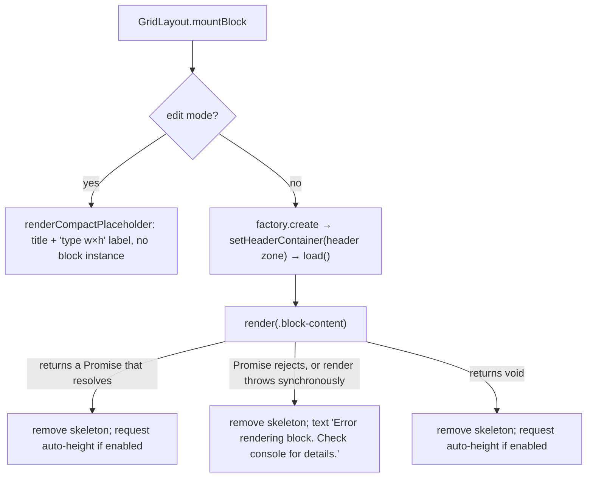
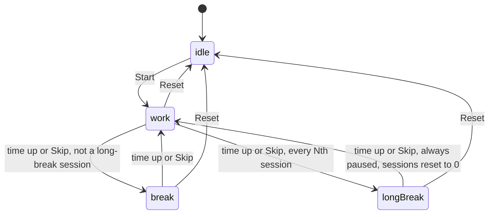
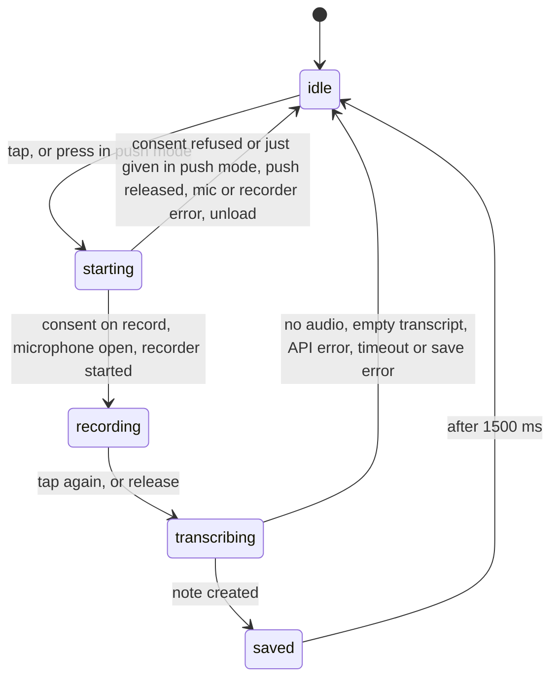

# Block catalogue

This page covers each of the 17 block types: what it shows, its config keys, what makes it re-render, how it sizes itself, its settings UI, what it sends over the network, and its known limits. It describes branch `xray-remediation` after the X-ray fixes of 2026-10-10. Paths are relative to the repo root.

Related pages:

| Topic | Page |
|---|---|
| The `BaseBlock` API | [api/blocks.md](api/blocks.md) |
| How the grid hosts blocks | [api/grid.md](api/grid.md), [architecture.md](architecture.md) |
| Shared `_`-prefixed styling keys | [styling.md](styling.md) |
| Persistence, migrations, API-key encryption | [data-model.md](data-model.md) |
| Render and save sequences | [flows.md](flows.md) |
| The plugin surface | [api/plugin.md](api/plugin.md) |

Where each block is defined:
- One `BaseBlock` subclass per type in `src/blocks/`.
- The type literal is listed in `BLOCK_TYPES` (`src/types.ts:4-10`).
- The factory is registered in `registerBlocks()` (`src/main.ts:41-207`).
- The add-block modal takes its icon and description from `BLOCK_META` (`src/blockMeta.ts:3-21`).

## Summary

| Type id | Display name | Class | Default size (w×h) | Auto-height | Live updates (debounce) |
|---|---|---|---|---|---|
| `greeting` | Greeting | `GreetingBlock` | 1×3 | no | 60 s timer |
| `clock` | Clock / date | `ClockBlock` | 1×3 | no | 1 s or 60 s timer |
| `folder-links` | Quick links | `FolderLinksBlock` | 1×3 | no | vault `create` / `delete` / `rename` in scope (150 ms) |
| `button-grid` | Button grid | `ButtonGridBlock` | 1×5 | always | none (re-measures on width change) |
| `quotes-list` | Quotes | `QuotesListBlock` | 2×3 | unless `heightMode: 'wrap'` | `metadataCache` `changed` when the tag matches or the note is shown, vault `delete` of `.md` (500 ms) |
| `image-gallery` | Image gallery | `ImageGalleryBlock` | 3×3 | unless `heightMode: 'fixed'` | vault `create` / `delete` / `rename` / `modify` of media in the folder (300 ms) |
| `embedded-note` | Embedded note | `EmbeddedNoteBlock` | 1×3 | only `heightMode: 'grow'` | vault `modify` / `delete` / `rename` of the file (300 ms); the plugin rewrites `filePath` on a rename (`followRename`) |
| `static-text` | Static text | `StaticTextBlock` | 1×3 | unless `heightMode: 'fixed'` | none |
| `html` | HTML block | `HtmlBlock` | 1×3 | no | none |
| `video-embed` | Video embed | `VideoEmbedBlock` | 2×4 | no | none |
| `bookmarks` | Bookmarks | `BookmarkBlock` | 2×3 | no | none |
| `recent-files` | Recent files | `RecentFilesBlock` | 1×4 | no | vault `modify` of `.md`; `create` / `delete` / `rename` of any file (500 ms) |
| `pomodoro` | Pomodoro timer | `PomodoroBlock` | 1×4 | no | 1 s display timer; the phase runs on the wall clock |
| `spacer` | Spacer | `SpacerBlock` | 1×2 | no | none |
| `random-note` | Random note | `RandomNoteBlock` | 1×4 | always | `metadataCache` `changed` when the tag matches or the note is the one shown (500 ms); vault `delete` / `rename` of `.md` (2000 ms) |
| `voice-dictation` | Voice notes | `VoiceDictationBlock` | 2×3 | no | none (elapsed timer only while recording) |
| `vault-search` | Vault Search | `VaultSearchBlock` | 2×2 | no | none (searches on input, 150 ms) |

"Auto-height" combines two things: the factory's `autoHeight: true` flag, and the per-type `heightMode` opt-out in `GridLayout.shouldAutoHeight` (`src/GridLayout.ts:118-129`).

### What leaves the device

| Type | Network or external access |
|---|---|
| `voice-dictation` | Uploads the recorded audio and the API key to OpenAI or Google, after a consent per provider on this device, which the block settings can withdraw |
| `video-embed` | Loads the provider's player iframe (YouTube, Vimeo, Dailymotion) with `referrerpolicy="no-referrer"` |
| `html` | In iframe mode, the CSP allows passive loads of images, media and fonts from `https:` and `data:`, with no referrer. In inline mode, whatever `sanitizeHTMLToDom` lets through, with no CSP or referrer policy from the plugin |
| `random-note` | Loads an `https://` cover image named in frontmatter, with no referrer |
| `bookmarks` | Opens an `http(s)` item in the system browser when clicked |
| `embedded-note`, `static-text` | Whatever the rendered Markdown references, through Obsidian's `MarkdownRenderer` |
| all others | Nothing |

## Conventions shared by all blocks

### Config defaults, fallbacks and import

- **Factory shape.** A factory is `{ type, displayName, defaultConfig, defaultSize, autoHeight?, create }` (`src/types.ts:90-103`).
- **New blocks.** A new block gets `config: structuredClone(factory.defaultConfig)` (`src/EditToolbar.ts:235`), so array defaults such as `links: []` and `items: []` are its own and not shared with the factory. The settings modal also edits a `structuredClone` draft (`src/modals/BlockSettingsModal.ts:51`).
- **Fallbacks.** Blocks read config through destructuring defaults. That fallback applies whenever a key is missing, which happens in:
  - default-layout blocks (`DEFAULT_LAYOUT_DATA`, `src/validation.ts:24-109`);
  - older `data.json` files;
  - hand-edited `data.json` files.
- **Reading the tables.** The config tables below list the factory default. Where the block's fallback differs from it, the fallback is shown in **bold** with its line.
- **Import checks.** Clipboard import goes through `sanitizeImportedConfig` (`src/utils/importSanitizer.ts:78-121`). It keeps a declared key only if the value has the JSON type of the declared default (`matchesDeclaredType`, `:19-28`):
  - a key declared `undefined` accepts any string, number or boolean;
  - an array default accepts any array;
  - a number must be finite.
- **What import strips or skips.**
  - Undeclared keys are stripped, except `_`-prefixed ones: a known shared key goes through its validator in `SHARED_VALIDATORS` (`:42-64`), and an unknown `_` key is kept when its value is a string, number or boolean (`:91-111`).
  - `apiKey` and `customCss` are always stripped (`:11`).
- **Numeric ranges.** A declared number is rounded and clamped to its range in `CONFIG_RANGES` when the type and key have one (`clampConfigNumber`, `src/utils/configRanges.ts:10-29`; applied at `src/utils/importSanitizer.ts:114`). The table holds the ranges the settings controls offer: `columns` of `button-grid` and `bookmarks` (1–3), `quotes-list` `columns` (1–3) and `maxItems` (0–500), `image-gallery` `columns` (2–7) and `maxItems` (0–500), `recent-files` `maxItems` (5–20), and the four `pomodoro` durations and counts. The shared numeric `_` keys are clamped to `STYLE_RANGES` instead.
- **Clamped again at read.** `quotes-list`, `recent-files` and `pomodoro` read those numbers through `rangedNumber(type, config, key, fallback)` (`src/utils/configRanges.ts:31-36`), which clamps a finite number and returns the fallback for anything else. So a hand-edited or old `data.json` cannot push them out of range either. `button-grid`, `bookmarks` and `image-gallery` clamp in their own render code.
- **Not checked.** Array elements are not checked: the shapes inside `links[]` and `items[]` pass import unchanged, and load-time validation does not check config values.

See [data-model.md](data-model.md) for the migrations `migrateBlockInstance` applies at load time (`src/validation.ts:131-222`).

### Mount and render

- **Rendering target.** The `el` passed to `render` is `.block-content`. The header goes into `.block-header-zone`, which sits outside it (`src/grid/BlockWrapper.ts:36-47`).
- **Wrapper.** The wrapper carries the classes `homepage-block-wrapper hp-block-<type>` and the shared styling from `applyBlockStyling` (`:20-29`).
- **Skeleton.** The skeleton overlay is created only on the initial render (`src/GridLayout.ts:519`). It stays until an async render settles, so a block whose `render` awaits slow work keeps the overlay up; the image gallery is one.
- **Error handling inside blocks.** Several blocks catch their own render failure and call `renderErrorHint`, which draws a `.block-empty-hint.block-error-hint` (`src/blocks/BaseBlock.ts:89-94`). These are `quotes-list`, `image-gallery`, `embedded-note`, `static-text` and `random-note`. For them, GridLayout's fallback text shows only when something escapes that handler. A live re-render that fails shows an error hint for every block (see [Live updates](#live-updates)).
- **Teardown.** Every render (a settings save, a column change, an added, duplicated or moved block, an edit-mode toggle, a view reload) unloads all block instances (`src/GridLayout.ts:321-323`). Anything not in config or in a module-level store is lost.
  - `GridLayout.rerender()` does nothing while any block's `hasUnsavedInlineState()` returns true (`:299-308`).
  - Entering or leaving edit mode (`:222`) and adding a block (`:294`) render directly and skip that guard.
- **Edit mode.** Edit mode never mounts or renders blocks; the only instance it creates is the temporary one behind the settings modal, which is never loaded or rendered (see [Settings](#settings)). Timers, vault listeners, recordings and lightboxes belong to the view-mode instances, which are unloaded.

### Header

`renderHeader(el, title)` (`src/blocks/BaseBlock.ts:60-81`) reads `this.instance.config`, the render-time snapshot:
- The label is `_titleLabel.trim()`, or `title` if that is blank.
- The header is hidden when `_showTitle === false`.
- `_titleSize` `h1`–`h6` adds the class `block-header-hN`.
- `_titleEmoji` is placed before the label.

Blocks that never call `renderHeader`:
- `greeting`, `clock` and `spacer` never call it. For these, the label keys `_titleLabel`, `_titleEmoji` and `_titleSize` have no effect in view mode, and `_showTitle` only decides whether a collapsed block is drawn collapsed (`src/grid/BlockWrapper.ts:23`). The other Header-tab keys act on the wrapper and still apply: `_showDivider` adds the divider (`src/grid/BlockWrapper.ts:44-46`) and `_titleGap` sets the card gap. The edit-mode placeholder does show `_titleLabel` and `_titleEmoji`, but it ignores `_showTitle` and `_titleSize` (`src/grid/BlockWrapper.ts:82-89`).
- `embedded-note` calls it only when `showTitle` is on: with the file's basename, or with `'Embedded note'` when no path is set or the file is missing (`src/blocks/EmbeddedNoteBlock.ts:68-86`).

### Settings

- **Content tab.** The Content tab of `BlockSettingsModal` calls `block.renderContentSettings(body, draft)` (`src/modals/BlockSettingsModal.ts:401-411`). The draft is a `structuredClone` of the config, and Save replaces the whole config.
- **No content settings.** A block that renders nothing into the Content tab gets the text "This block has no content settings." (`spacer`).
- **Where settings open from.** The modal opens only from the edit-mode handle bar. Edit mode has no block instances, so a temporary instance is created for the modal and unloaded when it closes (`src/grid/EditHandleBar.ts:106-131`).
- The shared Header, Body and Card tabs are described in [styling.md](styling.md).

### Auto-height

| Type | Measured element (`data-auto-height-content`) | Active when |
|---|---|---|
| `button-grid` | `.button-grid` | always |
| `quotes-list` | `.quotes-columns` (list mode) or `.insight-card` (single mode, tag source) | `heightMode !== 'wrap'` |
| `image-gallery` | `.image-gallery` | `heightMode !== 'fixed'` |
| `embedded-note` | `.embedded-note-content` | `heightMode === 'grow'` |
| `static-text` | `.static-text-content` / `.static-text-inline-editor` | `heightMode !== 'fixed'` |
| `random-note` | `.random-note-body` (the card inside `.block-content`), only while a note is shown | always |

- **Measurement.** `AutoHeightManager` measures the first `[data-auto-height-content]` element in the grid item and sets the row count with `gridStack.update` (`src/grid/AutoHeight.ts:103-168`).
- **When it does nothing.** It skips collapsed blocks (`:112-113`). It also does nothing when the grid has a single column (`effectiveColumns === 1`, `:66-69`).
- **What triggers a re-measure:**
  - the initial render;
  - every `scheduleRender` run;
  - an explicit `requestAutoHeight()`;
  - `observeWidthForAutoHeight`, which fires on width changes and once on the first observation, because `prevWidth` starts at 0 (`src/blocks/BaseBlock.ts:167-185`);
  - a responsive column change: a narrowing to two or more columns re-requests every auto-height block (`src/grid/ResponsiveColumns.ts:193-200`), and so does a return to the canonical column count (`:171`).

The mechanism is detailed in [api/grid.md](api/grid.md).

### Live updates

`scheduleRender(delayMs, fn)` (`src/blocks/BaseBlock.ts:130-154`):
- **One timer per block.** A new call replaces the pending one, so a block with two delays (random-note) waits the delay of the latest call.
- **Detached blocks.** It skips the run when `containerEl` is no longer connected.
- **Afterwards.** Once `fn` finishes, it requests auto-height.
- **Errors.** A synchronous throw and an async rejection are both caught. Each is logged as `[Homepage Blocks] <Class> re-render failed:`, and `renderErrorHint` replaces the content with "Couldn’t refresh this block — check the console for details." (`:136-147`). Re-render functions empty the element first, so without the hint the card would stay blank.

Listeners exist only while the block is mounted in view mode on an open homepage.

---

## `greeting` — Greeting

Source: `src/blocks/GreetingBlock.ts`. It shows a time-of-day salutation, the user's name, an optional emoji and an optional `HH:mm` time.

| Key | Type | Default | Meaning |
|---|---|---|---|
| `name` | string | `'World'` (fallback **`'bentornato'`**, `:198`) | Name after the salutation |
| `showTime` | boolean | `true` | Show the `HH:mm` line |
| `showEmoji` | boolean | `true` | Show the emoji line |
| `emojiMode` | `'auto'` \| `'custom'` \| `'random'` | `'auto'` | `auto`: default emoji per time slot. `custom`: emoji per slot. `random`: pick from the pool |
| `emojiMorning`, `emojiAfternoon`, `emojiEvening`, `emojiNight` | string | `undefined` | Custom mode. A blank value falls back to `DEFAULT_EMOJIS` (sun, sun behind cloud, city at dusk, crescent moon; `:97-102`, `:148`) |
| `emojiPool` | string | `''` | Random mode. Split on whitespace or commas (`:163-167`) |
| `emojiDailySeed` | boolean | `false` | Random mode: one pick per day via `dailyIndex` (`:154-156`) |
| `salutationMode` | `'auto'` \| `'custom'` | `'auto'` | Language preset or custom text |
| `salutationPreset` | string | `'it'` | Key into `LANG_PRESETS`, which has 51 languages (`:35-87`). An unknown key falls back to Italian (`:132-133`) |
| `salutMorning`, `salutAfternoon`, `salutEvening` | string | `undefined` | Custom mode. A blank value falls back to the selected preset (`:127-134`) |

**Rendering** (`:176-211`)
- `.greeting-block` contains `.greeting-emoji`, then `.greeting-name` (made of `span.greeting-salut` "Salutation, " and `span.greeting-user`), then `.greeting-time`.
- `tick()` runs once at render and then every 60 s via `registerInterval`.
- Time slots:
  - Emoji (`timeSlot`, `:104-109`): morning 5–12, afternoon 12–17, evening 17–21, night 21–5.
  - Salutation (`salutSlot`, `:111-115`): morning 5–12, afternoon 12–18, evening 18–5.
- `.block-content.greeting-block` is `container-type: size` (`styles.css:635-643`).

**Live updates:** the timer only. **Auto-height:** none. **Network:** none.

**Settings** (`:213-385`)
- Name, which shows `'bentornato'` when unset.
- Show time.
- "Salutation" section:
  - Mode dropdown: Language preset or Custom text.
  - Preset mode: a Language dropdown sorted by label, plus a preview line.
  - Custom mode: three text fields labelled with their slot times. They are pre-filled with the Italian defaults (`:262-276`), although at runtime a blank slot falls back to the *selected* preset.
- "Emoji" section:
  - Show emoji.
  - Emoji mode: Auto (time of day), Custom per slot, or Random pool.
  - Custom: four emoji pickers. Clearing one stores `''`, which renders the default emoji.
  - Random: a chip list with a delete button per chip and an add picker; the pool is stored space-joined. A "Same emoji all day" toggle sets `emojiDailySeed`.

**Limits**
- **Header settings.** The block never calls `renderHeader`, so `_titleLabel`, `_titleEmoji` and `_titleSize` do nothing in view mode (see [Header](#header) for the keys that still apply).
- **Clock drift.** The 60 s interval is not aligned to the minute, so the time shown can lag by up to about 60 s (`:191`).
- **Random emoji.** In random mode without the daily seed, `Math.random` runs on every tick, so the emoji changes every minute (`:157`, `:201`).
- **Slot boundaries.** The emoji and salutation tables split the afternoon differently (17:00 and 18:00).
- **Settings leak.** Each pool re-render adds a new add-picker to `slotPickers` without destroying the previous one (`:344-372`).

## `clock` — Clock / date

Source: `src/blocks/ClockBlock.ts`. It shows a live time line and an optional date line.

| Key | Type | Default | Meaning |
|---|---|---|---|
| `showSeconds` | boolean | `false` | Uses `HH:mm:ss` and a 1 s interval |
| `showDate` | boolean | `true` | Shows the date line, format fixed as `'dddd, D MMMM YYYY'` (`:54`) |
| `clockStyle` | `'minimal'` \| `'centered'` \| `'large'` \| `'accent'` | `'minimal'` | Adds the class `clock-style-<x>`. A value that fails `in CLOCK_STYLES` becomes `minimal` (`:25`) |
| `format` | string | `''` | Moment format for the time line. Blank gives `HH:mm` or `HH:mm:ss` (`:47-51`) |

**Rendering:** `.clock-block.clock-style-<style>` containing `.clock-time` and `.clock-date` (`:17-36`).

**Live updates:** `registerInterval` fires every `showSeconds ? 1000 : 60_000` ms (`:34-35`). **Auto-height:** none. **Network:** none.

**Settings** (`:58-82`): Style, Show seconds, Show date, Custom format ("Moment.js format string. Leave blank for default.").

**Limits**
- **Header settings.** The block never calls `renderHeader`, so the header label settings have no view-mode effect (see [Header](#header)).
- **Update interval.** The interval follows `showSeconds`, not `format`. A custom format that includes seconds, with `showSeconds: false`, updates once a minute. The 60 s interval is not aligned to the minute.
- **Style check.** The `in` check also accepts inherited keys, so `toString` yields the harmless class `clock-style-toString`.

## `folder-links` — Quick links

Source: `src/blocks/FolderLinksBlock.ts`. It shows buttons for the files found under a folder or glob, followed by manual links.

| Key | Type | Default | Meaning |
|---|---|---|---|
| `_titleLabel` | string | `'Quick links'` | Header label. With no label set, the header reads **`'Folder links'`** (`:112`) |
| `folder` | string | `''` | Folder path or glob to auto-list |
| `folderEmoji` | string | `''` | Emoji shown before each auto-listed file |
| `links` | `{ label, path, emoji? }[]` | `[]` | Manual links |
| `linkAlign` | `'left'` \| `'center'` \| `'right'` | `'left'` | Adds the class `folder-links-align-<x>`. An invalid value becomes `left` (`:109`) |

**Glob handling** (`parseFolderPattern`, `:34-48`; `globToRegex`, `:50-71`)
- The input is trimmed and trailing `/` is removed.
- Without `*` or `?`, the whole string is the folder and every file under it matches.
- With a wildcard, the static prefix is everything before the last `/` that precedes the first wildcard.
- Pattern syntax:
  - `**` matches across folders and absorbs a following `/`.
  - `*` matches within one path segment.
  - `?` matches one character within a segment.
  - Every other character is literal, so `[...]` and `{a,b}` are not special.
- Matching is anchored and case-insensitive, against the path relative to the prefix.

**Rendering** (`renderContent`, `:101-181`, synchronous)
- **First render.** It is deferred with `workspace.onLayoutReady` (`:98`).
- **Auto-list.** It collects every `TFile` under the folder recursively, of any extension (`getNotesInFolder`, `:184-194`). The files are filtered by the glob, sorted by `basename`, and rendered as `button.folder-link-btn`. A click calls `openLinkText(path, '')`.
- **Manual links.** A manual link is checked with `isDangerousUrl` first. A dangerous link shows the Notice "Homepage blocks: blocked an unsafe link." (`:164-173`).
- **Messages:**
  - "Vault root listing is not supported. Select a subfolder." (input `/`)
  - `Folder "<x>" not found.`
  - `No notes matching "<input>".` or `No notes in "<path>".`
  - Empty hint "No links yet. Add manual links or pick a folder in settings."

**Live updates** (`:82-95`)
- `create` and `delete` trigger when the file is under the static prefix.
- `rename` triggers when the new or the old path is under the prefix.
- The debounce is 150 ms.
- When the prefix is `''`, every vault create, delete and rename triggers a re-render. That includes blocks that have manual links only; for a glob rooted at the vault root, each re-render rescans the whole vault.

**Auto-height:** none. **Network:** none from the block.

**Settings** (`:196-291`)
- Link alignment.
- Auto-list folder: a text field (placeholder `Projects/*.md`) with a browse button that opens `FolderSuggestModal`. The vault root is stored as `''`.
- Folder link emoji picker.
- "Manual links": rows with drag reorder, Label, Path, remove, and an emoji picker. An "Add link" button follows.

**Limits**
- **No cap.** The number of listed files is not capped.
- **Root globs.** A glob rooted at the vault root, such as `**/*.md`, gets past the root guard and scans the whole vault (`:121-126`).
- **File types.** Non-note files are listed too; folders never are.
- **Malformed links.** A `null` element in `links` makes `renderContent` throw. Inside `scheduleRender`'s timer the throw becomes the "Couldn’t refresh this block" hint.

## `button-grid` — Button grid

Source: `src/blocks/ButtonGridBlock.ts`. It shows a grid of emoji and label buttons, each of which can open a vault link.

| Key | Type | Default | Meaning |
|---|---|---|---|
| `_titleLabel` | string | `'Button grid'` | Header label. With no label set, the header reads **`'Buttons'`** (`:25`) |
| `columns` | number | `2` | Clamped to 1–3 at render (`:28`). The load migration also clamps values above 3 to 3 (`src/validation.ts:198-201`) |
| `items` | `{ emoji, label, link? }[]` | `[]` | Buttons. With no `link`, a button is inert (class `hp-cursor-default`) |
| `customCss` | string | not declared (`src/main.ts:78-80`) | `--hp-btn-*` declarations, applied to the **wrapper** by `applyBlockStyling`, not by the block |

**Rendering** (`:15-59`)
- `.button-grid` gets an inline `--hp-grid-cols: repeat(N, 1fr)`, the auto-height marker, and `observeWidthForAutoHeight`.
- A button with a link is gated by `isDangerousUrl` and then calls `openLinkText(link, '')`.
- With no items, the block shows an empty hint.

**The `customCss` pipeline** (`src/utils/blockStyling.ts:52-106`)
1. Comments are stripped and the text is split on `;`.
2. Only keys matching `^--hp-btn-[a-z0-9-]+$` are kept.
3. A value is rejected if it contains `url(`, `image(`, `image-set(`, `cross-fade(`, `element(`, `paint(`, or a control character.
4. Kept values are applied with `setProperty`. Their keys are tracked in `data-hp-custom-css-keys`, so the next render can remove stale ones.

The variables the stylesheet reads are `--hp-btn-bg`, `-border`, `-radius`, `-padding`, `-color`, `-shadow`, `-gap`, `-hover-bg`, `-hover-border-color`, `-hover-transform`, `-hover-shadow`, `-active-transform`, `-active-shadow` and `-emoji-size` (`styles.css:1519-1562`).

`customCss` never travels outside the block:
- It is deleted on export (`src/settings/HomepageSettingTab.ts:385,389`).
- It is stripped on import (`src/utils/importSanitizer.ts:11`).
- It is removed from any other block type at load (`src/validation.ts:206-208`).

**Live updates:** none. **Auto-height:** always. **Network:** none, and `url()` values are rejected.

**Settings** (`:61-146`)
- Columns: 1, 2 or 3.
- "Custom CSS": a full-width textarea, `maxLength` 4096.
- "Items": each row has drag reorder, an emoji picker, Label, "Note path (optional)" (empty stores `undefined`), and delete. A "+ add item" button follows.

**Limits**
- **Narrow blocks do not collapse.** The `@container (max-width: 250px)` rule sets `--hp-grid-cols: 1fr` (`styles.css:1566-1570`). The inline `--hp-grid-cols` set by the block (`:29`) overrides it, so the one-column collapse never happens.
- **Default layout.** The six "Quick actions" buttons in the default layout have no `link`, so none of them does anything (`src/validation.ts:71-86`).

## `quotes-list` — Quotes

Source: `src/blocks/QuotesListBlock.ts`. It shows quotes taken from notes with a tag, or from text typed into the settings. It has a list mode and a single-quote mode.

| Key | Type | Default | Meaning |
|---|---|---|---|
| `_titleLabel` | string | `'Quotes'` | Header label (the default title is also `'Quotes'`, `:112`) |
| `source` | `'tag'` \| `'text'` | `'tag'` | Tagged notes or manual text |
| `tag` | string | `''` | Tag, with or without `#` (`normalizeTag`) |
| `quotes` | string | `''` | Manual quotes, separated by a line containing only `---`. A last line starting with `—`, `–` or `--` becomes the source |
| `maxItems` | number | `20` (fallback `20`, `:107`) | `1` selects single mode, `0` shows all, `n` shows the first `n`. Read through `rangedNumber`, clamped to 0–500 |
| `dailySeed` | boolean | `true` | Single mode: the same pick all day (`dailyIndex`) instead of `Math.random` |
| `columns` | number | `2` | Maximum number of columns. Read through `rangedNumber`, clamped to 1–3 (`:106`) |
| `heightMode` | `'wrap'` \| `'extend'` | `'extend'` | `wrap`: scroll inside a 500 px maximum. `extend`: auto-height |
| `quoteStyle` | `'classic'` \| `'centered'` \| `'card'` | `'classic'` | List-mode style classes |
| `showAccentBar` | boolean | `true` | `false` adds `quote-no-accent` |
| `showNoteTitle` | boolean | `true` | Tag source: show the note name (list) or the title (single) |
| `textAlign` | `'left'` \| `'center'` \| `'right'` | `'left'` | Sets `--hp-quote-align` (`:110`), which `.quote-item` and `.insight-card` use as `text-align` (`styles.css:1706-1711`). The centered quote style keeps its own, more specific `text-align` |
| `verticalAlign` | `'top'` \| `'middle'` \| `'bottom'` | `'top'` | Sets `--hp-quote-valign` |
| `fontStyle` | `'default'` \| `'serif'` \| `'handwriting'` | `'default'` | Adds `quote-font-serif` or `quote-font-handwriting` |
| `customFont` | string | `''` | Trimmed and cut to 64 characters. It must match `^[a-zA-Z0-9\s,'\-_]+$` and then becomes `--hp-quote-font` (`:130-133`) |

The default layout's "Daily insight" block sets `maxItems: 1`, so it shows one note per day (`src/validation.ts:66-71`).

**Modes** (`loadAndRender`, `:97-286`)

| `maxItems` | `source: 'tag'` | `source: 'text'` |
|---|---|---|
| `1` | One tagged note: the first heading (or the basename) plus the **whole** body from `parseNoteInsight` | One quote, from `renderSingleTextQuote` |
| `0` | Every tagged note, showing the first 3 body lines of each | Every quote |
| `n > 1` | The first `n` tagged notes | The first `n` quotes |

- **Formatting.** Inline formatting covers only `**bold**` and `#hashtag`, via `renderFormatted` (`:29-44`). Other Markdown is shown as raw text.
- **List body.** The body of each tagged note in list mode (`extractBody`, `:357-365`) is its first 3 non-empty lines after the frontmatter that do not start with `#`, joined by spaces.
- **Colour.** A frontmatter `color` value is capped at 64 characters. If it matches `COLOR_RE` (`:12`), it becomes `--hp-quote-color` and the class `quote-colored` is added.
- **Columns.** A `ResizeObserver` sets `--hp-column-count = max(1, min(columns, floor(width / 200)))`. It is skipped for the centered style (`:210-223`). Its one cleanup is registered in `render`, not in `loadAndRender`, which runs again on every live update (`:72-73`).
- **Shown notes.** Each render records the paths of the notes it shows in `shownPaths` (`:99`, `:169`, `:247`).
- **Errors.** A render failure shows `renderErrorHint` with "Couldn’t load quotes — check the console for details." (`:91-94`).

**Live updates** (`:78-89`)
- They apply only when `source !== 'text'` and `tag` is set.
- `metadataCache` `changed` triggers when the file's **new** cache has the tag, or when the file is one the block shows (`shownPaths`), so a shown note that loses the tag leaves the block (`:82`).
- A vault `delete` of any `.md` file triggers.
- The debounce is 500 ms, and each run empties the block and re-reads every selected note.

**Auto-height**
- On unless `heightMode === 'wrap'`.
- List mode marks `.quotes-columns` and observes its width.
- Single mode with a tag source marks `.insight-card`, in extend mode only (`:185-189`).
- In wrap mode, `.quotes-columns` has `max-height: 500px; overflow-y: auto` (`styles.css:1588-1594`) and gets `tabindex=0`, `role=region`. A later rule keeps `overflow-y: auto` against the wrapper's default clip of `.block-content` children, so the list scrolls (`styles.css:2507-2515`).

**Network:** none.

**Settings** (`:367-509`)
- Source: "Notes with tag" or "Manual text". The choice toggles two hidden sections:
  - Tag section: Tag, Show note title.
  - Text section: an 8-row textarea.
- Max quotes: blank or ≤ 0 stores `0` ("All"); any other value is capped at 500.
- Daily seed: shown only when `maxItems === 1`.
- Columns: 1, 2 or 3.
- Height mode: "Scroll (fixed height)" or "Grow to fit all".
- Quote style, Show accent bar, Text alignment, Vertical alignment, Font style, Custom font.

**Limits**
- **Missing `maxItems`.** A block without a `maxItems` key, as in a hand-edited `data.json` or one written by an older version, renders up to **20** items while the settings field shows it blank ("All"). An older default layout's "Daily insight" block has no `maxItems`, so it renders as a list until `maxItems` is set to 1.
- **Single mode with text source.** This combination never sets the auto-height marker (`:143-146` returns early), so `extend` has no effect and the block keeps its stored height. The tag source's "no tag" and "no files" branches also return before the marker is set (`:149-162`).
- **Vertical alignment.** `--hp-quote-valign` is read only by `.insight-card` (`styles.css:1020`), so vertical alignment affects single mode only.
- **Quote separator.** Quotes split only on the exact sequence `\n---\n` (`:297`, `:337`). CRLF text, or `---` followed by spaces, does not split.
- **Missed updates.**
  - Renames are not handled.
  - Text mode never refreshes until the block is remounted.
- **Daily pick.** The single pick is `dailyIndex(files.length)` over the tag cache's order, so it moves when a tagged note is added or removed during the day.
- **Tag matching** is exact and case-sensitive (see [Helpers](#helpers-used-by-blocks)).

## `image-gallery` — Image gallery

Source: `src/blocks/ImageGalleryBlock.ts`. It shows images and videos found recursively under a folder, as a grid or a masonry layout, and opens a full-screen lightbox on click.

| Key | Type | Default | Meaning |
|---|---|---|---|
| `_titleLabel` | string | `'Gallery'` | Header label (the default title is also `'Gallery'`, `:296`) |
| `folder` | string | `''` | Exact folder path. The vault root is not supported |
| `columns` | number | `3` | Clamped to 1–7 at render (`:290`). The settings offer 2–7, and an import clamps to 2–7 (`CONFIG_RANGES`) |
| `maxItems` | number | `0` | A positive value is floored and capped at 500; `0`, a negative value or a non-number shows all (`:291-292`) |
| `layout` | `'grid'` \| `'masonry'` | `'grid'` | Anything other than `'masonry'` renders as a grid |
| `heightMode` | `'auto'` \| `'fixed'` | `'auto'` | `fixed`: the gallery scrolls inside its cell (`image-gallery--fixed-height`, `styles.css:1788-1791`). A rule keeps `overflow-y: auto` against the wrapper's default clip of `.block-content` children (`styles.css:2507-2515`) |

**Media types:** images `.png .jpg .jpeg .gif .webp .svg`, videos `.mp4 .webm .mov .mkv` (`:8-9`).

**Rendering** (`loadAndRender`, `:279-439`)
- **Grid.** `--hp-grid-cols` is set from `responsiveGridColumns(columns, 100)`. CSS reads it as `var(--hp-grid-cap, var(--hp-grid-cols))`, and the container queries at ≤500, ≤400 and ≤280 px set the cap (`styles.css:1849-1878`, `:3872`).
- **Masonry.** A `ResizeObserver` sets `--hp-masonry-cols = max(1, min(columns, floor(width / 100)))`. CSS uses `column-count: min(cap, cols)` (`:308-322`, `styles.css:3873`).
- **File list.** `getMediaFiles` walks `TFolder.children` recursively in the vault's order, with no sorting, and stops at `maxItems` (`:441-458`).
- **Items.** Each item is `div.gallery-item` with `role=button` and `tabindex=0`. A click, Enter or Space opens the lightbox at that index.
- **Images.**
  - A synchronous `imageCache.getCached(path, mtime)` hit sets `src` immediately.
  - A miss adds a shimmer class (`gallery-item--loading`) and queues thumbnail generation. The queue runs through a pool of 6 (`THUMB_CONCURRENCY`, `:205`).
  - Each thumbnail URL shown goes through `showThumb`, which calls `imageCache.retain(url)` (`:217-221`). The next render and `onunload` release them all (`releaseThumbs`, `:223-226`, `:230`, `:281`), so the cache revokes a blob URL only once no gallery shows it.
  - `loading="lazy"` is set only in fixed mode, from index `columns` onward (`:381`).
- **Videos.**
  - A muted, looping `<video preload=metadata>` using the full-resolution URL.
  - It seeks to 0.1 s on metadata so the first frame shows.
  - It plays on hover unless a lightbox is open.
- **Waiting.** `render` resolves only after every cached image has loaded, every video has its metadata, and every thumbnail has been generated (`:429-432`). Only then does it start `observeWidthForAutoHeight` (non-fixed modes only).
- **Messages:**
  - No folder: hint "No folder selected. Pick an image folder in settings to display a gallery."
  - Missing folder: `Folder "<x>" not found.`
  - A folder with no media renders an empty gallery with no hint.
- **Errors.** A render failure shows `renderErrorHint` with "Couldn’t load this gallery — check the console for details." (`:263-266`).

**Lightbox** (module level, `:16-175`)
- **Singleton.** `activeLightbox` is one module-level singleton, so only one lightbox exists across all gallery blocks. `abortActiveLightbox()` removes it; plugin unload calls it (`src/main.ts:341`).
- **Ownership.** `myLightboxAc` records which instance opened the lightbox. An instance's unload closes the lightbox only if it owns it (`:228-237`).
- **Structure.**
  - The overlay is `activeDocument.body > div.gallery-lightbox`, so it is safe in popout windows. It has `role=dialog`, `aria-modal=true` and `aria-label="Image viewer"`. CSS gives it `z-index: 99999` (`styles.css:1881-1884`).
  - Prev and Next buttons and an "i / n" counter are hidden when there is a single item.
  - The media element is an `img` or a `video` with controls and an autoplay attempt.
- **Keyboard.** One `keydown` listener on the document:
  - Esc closes; the arrow keys navigate; Tab cycles between the visible nav buttons.
  - Keys are ignored while focus is in an input or contenteditable element, and while any `.modal-container` exists.
- **Touch.** A swipe counts when `|dx| > 50` and `|dx| > 1.5·|dy|`.
- **Closing and focus.** Clicking the backdrop closes the lightbox, except within 300 ms after a swipe. On close, focus returns to the thumbnail that opened it.

**Live updates** (`:243-258`)
- They apply to media files whose path starts with `folder + '/'`.
- `create` triggers a re-render.
- `delete` and `modify` invalidate the cache entry, then trigger.
- `rename` invalidates the old path, then triggers.
- The debounce is 300 ms, and each run empties the block and re-renders it.

**Auto-height:** on unless `heightMode === 'fixed'`. **Network:** none; images come from `vault.getResourcePath` or blob URLs.

**Settings** (`:460-507`)
- Folder: text field plus a browse button. The vault root is stored as `''`, which shows the no-folder hint.
- Height: "Auto (fit all images)" or "Fixed (scroll)".
- Layout: Grid or Masonry.
- Columns: 2–7.
- Max items: "0 = show all files.", clamped to 0–500.

**Limits**
- **Slow first paint.** Large folders with `maxItems: 0` load every media file. The initial skeleton overlay stays up until all thumbnails are done. In fixed mode, lazy images are awaited too, whether cached (`:387`) or freshly generated (`:397`), so the render can wait on the browser's lazy loading.
- **Ordering.** Files are not sorted.
- **Fewer grid columns than configured** *(derived from the CSS Grid `auto-fill` rule, not observed in a running app)*. Each track's minimum is `calc(100% / N)`, and `.image-gallery` has `gap: 8px` (`styles.css:1755`). N such tracks plus the gaps overflow the container, so above the 500 px breakpoint at most N−1 columns fit.
- **Thumbnails** (see [Helpers](#helpers-used-by-blocks)):
  - SVGs are never thumbnailed.
  - An animated GIF larger than 400 px gets a static WebP thumbnail.

## `embedded-note` — Embedded note

Source: `src/blocks/EmbeddedNoteBlock.ts`. It renders one vault file as Markdown inside the card.

| Key | Type | Default | Meaning |
|---|---|---|---|
| `filePath` | string | `''` | Path of the file to embed. It is rewritten when that file is renamed |
| `showTitle` | boolean | `true` | Calls `renderHeader(el, file.basename)`, or `renderHeader(el, 'Embedded note')` when no path is set or the file is missing. `_titleLabel` still overrides the title, and `_showTitle: false` still hides the header |
| `heightMode` | `'scroll'` \| `'grow'` | `'scroll'` | `scroll`: `.embedded-note-content` is capped at `max-height: 400px` and scrolls (`styles.css:2012-2016`; a rule keeps `overflow-y: auto` against the wrapper's default clip, `styles.css:2507-2515`). `grow`: auto-height |

**Rendering** (`renderContent`, `:56-106`)
- It reads `liveConfig()` rather than `this.instance`, because a rename rewrites `filePath`.
- **Missing path or file.** Both branches render the header with the title `'Embedded note'` first, so the previous note's name does not stay in the header zone (`:68-82`).
  - No path: hint "No note selected. Choose a file path in settings to embed it here."
  - Path is not a `TFile`: plain text `File not found: <path>`.
- **Content element.** `.embedded-note-content` gets `role=region`, `tabindex=0` and an aria-label in scroll mode, and the auto-height marker in grow mode.
- **Markdown.** `vault.read`, then a staleness check, then `MarkdownRenderer.render(app, content, contentEl, file.path, this)`. On failure it shows "Error rendering file." (`:97-105`). `BaseBlock.openLinksOnClick(contentEl, file.path)` makes the note's `[[links]]` open on click, resolved from the note's path as reading view resolves them.
- `render` returns the promise, so GridLayout measures height after the Markdown has rendered.

**Rename tracking** (`HomepagePlugin.followRename`, `src/main.ts:472-486`)
- The plugin registers a vault `rename` listener in `onload`, before any block mounts (`src/main.ts:248`). It rewrites `filePath` in every `embedded-note` block of **both** arrays, `blocks` and `mobileBlocks`, that names the old path, and saves.
- It works with no block mounted: in edit mode and with the homepage closed.
- It also rewrites the Discard snapshot of an open edit session (`mapEditSnapshot`), so Discard restores the new path.

**Live updates** (`:14-48`, 300 ms)
- `modify` or `delete` of the file at `liveConfig().filePath` triggers a re-render.
- `rename`: the plugin's listener has usually rewritten `filePath` already, so the block finds the new path in the live config and re-renders (`:47`). When the live config still holds the old path, the block falls back to `plugin.updateBlockConfig(id, { filePath: newPath })` and then re-renders (`:43-45`). `updateBlockConfig` waits for pending saves first (`src/main.ts:577-597`).
- There is no `create` listener.

**Auto-height:** only in `grow` mode. There is no width observer. **Network:** whatever the rendered Markdown references.

**Settings** (`:108-128`)
- File path: a text field with `FileSuggest`. It suggests Markdown files by case-insensitive substring match, sorted by path, 30 at most (`:131-155`).
- Show title.
- Height mode: "Scroll (fixed height)" or "Grow to fit all".

**Limits**
- **Late creation.** A configured path that does not exist yet stays "File not found" after the file is created, until something else triggers a re-render.
- **Non-Markdown files.** The text field accepts any path; only the suggester is limited to Markdown. Any `TFile` is read and rendered as Markdown.

## `static-text` — Static text

Source: `src/blocks/StaticTextBlock.ts`. It shows Markdown text stored in the block's config, with an inline pencil editor.

| Key | Type | Default | Meaning |
|---|---|---|---|
| `content` | string | `''` | Markdown source |
| `heightMode` | `'auto'` \| `'fixed'` | `'auto'` | `fixed` turns auto-height off; the content then scrolls in the cell |

**Rendering** (`renderContent`, `:48-84`)
- The default header title is `'Text'`.
- It adds a pencil button `.static-text-edit-btn` with aria-label "Edit content". CSS shows it at `opacity: 0` until hover or keyboard focus (`:focus-visible`), and at 0.6 on mobile (`styles.css:2045-2081`).
- The content goes into `.static-text-content`, via `MarkdownRenderer.render(app, content, contentEl, '', this)`. The source path is `''`. `BaseBlock.openLinksOnClick(contentEl, '')` makes its `[[links]]` open on click, since the static render wires no link handling.
- With no content, the block shows a hint: "No content yet. Click the pencil icon to add text."
- `render` itself is synchronous and returns `void`. `renderContent` runs detached. Its failures, at mount and after an inline Save or Cancel, go through `showRenderFailure`, which logs them and shows `renderErrorHint` "Couldn’t render this content." (`:36-46`, `:136`, `:142`).

**Inline edit** (`enterInlineEdit`, `:86-158`)
1. The rendered content and the pencil are hidden (`hp-hidden`). A `.static-text-inline-editor` is added with a textarea seeded from `liveConfig().content`, plus Save and Cancel buttons.
2. `hasUnsavedInlineState()` returns true from now until the save lands. This holds off external rerenders.
3. **Save** (button or Ctrl/Cmd+Enter):
   - locks the textarea and both buttons;
   - awaits `plugin.updateBlockConfig(id, { content })`;
   - clears the flag;
   - re-renders from `liveConfig()`;
   - calls `requestAutoHeight()` (`:121-137`).
4. **Cancel** (button or Esc) clears the flag and re-renders (`:139-143`).
5. Entering edit mode and adding a block render the grid directly (`src/GridLayout.ts:222`, `:294`), and a reload or a closed tab destroys the grid too. `onunload` then saves an open draft through `saveActiveBlocks` (synchronously in memory), unless the text is unchanged or the stored text was replaced meanwhile, e.g. by Reset or Import (`:15-34`). Cancel drops the draft first, so a cancelled edit is not saved.

**Live updates:** none. **Auto-height:** on unless `heightMode === 'fixed'`. There is no width observer. **Network:** whatever the rendered Markdown references.

**Settings** (`:160-176`)
- Height: "Auto (fit content)" or "Fixed (scroll)".
- Content: a 10-row raw textarea.

**Limits**
- **Early measurement.** Because `render` returns `void`, GridLayout requests auto-height as soon as it returns (`src/GridLayout.ts:543-547`). *(Inference)* That can be before `MarkdownRenderer` has finished. After that mount-time request, the block itself asks for a re-measure only after an inline save; the grid also re-requests one after a responsive column change (`src/grid/ResponsiveColumns.ts:171`, `:193-200`).
- **Link resolution.** Links resolve with source path `''`.

## `html` — HTML block

Source: `src/blocks/HtmlBlock.ts`. It shows user-supplied HTML, either inline after sanitizing, or as a full document in a sandboxed iframe.

| Key | Type | Default | Meaning |
|---|---|---|---|
| `html` | string | `''` | Markup. If it matches `/<style\b/i` anywhere, iframe mode is used (`:25`) |

The default header title is `'HTML'`. With no markup, the block shows a hint: "No HTML content yet. Add your markup in settings."

**Inline mode** (`:31-38`)
1. Tags matching `/<\/?\s*(iframe|object|embed|form|meta|link|base|script|style|svg)\b[^>]*>/gi` are stripped repeatedly until the text stops changing.
2. The result goes through Obsidian's `sanitizeHTMLToDom`.

The plugin adds no CSP or referrer policy in this mode.

**Iframe mode** (`renderIframe`, `:42-136`)
1. **Strip.** The same repeated strip runs, without `style`: `script|iframe|object|embed|form|meta|link|base|svg`. The code comment calls this defence in depth, not the security boundary.
2. **Theme bridge.** Every `var(--name` reference is resolved against the block's own document (`contentEl.win.getComputedStyle(contentEl.doc.body)`) and prepended as a `:root{...}` rule. Base CSS resets margins and wires `--hp-body-width` and `--hp-body-scale` (`:66-82`). The values are a snapshot taken at render time.
3. **CSP meta**, injected verbatim: `default-src 'none'; style-src 'unsafe-inline'; img-src data: https:; media-src data: https:; font-src data: https:;` (`:89-91`). The bridge is inserted right after the first `<head…>` match, or at the start of the document if there is none.
4. **Iframe element.** `iframe.hp-html-iframe` with `sandbox="allow-same-origin"` (no `allow-scripts`), `referrerpolicy="no-referrer"`, and `srcdoc` (`:105-109`).
5. **Auto-scale on `load`.** If the content is taller than the iframe, the handler widens `body` and scales it down. It iterates up to 4 times, until the scale changes by less than 0.005, then adds `hp-clipped` (`:114-135`). It only shrinks, and runs once per load, not on resize.

**Live updates:** none. **Auto-height:** none.

**Network:** in iframe mode, the passive `https:`/`data:` loads listed in the CSP, sent with no referrer. In inline mode, whatever `sanitizeHTMLToDom` lets through.

**Settings** (`:138-145`): a raw 12-row textarea with spellcheck off, described as "Supports full HTML documents with <style> blocks."

**Limits**
- **CSP displacement.** The `<head>` regex also matches inside an HTML comment, such as `<!-- <head> -->`. The CSP meta then lands inside the comment and does not apply (`:93-96`). The sandbox still blocks scripts.
- **Links.** `<a>` elements are not stripped in either mode.
- **Mode switch.** Any `<style` followed by a word boundary, in any letter case, switches the block to iframe mode, even inside plain text.
- **Inline SVG.** The `<svg>` and `</svg>` tags are stripped in both modes, so inline SVG does not render; the tags inside them are not stripped by that regex.

## `video-embed` — Video embed

Source: `src/blocks/VideoEmbedBlock.ts`. It shows a player iframe for YouTube, Vimeo or Dailymotion.

| Key | Type | Default | Meaning |
|---|---|---|---|
| `url` | string | `''` | Video or playlist URL |
| `shuffleOnLoad` | boolean | `false` | Adds `shuffle=1` to YouTube playlist embeds. It has no effect on single videos |

**URL parsing** (`parseUrl`, `:20-68`; `buildEmbedSrc`, `:70-82`). The input must be an absolute URL.

| Input host | Accepted forms | Embed `src` |
|---|---|---|
| `youtube.com`, `www.youtube.com` | `/playlist?list=ID`; `?v=ID`, `/embed/ID`, `/shorts/ID` (11-character id), optionally with `list` | `https://www.youtube.com/embed/<id>`; playlists use `/embed/<id>?list=…` or `/embed/videoseries?list=…` |
| `youtu.be` | `/<id>`, optionally with `?list=` | as above |
| `vimeo.com`, `www.vimeo.com` | `/<digits>…` | `https://player.vimeo.com/video/<id>` |
| `dailymotion.com`, `www.dailymotion.com` | `/video/<alnum>` | `https://www.dailymotion.com/embed/video/<id>` |

- **Validation.** Playlist ids must match `^[A-Za-z0-9_-]{2,64}$`.
- **Not accepted:** `m.youtube.com`, `music.youtube.com`, `youtube-nocookie.com`, `/live/` paths, `dai.ly`, and `player.vimeo.com` input URLs. For Vimeo, anything after the numeric id, such as an unlisted-video hash, is dropped.

**Rendering** (`:90-148`)
- The default header title is `'Video'`.
- A URL that is missing or unsupported shows the hint "No video URL. Paste a YouTube, Vimeo, or Dailymotion link in settings."
- The built `src` host must match `ALLOWED_EMBED_HOSTS`, otherwise "Video source blocked for security reasons." (`:85-86`, `:118-124`).
- Iframe attributes:
  - `allow="autoplay; encrypted-media; picture-in-picture"`, with no clipboard-write
  - `allowfullscreen`, `loading="lazy"`, `referrerpolicy="no-referrer"`
  - `sandbox="allow-same-origin allow-scripts allow-popups allow-presentation"`
- The iframe fills the cell at `height: 100%`, with no aspect-ratio lock (`styles.css:2132-2144`).

**Live updates:** none. **Auto-height:** none. **Network:** the provider page and its scripts run inside the sandboxed iframe.

**Settings** (`:150-167`): "Video or playlist link" and "Shuffle on load".

## `bookmarks` — Bookmarks

Source: `src/blocks/BookmarkBlock.ts`. It shows a grid of link cards. Web links open in the browser; anything else is opened as a vault link.

| Key | Type | Default | Meaning |
|---|---|---|---|
| `_titleLabel` | string | `'Bookmarks'` | Header label (the default title is also `'Bookmarks'`) |
| `items` | `{ label, url, description?, emoji? }[]` | `[]` | Cards |
| `columns` | number | `2` | Clamped to 1–3 at render (`:30`). It is used as the maximum of an `auto-fill` grid |
| `showDescriptions` | boolean | `true` | Shows `description` under the label |

**Rendering** (`:21-67`)
- `.bookmark-grid` gets `--hp-grid-cols = responsiveGridColumns(columns)`, whose minimum track width is 120 px.
- Each card is a `button.bookmark-card`.
- With no items, the block shows a hint: "No bookmarks yet. Add links in settings."
- **Click routing:**
  - An `http:` or `https:` URL opens with `window.open(url, '_blank', 'noopener,noreferrer')`.
  - Another absolute URL is checked with `isDangerousUrl`. A dangerous one shows the Notice "Homepage blocks: blocked an unsafe link.".
  - Everything else, including `obsidian:` and `mailto:` URLs and plain paths, goes to `openLinkText(url, '')`.

**Live updates:** none. **Auto-height:** none. **Network:** only the user's own navigation.

**Settings** (`:69-128`)
- Columns and Show descriptions.
- Item rows, each with drag reorder, an emoji text input, Label, "URL or note path", "Description (optional)", and delete.
- A "+ add item" button.

**Limits**
- **Malformed items.** Item fields are not type-checked at render. A malformed `items` value makes `render` throw, and GridLayout catches it.
- **Fewer columns than configured** *(derived from the CSS Grid rule, as for the gallery)*. The track minimum is `max(120px, 100% / N)` and the gap is 6 px (`styles.css:3387-3390`), so at most N−1 columns fit (at least 1). A 2-column block renders one column.
- **Narrow-width rule.** The `@container (max-width: 250px)` override of `--hp-grid-cols` (`styles.css:1575-1578`) loses to the inline value.

## `recent-files` — Recent files

Source: `src/blocks/RecentFilesBlock.ts`. It lists Markdown files by modification time, newest first.

| Key | Type | Default | Meaning |
|---|---|---|---|
| `_titleLabel` | string | `'Recent files'` | Header label |
| `maxItems` | number | `10` | `slice(0, maxItems)`. Read through `rangedNumber`, clamped to 5–20, the range of the settings slider (`:44`) |
| `showTimestamp` | boolean | `true` | Shows `moment(mtime).fromNow()` |
| `excludeFolders` | string | `''` | Comma-separated folders. A file is excluded when its path starts with `folder + '/'` (case-sensitive) |

**Rendering** (`:43-83`)
- `getMarkdownFiles()` is filtered, sorted by `stat.mtime` descending, and sliced.
- Each file is a `button.recent-file-btn` that calls `openLinkText(path, '')`.
- With no files, the block shows a hint: "No recent files found."

**Live updates** (`:16-40`, 500 ms)
- `modify` triggers unless:
  - the file is not `.md`;
  - the file is in an excluded folder;
  - the file is already at the top (`topPath`).
- `create`, `delete` and `rename` of **any** file always trigger.
- Each run sorts the whole vault again.

**Auto-height:** none. **Network:** none.

**Settings** (`:85-114`)
- Max items: a slider from 5 to 20.
- Show timestamps.
- Exclude folders, with placeholder `Templates, archive/old`.

**Limits**
- **Timestamps go stale.** Relative timestamps are never refreshed on a timer.
- **Exclusion syntax.** An exclusion entry with a leading or trailing `/` never matches.

## `pomodoro` — Pomodoro timer

Source: `src/blocks/PomodoroBlock.ts`. It shows a work/break timer with a progress ring, session dots and a synthesized end-of-phase sound.

| Key | Type | Default | Settings range | Meaning |
|---|---|---|---|---|
| `_titleLabel` | string | `'Pomodoro'` | – | Header label |
| `workMinutes` | number | `25` | 1–60 | Work phase length |
| `breakMinutes` | number | `5` | 1–30 | Short break length |
| `longBreakMinutes` | number | `15` | 1–60 | Long break length |
| `sessionsBeforeLong` | number | `4` | 2–8 | Work sessions per cycle; also the number of dots |
| `soundType` | `'none'` \| `'crystal'` \| `'chime'` \| `'bowl'` | `'crystal'` | dropdown | End-of-phase sound |
| `autoStartCycle` | boolean | `false` | toggle | Start the next phase automatically |

The four numbers are read through `rangedNumber`, clamped to the settings ranges, with the defaults above as fallbacks (`settings()`, `:142-151`). An import clamps them to the same ranges.

**Timer model** (`src/utils/pomodoroTimer.ts`, pure)
- `PomodoroState` is `{ phase, running, endsAt, remainingMs, totalMs, completedSessions }` (`:16-23`). A running phase ends at `endsAt`, an epoch time in ms, so the time left comes from the clock (`remainingMs`, `:36-38`). A paused or idle phase keeps `remainingMs`.
- `startOrPause` starts work from idle, pauses a running phase (storing what is left) or resumes a paused one (`:41-45`).
- `next` gives the phase after one that ended (`:48-57`):
  - after work, a long break when the new `completedSessions % sessionsBeforeLong === 0`, otherwise a short break, running only if `autoStartCycle`;
  - after a short break, work, running only if `autoStartCycle`;
  - after a long break, work, paused, with the session count reset to 0.
- `skip` moves to the next phase now; it does nothing when idle (`:60-62`). The skipped-to phase is stored as it is shown.
- `advance(state, settings, now)` completes, in turn, every phase that ended before `now` and returns how many did (`:69-77`). A cycle stops after its long break, so the loop ends within 2 × `sessionsBeforeLong` steps.

**State** (`src/blocks/PomodoroBlock.ts:17-35`; the line numbers below are in this file)
- Timer state is kept in a module-level `timerStore: Map<blockId, PomodoroState>` (`:22`). It is never written to `data.json`.
- `setState` writes the shown state and the stored state together (`:154-158`).
- On mount, a stored phase other than `idle` is restored; an idle timer is rebuilt from the current settings. `advance` then catches up the phases that ended while no block was mounted, silently (`:120-127`).
- On unload, only an `idle` entry is deleted (`:134-136`). A running or paused timer survives re-renders, edit mode and a closed homepage for the session.
- A shared `AudioContext` is used for sound.
- Plugin unload calls `clearPomodoroState()` and `closeSharedAudioCtx()` (`src/main.ts:339-340`).

**Rendering** (`:45-137`)
- The default header title is `'Pomodoro'`.
- The SVG ring has radius 52; its progress stroke uses `var(--block-accent, var(--color-accent))`.
- `MM:SS` is overlaid on the ring, rounded up to the whole second. The phase label reads Ready, Work, Break or Long break (`updateDisplay`, `:249-310`).
- Buttons: Start/Pause/Resume, Reset and Skip.
- In view mode, `.block-content` is absolutely positioned over the card (`styles.css:3542-3547`). The ring size is `min(40cqh, 80cqw, 140px)` (`:3569-3575`).

**Logic**
- **Tick.** A 1 s `registerInterval` calls `tick` (`:130`, `:160-169`). The clock decides: `tick` runs `advance`, and when one or more phases completed it plays **one** sound (unless `none`) and stores the new state. Otherwise it only refreshes the display of a running phase.
- **Sounds** are Web Audio sine tones (`:171-233`): crystal is 1200 Hz, chime is 800 Hz then 1000 Hz, bowl is 300 Hz for about 4 s. Changing the sound in settings plays a preview.

**Live updates:** only the 1 s display timer. **Auto-height:** none. **Network:** none.

**Settings** (`:313-378`): Work duration, Break duration, Long break duration, Sessions before long break, Notification sound, Auto-start next session.

**Limits**
- **Session only.** The timer lives in memory: it is lost on plugin unload or an Obsidian restart.
- **Silent catch-up.** Phases that end while no block is mounted play no sound, then or later.
- **Two homepage views** share one store entry, because they share the block id. Both show and control the same timer.

## `spacer` — Spacer

Source: `src/blocks/SpacerBlock.ts`. `render` only adds the class `spacer-block` (`:3-7`).

| Key | Default | Meaning |
|---|---|---|
| `_showTitle`, `_showBorder`, `_showBackground`, `_showHeaderAccent` | `false` each | Shared styling keys, preset so a new spacer is invisible (`src/main.ts:172`) |

- **Behaviour.** It has no header call, no content settings (the Content tab shows "This block has no content settings."), no listeners, no auto-height and no network access.
- **Single-column mode.** In single-column mode, `.block-content.spacer-block` gets `min-height: 0` (`styles.css:3009-3011`).

## `random-note` — Random note

Source: `src/blocks/RandomNoteBlock.ts`. It shows a card for one random or daily note that carries a tag, with a cover image, a title and a preview.

| Key | Type | Default | Meaning |
|---|---|---|---|
| `_titleLabel` | string | `'Random note'` | Header label |
| `tag` | string | `''` | Tag, with or without `#` |
| `dailySeed` | boolean | `false` | The same note all day instead of `Math.random` |
| `imageProperty` | string | `'cover'` | Frontmatter key for the cover image |
| `titleProperty` | string | `'title'` | Frontmatter key for the title; the basename is used when it is missing |
| `showImage` | boolean | `true` | Show the cover |
| `showPreview` | boolean | `true` | Show the preview line |

**Rendering** (`loadAndRender`, `:57-189`)
- **Header and empty states.** The default header title is `'Random note'`.
  - No tag: hint "No tag configured. Add a tag in settings to show random notes."
  - No matches: hint text `No files found with tag #x`.
- **File list.** It calls `getFilesWithTag(normalizeTag(tag))`, which returns a copy, and sorts that copy by path (`:87`).
- **Pick** (`pickFile`, `:193-206`).
  - Without the daily seed it uses `Math.random`.
  - With the daily seed it takes `files[dailyEpochDay() % length]`, cached per instance for the day.
  - The picked path is kept in `shownPath` (`:98`); each render clears it first (`:76`).
- **Preview.**
  - It uses frontmatter `description`, then `excerpt`.
  - Otherwise it reads the file and takes the first line after the frontmatter that is not a heading, embed, code fence or `---` (`extractPreview`, `:208-230`).
  - That line is cut to 500 characters, stripped of `**`, `*`, `[t](u)` and `[[l|a]]` markup, then cut to 200.
- **Cover.**
  - The value is `fm[imageProperty]`, as a string or the first element of an array.
  - An `https://` value is used directly.
  - Anything else goes through `stripWikiLink`, then `getFirstLinkpathDest`, then `getAbstractFileByPath`, then `getResourcePath`.
  - The image gets `referrerPolicy='no-referrer'` and CSS `max-height: 200px; object-fit: contain`.
  - The `@container (max-height: 160px)` query hides the cover and the preview (`styles.css:1502-1509`). `.block-content.random-note-block` is the size container (`styles.css:1420-1422`).
- **Card.** Cover, title, preview and footer go into `div.random-note-body`, the flex column inside `.block-content` (`:128`, `styles.css:1424-1428`).
- **Title and footer.** The title is a `button.random-note-title`. The footer holds the filename, as plain text, and an "Open" button. The title and the "Open" button both open the note.
- **Auto-height wiring.** `render` returns `void` (`:51-54`). GridLayout therefore measures immediately, and the block calls `requestAutoHeight()` itself when it finishes (`:188`).

**Live updates** (`:34-49`)
- `metadataCache` `changed` triggers after 500 ms when the tag is set and either the file's **new** cache has it or the file is the note shown (`shownPath`). A shown note that loses the tag is therefore replaced (`:38`).
- A vault `delete` or `rename` of any `.md` file triggers after 2000 ms when the tag is set.
- Both go through the single `scheduleRender` timer.

**Auto-height:** always. `.random-note-body` is marked and observed for width changes (`:128-130`). `.block-content` fills the grid cell, so measuring it would return the cell plus its padding and grow the block by a row on every measurement; the card inside it has its content height. The empty states (no tag, no matches) set no marker and keep the stored height.

**Network:** an `https://` cover is fetched from its host on every render, with no referrer.

**Settings** (`:232-291`)
- Tag filter: trimmed.
- Daily seed.
- Show cover image.
- Cover image property: an empty value stores `'cover'`.
- Title property: an empty value stores `'title'`.
- Show content preview.

**Limits**
- **The pick changes often.** Every re-render picks again, and the per-instance daily cache is lost when the block is recreated. Without the daily seed, the note shown changes on edits to tagged notes and on deletes or renames of unrelated `.md` files.
- **Unsupported cover values.** `http://` values and `![[…]]` embed syntax are not resolved.

## `voice-dictation` — Voice notes

Source: `src/blocks/VoiceDictationBlock.ts`. It records audio, sends it to OpenAI Whisper or Google Gemini for transcription, and saves the text as a new note. The note path and text rules are in `src/utils/voiceNote.ts`, the request timeout in `src/utils/timeout.ts`.

| Key | Type | Default | Meaning |
|---|---|---|---|
| `folder` | string | `''` | Destination folder. `''` means the vault root |
| `triggerMode` | `'tap'` \| `'push'` | `'tap'` | `push`: record while the button is held. Any other value acts as tap |
| `provider` | `'whisper'` \| `'gemini'` | `'whisper'` | Transcription service |
| `apiKey` | string | `''` | Plaintext in memory when this device can decrypt it; a key it cannot decrypt stays ciphertext. Ciphertext (`enc:v1:…`) at rest, with two exceptions when encryption fails and there is no earlier ciphertext to keep: a transient failure writes `''` for that save, and a platform without WebCrypto writes the plaintext. See [data-model.md](data-model.md) |
| `model` | string | `''` | Blank means `whisper-1` or `gemini-2.0-flash`. The settings list the models in `WHISPER_MODELS` / `GEMINI_MODELS` (`:57-68`). For both providers the name must match `^[a-zA-Z0-9._-]+$` (`MODEL_NAME_RE`, `:73`), or the transcription is refused |
| `language` | string | `''` | Used only when it matches `^[a-z]{2,3}(-[A-Z]{2})?$` (`LANGUAGE_RE`, `:75`): Whisper sends it as a form field, Gemini adds a hint to its prompt. Any other value is left out |
| `noteTemplate` | string | `''` | Empty: the note is the transcript. Otherwise see **Saving** below |

**Rendering** (`:129-233`)
- The default header title is `'Voice notes'`.
- The block shows a `.voice-status` line (`role=status`, `aria-live=polite`), a mic button, an elapsed `m:ss` timer and a "Saved" flash. The state is stored in `el.dataset.voiceState`. The status labels are "Tap to record", "Starting…", "Recording…" and "Transcribing…" (`:244-251`).
- **The mic is disabled** (`voice-mic--unavailable`) when:
  - there is no key: status "Add an API key in block settings" (`:166-174`). It is a status line, not a Notice, because `render` runs at every open, settings save and edit-mode exit;
  - the key is still ciphertext: status "API key unavailable on this device";
  - there is no `MediaRecorder` or `getUserMedia`: status "Not available on this platform".
- **Trigger wiring** (`:191-216`).
  - Tap: a click starts from `idle` and stops from `recording`. A click while `starting` is ignored.
  - Push: `pointerdown` sets `pushHeld` and captures the pointer on the button (`setPointerCapture`), so the release reaches the button even when the pointer has left it. `pointerup` and `pointercancel` stop a recording, or cancel a start still pending (`cancelStart`, `:447-451`).
- In view mode, `.block-content` is absolutely positioned over the card (`styles.css:3542-3547`).

**Recording** (`startRecording`, `:331-435`)
1. It runs only from `idle` (`:333`). It checks the key again: a missing or encrypted key shows "API key required — configure it in block settings" and is never sent (`:336-339`).
2. It claims the start: `recordingGen` is incremented and the state becomes `starting` (`:344-347`). A push release, an unload or a re-render increments `recordingGen` again, which cancels the start at its next check.
3. Consent: if `hasConsent(app, provider)` is false, `VoiceConsentModal` asks, and on confirm `hp-voice-consent[provider] = true` is stored through `app.saveLocalStorage` (per vault, per device, per provider; `:23-51`, `:350-359`). Closing the modal counts as refusal.
   - Tap mode goes on to record after a confirm.
   - Push mode returns to `idle` after the modal, whatever the answer: the press that opened it no longer holds the button, so recording starts from the next press.
4. `getUserMedia({ audio: true })`. Errors show Notices: "No microphone found on this device", "Microphone access denied" or "Microphone unavailable" (`:364-378`).
5. If the start was cancelled while the microphone opened, or push mode was released meanwhile, the stream is stopped at once and the state goes back to `idle` (`:380-386`).
6. The MIME type is the first supported of `audio/webm;codecs=opus`, `audio/webm`, `audio/mp4`, `audio/aac` and `audio/ogg`, with any `;codecs=` parameter dropped, so `audio/webm;codecs=opus` records as `audio/webm` (`:388-396`). Recording has no timeslice, so the audio arrives as one chunk.
7. Creating or starting the `MediaRecorder` can throw. `abandonStart` then logs the message, stops the stream, shows "Recording could not start on this device" and returns to `idle` (`:401-409`, `:428-433`, `:437-445`).
8. The generation number also discards stale `onstop` callbacks (`:418-426`) and results that arrive after a re-render or unload (`:505`).

- **Timers.** The elapsed timer and the "Saved" flash each keep one `window` timer handle, replaced on reuse and cleared on unload (`:268-298`, `:134-138`, `:231`).

**Transcription** (`:528-624`)
- **Timeout.** Both requests go through `withTimeout(requestUrl(…), 120_000)` (`TRANSCRIBE_TIMEOUT_MS`, `:71`). After 120 s without an answer the promise rejects with `RequestTimeoutError` and the block shows "Transcription timed out"; other failures show "Transcription failed" (`:491-500`). The request itself is not cancelled, only no longer awaited (`src/utils/timeout.ts:4-16`).
- **Whisper.** A hand-built multipart `POST https://api.openai.com/v1/audio/transcriptions` with `Authorization: Bearer <key>`. The text fields come from `whisperTextFields(cfg)` (`:83-89`): `model` (default `whisper-1`; a name that fails `MODEL_NAME_RE` throws "Invalid Whisper model name") and `language` only when it is a language code. A value holding CR/LF or quotes therefore cannot change the multipart body. Then `file`.
- **Gemini.**
  - The model name must match `MODEL_NAME_RE`.
  - The request is `POST https://generativelanguage.googleapis.com/v1beta/models/<model>:generateContent` with `x-goog-api-key`.
  - The body holds a text part ("Transcribe this audio exactly…") and the audio as base64 `inlineData`.
- **Errors.** A non-200 status throws `<Provider> API error <status>`, without the response body. The log line carries only the error message.

**Saving** (`saveNote`, `:302-327`)
- **Path** (`voiceNotePath`, `src/utils/voiceNote.ts:11-32`).
  - The folder is cleaned: leading `/`, `\` and `~`, any drive prefix and NUL characters are removed, and `\` becomes `/`. The path is normalized.
  - A folder with a `..` segment is refused: `saveNote` throws a `NoteSaveError`, shown as the Notice "The destination folder can’t contain “..”." (`:311`, `:520`). No "Saved" flash appears.
  - The note is named `YYYY-MM-DD HH-mm-ss.md`. When that name exists, ` 2`, ` 3` and so on is appended, so two notes saved in the same second are both kept.
- **Folders.** Missing folders are created segment by segment (`:313-322`).
- **Text** (`buildNoteContent`, `src/utils/voiceNote.ts:68-75`).
  - No template: the transcript.
  - A template without `{{transcript}}`: the template, a blank line, then the transcript.
  - Otherwise every `{{transcript}}` is filled in, but only if each one sits in plain text (`inPlainText`, `:47-57`): the Markdown block that holds it, i.e. the text since the last blank line, contains no `<`, no `](`, no `]:` and no `url(`, and it is not inside an open `<style>` or `<svg>` element. In such places the transcript would land in a URL that is fetched when the note opens.
  - A template that fails the rule is ignored for that note, which then holds the transcript alone, and the Notice "Note template ignored: {{transcript}} sits inside a link or an HTML tag." appears (`src/blocks/VoiceDictationBlock.ts:514`).
- **Other save failures** show "Failed to save note".

**Live updates:** none. **Auto-height:** none.

**Network:** the audio and the API key go to the chosen provider, and only after consent.

**Settings** (`:626-738`). The whole panel re-renders when the provider changes, and the model resets to that provider's default.
- Destination folder: clicking the field opens `FolderSuggestModal`.
- Trigger mode.
- Transcription provider.
- Upload consent: shown only when this device has consented for the selected provider. "Forget" stores `false` for that provider and re-renders the panel (`forgetConsent`, `:44-51`, `:675-682`). The next recording asks again. The consent dialog says that consent can be withdrawn here.
- API key: a password field. A key from another device shows as empty with the placeholder "Stored key unreadable on this device"; leaving it empty keeps that key.
- Model.
- Language.
- Note template: a 4-row textarea.

**Key handling outside the block**
- Keys are encrypted on save and decrypted on load (`src/utils/apiKeyLayout.ts`).
- At load, one Notice reports keys this device cannot decrypt. It counts only the block array this device renders, and reports each block once while its key stays unreadable (`src/main.ts:353-370`, `unreadableKeyNotice` in `src/utils/apiKeyLayout.ts`).
- Export and import strip `apiKey` (`src/settings/HomepageSettingTab.ts:384,388`; `src/utils/importSanitizer.ts:11`).
- Copy-to-mobile blanks the key (`src/settings/HomepageSettingTab.ts:289-290`).
- An import lists a non-empty `noteTemplate` and `folder` among the active content in its confirmation, and "Import without content" resets them to their defaults (`ACTIVE_CONTENT_KEYS`, `src/utils/importSanitizer.ts`).

**Limits**
- **Discarded results.** An unload during transcription discards the result after the upload. Unload happens on a re-render, on entering edit mode or on closing the tab.
- **Abandoned requests.** A timed-out request keeps running in the background; its answer is ignored.
- **No size limit.** Recording duration and size are not capped.
- **Status label.** The idle label says "Tap to record" in push mode too.

## `vault-search` — Vault Search

Source: `src/blocks/VaultSearchBlock.ts`. It shows a search field that matches Markdown file names and opens the chosen result.

| Key | Type | Default | Meaning |
|---|---|---|---|
| `placeholder` | string | `'Search vault...'` | Input placeholder. An empty value falls back to the same text (`:55`) |

**Rendering** (`:40-117`)
- The default header title is `'Vault Search'`.
- The input is wrapped with a search icon.
- **Dropdown placement.** The dropdown is appended to `el.doc.body` and is `position: fixed`. It is placed through `--hp-search-dropdown-top`, `-left` and `-width` (`styles.css:1096-1107`) and removed on unload.
- **Search** (`search`, `:119-145`, debounced 150 ms). A case-insensitive substring match on `basename` over `getMarkdownFiles()`. Results are ranked by match position, then by name, top 10. Paths and file contents are not searched.
- **Keys.** ArrowUp and ArrowDown wrap around the list. Enter opens the selected result, or the first one, and flushes a pending search first. Esc closes the dropdown, clears the input and blurs it.
- **Result rows.** A `click` on a row opens it via `openLinkText`. The row's `mousedown` only calls `preventDefault`, so the field keeps the focus and its blur does not close the list before the click lands. Rows have no `touchstart` handler, so a touch that starts a scroll of the list opens nothing (`:167-177`). Blur closes the dropdown after 50 ms.
- **Scroll tracking.** While the dropdown is open, `scroll` (capture) and `resize` listeners reposition it, throttled with rAF. They are added to the block's own window (`inputEl.win`, kept in `trackedWin`), so a popout window is tracked too, and removed from that same window (`:22-28`, `:245-261`).
- **Rerender guard.** `hasUnsavedInlineState()` is true while the trimmed query is non-empty.

**Live updates:** none. **Auto-height:** none. **Network:** none.

**Settings:** Placeholder text.

**Limits**
- **Stale results.** `closeDropdown` clears `results` but not the dropdown's DOM. Focusing the field again with a query shows the stale rows: the mouse can still use them, but the keyboard sees an empty list (`:104-106`, `:230-237`).
- **Accessibility.** The input has no `aria-label`, and the results have no listbox roles.

---

## Helpers used by blocks

| Helper | Used by | Behaviour that matters |
|---|---|---|
| `src/utils/tags.ts` | `quotes-list`, `random-note` | See below |
| `src/utils/dailySeed.ts` | `greeting`, `quotes-list` (`dailyIndex`); `random-note` (`dailyEpochDay`) | See below |
| `src/utils/imageCache.ts` | `image-gallery` | See below |
| `src/utils/responsiveGrid.ts` | `image-gallery` (min 100 px), `bookmarks` (min 120 px) | `repeat(auto-fill, minmax(max(<min>px, calc(100% / N)), 1fr))`. It does not subtract the grid gap, hence the N−1 column note above |
| `src/utils/urls.ts` `isDangerousUrl` | `folder-links`, `button-grid`, `bookmarks` | True for an absolute URL with scheme `javascript:`, `data:`, `vbscript:`, `file:` or `blob:` |
| `src/utils/noteContent.ts` `parseNoteInsight` | `quotes-list` single mode | First heading, plus **all** non-empty body lines after the frontmatter that do not start with `#`, joined, with no cap |
| `src/utils/dragReorder.ts` | settings of `folder-links`, `button-grid`, `bookmarks` | HTML5 drag and drop, splicing in place. `state.dragIdx` is never reset after a drop |
| `src/utils/emojiPicker.ts` (+ `emojis.ts`, 335 entries) | settings of `greeting`, `folder-links`, `button-grid`; `_titleEmoji` in `BlockSettingsModal` | Search debounced 100 ms; closes on an outside `mousedown`; no Esc handling or arrow-key navigation |
| `src/utils/FolderSuggestModal.ts` | `folder-links`, `image-gallery`, `voice-dictation` | Lists every folder, including the root (shown as "/ (vault root)"). `folder-links` and `image-gallery` store the root as `''` |

**`tags.ts`**
- `normalizeTag` adds a leading `#`.
- `cacheHasTag` (`:7-18`) matches inline tags and frontmatter `tags` (an array or a string, with or without `#`). The match is exact and case-sensitive. It does not roll up nested tags (`#a` does not match `#a/b`) and does not read the singular `tag` key.
- `getFilesWithTag` (`:103-111`) returns a **copy** of the cached array, so a caller may sort it without changing the order other callers see.
- `installTagCacheListeners` (called in `onload`, `src/main.ts:243`) keeps the cache fresh one file at a time: a note that gains the tag is appended, one that loses it is removed (`reindexFile`, `:46-62`).

**`dailySeed.ts`**
- The day number is based on local midnight (`:6-8`).
- *(Derived, not tested.)* In time zones that switch between UTC+0 and UTC+1 (UK, Ireland, Portugal), the day number repeats on the spring DST change and skips a day on the autumn one.

**`imageCache.ts`**
- Thumbnails are at most 400 px, WebP at quality 0.75, generated only for png, jpg, jpeg, gif and webp (not SVG).
- The cache holds up to 600 entries (`MAX_ENTRIES`, `:11`), above the gallery cap of 500 items, so one gallery never evicts its own thumbnails. Eviction removes the least recently shown entries: a hit moves its entry to the most-recent end (`touch`, `:149-152`; `evict`, `:172-183`).
- Thumbnail generation has a 5 s timeout, started before the image loads, after which the original URL is used. The result settles once, so a `toBlob` that completes after the timeout creates no blob URL (`resizeToBlob`). An image above 100 megapixels is loaded but not resized.
- Entries are keyed by path and checked against `mtime`.
- **Blob URL lifetime.** A gallery calls `retain(url)` for each thumbnail it shows and `release(url)` when it re-renders or unloads (`:93-106`). A blob URL that leaves the cache (eviction, `invalidate`, a stale result) is revoked at once when no gallery shows it; otherwise it is kept as an orphan and revoked at its last release (`drop`, `:142-146`). `destroy()` revokes everything, orphans included.
- `destroy()` runs on unload and `reset()` on load (`src/main.ts:239`, `:338`).

## Known defects and doc drift

The code checks for each item are in the block sections above. Items marked *derived* follow from reading the code or the CSS rules and were not observed in a running app.

1. **No header.** `greeting` and `clock` never call `renderHeader`, so the header label settings (`_titleLabel`, `_titleEmoji`, `_titleSize`) do nothing in view mode. README.md says every block shares them.
2. **`quotes-list` missing `maxItems`.** A block saved without `maxItems`, such as the "Daily insight" block of a layout created by an older version, renders 20 items while the settings field shows "All".
3. **`quotes-list` single mode with text source.** It never marks an auto-height element.
4. **`button-grid` narrow collapse.** The one-column rule for narrow blocks never applies, because the inline `--hp-grid-cols` wins. The same holds for `bookmarks`.
5. **Too few columns** *(derived)*. Gallery and bookmark grids fit at most N−1 of the N configured columns, because `responsiveGridColumns` ignores the gap.
6. **`html` CSP.** The CSP meta can be displaced by a `<head>` inside a comment. The sandbox, which has no `allow-scripts`, still blocks scripts.
7. **Unvalidated arrays.** Array element shapes (`links[]`, `items[]`) are never validated.
8. **Comment and CLAUDE.md drift:**
    - The `observeWidthForAutoHeight` docstring says its cleanup "is registered automatically via `this.register()`" (`src/blocks/BaseBlock.ts:165`). The code does it in `BaseBlock.onunload` (`:197-207`), as CLAUDE.md now says.
    - CLAUDE.md lists `FolderSuggestModal` users as FolderLinks and ImageGallery; VoiceDictation uses it too.
    - CLAUDE.md lists `dailySeed.ts` users as QuotesList and RandomNote; Greeting uses it too.
9. **README / `BLOCK_META` drift:**
    - `BLOCK_META` says "or other videos", and the README says "playlists with shuffle": only YouTube, Vimeo and Dailymotion are accepted, and shuffle is YouTube-only.
    - "Custom HTML content (sanitized)": only inline mode uses `sanitizeHTMLToDom`; `<style>` documents are isolated by the sandbox and the CSP instead.
    - The README describes the voice block as tap-to-record only, but push-to-talk also exists.

## Test coverage

| Test file | Covers |
|---|---|
| `tests/blocks/BaseBlock.test.ts` | `renderErrorHint`; `renderHeader` label, hiding and emoji; the error hint after a failed scheduled re-render, async or sync |
| `tests/blocks/ButtonGridBlock.test.ts` | Re-measure on width change |
| `tests/blocks/EmbeddedNoteBlock.test.ts` | Re-render after a rename and then an edit; links open on click; the header drops a deleted note's title |
| `tests/blocks/PomodoroBlock.test.ts` | A paused timer survives a remount; a running one keeps counting while no block is mounted |
| `tests/blocks/QuotesListBlock.test.ts` | The Max quotes default; the default layout's single daily insight; a re-render when a shown note loses the tag |
| `tests/blocks/RandomNoteBlock.test.ts` | The card, not the content element, is measured; a re-render when the shown note loses the tag |
| `tests/blocks/StaticTextBlock.test.ts` | Save shows the saved text, requests a re-measure, locks the editor while pending, and re-opens on the saved text; an open draft survives unload unless cancelled or replaced meanwhile; links open on click; an error hint when the saved text cannot be rendered |
| `tests/blocks/VaultSearchBlock.test.ts` | `hasUnsavedInlineState`; a result opens on click, not on touchstart |
| `tests/blocks/VoiceDictationBlock.test.ts` | Settings handling of a key from another device; mic disabled for a ciphertext key or no key; one recorder per start; push-to-talk released early, the consent press, a recorder that cannot start, an unload during the start; Whisper form fields; withdrawing consent |
| `tests/utils/pomodoroTimer.test.ts`, `voiceNote.test.ts`, `timeout.test.ts`, `configRanges.test.ts`, `imageCache.test.ts` | The timer model; note paths and templates; the request timeout; the numeric ranges; LRU eviction and blob URL revocation |
| `tests/utils/tags.test.ts`, `dailySeed.test.ts`, `urls.test.ts`, `importSanitizer.test.ts` | The helpers above, including the copy `getFilesWithTag` returns; the import allowlist runs against the real factories |

No test targets `greeting`, `clock`, `folder-links`, `image-gallery`, `html`, `video-embed`, `bookmarks`, `recent-files` or `spacer`. The grid render tests (`tests/grid/GridLayout.render.test.ts`) mount the real `ClockBlock` only as a fixture, checking that `.clock-block` renders; they register `SpacerBlock` but never render it.
