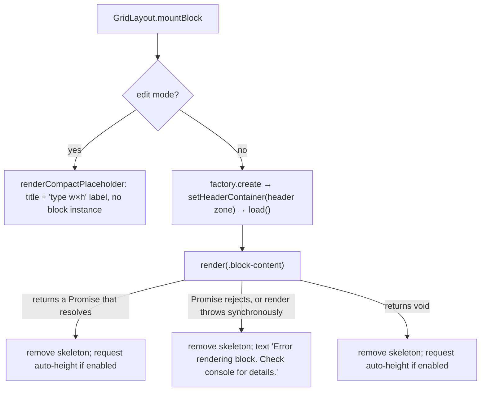
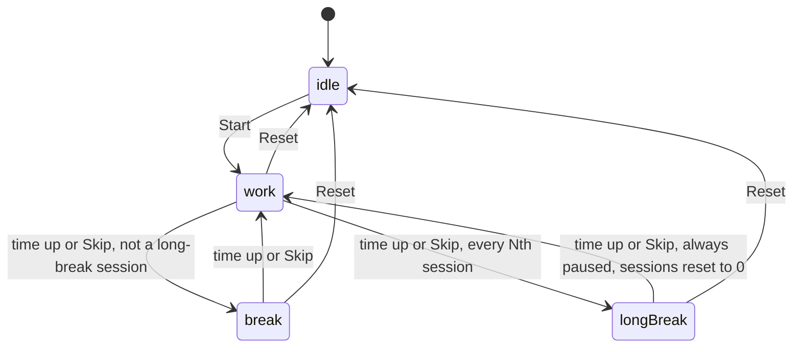
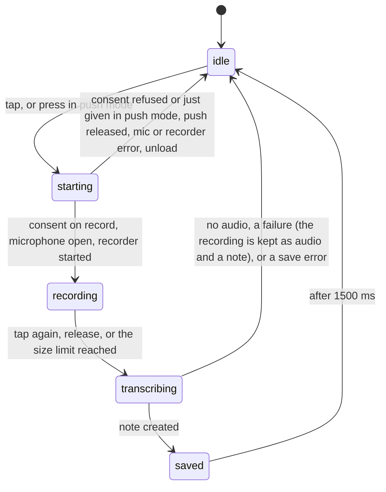

# Block catalogue

This page covers each of the 17 block types: what it shows, its config keys, what makes it re-render, how it sizes itself, its settings UI, what it sends over the network, and its known limits. It describes branch `xray-remediation` after the X-ray fixes and the review-backlog fixes of 2026-10-10 (the `M` ids of [reviews/2026-09-27-code-review.md](reviews/2026-09-27-code-review.md)). Paths are relative to the repo root.

Related pages:

| Topic | Page |
|---|---|
| The `BaseBlock` API | [api/blocks.md](api/blocks.md) |
| How the grid hosts blocks | [api/grid.md](api/grid.md), [architecture.md](architecture.md) |
| Shared `_`-prefixed styling keys | [styling.md](styling.md) |
| Persistence, migrations, API-key encryption | [data-model.md](data-model.md) |
| Render and save sequences | [flows.md](flows.md) |
| The plugin surface | [api/plugin.md](api/plugin.md) |

Where each block is defined:
- One `BaseBlock` subclass per type in `src/blocks/`.
- The type literal is listed in `BLOCK_TYPES` (`src/types.ts:4-10`).
- The factory is registered in `registerBlocks()` (`src/main.ts:42-208`).
- The add-block modal takes its icon and description from `BLOCK_META` (`src/blockMeta.ts:3-21`).
- The title a block draws when no `_titleLabel` is set comes from `blockTitle(type)` (`BLOCK_TITLES`, `src/blockMeta.ts:29-51`). It is `''` for `greeting`, `clock` and `spacer`, which draw no header. The blocks, the settings preview and the edit-mode placeholder all read it, so the placeholder no longer shows the factory's display name instead (M104).

## Summary

| Type id | Display name | Class | Default size (w×h) | Auto-height | Live updates (debounce) |
|---|---|---|---|---|---|
| `greeting` | Greeting | `GreetingBlock` | 1×3 | no | 1 s timer, redraws when the minute or hour changes |
| `clock` | Clock / date | `ClockBlock` | 1×3 | no | 1 s timer, writes only changed text |
| `folder-links` | Quick links | `FolderLinksBlock` | 1×3 | no | vault `create` / `delete` / `rename` in scope (150 ms) |
| `button-grid` | Button grid | `ButtonGridBlock` | 1×5 | always | none (re-measures on width change) |
| `quotes-list` | Quotes | `QuotesListBlock` | 2×3 | unless `heightMode: 'wrap'` | `metadataCache` `changed` when the tag matches or the note is shown, vault `delete` of `.md` (500 ms); a day change (`onDayChange`) |
| `image-gallery` | Image gallery | `ImageGalleryBlock` | 3×3 | unless `heightMode: 'fixed'` | vault `create` / `delete` / `rename` / `modify` of media in the folder (300 ms) |
| `embedded-note` | Embedded note | `EmbeddedNoteBlock` | 1×3 | only `heightMode: 'grow'` | vault `modify` / `delete` / `rename` of the file (300 ms); the plugin rewrites `filePath` on a rename (`followRename`) |
| `static-text` | Static text | `StaticTextBlock` | 1×3 | unless `heightMode: 'fixed'` | none (re-measures when its content changes size) |
| `html` | HTML block | `HtmlBlock` | 1×3 | no | none |
| `video-embed` | Video embed | `VideoEmbedBlock` | 2×4 | no | none |
| `bookmarks` | Bookmarks | `BookmarkBlock` | 2×3 | no | none |
| `recent-files` | Recent files | `RecentFilesBlock` | 1×4 | no | vault `modify` of `.md`; `create` / `delete` / `rename` of any file (500 ms); relative times rewritten every 60 s |
| `pomodoro` | Pomodoro timer | `PomodoroBlock` | 1×4 | no | 1 s display timer; the phase runs on the wall clock |
| `spacer` | Spacer | `SpacerBlock` | 1×2 | no | none |
| `random-note` | Random note | `RandomNoteBlock` | 1×4 | always | `metadataCache` `changed` when the tag matches or the note is the one shown (500 ms); vault `delete` / `rename` of `.md` (2000 ms); a day change (`onDayChange`) |
| `voice-dictation` | Voice notes | `VoiceDictationBlock` | 2×3 | no | none (elapsed timer only while recording) |
| `vault-search` | Vault search | `VaultSearchBlock` | 2×2 | no | none (searches on input, 150 ms) |

"Auto-height" combines two things: the factory's `autoHeight: true` flag, and the per-type `heightMode` opt-out in `GridLayout.shouldAutoHeight` (`src/GridLayout.ts:123-134`).

The display name `Vault search` was `Vault Search` before M101 (`src/main.ts:203`); the header default title is `'Vault search'` too.

### What leaves the device

| Type | Network or external access |
|---|---|
| `voice-dictation` | Uploads the recorded audio and the API key to OpenAI or Google, after a consent per provider on this device, which the block settings can withdraw |
| `video-embed` | Loads the provider's player iframe (YouTube, Vimeo, Dailymotion) with `referrerpolicy="strict-origin-when-cross-origin"`: the origin is sent, never the page path (M48) |
| `html` | In iframe mode, the CSP allows passive loads of images, media and fonts from `https:` and `data:`, with no referrer. In inline mode, nothing: media elements and resource attributes are removed (M59) |
| `random-note` | Loads an `https://` cover image named in frontmatter, with no referrer |
| `bookmarks`, `button-grid` | Open a target with a URL scheme (other than the dangerous ones), or a schemeless domain as `https://`, in the system browser when clicked |
| `embedded-note`, `static-text` | Whatever the rendered Markdown references, through Obsidian's `MarkdownRenderer` |
| all others | Nothing |

## Conventions shared by all blocks

### Config defaults, fallbacks and import

- **Factory shape.** A factory is `{ type, displayName, defaultConfig, defaultSize, autoHeight?, create }` (`src/types.ts:90-103`).
- **New blocks.** A new block gets `config: structuredClone(factory.defaultConfig)` (`src/EditToolbar.ts:235`), so array defaults such as `links: []` and `items: []` are its own and not shared with the factory. The settings modal also edits a `structuredClone` draft (`src/modals/BlockSettingsModal.ts:51`).
- **Fallbacks.** Blocks read config through destructuring defaults. That fallback applies whenever a key is missing, which happens in:
  - default-layout blocks (`DEFAULT_LAYOUT_DATA`, `src/validation.ts:24-104`);
  - older `data.json` files;
  - hand-edited `data.json` files.
- **Reading the tables.** The config tables below list the factory default. Where the block's fallback differs from it, the fallback is shown in **bold** with its line.
- **Import checks.** Clipboard import goes through `sanitizeImportedConfig` (`src/utils/importSanitizer.ts:76-118`). It keeps a declared key only if the value has the JSON type of the declared default (`matchesDeclaredType`, `:20-26`):
  - a key declared `undefined` accepts only a string: every such key holds text, and a number reached Greeting's `.trim()` as a TypeError every second (M61);
  - an array default accepts any array;
  - a number must be finite.
- **What import strips or skips.**
  - Undeclared keys are stripped, except `_`-prefixed ones: a known shared key goes through its validator in `SHARED_VALIDATORS` (`:40-62`), and an unknown `_` key is kept when its value is a string, number or boolean (`:89-109`).
  - `apiKey` and `customCss` are always stripped (`:11`).
- **Numeric ranges.** A declared number is rounded and clamped to its range in `CONFIG_RANGES` when the type and key have one (`clampConfigNumber`, `src/utils/configRanges.ts:10-29`; applied at `src/utils/importSanitizer.ts:112`). The table holds the ranges the settings controls offer: `columns` of `button-grid` and `bookmarks` (1–3), `quotes-list` `columns` (1–3) and `maxItems` (0–500), `image-gallery` `columns` (2–7) and `maxItems` (0–500), `recent-files` `maxItems` (5–20), and the four `pomodoro` durations and counts. The shared numeric `_` keys are clamped to `STYLE_RANGES` instead.
- **Clamped again at read.** `quotes-list`, `recent-files` and `pomodoro` read those numbers through `rangedNumber(type, config, key, fallback)` (`src/utils/configRanges.ts:31-36`), which clamps a finite number and returns the fallback for anything else. So a hand-edited or old `data.json` cannot push them out of range either. `button-grid`, `bookmarks` and `image-gallery` clamp in their own render code.
- **Not checked.** Array elements are not checked: the shapes inside `links[]` and `items[]` pass import unchanged, and load-time validation does not check config values.
- **Links listed on import.** A Bookmarks `url`, a Button grid `link` or a Quick links `path` with a URL scheme other than `http(s)` (`obsidian://` can overwrite a note, an OS handler can run a program) is listed in the import confirmation as active content, next to Static Text, HTML and the Voice notes template and folder (`LINK_LISTS`, `isOtherSchemeLink`, `src/utils/importSanitizer.ts:155-166`). "Import without content" clears those values and keeps the entries; a button keeps its entry with `link` undefined (`withoutActiveContent`, `:201`).

See [data-model.md](data-model.md) for the migrations `migrateBlockInstance` applies at load time (`src/validation.ts:131-222`).

### Mount and render

- **Rendering target.** The `el` passed to `render` is `.block-content`. The header goes into `.block-header-zone`, which sits outside it (`src/grid/BlockWrapper.ts:36-47`).
- **Wrapper.** The wrapper carries the classes `homepage-block-wrapper hp-block-<type>` and the shared styling from `applyBlockStyling` (`:20-29`).
- **Skeleton.** The skeleton overlay is created only on the initial render (`src/GridLayout.ts:605`). It goes when an async render settles, and at the latest after 300 ms (`SKELETON_MAX_MS`, `:24`, `:609`): an Embedded Note used to keep it up while it waited for every remote image in the note (M77). The auto-height measurement still waits for the whole render.
- **Error handling inside blocks.** Several blocks catch their own render failure and call `renderErrorHint`, which draws a `.block-empty-hint.block-error-hint` (`src/blocks/BaseBlock.ts:105-110`). These are `quotes-list`, `image-gallery`, `embedded-note`, `static-text` and `random-note`. For them, GridLayout's fallback text shows only when something escapes that handler. A live re-render that fails shows an error hint for every block (see [Live updates](#live-updates)).
- **Teardown.** Every render (a settings save, a column change, an added, duplicated or moved block, an edit-mode toggle, a view reload) unloads all block instances (`src/GridLayout.ts:396-399`). Anything not in config or in a module-level store is lost.
  - `GridLayout.rerender()` does nothing while any block's `hasUnsavedInlineState()` returns true (`:375-384`).
  - Entering or leaving edit mode (`:269`) and adding a block (`:370`) render directly and skip that guard.
- **Edit mode.** Edit mode never mounts or renders blocks; the only instance it creates is the temporary one behind the settings modal, which is never loaded or rendered (see [Settings](#settings)). Timers, vault listeners, recordings and lightboxes belong to the view-mode instances, which are unloaded.

### Header

`renderHeader(el, title)` (`src/blocks/BaseBlock.ts:63-97`) reads `this.instance.config`, the render-time snapshot:
- The label is `_titleLabel.trim()`, or `title` if that is blank. Blocks pass `blockTitle(type)` as `title`.
- The header is hidden when `_showTitle === false`.
- `_titleSize` `h1`–`h6` adds the class `block-header-hN`.
- `_titleEmoji` is placed before the label.
- **The header zone is the collapse toggle only while it shows a header** (M49). `buildBlockWrapper` creates the zone with no role (`src/grid/BlockWrapper.ts:38-42`); `renderHeader` gives it `role=button`, `tabindex=0` and `aria-expanded` when it draws a header, and removes them when the header is hidden (`src/blocks/BaseBlock.ts:76-88`). `attachCollapseToggle` ignores a zone without `role=button` (`src/grid/CollapseToggle.ts:64`), so a header-less block can no longer be collapsed, by click or by a 0 px Tab stop, with nothing left to expand it.

Blocks that never call `renderHeader`:
- `greeting`, `clock` and `spacer` never call it. For these, the label keys `_titleLabel`, `_titleEmoji` and `_titleSize` have no effect in view mode, and a stored `collapsed: true` is never drawn collapsed: `isCollapsible` (`src/grid/CollapseToggle.ts:22-24`) needs a `blockTitle`, and both `buildBlockWrapper` (`src/grid/BlockWrapper.ts:25`) and `viewModeHeight` use it, so a block collapsed by the old zero-height toggle is not stuck at one row. Their Header tab shows only "This block has no title." (`src/modals/BlockSettingsModal.ts:141-146`, M104), and the settings preview draws no header. Stored values of the other Header-tab keys act on the wrapper and still apply: `_showDivider` adds the divider (`src/grid/BlockWrapper.ts:46-48`) and `_titleGap` sets the card gap. The edit-mode placeholder shows `_titleLabel` (or `blockTitle`, falling back to the display name) and `_titleEmoji`, but it ignores `_showTitle` and `_titleSize` (`src/grid/BlockWrapper.ts:84-92`).
- `embedded-note` calls it only when `showTitle` is on: with the file's basename, or with `'Embedded note'` when no path is set or the file is missing (`src/blocks/EmbeddedNoteBlock.ts:70-87`).

### Settings

- **Content tab.** The Content tab of `BlockSettingsModal` calls `block.renderContentSettings(body, draft)` (`src/modals/BlockSettingsModal.ts:401-411`). The draft is a `structuredClone` of the config, and Save replaces the whole config.
- **No content settings.** A block that renders nothing into the Content tab gets the text "This block has no content settings." (`spacer`).
- **Where settings open from.** The modal opens only from the edit-mode handle bar. Edit mode has no block instances, so a temporary instance is created for the modal and unloaded when it closes (`src/grid/EditHandleBar.ts:106-131`).
- The shared Header, Body and Card tabs are described in [styling.md](styling.md).
- **List rows.** The reorder grip of each settings row (Quick links, Button grid, Bookmarks) is a `button`: besides a mouse drag, Alt+ArrowUp or Alt+ArrowDown moves the row and keeps the focus on its grip (`enableDragReorder`, `src/utils/dragReorder.ts:30-44`, M115). The row delete buttons are named ("Remove button", "Remove bookmark", M112).
- **Emoji picker.** Escape closes only the picker panel and returns the focus to its trigger; it used to reach the settings dialog, which closed and dropped every unsaved change (`src/utils/emojiPicker.ts:139-147`, M116). The trigger has an accessible name (`label`, `ariaLabel`, else "Choose emoji").

### Opening files and links

All blocks open through `src/utils/openTarget.ts` (M21-M23, M65, M66), not through `workspace.openLinkText`:

| Helper | Used by | Behaviour |
|---|---|---|
| `openFile(app, file, evt)` (`:13-15`) | files a block holds: Quick links (auto-listed), Recent files, Random note, Vault search | `workspace.getLeaf(Keymap.isModEvent(evt)).openFile(file)`. The `TFile` itself is opened, so a `#` in a file or folder name no longer opens a different note or creates an empty one. Ctrl/Cmd or a middle click opens a new tab, with Alt a split, as in the file explorer |
| `onOpenClick(el, fn)` (`:18-21`) | the same, and Bookmarks, Button grid, typed Quick links | Runs `fn` on `click` and on a middle-button `auxclick`; a right click does nothing |
| `openNoteLink(app, raw, evt)` (`:38-48`) | typed Quick links | Cleans the text (`cleanLinkText`: trimmed, `[[ ]]` and an `|alias` removed), resolves it with `metadataCache.getFirstLinkpathDest(path, '')` and opens the file with its `#subpath`. A link that resolves to no note shows the Notice `Homepage blocks: no note named “<path>”.` and creates nothing; before, a stale link created an empty note at the old path |
| `openLinkTarget(app, raw, evt)` (`:62-83`) | Bookmarks, Button grid | A dangerous URL (`isDangerousUrl`) shows "Homepage blocks: blocked an unsafe link.". A value with a URL scheme of two or more letters (`obsidian:`, `mailto:`, `https:`, ...; a drive letter is not one) opens with `window.open(value, '_blank', 'noopener,noreferrer')`. A value that resolves as a note opens it. A schemeless domain such as `github.com/owner` that is not a file name (`Plan.md`) opens as `https://<value>`. Anything else goes to `openNoteLink`, so a miss is the Notice above |

### Folder settings and renames

- **Typed folders** are normalised by `normalizeFolderPath` (`src/utils/folderPath.ts:7-10`, M67): trimmed, slashes around the path removed, `''` for the root. `Photos/` and `/Photos` now find `Photos`. Quick links, the gallery and the Recent files exclusions use it.
- **The folder picker** (`FolderSuggestModal`) leaves the vault root out for the gallery and Quick links, which need a subfolder (`{ includeRoot: false }`); Voice notes keeps it.
- **Renames are followed in block settings** (M55, M22). The plugin's vault `rename` listener (`src/main.ts:262`) runs `followRenameInBlock` (`src/utils/pathRename.ts:72-102`) on every block of both arrays and on the Discard snapshot of an open edit session (`HomepagePlugin.followRename`, `src/main.ts:494-510`), with no block mounted too. When a path changed it saves and reloads every open homepage view that is not being edited (`:504-509`), so mounted blocks, which read their render-time config, use the new paths at once; a view in edit mode keeps its placeholders. A value that names the renamed file (with or without `.md`) or lies inside a renamed folder is rewritten. Typed note links go through `renameLink` (`:25-39`): `Projects/Plan`, `Plan` and `[[Plan#Goals|alias]]` keep their brackets, heading and alias, and a link by name alone follows only when that name no longer resolves to another note (`getFirstLinkpathDest`), as Obsidian's own link update would see it:

| Type | Keys rewritten |
|---|---|
| `embedded-note` | `filePath` |
| `image-gallery`, `voice-dictation` | `folder` |
| `folder-links` | `folder`, and `path` of each `links[]` item (as a typed link) |
| `button-grid` | `link` of each `items[]` item that has no URL scheme (as a typed link) |
| `bookmarks` | `url` of each `items[]` item that has no URL scheme (as a typed link) |
| `recent-files` | each comma-separated entry of `excludeFolders` |

A glob in Quick links' `folder` is rewritten only where its text starts with the old path.

### Auto-height

| Type | Measured element (`data-auto-height-content`) | Active when |
|---|---|---|
| `button-grid` | `.button-grid` | always |
| `quotes-list` | `.quotes-columns` (list mode) or `.insight-card` (single mode, tag or text source) | `heightMode !== 'wrap'` |
| `image-gallery` | `.image-gallery` | `heightMode !== 'fixed'` |
| `embedded-note` | `.embedded-note-content`, observed for size changes | `heightMode === 'grow'` |
| `static-text` | `.static-text-content` (observed for size changes) / `.static-text-inline-editor` | `heightMode !== 'fixed'` |
| `random-note` | `.random-note-body` (the card inside `.block-content`), only while a note is shown | always |

- **Measurement.** `AutoHeightManager` measures the first `[data-auto-height-content]` element in the grid item and sets the row count with `gridStack.update` (`src/grid/AutoHeight.ts:103-168`).
- **When it does nothing.** It skips collapsed blocks (`:112-113`). It also does nothing when the grid has a single column (`effectiveColumns === 1`, `:66-69`).
- **What triggers a re-measure:**
  - the initial render;
  - every `scheduleRender` run;
  - an explicit `requestAutoHeight()`;
  - `observeWidthForAutoHeight`, which fires on width changes and once on the first observation, because `prevWidth` starts at 0 (`src/blocks/BaseBlock.ts:183-201`);
  - `observeSizeForAutoHeight` (`src/blocks/BaseBlock.ts:209-222`, M34), which fires when the observed content-sized element changes width or height after its first report: an image in the Markdown that loads late, a folded callout opened, a Dataview refresh. Static Text and grow-mode Embedded Note use it;
  - a responsive column change: a narrowing to two or more columns re-requests every auto-height block (`src/grid/ResponsiveColumns.ts:193-200`), and so does a return to the canonical column count (`:171`).

The mechanism is detailed in [api/grid.md](api/grid.md).

### Live updates

`onDayChange(fn)` (`src/blocks/BaseBlock.ts:235-243`) runs `fn` when the local calendar day (`dailyEpochDay`) changes while the block stays mounted, checked every 60 s through `registerInterval` (M83). Quotes and Random note use it to re-pick a daily note at midnight.

`scheduleRender(delayMs, fn)` (`src/blocks/BaseBlock.ts:146-170`):
- **One timer per block.** A new call replaces the pending one, so a block with two delays (random-note) waits the delay of the latest call.
- **Detached blocks.** It skips the run when `containerEl` is no longer connected.
- **Afterwards.** Once `fn` finishes, it requests auto-height.
- **Errors.** A synchronous throw and an async rejection are both caught. Each is logged as `[Homepage Blocks] <Class> re-render failed:`, and `renderErrorHint` replaces the content with "Couldn’t refresh this block — check the console for details." (`:151-167`). Re-render functions empty the element first, so without the hint the card would stay blank.

Listeners exist only while the block is mounted in view mode on an open homepage.

---

## `greeting` — Greeting

Source: `src/blocks/GreetingBlock.ts`. It shows a time-of-day salutation, the user's name, an optional emoji and an optional `HH:mm` time.

| Key | Type | Default | Meaning |
|---|---|---|---|
| `name` | string | `''` (M94) | Name after the salutation. Empty or blank: the salutation alone, with no comma |
| `showTime` | boolean | `true` | Show the `HH:mm` line |
| `showEmoji` | boolean | `true` | Show the emoji line |
| `emojiMode` | `'auto'` \| `'custom'` \| `'random'` | `'auto'` | `auto`: default emoji per time slot. `custom`: emoji per slot. `random`: pick from the pool |
| `emojiMorning`, `emojiAfternoon`, `emojiEvening`, `emojiNight` | string | `undefined` | Custom mode. A blank or non-string value falls back to `DEFAULT_EMOJIS` (sun, sun behind cloud, city at dusk, crescent moon; `:107-112`, `:158-159`) |
| `emojiPool` | string | `''` | Random mode. Split on whitespace or commas (`:174-178`) |
| `emojiDailySeed` | boolean | `false` | Random mode: one pick per day via `dailyIndex` (`:165-167`) |
| `salutationMode` | `'auto'` \| `'custom'` | `'auto'` | Language preset or custom text |
| `salutationPreset` | string | `undefined` (M94) | Key into `LANG_PRESETS`, which has 51 languages (`:35-88`). Unset or unknown: the preset of the app language (`getLanguage()`, its part before `-`/`_`), else English (`defaultPresetKey`, `presetOf`, `:98-105`). A stored key is kept, so older blocks that saved `'it'` stay Italian |
| `salutMorning`, `salutAfternoon`, `salutEvening` | string | `undefined` | Custom mode. A blank or non-string value falls back to the selected preset (`:127-145`; a stored number from an older import no longer throws, M61) |

**Rendering** (`:187-232`)
- `.greeting-block` contains `.greeting-emoji`, then `.greeting-name` (made of `span.greeting-salut` "Salutation, " and `span.greeting-user`; with an empty name only "Salutation", `:222-228`), then `.greeting-time`.
- `tick()` runs once at render and then every second via `registerInterval` (`:203-204`, M46). It redraws only when the hour or, with the time shown, the `HH:mm` text has changed (`shown`, `:207-217`), so the new minute appears when it starts.
- Time slots:
  - Emoji (`timeSlot`, `:114-119`): morning 5–12, afternoon 12–17, evening 17–21, night 21–5.
  - Salutation (`salutSlot`, `:121-125`): morning 5–12, afternoon 12–18, evening 18–5.
- `.block-content.greeting-block` is `container-type: size` (`styles.css:635-643`).

**Live updates:** the timer only. **Auto-height:** none. **Network:** none.

**Settings** (`:234-410`)
- Name, empty when unset.
- Show time.
- "Salutation" section:
  - Mode dropdown: Language preset or Custom text.
  - Preset mode: a Language dropdown sorted by label, set to the app language's preset when none is stored, plus a preview line.
  - Custom mode: three text fields labelled with their slot times. They are empty when unset, with the selected preset's salutation as placeholder (`:282-300`, M93), which is what a blank slot renders.
- "Emoji" section:
  - Show emoji.
  - Emoji mode: Auto (time of day), Custom per slot, or Random pool.
  - Custom: four emoji pickers, each named for its slot ("Morning emoji", ...). Clearing one stores `''`, which renders the default emoji.
  - Random: a chip list with a delete button per chip and an add picker; the pool is stored space-joined. A "Same emoji all day" toggle sets `emojiDailySeed`.

**Limits**
- **Header settings.** The block never calls `renderHeader`; its Header tab shows "This block has no title." (see [Header](#header) for the stored keys that still apply).
- **Random emoji.** In random mode without the daily seed, `Math.random` runs on every redraw: every minute with the time shown, every hour without it (`:168`, `:215-220`).
- **Slot boundaries.** The emoji and salutation tables split the afternoon differently (17:00 and 18:00).
- **Settings leak.** Each pool re-render adds a new add-picker to `slotPickers` without destroying the previous one (`:369-397`).

## `clock` — Clock / date

Source: `src/blocks/ClockBlock.ts`. It shows a live time line and an optional date line.

| Key | Type | Default | Meaning |
|---|---|---|---|
| `showSeconds` | boolean | `false` | Uses `HH:mm:ss` |
| `showDate` | boolean | `true` | Shows the date line, format fixed as `'dddd, D MMMM YYYY'` (`:53`) |
| `clockStyle` | `'minimal'` \| `'centered'` \| `'large'` \| `'accent'` | `'minimal'` | Adds the class `clock-style-<x>`. A value that fails `in CLOCK_STYLES` becomes `minimal` (`:29`) |
| `format` | string | `''` | Moment format for the time line. Blank gives `HH:mm` or `HH:mm:ss` (`:52`) |

**Rendering:** `.clock-block.clock-style-<style>` containing `.clock-time` and `.clock-date` (`:22-42`). A rule of specificity (0,3,0), `.homepage-block-wrapper .block-content.clock-block`, now wins over the generic `display: grid` of `.block-content`, so the time and date are centred as the style intends (M99).

**Live updates:** `registerInterval` fires every second whatever `showSeconds` and `format` say (`:40-41`, M46). Each tick writes a line only when its text changed (`setIfChanged`, `:13-16`), so the new minute shows when it starts and a custom format with seconds ticks every second. **Auto-height:** none. **Network:** none.

**Settings** (`:56-80`): Style, Show seconds, Show date, Custom format ("Moment.js format string. Leave blank for default.").

**Limits**
- **Header settings.** The block never calls `renderHeader`; its Header tab shows "This block has no title." (see [Header](#header)).
- **Style check.** The `in` check also accepts inherited keys, so `toString` yields the harmless class `clock-style-toString`.

## `folder-links` — Quick links

Source: `src/blocks/FolderLinksBlock.ts`. It shows buttons for the files found under a folder or glob, followed by manual links.

| Key | Type | Default | Meaning |
|---|---|---|---|
| `_titleLabel` | string | `'Quick links'` | Header label. With no label set, the header reads **`'Folder links'`** (`blockTitle`, `:114`) |
| `folder` | string | `''` | Folder path or glob to auto-list. Rewritten when the folder is renamed |
| `folderEmoji` | string | `''` | Emoji shown before each auto-listed file |
| `links` | `{ label, path, emoji? }[]` | `[]` | Manual links. A `path` is rewritten when its note is renamed |
| `linkAlign` | `'left'` \| `'center'` \| `'right'` | `'left'` | Adds the class `folder-links-align-<x>`. An invalid value becomes `left` (`:111`) |

**Glob handling** (`parseFolderPattern`, `:36-50`; `globToRegex`, `:52-73`)
- The input goes through `normalizeFolderPath`: trimmed, with leading and trailing `/` removed (M67).
- Without `*` or `?`, the whole string is the folder and every file under it matches.
- With a wildcard, the static prefix is everything before the last `/` that precedes the first wildcard.
- Pattern syntax:
  - `**` matches across folders and absorbs a following `/`.
  - `*` matches within one path segment.
  - `?` matches one character within a segment.
  - Every other character is literal, so `[...]` and `{a,b}` are not special.
- Matching is anchored and case-insensitive, against the path relative to the prefix.

**Rendering** (`renderContent`, `:103-174`, synchronous)
- **First render.** It is deferred with `workspace.onLayoutReady` (`:100`).
- **Auto-list.** It collects every `TFile` under the folder recursively, of any extension (`getNotesInFolder`, `:177-187`). The files are filtered by the glob, sorted by `basename`, and rendered as `button.folder-link-btn`. A click opens the file itself with `openFile`; Ctrl/Cmd or a middle click opens a new tab (`:145`, see [Opening files and links](#opening-files-and-links)).
- **Manual links.** A manual link opens through `openNoteLink`, only when its text resolves to a note; otherwise a Notice names it and no note is created (`:164-166`, M22, M66). A dangerous-scheme value from an imported layout resolves to no note.
- **Messages:**
  - "Vault root listing is not supported. Select a subfolder." (an input that normalises to the root, such as `/`)
  - `Folder "<x>" not found.`
  - `No notes matching "<input>".` or `No notes in "<path>".`
  - Empty hint "No links yet. Add manual links or pick a folder in settings."

**Live updates** (`:84-97`)
- `create` and `delete` trigger when the file is under the static prefix.
- `rename` triggers when the new or the old path is under the prefix.
- The debounce is 150 ms.
- When the prefix is `''`, every vault create, delete and rename triggers a re-render. That includes blocks that have manual links only; for a glob rooted at the vault root, each re-render rescans the whole vault.

**Auto-height:** none. **Network:** none from the block.

**Settings** (`:189-284`)
- Link alignment.
- Auto-list folder: a text field (placeholder `Projects/*.md`) with a browse button that opens `FolderSuggestModal` without the vault root (`{ includeRoot: false }`, `:223`, M67).
- Folder link emoji picker.
- "Manual links": rows with a reorder grip (drag, or Alt+Arrow keys), Label, Path, remove, and an emoji picker. An "Add link" button follows.

**Limits**
- **No cap.** The number of listed files is not capped.
- **Root globs.** A glob rooted at the vault root, such as `**/*.md`, gets past the root guard and scans the whole vault (`:123-128`).
- **File types.** Non-note files are listed too; folders never are.
- **Malformed links.** A `null` element in `links` makes `renderContent` throw. Inside `scheduleRender`'s timer the throw becomes the "Couldn’t refresh this block" hint.

## `button-grid` — Button grid

Source: `src/blocks/ButtonGridBlock.ts`. It shows a grid of emoji and label buttons, each of which can open a vault link.

| Key | Type | Default | Meaning |
|---|---|---|---|
| `_titleLabel` | string | `'Button grid'` | Header label. With no label set, the header reads **`'Buttons'`** (`blockTitle`, `:26`) |
| `columns` | number | `2` | Clamped to 1–3 at render (`:29`). The load migration also clamps values above 3 to 3 (`src/validation.ts:198-201`) |
| `items` | `{ emoji, label, link? }[]` | `[]` | Buttons. With no `link`, a button is inert (class `hp-cursor-default`). A `link` is rewritten when its note is renamed |
| `customCss` | string | not declared (`src/main.ts:78-80`) | `--hp-btn-*` declarations, applied to the **wrapper** by `applyBlockStyling`, not by the block |

**Rendering** (`:16-55`)
- `.button-grid` gets only an inline column count, `--hp-grid-count: N` (`:31`), which `styles.css` turns into `repeat(var(--hp-grid-count, 2), 1fr)` (`styles.css:3994`). It also gets the auto-height marker and `observeWidthForAutoHeight`.
- A button with a link opens it through `openLinkTarget` on a click or a middle click (`:50`): a URL with a scheme or a schemeless domain opens externally, a note opens when the link resolves, and a dangerous URL or a stale link shows a Notice (see [Opening files and links](#opening-files-and-links), M22, M23).
- With no items, the block shows an empty hint.
- **Narrow blocks.** Below 250 px of container width the grid falls back to one column (`.button-grid-block .button-grid`, `styles.css:1643-1648`); with only the count inline, the container query now wins (M98).

**The `customCss` pipeline** (`src/utils/blockStyling.ts:52-106`)
1. Comments are stripped and the text is split on `;`.
2. Only keys matching `^--hp-btn-[a-z0-9-]+$` are kept.
3. A value is rejected if it contains `url(`, `image(`, `image-set(`, `cross-fade(`, `element(`, `paint(`, or a control character.
4. Kept values are applied with `setProperty`. Their keys are tracked in `data-hp-custom-css-keys`, so the next render can remove stale ones.

The variables the stylesheet reads are `--hp-btn-bg`, `-border`, `-radius`, `-padding`, `-color`, `-shadow`, `-gap`, `-hover-bg`, `-hover-border-color`, `-hover-transform`, `-hover-shadow`, `-active-transform`, `-active-shadow` and `-emoji-size` (`styles.css:1519-1562`).

`customCss` never travels outside the block:
- It is deleted on export (`src/settings/HomepageSettingTab.ts:385,389`).
- It is stripped on import (`src/utils/importSanitizer.ts:11`).
- It is removed from any other block type at load (`src/validation.ts:206-208`).

**Live updates:** none. **Auto-height:** always. **Network:** none, and `url()` values are rejected.

**Settings** (`:57-142`)
- Columns: 1, 2 or 3.
- "Custom CSS": a full-width textarea, `maxLength` 4096.
- "Items": each row has a reorder grip (drag, or Alt+Arrow keys), an emoji picker, Label, "Note path (optional)" (empty stores `undefined`), and a delete button named "Remove button". A "+ add item" button follows.

**Default layout.** The "Quick actions" block of the default layout has `items: []` and shows the "No items yet" hint (`src/validation.ts:75-81`). It used to ship six buttons with no `link`, which did nothing (M95).

## `quotes-list` — Quotes

Source: `src/blocks/QuotesListBlock.ts`. It shows quotes taken from notes with a tag, or from text typed into the settings. It has a list mode and a single-quote mode.

| Key | Type | Default | Meaning |
|---|---|---|---|
| `_titleLabel` | string | `'Quotes'` | Header label (the default title is also `'Quotes'`, `:114`) |
| `source` | `'tag'` \| `'text'` | `'tag'` | Tagged notes or manual text |
| `tag` | string | `''` | Tag, with or without `#` (`normalizeTag`). Matched as Obsidian's tag search matches it (see [Helpers](#helpers-used-by-blocks)) |
| `quotes` | string | `''` | Manual quotes, separated by a line containing only `---`. A last line starting with `—`, `–` or `--` becomes the source |
| `maxItems` | number | `20` (fallback `20`, `:109`) | `1` selects single mode, `0` shows all, `n` shows the first `n`. Read through `rangedNumber`, clamped to 0–500 |
| `dailySeed` | boolean | `true` | Single mode: the same pick all day (`dailyIndex`) instead of `Math.random` |
| `columns` | number | `2` | Maximum number of columns. Read through `rangedNumber`, clamped to 1–3 (`:108`) |
| `heightMode` | `'wrap'` \| `'extend'` | `'extend'` | `wrap`: scroll inside a 500 px maximum. `extend`: auto-height |
| `quoteStyle` | `'classic'` \| `'centered'` \| `'card'` | `'classic'` | List-mode style classes |
| `showAccentBar` | boolean | `true` | `false` adds `quote-no-accent` |
| `showNoteTitle` | boolean | `true` | Tag source: show the note name (list) or the title (single) |
| `textAlign` | `'left'` \| `'center'` \| `'right'` | `'left'` | Sets `--hp-quote-align` (`:110`), which `.quote-item` and `.insight-card` use as `text-align` (`styles.css:1706-1711`). The centered quote style keeps its own, more specific `text-align` |
| `verticalAlign` | `'top'` \| `'middle'` \| `'bottom'` | `'top'` | Sets `--hp-quote-valign` |
| `fontStyle` | `'default'` \| `'serif'` \| `'handwriting'` | `'default'` | Adds `quote-font-serif` or `quote-font-handwriting` |
| `customFont` | string | `''` | Trimmed and cut to 64 characters. It must match `^[a-zA-Z0-9\s,'\-_]+$` and then becomes `--hp-quote-font` (`:130-133`) |

The default layout's "Daily insight" block sets `maxItems: 1`, so it shows one note per day (`src/validation.ts:66-71`).

**Modes** (`loadAndRender`, `:99-301`)

| `maxItems` | `source: 'tag'` | `source: 'text'` |
|---|---|---|
| `1` | One tagged note: its title plus the **whole** body from `parseNoteInsight` | One quote, from `renderSingleTextQuote` |
| `0` | Every tagged note, showing the first paragraph of each, capped at 280 characters, with its author line | Every quote |
| `n > 1` | The first `n` tagged notes | The first `n` quotes |

- **Note text.** Both modes read the note through one extractor, `noteBlocks` in `src/utils/noteContent.ts` (M44), which keeps the text as Obsidian shows it (see [Helpers](#helpers-used-by-blocks)).
- **Single-mode title.** `parseNoteInsight` takes the title from a heading only when the note starts with one; otherwise the block shows the basename (M89). The body is every paragraph, joined, with no cap.
- **Formatting.** Inline formatting covers only `**bold**` and `#hashtag`, via `renderFormatted` (`:30-45`). Other Markdown is shown as raw text.
- **List body.** The body of each tagged note in list mode is `noteQuote(content, cache)` (`:284`; `src/utils/noteContent.ts:113-119`, M88): the note's first paragraph in full, joined by spaces and cut to 280 characters with an ellipsis (`…`) when longer. When the paragraph has more than one line and its last one starts with `—`, `–` or `--`, that line is shown apart as `div.quote-author` ("— Author", `:290`; `styles.css` `.quote-author`).
- **Colour.** A frontmatter `color` value is capped at 64 characters. If it matches `COLOR_RE` (`:13`), it becomes `--hp-quote-color` and the class `quote-colored` is added.
- **Columns.** A `ResizeObserver` sets `--hp-column-count = max(1, min(columns, floor(width / 200)))`. It is skipped for the centered style (`:219-231`). Its one cleanup is registered in `render`, not in `loadAndRender`, which runs again on every live update.
- **Shown notes.** Each render records the paths of the notes it shows in `shownPaths` (`:101`, `:176`, `:261`).
- **No tagged notes.** List mode shows the hint `No notes tagged #x.` instead of an empty card (`:251-258`, M87).
- **Errors.** A render failure shows `renderErrorHint` with "Couldn’t load quotes — check the console for details." (`:93-96`).

**Live updates** (`:76-91`)
- They apply only when `source !== 'text'` and `tag` is set.
- `metadataCache` `changed` triggers when the file's **new** cache has the tag, or when the file is one the block shows (`shownPaths`), so a shown note that loses the tag leaves the block (`:84`).
- A vault `delete` of any `.md` file triggers.
- A day change (`onDayChange`, `:77`) triggers unless `dailySeed` is `false`, so a daily pick rolls over at midnight while the homepage stays open (M83).
- The debounce is 500 ms, and each run empties the block and re-reads every selected note.

**Auto-height**
- On unless `heightMode === 'wrap'`.
- List mode marks `.quotes-columns` and observes its width.
- Single mode marks `.insight-card` in extend mode, for a tag source (`:192-196`) and for a text source (`:146-151`, M36), which was clipped at its stored rows before.
- In wrap mode, `.quotes-columns` has `max-height: 500px; overflow-y: auto` (`styles.css:1588-1594`) and gets `tabindex=0`, `role=region`. A later rule keeps `overflow-y: auto` against the wrapper's default clip of `.block-content` children, so the list scrolls (`styles.css:2507-2515`).

**Network:** none.

**Settings** (`:372-515`)
- Source: "Notes with tag" or "Manual text". The choice toggles two hidden sections:
  - Tag section: Tag, Show note title.
  - Text section: an 8-row textarea.
- Max quotes: shows the number the block renders, `rangedNumber(..., 20)`, so a block saved without the key shows 20, and 0 shows blank ("All") (`:425`). Blank or ≤ 0 stores `0`; any other value is capped at 500.
- Daily seed: shown only when the rendered `maxItems` is 1 (`:434`).
- Columns: 1, 2 or 3.
- Height mode: "Scroll (fixed height)" or "Grow to fit all".
- Quote style, Show accent bar, Text alignment, Vertical alignment, Font style, Custom font.

**Limits**
- **Missing `maxItems`.** An older default layout's "Daily insight" block has no `maxItems`, so it renders as a list of up to 20 until `maxItems` is set to 1; the settings field now shows that 20.
- **Single mode, empty branches.** The tag source's "no tag" and "no files" branches return before the auto-height marker is set (`:156-169`), and so does a text source with no quotes.
- **Vertical alignment.** `--hp-quote-valign` is read only by `.insight-card` (`styles.css:1020`), so vertical alignment affects single mode only.
- **Quote separator.** Quotes split only on the exact sequence `\n---\n` (`:312`, `:353`). CRLF text, or `---` followed by spaces, does not split.
- **Missed updates.**
  - Renames are not handled.
  - Text mode never refreshes until the block is remounted.
- **Daily pick.** The single pick is `dailyIndex(files.length)` over the tag cache's order, so it moves when a tagged note is added or removed during the day.

## `image-gallery` — Image gallery

Source: `src/blocks/ImageGalleryBlock.ts`. It shows images and videos found recursively under a folder, as a grid or a masonry layout, and opens a full-screen lightbox on click.

| Key | Type | Default | Meaning |
|---|---|---|---|
| `_titleLabel` | string | `'Gallery'` | Header label (the default title is also `'Gallery'`, `:316`) |
| `folder` | string | `''` | Folder path, normalised with `normalizeFolderPath` (`:309`), so slashes around it are ignored (M67). The vault root is not supported. Rewritten when the folder is renamed |
| `columns` | number | `3` | Clamped to 1–7 at render (`:310`). The settings offer 2–7, and an import clamps to 2–7 (`CONFIG_RANGES`) |
| `maxItems` | number | `0` | A positive value is floored and capped at 500; `0`, a negative value or a non-number shows all (`:311-312`) |
| `layout` | `'grid'` \| `'masonry'` | `'grid'` | Anything other than `'masonry'` renders as a grid |
| `heightMode` | `'auto'` \| `'fixed'` | `'auto'` | `fixed`: the gallery scrolls inside its cell (`image-gallery--fixed-height`, `styles.css:1788-1791`). A rule keeps `overflow-y: auto` against the wrapper's default clip of `.block-content` children (`styles.css:2507-2515`) |

**Media types:** images `.png .jpg .jpeg .gif .webp .svg`, videos `.mp4 .webm .mov .mkv` (`:8-9`).

**Rendering** (`loadAndRender`, `:299-464`)
- **Grid.** `--hp-grid-cols` is set from `responsiveGridColumns(columns, 100, 8)` (`:344`), whose track minimum leaves room for the 8 px gaps, so N columns fit (M97). CSS reads it as `var(--hp-grid-cap, var(--hp-grid-cols))`, and the container queries at ≤500, ≤400 and ≤280 px set the cap.
- **Masonry.** A `ResizeObserver` sets `--hp-masonry-cols = max(1, min(columns, floor(width / 100)))`. CSS uses `column-count: min(cap, cols)` (`:328-342`).
- **File list.** `getMediaFiles` walks `TFolder.children` recursively in the vault's order, with no sorting, and stops at `maxItems` (`:466-483`).
- **Items.** Each item is `div.gallery-item` with `role=button` and `tabindex=0`. A click, Enter or Space opens the lightbox at that index.
- **Images.**
  - A synchronous `imageCache.getCached(path, mtime)` hit sets `src` immediately.
  - A miss adds a shimmer class (`gallery-item--loading`) and queues thumbnail generation. The queue runs through a pool of 6 (`THUMB_CONCURRENCY`, `:223`).
  - Each thumbnail URL shown goes through `showThumb`, which calls `imageCache.retain(url)` (`:235-239`). The next render and `onunload` release them all (`releaseThumbs`, `:241-244`, `:250`, `:301`), so the cache revokes a blob URL only once no gallery shows it.
  - `loading="lazy"` is set only in fixed mode, from index `columns` onward (`:405`).
- **Videos.**
  - A muted, looping `<video preload=metadata>` using the full-resolution URL.
  - It seeks to 0.1 s on metadata so the first frame shows.
  - It plays on hover unless a lightbox is open.
- **Waiting** (`:454-463`, M42). In auto mode, `render` resolves after every cached image has loaded, every video has its metadata, and every thumbnail has been generated; each image wait ends after at most 8 s (`IMAGE_WAIT_MS`, `waitForImage`, `:191-203`), so a host that never answers cannot hold the render. Only then does it start `observeWidthForAutoHeight`. A fixed-height gallery is not measured, so it waits for no image load and no video metadata (`settle`, `:384`; `:439`), only for the thumbnail generation pool.
- **Messages:**
  - No folder: hint "No folder selected. Pick an image folder in settings to display a gallery."
  - Missing folder: `Folder "<x>" not found.`
  - A folder with no media renders an empty gallery with no hint.
- **Errors.** A render failure shows `renderErrorHint` with "Couldn’t load this gallery — check the console for details." (`:283-286`).

**Lightbox** (module level, `:18-188`)
- **Singleton.** `activeLightbox` is one module-level singleton, so only one lightbox exists across all gallery blocks. `abortActiveLightbox()` removes it; plugin unload calls it.
- **Ownership.** `myLightboxAc` records which instance opened the lightbox. An instance's unload closes the lightbox only if it owns it (`:246-256`).
- **Structure.**
  - The overlay is `activeDocument.body > div.gallery-lightbox`, so it is safe in popout windows. It has `role=dialog`, `aria-modal=true` and `aria-label="Image viewer"`. CSS gives it `z-index: 99999`.
  - A labelled Close button (`button.gallery-lightbox-close`, `aria-label="Close"`, an `x` icon, top right) closes it (`:56-57`, M113).
  - Prev and Next buttons and an "i / n" counter are hidden when there is a single item.
  - The media element is an `img` or a `video` with controls and an autoplay attempt.
- **Keyboard.** One `keydown` listener on the document:
  - Esc closes; the arrow keys navigate, except while a video has the focus, where they stay with the video's own seeking (`:144-146`); Tab cycles, in visual order, through Close, Prev, the video when one is shown, and Next (`focusables`, `:112-116`, M113).
  - Keys are ignored while focus is in an input or contenteditable element, and while any `.modal-container` exists.
- **Touch.** A swipe counts when `|dx| > 50` and `|dx| > 1.5·|dy|`.
- **Closing and focus.** Clicking the backdrop closes the lightbox, except within 300 ms after a swipe. On close, focus returns to the thumbnail that opened it.

**Live updates** (`:243-258`)
- They apply to media files whose path starts with `folder + '/'`.
- `create` triggers a re-render.
- `delete` and `modify` invalidate the cache entry, then trigger.
- `rename` invalidates the old path, then triggers.
- The debounce is 300 ms, and each run empties the block and re-renders it.

**Auto-height:** on unless `heightMode === 'fixed'`. **Network:** none; images come from `vault.getResourcePath` or blob URLs.

**Settings** (`:460-507`)
- Folder: text field plus a browse button. The vault root is stored as `''`, which shows the no-folder hint.
- Height: "Auto (fit all images)" or "Fixed (scroll)".
- Layout: Grid or Masonry.
- Columns: 2–7.
- Max items: "0 = show all files.", clamped to 0–500.

**Limits**
- **Slow first measurement.** Large folders with `maxItems: 0` load every media file, and an auto-height gallery is measured only once every thumbnail is generated and every image has loaded or waited 8 s. The skeleton overlay no longer waits for it (300 ms cap, see [Mount and render](#mount-and-render)).
- **Ordering.** Files are not sorted.
- **Thumbnails** (see [Helpers](#helpers-used-by-blocks)):
  - SVGs are never thumbnailed.
  - An animated GIF larger than 400 px gets a static WebP thumbnail.

## `embedded-note` — Embedded note

Source: `src/blocks/EmbeddedNoteBlock.ts`. It renders one vault file as Markdown inside the card.

| Key | Type | Default | Meaning |
|---|---|---|---|
| `filePath` | string | `''` | Path of the file to embed. It is rewritten when that file is renamed |
| `showTitle` | boolean | `true` | Calls `renderHeader(el, file.basename)`, or `renderHeader(el, 'Embedded note')` when no path is set or the file is missing. `_titleLabel` still overrides the title, and `_showTitle: false` still hides the header |
| `heightMode` | `'scroll'` \| `'grow'` | `'scroll'` | `scroll`: `.embedded-note-content` is capped at `max-height: 400px` and scrolls (`styles.css:2012-2016`; a rule keeps `overflow-y: auto` against the wrapper's default clip, `styles.css:2507-2515`). `grow`: auto-height |

**Rendering** (`renderContent`, `:57-108`)
- It reads `liveConfig()` rather than `this.instance`, because a rename rewrites `filePath`.
- **Missing path or file.** Both branches render the header with the title `'Embedded note'` (`blockTitle`) first, so the previous note's name does not stay in the header zone (`:70-83`).
  - No path: hint "No note selected. Choose a file path in settings to embed it here."
  - Path is not a `TFile`: plain text `File not found: <path>`.
- **Content element.** `.embedded-note-content.markdown-rendered` (`:89`): the `markdown-rendered` class styles tables, code, blockquotes and images as reading view does (M92). It gets `role=region`, `tabindex=0` and an aria-label in scroll mode, and the auto-height marker plus `observeSizeForAutoHeight` in grow mode (`:90-97`).
- **Markdown.** `vault.read`, then a staleness check, then `MarkdownRenderer.render(app, content, contentEl, file.path, this)`. On failure it shows "Error rendering file." (`:99-107`). `BaseBlock.openLinksOnClick(contentEl, file.path)` makes the note's `[[links]]` open on click, resolved from the note's path as reading view resolves them.
- `render` returns the promise, so GridLayout measures height after the Markdown has rendered.

**Rename tracking** (`HomepagePlugin.followRename`, `src/main.ts:494-510`)
- The plugin registers a vault `rename` listener in `onload`, before any block mounts (`src/main.ts:262`). It rewrites `filePath` in every `embedded-note` block of **both** arrays, `blocks` and `mobileBlocks`, that names the old path, and saves. The same pass rewrites the paths other blocks name (see [Folder settings and renames](#folder-settings-and-renames)).
- It works with no block mounted: in edit mode and with the homepage closed.
- It also rewrites the Discard snapshot of an open edit session (`mapEditSnapshot`), so Discard restores the new path.
- After saving a changed path it reloads the open homepage views that are not being edited, which re-mounts the block.

**Live updates** (`:16-50`, 300 ms)
- `modify` or `delete` of the file at `liveConfig().filePath` triggers a re-render.
- `rename`: the plugin's listener has usually rewritten `filePath` already, so the block finds the new path in the live config and re-renders. When the live config still holds the old path, the block falls back to `plugin.updateBlockConfig(id, { filePath: newPath })` and then re-renders (`:45`). `updateBlockConfig` waits for pending saves first, and also patches the Discard snapshot of an edit session started meanwhile (M52).
- There is no `create` listener.

**Auto-height:** only in `grow` mode. There is no width observer, but `observeSizeForAutoHeight` re-measures when the rendered note changes size after the first render: an image that loads late, a callout opened, a Dataview refresh (M34). **Network:** whatever the rendered Markdown references.

**Settings** (`:111-131`)
- File path: a text field with `FileSuggest`. It suggests Markdown files by case-insensitive substring match, sorted by path, 30 at most (`:134-158`).
- Show title.
- Height mode: "Scroll (fixed height)" or "Grow to fit all".

**Limits**
- **Late creation.** A configured path that does not exist yet stays "File not found" after the file is created, until something else triggers a re-render.
- **Non-Markdown files.** The text field accepts any path; only the suggester is limited to Markdown. Any `TFile` is read and rendered as Markdown.

## `static-text` — Static text

Source: `src/blocks/StaticTextBlock.ts`. It shows Markdown text stored in the block's config, with an inline pencil editor.

| Key | Type | Default | Meaning |
|---|---|---|---|
| `content` | string | `''` | Markdown source |
| `heightMode` | `'auto'` \| `'fixed'` | `'auto'` | `fixed` turns auto-height off; the content then scrolls in the cell |

**Rendering** (`renderContent`, `:50-88`)
- The default header title is `'Text'`.
- It adds a pencil button `.static-text-edit-btn` with aria-label "Edit content". CSS shows it at `opacity: 0` until hover or keyboard focus (`:focus-visible`), and at 0.6 on mobile (`styles.css:2045-2081`).
- The content goes into `.static-text-content.markdown-rendered` (`:72`), so tables, code, blockquotes and images are styled as in reading view (M92), via `MarkdownRenderer.render(app, content, contentEl, '', this)`. The source path is `''`. `BaseBlock.openLinksOnClick(contentEl, '')` makes its `[[links]]` open on click, since the static render wires no link handling.
- With no content, the block shows a hint: "No content yet. Click the pencil icon to add text."
- `render` returns the `renderContent` promise (`:37-43`, M34), so GridLayout measures after the Markdown has rendered. Its failures, at mount and after an inline Save or Cancel, go through `showRenderFailure`, which logs them and shows `renderErrorHint` "Couldn’t render this content." (`:45-48`, `:140`, `:146`).

**Inline edit** (`enterInlineEdit`, `:90-162`)
1. The rendered content and the pencil are hidden (`hp-hidden`). A `.static-text-inline-editor` is added with a textarea named "Text content" (`:107`, M112) seeded from `liveConfig().content`, plus Save and Cancel buttons.
2. `hasUnsavedInlineState()` returns true from now until the save lands. This holds off external rerenders.
3. **Save** (button or Ctrl/Cmd+Enter):
   - locks the textarea and both buttons;
   - awaits `plugin.updateBlockConfig(id, { content })`;
   - clears the flag;
   - re-renders from `liveConfig()`;
   - calls `requestAutoHeight()` (`:125-141`).
4. **Cancel** (button or Esc) clears the flag and re-renders (`:143-147`).
5. Entering edit mode and adding a block render the grid directly (`src/GridLayout.ts:269`, `:370`), and a reload or a closed tab destroys the grid too. `onunload` then saves an open draft through `saveActiveBlocks` (synchronously in memory), unless the text is unchanged or the stored text was replaced meanwhile, e.g. by Reset or Import (`:15-35`). Cancel drops the draft first, so a cancelled edit is not saved.

**Live updates:** none. **Auto-height:** on unless `heightMode === 'fixed'`. `.static-text-content` is observed with `observeSizeForAutoHeight` (`:75`, M34), so the block is measured again whenever the rendered text changes size: a late image, a callout opened, a width change. **Network:** whatever the rendered Markdown references.

**Settings** (`:164-180`)
- Height: "Auto (fit content)" or "Fixed (scroll)".
- Content: a 10-row raw textarea.

**Limits**
- **Link resolution.** Links resolve with source path `''`.

## `html` — HTML block

Source: `src/blocks/HtmlBlock.ts`. It shows user-supplied HTML, either inline after sanitizing, or as a full document in a sandboxed iframe.

| Key | Type | Default | Meaning |
|---|---|---|---|
| `html` | string | `''` | Markup. If it matches `/<style\b/i` anywhere, iframe mode is used (`:51`) |

The default header title is `'HTML'`. With no markup, the block shows a hint: "No HTML content yet. Add your markup in settings."

**Inline mode** (`:56-64`)
1. Tags matching `/<\/?\s*(iframe|object|embed|form|meta|link|base|script|style|svg)\b[^>]*>/gi` are stripped repeatedly until the text stops changing.
2. The result goes through Obsidian's `sanitizeHTMLToDom`.
3. `disarmInline` (`:16-28`, M59) then removes what a hostile imported layout could abuse:
   - every `img`, `video`, `audio`, `source`, `track`, `picture`, `iframe`, `object`, `embed`, `link`, `style`, `svg` and `canvas` element, which would load from a remote host on every open (`INLINE_MEDIA`, `:6`);
   - the `style`, `src`, `srcset`, `poster`, `background`, `data`, `action` and `formaction` attributes of every element (`INLINE_ATTRS`, `:8`), so a fragment can neither fetch a resource nor lay a fixed overlay over the homepage;
   - every `href` that is not an absolute `http:` or `https:` URL, so an `obsidian://` link cannot overwrite a note on one click.

`.html-block-content` also has `contain: paint`, so a fixed-position element of an inline fragment (an Obsidian class such as `modal-container`) is held and clipped inside the block instead of covering the page. An inline fragment is therefore structure and text only: to style HTML, or to show images, use a document with a `<style>` block.

**Iframe mode** (`renderIframe`, `:68-152`)
1. **Strip.** The same repeated strip runs, without `style`: `script|iframe|object|embed|form|meta|link|base|svg`. The code comment calls this defence in depth, not the security boundary.
2. **Theme bridge.** Every `var(--name` reference is resolved against the block's own document (`contentEl.win.getComputedStyle(contentEl.doc.body)`) and prepended as a `:root{...}` rule. Base CSS resets margins, gives `body` `display: flow-root` so a first child's top margin stays inside it, and wires `--hp-body-width` and `--hp-body-scale` (`:92-109`). The values are a snapshot taken at render time.
3. **CSP meta**, injected verbatim: `default-src 'none'; style-src 'unsafe-inline'; img-src data: https:; media-src data: https:; font-src data: https:;` (`:116-118`). The `srcdoc` is `<!DOCTYPE html>`, the CSP meta, the bridge `<style>`, then the page with its own doctypes removed (`:123`, M60). The policy therefore comes before any markup of the page, which no longer voids it by putting markup before a literal `<head>`; the page's `<html>` and `<head>` tags merge into the head the parser has already opened.
4. **Iframe element.** `iframe.hp-html-iframe` with `sandbox="allow-same-origin"` (no `allow-scripts`), `referrerpolicy="no-referrer"`, `title="HTML content"` (M112), and `srcdoc` (`:129-133`).
5. **Fit** (`fitDocument`, `:162-191`). It runs on `load` and, through a `ResizeObserver` throttled with rAF, whenever the frame changes size (`:137-151`, M37), so a frame that loaded in a hidden tab is fitted once it has a size. In single column only a width change refits it: there the frame's height is its own doing, and refitting on it grew the frame on every round (by a collapsing margin or a `100vh` element). Each run first undoes the previous fit.
   - In a multi-column grid, if the content is taller than the iframe, it widens `body` and scales it down. It iterates up to 4 times, until the scale changes by less than 0.005, then adds `hp-clipped`. It only shrinks.
   - In single column (`.hp-single-column`), the card has no height of its own: the frame takes its document's height, unscaled, through `--hp-iframe-height` (`styles.css`: `height: var(--hp-iframe-height, 150px)`, M38).

**Live updates:** none. **Auto-height:** none (the grid's own; in single column the frame sizes itself as above).

**Network:** in iframe mode, the passive `https:`/`data:` loads listed in the CSP, sent with no referrer. In inline mode, none from the fragment (see above).

**Settings** (`:193-200`): a raw 12-row textarea with spellcheck off, described as "Supports full HTML documents with <style> blocks."

**Limits**
- **Links.** `<a>` elements are kept in both modes; inline mode keeps only their `http(s)` targets.
- **Mode switch.** Any `<style` followed by a word boundary, in any letter case, switches the block to iframe mode, even inside plain text.
- **Inline SVG.** The `<svg>` and `</svg>` tags are stripped in both modes, so inline SVG does not render; the tags inside them are not stripped by that regex.

## `video-embed` — Video embed

Source: `src/blocks/VideoEmbedBlock.ts`. It shows a player iframe for YouTube, Vimeo or Dailymotion.

| Key | Type | Default | Meaning |
|---|---|---|---|
| `url` | string | `''` | Video or playlist URL |
| `shuffleOnLoad` | boolean | `false` | Adds `shuffle=1` to YouTube playlist embeds. It has no effect on single videos |

**URL parsing** (`parseUrl`, `:22-76`; `buildEmbedSrc`, `:78-90`). The input must be an absolute URL.

| Input host | Accepted forms | Embed `src` |
|---|---|---|
| `youtube.com`, `www.youtube.com` | `/playlist?list=ID`; `?v=ID`, `/embed/ID`, `/shorts/ID` (11-character id), optionally with `list` | `https://www.youtube.com/embed/<id>`; playlists use `/embed/<id>?list=…` or `/embed/videoseries?list=…` |
| `youtu.be` | `/<id>`, optionally with `?list=` | as above |
| `vimeo.com`, `www.vimeo.com`, `player.vimeo.com` | `/<id>`, `/<id>/<hash>`, `/video/<id>`, `/channels/<name>/<id>`, `/groups/<name>/videos/<id>`, optionally `?h=<hash>` (`:57-67`, M47) | `https://player.vimeo.com/video/<id>`, plus `?h=<hash>` when a privacy hash (6–20 hex digits) is given, which an unlisted video needs to play |
| `dailymotion.com`, `www.dailymotion.com` | `/video/<alnum>` | `https://www.dailymotion.com/embed/video/<id>` |

- **Validation.** Playlist ids must match `^[A-Za-z0-9_-]{2,64}$`.
- **Not accepted:** `m.youtube.com`, `music.youtube.com`, `youtube-nocookie.com`, `/live/` paths and `dai.ly`. For Vimeo, a path with more after the id or hash, such as `/showcase/…`, is not accepted.

**Rendering** (`:98-158`)
- The default header title is `'Video'`.
- A URL that is missing or unsupported shows the hint "No video URL. Paste a YouTube, Vimeo, or Dailymotion link in settings."
- The built `src` host must match `ALLOWED_EMBED_HOSTS`, otherwise "Video source blocked for security reasons." (`:93-94`, `:126-135`).
- Iframe attributes:
  - `allow="autoplay; encrypted-media; picture-in-picture"`, with no clipboard-write
  - `allowfullscreen`, `loading="lazy"`, `referrerpolicy="strict-origin-when-cross-origin"` (`:151`, M48): the origin only, never the page path. YouTube refuses an embed sent with no `Referer` (Error 153, seen on mobile); this is not verified on a device
  - `sandbox="allow-same-origin allow-scripts allow-popups allow-presentation"`
- The iframe fills the cell at `height: 100%`, with no aspect-ratio lock (`styles.css:2132-2144`). In single column, where the card has no height of its own, the player keeps a 16:9 aspect ratio instead (`.hp-single-column .video-embed-*`, M38).

**Live updates:** none. **Auto-height:** none. **Network:** the provider page and its scripts run inside the sandboxed iframe.

**Settings** (`:160-177`): "Video or playlist link" and "Shuffle on load".

## `bookmarks` — Bookmarks

Source: `src/blocks/BookmarkBlock.ts`. It shows a grid of link cards. Web links open in the browser; anything else is opened as a vault note when it resolves.

| Key | Type | Default | Meaning |
|---|---|---|---|
| `_titleLabel` | string | `'Bookmarks'` | Header label (the default title is also `'Bookmarks'`) |
| `items` | `{ label, url, description?, emoji? }[]` | `[]` | Cards. A `url` without a scheme is a vault path, rewritten when its note is renamed |
| `columns` | number | `2` | Clamped to 1–3 at render (`:31`). It is used as the maximum of an `auto-fill` grid |
| `showDescriptions` | boolean | `true` | Shows `description` under the label |

**Rendering** (`:22-52`)
- `.bookmark-grid` gets `--hp-grid-cols = responsiveGridColumns(columns, 120, 6)` (`:32`): a minimum track width of 120 px, with room left for the 6 px gaps, so N columns fit where the width allows (M97).
- Each card is a `button.bookmark-card`, with `height: auto` so the emoji and description fit inside Obsidian's fixed button height (M100).
- With no items, the block shows a hint: "No bookmarks yet. Add links in settings."
- **Click routing** (`openLinkTarget`, `:50`; see [Opening files and links](#opening-files-and-links), M23). A click or a middle click:
  - shows "Homepage blocks: blocked an unsafe link." for a dangerous URL;
  - opens any other URL with a scheme, `obsidian:` and `mailto:` included, with `window.open(url, '_blank', 'noopener,noreferrer')`;
  - opens a value that resolves to a vault note in Obsidian, in a new tab with Ctrl/Cmd or a middle click;
  - opens a schemeless domain such as `github.com` as `https://github.com`, where it used to create a stray note;
  - otherwise shows the "no note named" Notice.

**Live updates:** none. **Auto-height:** none. **Network:** only the user's own navigation.

**Settings** (`:54-113`)
- Columns and Show descriptions.
- Item rows, each with a reorder grip (drag, or Alt+Arrow keys), an emoji text input, Label, "URL or note path", "Description (optional)", and a delete button named "Remove bookmark".
- A "+ add item" button.

**Limits**
- **Malformed items.** Item fields are not type-checked at render. A malformed `items` value makes `render` throw, and GridLayout catches it.
- **Narrow-width rule.** The `@container (max-width: 250px)` override of `--hp-grid-cols` (`styles.css:1653-1656`) loses to the inline value. The 120 px track minimum of `auto-fill` still drops to one column in a narrow block.

## `recent-files` — Recent files

Source: `src/blocks/RecentFilesBlock.ts`. It lists Markdown files by modification time, newest first.

| Key | Type | Default | Meaning |
|---|---|---|---|
| `_titleLabel` | string | `'Recent files'` | Header label |
| `maxItems` | number | `10` | `slice(0, maxItems)`. Read through `rangedNumber`, clamped to 5–20, the range of the settings slider (`:57`) |
| `showTimestamp` | boolean | `true` | Shows `moment(mtime).fromNow()` |
| `excludeFolders` | string | `''` | Comma-separated folders, each normalised with `normalizeFolderPath`, so `Templates/` and `/Templates` work (`excludedFolders`, `:17-19`, M68). A file is excluded when `isInFolder(path, folder)`: its path lies inside the folder, letter case aside. Entries are rewritten when a named folder is renamed |

**Rendering** (`:54-96`)
- `getMarkdownFiles()` is filtered, sorted by `stat.mtime` descending, and sliced.
- Each file is a `button.recent-file-btn` that opens the file itself (`openFile`, `:94`), in a new tab with Ctrl/Cmd or a middle click (M21, M65).
- With no files, the block shows a hint: "No recent files found."

**Live updates** (`:27-52`, 500 ms)
- `modify` triggers unless:
  - the file is not `.md`;
  - the file is in an excluded folder;
  - the file is already at the top (`topPath`).
- `create`, `delete` and `rename` of **any** file always trigger.
- Each run sorts the whole vault again.
- The relative times drawn (`timeLabels`) are rewritten every 60 s with `moment(mtime).fromNow()`, without a re-render (`:46-48`, M84).

**Auto-height:** none. **Network:** none.

**Settings** (`:98-127`)
- Max items: a slider from 5 to 20.
- Show timestamps.
- Exclude folders, with placeholder `Templates, archive/old`.

**Limits**
- **Glob-free exclusions.** An exclusion entry is a folder path; wildcards are not matched.

## `pomodoro` — Pomodoro timer

Source: `src/blocks/PomodoroBlock.ts`. It shows a work/break timer with a progress ring, session dots and a synthesized end-of-phase sound.

| Key | Type | Default | Settings range | Meaning |
|---|---|---|---|---|
| `_titleLabel` | string | `'Pomodoro'` | – | Header label |
| `workMinutes` | number | `25` | 1–60 | Work phase length |
| `breakMinutes` | number | `5` | 1–30 | Short break length |
| `longBreakMinutes` | number | `15` | 1–60 | Long break length |
| `sessionsBeforeLong` | number | `4` | 2–8 | Work sessions per cycle; also the number of dots |
| `soundType` | `'none'` \| `'crystal'` \| `'chime'` \| `'bowl'` | `'crystal'` | dropdown | End-of-phase sound |
| `autoStartCycle` | boolean | `false` | toggle | Start the next phase automatically |

The four numbers are read through `rangedNumber`, clamped to the settings ranges, with the defaults above as fallbacks (`settings()`, `:142-151`). An import clamps them to the same ranges.

**Timer model** (`src/utils/pomodoroTimer.ts`, pure)
- `PomodoroState` is `{ phase, running, endsAt, remainingMs, totalMs, completedSessions }` (`:16-23`). A running phase ends at `endsAt`, an epoch time in ms, so the time left comes from the clock (`remainingMs`, `:36-38`). A paused or idle phase keeps `remainingMs`.
- `startOrPause` starts work from idle, pauses a running phase (storing what is left) or resumes a paused one (`:41-45`).
- `next` gives the phase after one that ended (`:48-57`):
  - after work, a long break when the new `completedSessions % sessionsBeforeLong === 0`, otherwise a short break, running only if `autoStartCycle`;
  - after a short break, work, running only if `autoStartCycle`;
  - after a long break, work, paused, with the session count reset to 0.
- `skip` moves to the next phase now; it does nothing when idle (`:60-62`). The skipped-to phase is stored as it is shown.
- `advance(state, settings, now)` completes, in turn, every phase that ended before `now` and returns how many did (`:69-77`). A cycle stops after its long break, so the loop ends within 2 × `sessionsBeforeLong` steps.

**State** (`src/blocks/PomodoroBlock.ts:17-35`; the line numbers below are in this file)
- Timer state is kept in a module-level `timerStore: Map<blockId, PomodoroState>` (`:22`). It is never written to `data.json`.
- `setState` writes the shown state and the stored state together (`:154-158`).
- On mount, a stored phase other than `idle` is restored; an idle timer is rebuilt from the current settings. `advance` then catches up the phases that ended while no block was mounted, silently (`:120-127`).
- On unload, only an `idle` entry is deleted (`:134-136`). A running or paused timer survives re-renders, edit mode and a closed homepage for the session.
- A shared `AudioContext` is used for sound.
- Plugin unload calls `clearPomodoroState()` and `closeSharedAudioCtx()` (`src/main.ts:339-340`).

**Rendering** (`:45-137`)
- The default header title is `'Pomodoro'`.
- The SVG ring has radius 52; its progress stroke uses `var(--block-accent, var(--color-accent))`.
- `MM:SS` is overlaid on the ring, rounded up to the whole second. The phase label reads Ready, Work, Break or Long break (`updateDisplay`, `:249-310`).
- Buttons: Start/Pause/Resume, Reset and Skip.
- In view mode, `.block-content` is absolutely positioned over the card (`styles.css:3542-3547`). The ring size is `min(40cqh, 80cqw, 140px)` (`:3569-3575`).

**Logic**
- **Tick.** A 1 s `registerInterval` calls `tick` (`:130`, `:160-169`). The clock decides: `tick` runs `advance`, and when one or more phases completed it plays **one** sound (unless `none`) and stores the new state. Otherwise it only refreshes the display of a running phase.
- **Sounds** are Web Audio sine tones (`:171-233`): crystal is 1200 Hz, chime is 800 Hz then 1000 Hz, bowl is 300 Hz for about 4 s. Changing the sound in settings plays a preview.

**Live updates:** only the 1 s display timer. **Auto-height:** none. **Network:** none.

**Settings** (`:313-378`): Work duration, Break duration, Long break duration, Sessions before long break, Notification sound, Auto-start next session.

**Limits**
- **Session only.** The timer lives in memory: it is lost on plugin unload or an Obsidian restart.
- **Silent catch-up.** Phases that end while no block is mounted play no sound, then or later.
- **Two homepage views** share one store entry, because they share the block id. Both show and control the same timer.

## `spacer` — Spacer

Source: `src/blocks/SpacerBlock.ts`. `render` only adds the class `spacer-block` (`:3-7`).

| Key | Default | Meaning |
|---|---|---|
| `_showTitle`, `_showBorder`, `_showBackground`, `_showHeaderAccent` | `false` each | Shared styling keys, preset so a new spacer is invisible (`src/main.ts:172`) |

- **Behaviour.** It has no header call (its Header tab shows "This block has no title."), no content settings (the Content tab shows "This block has no content settings."), no listeners, no auto-height and no network access.
- **Single-column mode.** In single-column mode, `.block-content.spacer-block` gets `min-height: 0` (`styles.css:3009-3011`).

## `random-note` — Random note

Source: `src/blocks/RandomNoteBlock.ts`. It shows a card for one random or daily note that carries a tag, with a cover image, a title and a preview.

| Key | Type | Default | Meaning |
|---|---|---|---|
| `_titleLabel` | string | `'Random note'` | Header label |
| `tag` | string | `''` | Tag, with or without `#`. Matched as Obsidian's tag search matches it (see [Helpers](#helpers-used-by-blocks)) |
| `dailySeed` | boolean | `false` | The same note all day instead of `Math.random` |
| `imageProperty` | string | `'cover'` | Frontmatter key for the cover image |
| `titleProperty` | string | `'title'` | Frontmatter key for the title; the basename is used when it is missing |
| `showImage` | boolean | `true` | Show the cover |
| `showPreview` | boolean | `true` | Show the preview line |

**Rendering** (`loadAndRender`, `:61-189`)
- **Header and empty states.** The default header title is `'Random note'`.
  - No tag: hint "No tag configured. Add a tag in settings to show random notes."
  - No matches: hint text `No files found with tag #x`.
- **File list.** It calls `getFilesWithTag(normalizeTag(tag))`, which returns a copy, and sorts that copy by path (`:91`).
- **Pick** (`pickFile`, `:193-206`).
  - Without the daily seed it uses `Math.random`.
  - With the daily seed it takes `files[dailyEpochDay() % length]`, cached per instance for the day.
  - The picked path is kept in `shownPath` (`:102`); each render clears it first (`:80`).
- **Preview.**
  - It uses frontmatter `description`, then `excerpt`.
  - Otherwise it reads the file and takes `notePreview(content, cache)` (`:118`; `src/utils/noteContent.ts:122-125`): the first paragraph from the shared note-text extractor (`noteBlocks`, see [Helpers](#helpers-used-by-blocks)), joined, without `**`/`*` emphasis, cut to 200 characters. Code, callout markers, comments, tables, inline fields and link targets no longer reach the preview (M44).
- **Cover.**
  - The value is `fm[imageProperty]`, as a string or the first element of an array.
  - An `https://` value is used directly.
  - Anything else goes through `stripWikiLink`, then `getFirstLinkpathDest`, then `getAbstractFileByPath`, then `getResourcePath`.
  - The image gets `referrerPolicy='no-referrer'` and CSS `max-height: 200px; object-fit: contain`.
  - The `@container (max-height: 160px)` query hides the cover and the preview (`styles.css:1502-1509`). `.block-content.random-note-block` is the size container (`styles.css:1420-1422`).
- **Card.** Cover, title, preview and footer go into `div.random-note-body`, the flex column inside `.block-content` (`:132`, `styles.css:1424-1428`).
- **Title and footer.** The title is a `button.random-note-title`. The footer holds the filename, as plain text, and an "Open" button. The title and the "Open" button both open the file itself (`openFile`, `:175`, `:186`), in a new tab with Ctrl/Cmd or a middle click (M21, M65).
- **Auto-height wiring.** `render` returns `void` (`:55-58`). GridLayout therefore measures immediately, and the block calls `requestAutoHeight()` itself when it finishes (`:188`).

**Live updates** (`:34-53`)
- `metadataCache` `changed` triggers after 500 ms when the tag is set and either the file's **new** cache has it or the file is the note shown (`shownPath`). A shown note that loses the tag is therefore replaced (`:42`).
- A vault `delete` or `rename` of any `.md` file triggers after 2000 ms when the tag is set.
- A day change (`onDayChange`, `:36`) triggers after 500 ms unless `dailySeed` is `false`, so the daily note rolls over at midnight while the homepage stays open (M83).
- All go through the single `scheduleRender` timer.

**Auto-height:** always. `.random-note-body` is marked and observed for width changes (`:132-134`). `.block-content` fills the grid cell, so measuring it would return the cell plus its padding and grow the block by a row on every measurement; the card inside it has its content height. The empty states (no tag, no matches) set no marker and keep the stored height.

**Network:** an `https://` cover is fetched from its host on every render, with no referrer.

**Settings** (`:208-267`)
- Tag filter: trimmed.
- Daily seed.
- Show cover image.
- Cover image property: an empty value stores `'cover'`.
- Title property: an empty value stores `'title'`.
- Show content preview.

**Limits**
- **The pick changes often.** Every re-render picks again, and the per-instance daily cache is lost when the block is recreated. Without the daily seed, the note shown changes on edits to tagged notes and on deletes or renames of unrelated `.md` files.
- **Unsupported cover values.** `http://` values and `![[…]]` embed syntax are not resolved.

## `voice-dictation` — Voice notes

Source: `src/blocks/VoiceDictationBlock.ts`. It records audio, sends it to OpenAI or Google Gemini for transcription, and saves the text as a new note. The note path and text rules are in `src/utils/voiceNote.ts`, the models and size limits per provider in `src/utils/voiceProviders.ts`, the request timeout in `src/utils/timeout.ts`.

| Key | Type | Default | Meaning |
|---|---|---|---|
| `folder` | string | `''` | Destination folder. `''` means the vault root. Rewritten when the folder is renamed |
| `triggerMode` | `'tap'` \| `'push'` | `'tap'` | `push`: record while the button is held. Any other value acts as tap |
| `provider` | `'whisper'` \| `'gemini'` | `'whisper'` | Transcription service |
| `apiKey` | string | `''` | Plaintext in memory when this device can decrypt it; a key it cannot decrypt stays ciphertext. Ciphertext (`enc:v1:…`) at rest, with two exceptions when encryption fails and there is no earlier ciphertext to keep: a transient failure writes `''` for that save, and a platform without WebCrypto writes the plaintext. See [data-model.md](data-model.md) |
| `model` | string | `''` | `effectiveModel(provider, model)` (`src/utils/voiceProviders.ts:30-32`): blank, or a retired Gemini 2.0 id (`gemini-2.0-flash`, `-001`, `-lite`, `-lite-001`), means the provider default, `gpt-transcribe` or `gemini-3.8-flash` (`DEFAULT_MODELS`, `:21-24`, M15). Any other id is used as stored, so a model released after this version can be typed. For both providers the name must match `^[a-zA-Z0-9._-]+$` (`MODEL_NAME_RE`, `:61`), or the transcription is refused |
| `language` | string | `''` | Used only when it matches `^[a-z]{2,3}(-[A-Z]{2})?$` (`LANGUAGE_RE`, `:63`): Whisper sends it as a form field, Gemini adds a hint to its prompt. Any other value is left out |
| `noteTemplate` | string | `''` | Empty: the note is the transcript. Otherwise see **Saving** below |

Models offered in the settings (`PROVIDER_MODELS`, `src/utils/voiceProviders.ts:8-19`, checked against the providers in October 2026):

| Provider | Models |
|---|---|
| OpenAI | `gpt-transcribe` (default); `whisper-1`, `gpt-4o-transcribe` and `gpt-4o-mini-transcribe`, labelled as retiring in February 2027 |
| Gemini | `gemini-3.8-flash` (default), `gemini-3.5-flash-lite` |

**Rendering** (`:147-297`)
- The default header title is `'Voice notes'`.
- The block shows a `.voice-status` line (`role=status`, `aria-live=polite`), a mic button, an elapsed `m:ss` timer and a "Saved" flash. The state is stored in `el.dataset.voiceState`. The status labels are "Tap to record", "Starting…", "Recording…" and "Transcribing…" (`:278-285`).
- **The mic is disabled** (`voice-mic--unavailable`) when:
  - there is no key: status "Add an API key in block settings" (`:184-191`). It is a status line, not a Notice, because `render` runs at every open, settings save and edit-mode exit;
  - the key is still ciphertext: status "API key unavailable on this device";
  - there is no `MediaRecorder` or `getUserMedia`: status "Not available on this platform".
- **Trigger wiring** (`:209-250`).
  - Tap: a click starts from `idle` and stops from `recording`. A click while `starting` is ignored.
  - Push: `pointerdown` sets `pushHeld` and captures the pointer on the button (`setPointerCapture`), so the release reaches the button even when the pointer has left it. `pointerup` and `pointercancel` stop a recording, or cancel a start still pending (`cancelStart`, `:524-527`). The button gets the class `voice-mic--push`, which sets `touch-action: none`, so a slight pan is no longer a `pointercancel` that ends the hold (M62).
  - Push from the keyboard (M62): Space or Enter down starts, as a hold, and the key's release stops; key repeats are ignored (`:229-242`).
- In view mode, `.block-content` is absolutely positioned over the card (`styles.css:3542-3547`).

**Recording** (`startRecording`, `:398-511`)
1. It runs only from `idle` (`:400`). It checks the key again: a missing or encrypted key shows "API key required — configure it in block settings" and is never sent (`:403-406`).
2. It claims the start: `recordingGen` is incremented and the state becomes `starting` (`:411-412`). A push release, an unload or a re-render increments `recordingGen` again, which cancels the start at its next check.
3. Consent: if `hasConsent(app, provider)` is false, `VoiceConsentModal` asks, and on confirm `hp-voice-consent[provider] = true` is stored through `app.saveLocalStorage` (per vault, per device, per provider; `:18-53`, `:416-426`). Closing the modal counts as refusal.
   - Tap mode goes on to record after a confirm.
   - Push mode returns to `idle` after the modal, whatever the answer: the press that opened it no longer holds the button, so recording starts from the next press.
4. `getUserMedia({ audio: true })`. Errors show Notices: "No microphone found on this device", "Microphone access denied" or "Microphone unavailable" (`:431-445`).
5. If the start was cancelled while the microphone opened, or push mode was released meanwhile, the stream is stopped at once and the state goes back to `idle`.
6. The MIME type is the first supported of `audio/webm;codecs=opus`, `audio/webm`, `audio/mp4`, `audio/aac` and `audio/ogg`, with any `;codecs=` parameter dropped, so `audio/webm;codecs=opus` records as `audio/webm` (`:457-462`).
7. **Size limit** (M19). The recorder starts with a 1 s timeslice (`recorder.start(1000)`, `:505`), so data arrives every second and is counted. At the stop size, 23,000,000 bytes for OpenAI or 13,000,000 for Gemini (`PROVIDER_STOP_BYTES`, `src/utils/voiceProviders.ts:49-52`), the Notice "Recording stopped near the <n> MB limit of the transcription service." appears and the recording stops and is transcribed (`:481-492`). The stop size sits below the send limit, `PROVIDER_MAX_BYTES` (`:39-42`): 25,000,000 bytes for OpenAI, whose uploads stop at 25 MB, and 14,500,000 for Gemini, whose inline request stops at 20 MB, base64 adding a third. The gap leaves room for the last chunk the recorder delivers after the stop, so an auto-stopped recording can still be sent. A blob above the send limit is not sent (`RecordingTooLargeError`, `:565`).
8. Creating or starting the `MediaRecorder` can throw. `abandonStart` then logs the message, stops the stream, shows "Recording could not start on this device" and returns to `idle` (`:514-521`).
9. The generation number also discards stale `onstop` callbacks (`:494-502`) and results that arrive after a re-render or unload (`:588`).

- **Timers.** The elapsed timer and the "Saved" flash each keep one `window` timer handle, replaced on reuse and cleared on unload (`:302-333`).

**Transcription** (`:543-710`)
- **Timeout.** Both requests go through `withTimeout(requestUrl(…), 120_000)` (`TRANSCRIBE_TIMEOUT_MS`, `:59`). After 120 s without an answer the promise rejects with `RequestTimeoutError`. The request itself is not cancelled, only no longer awaited (`src/utils/timeout.ts:4-16`).
- **Whisper.** A hand-built multipart `POST https://api.openai.com/v1/audio/transcriptions` with `Authorization: Bearer <key>`. The text fields come from `whisperTextFields(cfg)` (`:71-77`): `model` (`effectiveModel`, so `gpt-transcribe` when blank; a name that fails `MODEL_NAME_RE` throws "Invalid Whisper model name") and `language` only when it is a language code. A value holding CR/LF or quotes therefore cannot change the multipart body. Then `file`.
- **Gemini.**
  - The model is `effectiveModel('gemini', model)` and must match `MODEL_NAME_RE`.
  - The request is `POST https://generativelanguage.googleapis.com/v1beta/models/<model>:generateContent` with `x-goog-api-key`.
  - The body holds a text part ("Transcribe this audio exactly…") and the audio as base64 `inlineData`.
- **Errors.** HTTP 403 or 404 means the provider refused the model for this key (`ModelUnavailableError`, `:644`, `:698`). Any other non-200 status throws `<Provider> API error <status>`, without the response body. An answer with no text is an `EmptyTranscriptError` (`:652`, `:708`, M63): "no speech recognised", or for Gemini the reason it gave, `blocked: <blockReason>` or `stopped: <finishReason>` (`geminiEmptyReason`, `src/utils/voiceProviders.ts:60-67`). The log line carries only the error message.
- **Failure messages** (`failureMessage`, `:106-114`): "Transcription timed out.", "The transcription model “<id>” is not available to this API key. Pick another model in block settings.", "No transcript (<reason>).", "The recording is larger than the transcription service accepts." or "Transcription failed.".
- **A failed recording is kept** (M19, M63; `saveFailedRecording`, `:351-359`). The audio is written to the destination folder as `YYYY-MM-DD HH-mm-ss.<webm|mp4|ogg|aac>` (`vault.createBinary`), next to a note of the same stamp that holds the failure message and embeds the audio (`![[<file>]]`). The Notice, shown for 10 s, adds "The recording was saved as <file>." (`:569-583`). The recording is kept even when the block was closed, reloaded or re-rendered during the request; only the return to `idle` needs the same generation and a connected element. When that save fails too, the Notice gives the reason alone. Before, the audio was lost.

**Saving** (`saveNote`, `:336-343`)
- **Folder** (`resolveFolder`, `:371-397`).
  - `sanitizeVoiceFolder` (`src/utils/voiceNote.ts:22-35`) cleans it: leading `/`, `\` and `~`, any drive prefix and NUL characters are removed, and `\` becomes `/`. The path is normalized.
  - A folder with a `..` segment is refused with a `NoteSaveError`, shown as the Notice "The destination folder can’t contain “..”." (`:603`). No "Saved" flash appears.
  - Each segment matches an existing folder in any letter case, and that folder's own spelling is used. A missing segment is created, and an "already exists" error counts as success (M18): on a case-insensitive file system, a folder that differed only in case used to make every save fail.
- **Name** (`uniqueFilePath`, `src/utils/voiceNote.ts:38-43`). The note is named `YYYY-MM-DD HH-mm-ss.md`. When that name exists, ` 2`, ` 3` and so on is appended, so two notes saved in the same second are both kept.
- **Text** (`buildNoteContent`, `src/utils/voiceNote.ts:79-86`).
  - No template: the transcript.
  - A template without `{{transcript}}`: the template, a blank line, then the transcript.
  - Otherwise every `{{transcript}}` is filled in, but only if each one sits in plain text (`inPlainText`, `:58-68`): the Markdown block that holds it, i.e. the text since the last blank line, contains no `<`, no `](`, no `]:` and no `url(`, and it is not inside an open `<style>` or `<svg>` element. In such places the transcript would land in a URL that is fetched when the note opens.
  - A template that fails the rule is ignored for that note, which then holds the transcript alone, and the Notice "Note template ignored: {{transcript}} sits inside a link or an HTML tag." appears (`src/blocks/VoiceDictationBlock.ts:597`).
- **Other save failures** show "Failed to save note".

**Live updates:** none. **Auto-height:** none.

**Network:** the audio and the API key go to the chosen provider, and only after consent.

**Settings** (`:712-843`). The whole panel re-renders when the provider changes, and the model resets to that provider's default (`DEFAULT_MODELS`, `:759`).
- Destination folder: clicking the field opens `FolderSuggestModal`, the vault root included.
- Trigger mode.
- Transcription provider.
- Upload consent: shown only when this device has consented for the selected provider. "Forget" stores `false` for that provider and re-renders the panel (`forgetConsent`, `:47-53`, `:767-772`). The next recording asks again. The consent dialog says that consent can be withdrawn here.
- API key: a password field. A key from another device shows as empty with the placeholder "Stored key unreadable on this device"; leaving it empty keeps that key. That key is captured once, when the settings open (`:717`), so typing, a provider switch (which re-renders the panel) and then clearing the field still keep it (M56).
- Model: a dropdown of the provider's models plus "Custom…". Custom shows a "Custom model" text field ("A model ID the provider offers, for example one released after this plugin version.", with the default as placeholder), which stores the trimmed id only when it is empty or matches `MODEL_NAME_RE` (`:788-818`, M15). A stored id that is not in the list opens as Custom.
- Language.
- Note template: a 4-row textarea.

**Key handling outside the block**
- Keys are encrypted on save and decrypted on load (`src/utils/apiKeyLayout.ts`). An unchanged key is written again with the ciphertext this device already holds for it, so a save does not change `data.json` through a fresh IV (M57).
- At load, one Notice reports keys this device cannot decrypt. It counts only the block array this device renders, and reports each block once while its key stays unreadable (`unreadableKeyNotice` in `src/utils/apiKeyLayout.ts`).
- Export and import strip `apiKey` (`src/settings/HomepageSettingTab.ts`; `src/utils/importSanitizer.ts:11`).
- Copy-to-mobile blanks the key (`src/settings/HomepageSettingTab.ts`).
- An import lists a non-empty `noteTemplate` and `folder` among the active content in its confirmation, and "Import without content" resets them to their defaults (`ACTIVE_CONTENT_KEYS`, `src/utils/importSanitizer.ts`).

**Limits**
- **Discarded results.** An unload during transcription discards a successful transcript after the upload (a failed one is still kept as audio). Unload happens on a re-render, on entering edit mode or on closing the tab.
- **Abandoned requests.** A timed-out request keeps running in the background; its answer is ignored.
- **Duration.** Recording time is not capped; only the size is.
- **Status label.** The idle label says "Tap to record" in push mode too.

## `vault-search` — Vault search

Source: `src/blocks/VaultSearchBlock.ts`. It shows a search field that matches Markdown file names and opens the chosen result.

| Key | Type | Default | Meaning |
|---|---|---|---|
| `placeholder` | string | `'Search vault...'` | Input placeholder, and the input's `aria-label`. An empty value falls back to the same text (`:64`) |

**Rendering** (`:49-136`)
- The default header title is `'Vault search'` (`blockTitle`), as is the display name (M101).
- The input is wrapped with a search icon.
- **Dropdown placement.** The dropdown is appended to `el.doc.body` and is `position: fixed`. It is placed through `--hp-search-dropdown-top`, `-left` and `-width` and removed on unload.
- **Search** (`search`, `:138-165`, debounced 150 ms). A case-insensitive substring match on `basename` over `getMarkdownFiles()`. Results are ranked by match position, then by name, top 10. Paths and file contents are not searched.
- **Keys.** ArrowUp and ArrowDown wrap around the list. Enter opens the selected result, or the first one, and flushes a pending search first; Ctrl/Cmd+Enter opens it in a new tab. Esc closes the dropdown, clears the input and blurs it.
- **Result rows.** A click or a middle click on a row opens the file itself (`openFile`, through `openResult`, `:229-233`), in a new tab with Ctrl/Cmd or a middle click (M21, M65). The row's `mousedown` only calls `preventDefault`, so the field keeps the focus and its blur does not close the list before the click lands. Rows have no `touchstart` handler, so a touch that starts a scroll of the list opens nothing (`:188-196`). Blur closes the dropdown after 50 ms.
- **Screen readers** (M114). The input is a `combobox` (`aria-autocomplete="list"`, `aria-expanded`, `aria-controls`) for the dropdown, a `listbox` with a per-block id (`:60-84`). Each row is an `option` with `aria-selected`, and the highlighted row is named by `aria-activedescendant` (`:213-219`). A visually hidden polite live region (`.hp-visually-hidden`, `:75`) says "1 result" or "<n> results" after each search (`:159`).
- **Scroll tracking.** While the dropdown is open, `scroll` (capture) and `resize` listeners reposition it, throttled with rAF. They are added to the block's own window (`inputEl.win`, kept in `trackedWin`), so a popout window is tracked too, and removed from that same window (`:32-38`, `:273-290`).
- **Rerender guard.** `hasUnsavedInlineState()` is true while the trimmed query is non-empty.

**Live updates:** none. **Auto-height:** none. **Network:** none.

**Settings:** Placeholder text.

**Limits**
- **Stale results.** `closeDropdown` clears `results` but not the dropdown's DOM. Focusing the field again with a query shows the stale rows: the mouse can still use them, but the keyboard sees an empty list (`:123-125`, `:256-266`).

---

## Helpers used by blocks

| Helper | Used by | Behaviour that matters |
|---|---|---|
| `src/utils/tags.ts` | `quotes-list`, `random-note` | See below |
| `src/utils/dailySeed.ts` | `greeting`, `quotes-list` (`dailyIndex`); `random-note` (`dailyEpochDay`) | See below |
| `src/utils/imageCache.ts` | `image-gallery` | See below |
| `src/utils/responsiveGrid.ts` | `image-gallery` (min 100 px, gap 8 px), `bookmarks` (min 120 px, gap 6 px) | `repeat(auto-fill, minmax(max(<min>px, calc((100% - (N−1)·<gap>px) / N)), 1fr))` (`:8-10`). Each track's minimum leaves room for the gaps, so N columns fit; before M97 one column fewer was drawn |
| `src/utils/urls.ts` `isDangerousUrl` | `button-grid`, `bookmarks` (through `openLinkTarget`) | True for an absolute URL with scheme `javascript:`, `data:`, `vbscript:`, `file:` or `blob:` |
| `src/utils/openTarget.ts` | every block that opens a file or a link | See [Opening files and links](#opening-files-and-links) |
| `src/utils/folderPath.ts` | `folder-links`, `image-gallery`, `recent-files` | `normalizeFolderPath` (see [Folder settings and renames](#folder-settings-and-renames)); `isInFolder(path, folder)` (`:13-15`): true when the path lies inside the folder, letter case aside, never for the root |
| `src/utils/noteContent.ts` | `quotes-list`, `random-note` | See below |
| `src/utils/dragReorder.ts` | settings of `folder-links`, `button-grid`, `bookmarks` | HTML5 drag and drop, splicing in place, plus Alt+ArrowUp/ArrowDown on the grip button (M115). `state.dragIdx` is never reset after a drop |
| `src/utils/emojiPicker.ts` (+ `emojis.ts`, 335 entries) | settings of `greeting`, `folder-links`, `button-grid`; `_titleEmoji` in `BlockSettingsModal` | Search debounced 100 ms; closes on an outside `mousedown`; Escape closes only the panel (M116); no arrow-key navigation |
| `src/utils/FolderSuggestModal.ts` | `folder-links`, `image-gallery`, `voice-dictation` | Lists every folder, the root shown as "/ (vault root)", unless opened with `{ includeRoot: false }`, as `folder-links` and `image-gallery` do (M67) |

**`tags.ts`**
- `normalizeTag` adds a leading `#`.
- `cacheHasTag` (`:9-15`, M43) matches a tag as Obsidian's tag search does: it reads Obsidian's `getAllTags(cache)`, so inline tags and the frontmatter `tags`/`tag` keys in any spelling (`Tags:` too), and compares in any letter case, counting nested tags (`#quotes/stoic` has `#quotes`).
- `getFilesWithTag` (`:100-110`) returns a **copy** of the cached array, so a caller may sort it without changing the order other callers see. The cache key is the lower-cased tag, so `#Quotes` and `#quotes` share one entry.
- `installTagCacheListeners` (called in `onload`) keeps the cache fresh one file at a time: a note that gains the tag is appended, one that loses it is removed (`reindexFile`, `:43-59`).

**`noteContent.ts`** (M44, M45, M88, M89)
- `noteBlocks(content, cache)` (`:21-59`) is the one note-text extractor for Quotes and Random note. It returns the text as Obsidian shows it, as paragraphs (lists of lines), working line by line, so it needs no metadata cache:
  - the frontmatter is skipped (from the cache, or a leading `---` block);
  - `%%` comments and HTML comments are removed, code fences and `$$` math blocks are skipped;
  - headings, table rows, whole-line inline fields (`key:: value`) and horizontal rules end a paragraph and are dropped;
  - each kept line loses blockquote and callout markers (`> [!note]-`), list and task markers, embeds, link syntax (a wikilink shows its alias or its target, a Markdown link its text), bracketed inline fields, a trailing block id and leading tags (`cleanLine`, `:70-87`).
  - A line that starts with a tag (`#quote text`) is a tag line, not a heading, so it is kept without its tags (M45). `**bold**` and inline tags elsewhere stay, for the Quotes renderer.
- `parseNoteInsight` (`:94-97`): the title is the note's first non-empty line only when that is a heading (M89), and the body is every paragraph joined.
- `noteQuote` (`:113-119`): the first paragraph, cut to 280 characters with `…`, and its trailing `—`/`–`/`--` author line apart.
- `notePreview` (`:122-125`): the first paragraph as plain text without `**`/`*` emphasis, cut to 200 characters.

**`dailySeed.ts`**
- The day number comes from the local calendar date's year, month and day fields, as `Date.UTC(...) / 86 400 000` (`:11-14`, M85). It used local midnight's timestamp, which in a UTC+0 zone with summer time (UK, Ireland, Portugal) repeated one day and skipped another at the clock changes.

**`imageCache.ts`**
- Thumbnails are at most 400 px, WebP at quality 0.75, generated only for png, jpg, jpeg, gif and webp (not SVG).
- The cache holds up to 600 entries (`MAX_ENTRIES`, `:11`), above the gallery cap of 500 items, so one gallery never evicts its own thumbnails. Eviction removes the least recently shown entries: a hit moves its entry to the most-recent end (`touch`, `:149-152`; `evict`, `:172-183`).
- Thumbnail generation has a 5 s timeout, started before the image loads, after which the original URL is used. The result settles once, so a `toBlob` that completes after the timeout creates no blob URL (`resizeToBlob`). An image above 100 megapixels is loaded but not resized.
- Entries are keyed by path and checked against `mtime`.
- **Blob URL lifetime.** A gallery calls `retain(url)` for each thumbnail it shows and `release(url)` when it re-renders or unloads (`:93-106`). A blob URL that leaves the cache (eviction, `invalidate`, a stale result) is revoked at once when no gallery shows it; otherwise it is kept as an orphan and revoked at its last release (`drop`, `:142-146`). `destroy()` revokes everything, orphans included.
- `destroy()` runs on unload and `reset()` on load (`src/main.ts:239`, `:338`).

## Known defects and doc drift

The code checks for each item are in the block sections above. Items marked *derived* follow from reading the code or the CSS rules and were not observed in a running app.

1. **Unvalidated arrays.** Array element shapes (`links[]`, `items[]`) are never validated.
2. **`bookmarks` narrow rule.** The `@container (max-width: 250px)` override of `--hp-grid-cols` loses to the inline value; the `auto-fill` minimum still gives one column in a narrow block.
3. **Comment drift:** the `observeWidthForAutoHeight` docstring says its cleanup "is registered automatically via `this.register()`" (`src/blocks/BaseBlock.ts:181`). The code does it in `BaseBlock.onunload` (`:255-266`), as CLAUDE.md says.
4. **README / `BLOCK_META` drift:**
    - `BLOCK_META` says "or other videos": only YouTube, Vimeo and Dailymotion are accepted (shuffle is YouTube-only, as the README says).
    - "Custom HTML content (sanitized)": only inline mode uses `sanitizeHTMLToDom`; `<style>` documents are isolated by the sandbox and the CSP instead.

Fixed by the review-backlog pass of 2026-10-10 and no longer listed here: header controls for blocks with no header (M104), the Max quotes field of a block without the key (N16), the single text quote that never grew (M36), the Button grid narrow collapse (M98), one column fewer in gallery and bookmark grids (M97), the HTML CSP voided by markup before `<head>` (M60), the six inert default Quick actions (M95), case-sensitive tag matching (M43), the DST repeat of `dailyEpochDay` (M85), stale Recent files times and exclusions with slashes (M84, M68), the clock and greeting minute lag (M46), the 3-line list excerpt without its author (M88), the Vimeo hash (M47), the voice recording size and lost failed recordings (M19, M63), and the Vault search accessibility gaps (M114).

## Test coverage

| Test file | Covers |
|---|---|
| `tests/blocks/BaseBlock.test.ts` | `renderErrorHint`; `renderHeader` label, hiding and emoji; the error hint after a failed scheduled re-render, async or sync |
| `tests/blocks/BookmarkBlock.test.ts` | `obsidian://` and `mailto:` open externally; a schemeless domain opens as https and creates no note; a vault note opens, a missing one gets a Notice; named delete buttons |
| `tests/blocks/ButtonGridBlock.test.ts` | Re-measure on width change; a resolvable note opens and a stale link creates none; a URL opens externally; only the column count is inline; named delete buttons |
| `tests/blocks/ClockBlock.test.ts` | The new minute shows when it starts; a custom format with seconds updates every second |
| `tests/blocks/EmbeddedNoteBlock.test.ts` | Re-render after a rename and then an edit; links open on click; the header drops a deleted note's title; a re-measure when the note changes size in grow mode; the `markdown-rendered` container |
| `tests/blocks/FolderLinksBlock.test.ts` | A listed note opens itself, a modifier opens a tab; a typed link opens after trimming and stripping `[[ ]]`, and a link that resolves to none creates no note; a folder typed with a leading slash |
| `tests/blocks/GreetingBlock.test.ts` | The new minute; the app-language preset, no name and no trailing comma; the English fallback; a stored preset and name kept; the preset as hint of custom salutations; a stored non-text salutation or emoji renders the default |
| `tests/blocks/HtmlBlock.test.ts` | A document fitted once it has a size, also after a hidden load; in single column the frame takes its document's height; the frame title; inline fragments keep no style attribute, no remote media and only http(s) links; the CSP before any markup |
| `tests/blocks/ImageGalleryBlock.test.ts` | A thumbnail finished after unload is not held; a folder typed with slashes; a fixed-height gallery waits for no image; the lightbox Close button and the Tab trap through a video |
| `tests/blocks/PomodoroBlock.test.ts` | A paused timer survives a remount; a running one keeps counting while no block is mounted |
| `tests/blocks/QuotesListBlock.test.ts` | The Max quotes default and the field showing 20; the default layout's single daily insight; a re-render when a shown note loses the tag; a single text quote grows to fit, not in Wrap mode; the no-notes hint; the whole first paragraph with its author; the daily quote rolls over at midnight |
| `tests/blocks/RandomNoteBlock.test.ts` | The card, not the content element, is measured; a re-render when the shown note loses the tag; the picked file opens itself, in a new tab on Ctrl-click |
| `tests/blocks/RecentFilesBlock.test.ts` | The file itself opens, with a `#` in its name; Ctrl-click and middle click open a tab; exclusions with slashes or another letter case; relative times refreshed while open |
| `tests/blocks/StaticTextBlock.test.ts` | Save shows the saved text, requests a re-measure, locks the editor while pending, and re-opens on the saved text; an open draft survives unload unless cancelled or replaced meanwhile; links open on click; an error hint when the saved text cannot be rendered; a re-measure when the content changes size, and the grid waits for the Markdown; the `markdown-rendered` container; the named text field; the unsaved state held while a save is pending |
| `tests/blocks/VaultSearchBlock.test.ts` | `hasUnsavedInlineState`; a result opens on click, not on touchstart; Ctrl-click, middle click and Ctrl+Enter open a tab, a right click opens nothing; the combobox semantics |
| `tests/blocks/VideoEmbedBlock.test.ts` | The Vimeo privacy hash; player, channel and group links; a public video by id; the origin-only referrer |
| `tests/blocks/VoiceDictationBlock.test.ts` | Settings handling of a key from another device, also after typing, a provider switch and clearing the field; mic disabled for a ciphertext key or no key; one recorder per start; push-to-talk released early, the consent press, a recorder that cannot start, an unload during the start; Whisper form fields; withdrawing consent; the `gpt-transcribe` default; the model notice on a 404; a failed or empty transcription keeps the audio and a note; the stop before the size limit; a folder that differs only in letter case; push-to-talk from the keyboard and with no touch gestures |
| `tests/utils/pomodoroTimer.test.ts`, `voiceNote.test.ts`, `voiceProviders.test.ts`, `timeout.test.ts`, `configRanges.test.ts`, `imageCache.test.ts` | The timer model; note paths and templates; models, retired ids and size limits; the request timeout; the numeric ranges; LRU eviction and blob URL revocation |
| `tests/utils/tags.test.ts`, `dailySeed.test.ts`, `noteContent.test.ts`, `urls.test.ts`, `importSanitizer.test.ts` | The helpers above, including the copy `getFilesWithTag` returns, tag matching in any case, with `Tags`/`tag` keys and nested tags, the day number across DST, and the note-text extractor; the import allowlist runs against the real factories |
| `tests/utils/openTarget.test.ts`, `folderPath.test.ts`, `pathRename.test.ts`, `responsiveGrid.test.ts`, `dragReorder.test.ts`, `emojiPicker.test.ts`, `FolderSuggestModal.test.ts` | Opening files and link targets; folder normalisation and containment; renames in block settings; the gap-aware column template; keyboard reordering; Escape in the picker; the picker without the root |

No test targets `spacer`. The grid render tests (`tests/grid/GridLayout.render.test.ts`) register `SpacerBlock` but never render it.
