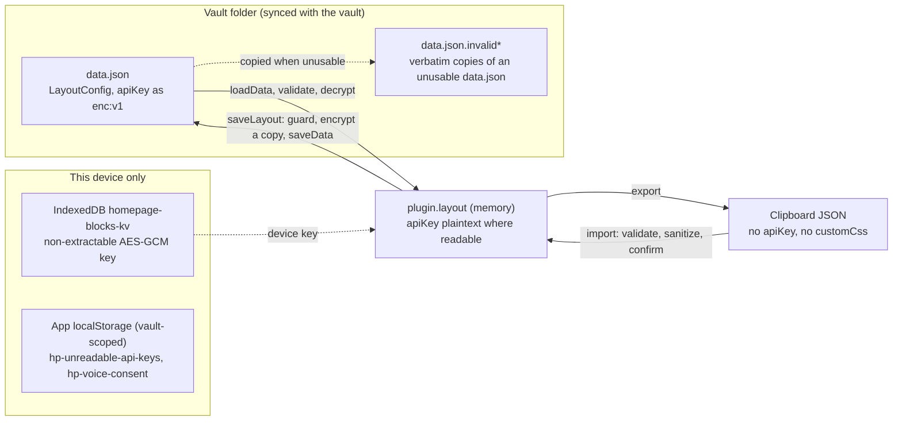
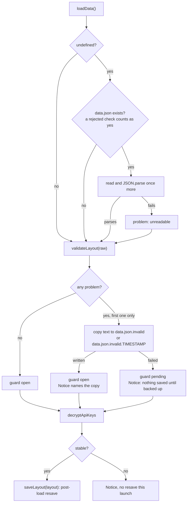
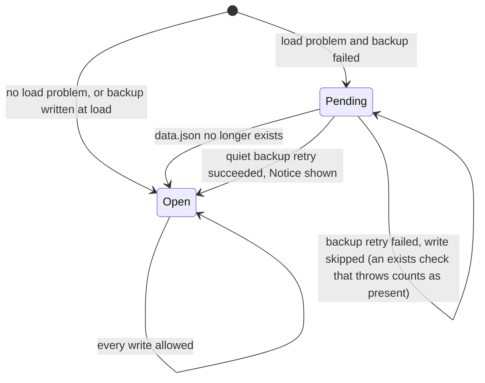
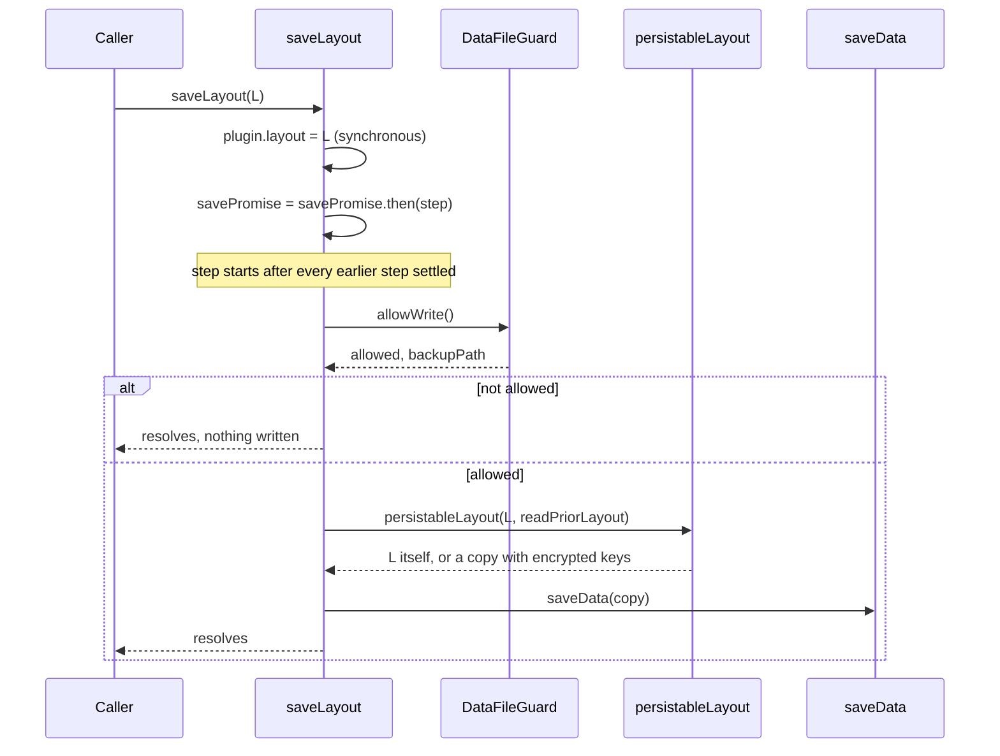

# Data model

What the plugin persists, how it validates and migrates it on load, how it writes it back, and what each device keeps for itself. Everything here describes the working tree of branch `xray-remediation`. Each claim cites its source as `path:line`.

Related docs:

- [architecture.md](architecture.md) covers module layout and lifecycle.
- [flows.md](flows.md) covers startup, open modes, edit mode and inline edits end to end.
- [blocks.md](blocks.md) lists each block type's own config keys.
- [styling.md](styling.md) covers how the shared `_` keys render.
- [api/plugin.md](api/plugin.md) documents `IHomepagePlugin` and the accessors.
- [api/grid.md](api/grid.md) covers positions, auto-height and packing.
- [api/blocks.md](api/blocks.md) documents `BaseBlock` and `BlockFactory`.

## 1. Where state lives

| Store | Content | Scope | Written by |
|---|---|---|---|
| `<plugin dir>/data.json` | One `LayoutConfig` object as JSON. `apiKey` values are ciphertext wherever encryption works. | Synced with the vault | `Plugin.saveData` inside `saveLayout` (`src/main.ts:424-458`) |
| `data.json.invalid`, `data.json.invalid.<ms>` | A verbatim copy of a `data.json` that could not be used | Plugin dir, synced; ignored by git (`.gitignore`) | `backupDataFile` (`src/utils/loadRecovery.ts:81-104`) |
| `plugin.layout` | The live `LayoutConfig`. It holds plaintext `apiKey` values where this device can decrypt them. | Memory | `onload` (`src/main.ts:250`), then `saveLayout`, which assigns it synchronously (`src/main.ts:425`). The grid callback and Discard also assign it just before calling `saveLayout` (`src/HomepageView.ts:35`, `src/EditToolbar.ts:82`). |
| IndexedDB `homepage-blocks-kv` / `keys` / `apiKeyDeviceKey` | The device's AES-GCM-256 `CryptoKey` | Per device and origin (§9.2) | `loadDeviceKey` (`src/utils/apiKeyCrypto.ts:87-119`) |
| `app.loadLocalStorage` / `saveLocalStorage` keys | Notice bookkeeping and voice consent | Per device and vault (§10) | `src/main.ts:350-367`, `src/blocks/VoiceDictationBlock.ts:21-40` |

The plugin dir is `manifest.dir`, falling back to `${vault.configDir}/plugins/${manifest.id}` (`src/main.ts:234`). The manifest id is `homepage-blocks`.

## 2. `LayoutConfig`

Declared at `src/types.ts:51-88`. The defaults come from `DEFAULT_LAYOUT_DATA` (`src/validation.ts:24-109`). Always take a copy through `getDefaultLayout()`, which is `structuredClone` of that template (`src/validation.ts:112-114`).

The "On load" column states what `validateLayout` accepts (`src/validation.ts:295-393`). Any other value is replaced by the fallback shown.

### 2.1 Layout

| Field | Type | Default | On load | Meaning |
|---|---|---|---|---|
| `columns` | `number` | `3` | One of `2, 3, 4, 5`, else `3` (`validation.ts:308-310`) | Desktop grid columns. In Unified mode every device uses them. `blocks` is clamped to this value (§6.2). |
| `layoutPriority` | `'row'` | `'row'` | Only `'row'`. Anything else, legacy `'column'` included, becomes `'row'` (`validation.ts:311-313`). | Packing direction. It is a reserved single-value union; the `priority` parameters are threaded through but ignored (`types.ts:16-25`). |
| `responsiveMode` | `'unified' \| 'separate'` | `'unified'` | One of those two (`validation.ts:314-316`) | **Unified:** every device renders `blocks` with `columns`. **Separate:** a device with `Platform.isMobile` renders `mobileBlocks` with `mobileColumns` (`main.ts:371-385`). |
| `mobileColumns` | `number` | `1` | One of `1, 2, 3`, else `1` (`validation.ts:317-319`) | Mobile grid columns in Separate mode. `mobileBlocks` is clamped to this value on every load, even in Unified mode. |
| `mobileLayoutPriority` | `'row'` | `'row'` | As `layoutPriority` (`validation.ts:320-322`) | Mobile packing direction (reserved) |
| `mobileBlocks` | `BlockInstance[]` | `[]` | See §6.2. Missing or `null` becomes `[]`. Any other non-array becomes `[]` and is reported as `unusable`. | Mobile block list. It is kept, unused, in Unified mode. |
| `blocks` | `BlockInstance[]` | 8 demo blocks (§4) | See §6.2. Missing or `null` becomes the demo blocks **without a report**. Any other non-array becomes the demo blocks and is reported as `unusable`. `[]` stays empty. | Desktop block list, and the only list in Unified mode |

### 2.2 Startup

The same gating logic is described in [flows.md](flows.md). A mobile device (`Platform.isMobile`) uses the `mobile*` values only when `separateStartup` is `true` (`src/utils/startupResolver.ts:23-37`). That gate is independent of `responsiveMode`.

| Field | Type | Default | On load | Meaning |
|---|---|---|---|---|
| `openOnStartup` | `boolean` | `false` | boolean (`validation.ts:323-325`) | Open the homepage in `onLayoutReady` |
| `openMode` | `OpenMode` | `'retain'` | `'replace-all' \| 'replace-last' \| 'retain'` (`validation.ts:326-328`) | Tab handling for the startup open |
| `manualOpenMode` | `OpenMode` | `'retain'` | As above (`validation.ts:329-331`) | Tab handling for the ribbon and command |
| `openWhenEmpty` | `boolean` | `false` | boolean (`validation.ts:332-334`) | Open when every root leaf is empty |
| `pin` | `boolean` | `false` | boolean (`validation.ts:335-337`) | Pin the homepage tab |
| `separateStartup` | `boolean` | `false` | boolean (`validation.ts:338-340`) | Mobile devices use the `mobile*` values below |
| `mobileOpenOnStartup` | `boolean` | resolved `openOnStartup` | boolean, else the **resolved desktop value** (`validation.ts:344-346`) | Mobile override |
| `mobileOpenMode` | `OpenMode` | resolved `openMode` | (`validation.ts:347-349`) | Mobile override |
| `mobileManualOpenMode` | `OpenMode` | resolved `manualOpenMode` | (`validation.ts:350-352`) | Mobile override |
| `mobileOpenWhenEmpty` | `boolean` | resolved `openWhenEmpty` | (`validation.ts:353-355`) | Mobile override |
| `mobilePin` | `boolean` | resolved `pin` | (`validation.ts:356-358`) | Mobile override |

Each `mobile*` fallback is the desktop value after that value has itself been validated, not the template constant. A `data.json` written before these fields existed therefore mirrors desktop on mobile.

### 2.3 Display

| Field | Type | Default | On load | Meaning |
|---|---|---|---|---|
| `showScrollbar` | `boolean` | `true` | If it is a boolean, it is used. Otherwise, if legacy `hideScrollbar` is a boolean, its inverse is used. Otherwise `true`. (`validation.ts:362-366`) | `false` adds `homepage-no-scrollbar` (`src/HomepageView.ts:31`) |
| `compactLayout` | `boolean` | `true` | boolean (`validation.ts:367-369`) | Initial y-packing in view mode. The repack after an auto-height change runs whatever this value is ([flows.md](flows.md) §7). |
| `hoverHighlight` | `boolean` | `true` | boolean (`validation.ts:370-372`) | Adds `homepage-hover-highlight` (`src/HomepageView.ts:32`) |

### 2.4 Shape guarantees

- `validateLayout` returns an object literal with exactly these 21 fields (`validation.ts:385-392`).
  - Any other top-level key is gone from memory after load.
  - The next save, normally the post-load resave (§7.4), then removes it from `data.json`. Legacy `hideScrollbar` goes the same way.
- Only the load and import paths run validation. `saveLayout` writes whatever object it is given (`main.ts:424-440`). In-tree writers build that object by spreading `plugin.layout`, or from `validateLayout` / `getDefaultLayout()` output (import, reset).

## 3. `BlockInstance`

Declared at `src/types.ts:29-49`.

| Field | Type | On load (`isValidBlockInstance`, `validation.ts:225-237`, and the clamp at `validation.ts:271-275`) | Meaning |
|---|---|---|---|
| `id` | `string` | Must match `/^[a-zA-Z0-9_-]+$/` (`SAFE_ID_RE`, `validation.ts:119`). Duplicates within one array are removed. | Identity (§5) |
| `type` | `BlockType` | One of the 17 `BLOCK_TYPES` (`types.ts:4-10`), after the legacy rename (§6.4) | Block factory key |
| `x` | `number` | Finite, `>= 0`. Clamped to `max(0, columns - min(w, columns))`. | Column, 0-indexed |
| `y` | `number` | Finite, `>= 0`. **No upper bound.** | Row, 0-indexed |
| `w` | `number` | Finite, `>= 1`. Clamped to `columns`. | Width in columns |
| `h` | `number` | Finite, `>= 1`. **No upper bound.** | Height in rows |
| `collapsed?` | `boolean` | **Not validated** | Collapsed state |
| `_expandedH?` | `number` | **Not validated** | Height to restore on expand |
| `config` | `Record<string, unknown>` | Must be a non-null, non-array object. **Apart from the migrations of §6.4, its contents are not validated on load.** | Block settings (§3.2) |

There is no integer check: a fractional `x` passes. Unknown extra fields on a block survive both load and import, because validation copies blocks with `{ ...b }` (`validation.ts:272`) and the import sanitizer rewrites only `config` (`src/utils/importSanitizer.ts:123-127`).

### 3.1 Position semantics

- **Canonical columns.** Positions are stored against the persisted `columns` / `mobileColumns`. The grid can narrow responsively, so that its effective column count is below the canonical one. In that state a position persist writes only `h`, and only for fixed-height blocks (`src/grid/LayoutPersister.ts:56, 86-106`).
- **Auto-height blocks.** Position persists write `x`, `y` and `w` only; the stored `h` is not rewritten (`LayoutPersister.ts:82-93, 104`; the same rule applies on block removal, `src/grid/EditHandleBar.ts:189-195`). The rendered height comes from measuring content. See [api/grid.md](api/grid.md).
- **Column changes.**
  - Changing the column count from the edit toolbar clamps `w` and saves the new count (`src/GridLayout.ts:237-252`).
  - The settings tab dropdowns save only `columns` or `mobileColumns` (`src/settings/HomepageSettingTab.ts:227-237, 247-257`).
  - Render clamps `w` again (`GridLayout.ts:351`), and the next load clamps `x` and `w` (§6.2).
- **Collapse.**
  - Collapsing resizes the cell to 1 row, then writes `collapsed: true` and `_expandedH: <live h>` (`src/grid/CollapseToggle.ts:63-69`). The stored `h` is not changed by the toggle; in view mode a collapsed block is drawn one row high whatever `h` holds (`viewModeHeight`, `CollapseToggle.ts:16-28`), at render and when the pane widens back to the saved columns.
  - Expanding resizes the cell and writes `collapsed: false` and `h: _expandedH ?? h` (`CollapseToggle.ts:70-77`).
  - The toggle is a no-op in edit mode (`CollapseToggle.ts:53`).
  - A block with `collapsed: true` and `_showTitle === false` renders expanded, at `_expandedH` when that is a positive number and at `h` otherwise (`CollapseToggle.ts:16-28`, `GridLayout.ts:343-346`, `src/grid/BlockWrapper.ts:21-24`).

### 3.2 `config`

- **Key namespaces** (`types.ts:43-48`):
  - Keys starting with `_` are shared card, header and body styling that every block accepts.
  - Block-specific keys must not start with `_`.
- **Declared keys.** Each factory's `defaultConfig` in `registerBlocks()` (`src/main.ts:41-207`) lists the keys its block reads. It seeds new blocks as a **shallow** copy, `config: { ...factory.defaultConfig }` (`src/EditToolbar.ts:196`), so array defaults such as `items: []` start out shared with the factory object. It also serves as the import allowlist (§11.2).
  - A key declared as `undefined` is never serialized, because JSON drops `undefined`.
  - The per-type key lists are in [blocks.md](blocks.md).
- **Settings modal.** Save replaces the whole `config` with a `structuredClone` draft (`src/modals/BlockSettingsModal.ts:51`; `EditHandleBar.ts:99-105`).
- **Keys with special persistence rules:**

| Key | Where | Rule |
|---|---|---|
| `apiKey` | voice-dictation (declared `''`, `main.ts:192`). The crypto helpers match any block's `config.apiKey` by name (`src/utils/apiKeyLayout.ts:6-9`). | Encrypted at rest (§9). Removed by export and import. Set to `''` by copy-to-mobile (§11). |
| `customCss` | button-grid only. It is read but deliberately undeclared (`main.ts:78-79`). | Deleted from every other type on load (`validation.ts:206-208`). Removed by export and import. |

#### Shared `_` keys

The persisted types and ranges are below. Rendering is described in [styling.md](styling.md). Numeric ranges come from `STYLE_RANGES` (`src/utils/blockStyling.ts:13-23`). Render clamps each value (`blockStyling.ts:83-213`), but an out-of-range value stays stored until an import sanitizes it.

| Key | Type / format | Default when absent |
|---|---|---|
| `_titleLabel` | string (import keeps at most 200 chars) | The block's built-in title (`src/blocks/BaseBlock.ts:63-65`) |
| `_titleEmoji` | string (import keeps at most 16 chars) | none |
| `_showTitle`, `_showBorder`, `_showBackground`, `_showHeaderAccent` | boolean | Shown; only `false` hides |
| `_showDivider` | boolean | Hidden; only `true` shows (`src/grid/BlockWrapper.ts:44`) |
| `_titleSize` | `/^h[1-6]$/` (`BaseBlock.ts:5`) | No size class |
| `_borderStyle` | `solid` \| `dashed` \| `dotted` (`blockStyling.ts:45`) | CSS default |
| `_accentColor`, `_gradientStart`, `_gradientEnd` | `''` or `#rrggbb` (`blockStyling.ts:6`) | none |
| `_titleGap` | 0–48 | CSS default, 8px (a stored 0 also means the default) |
| `_cardPadding` | −48–48 | The `--hp-card-padding` token (a stored 0 also means the token) |
| `_bgOpacity` | 0–100 | 100 |
| `_backdropBlur` | 0–20 | 0 |
| `_borderWidth` | 0–4 | CSS default |
| `_borderRadius` | 0–24 | CSS default |
| `_elevation` | 0–3 | 0 |
| `_accentIntensity` | 5–100 | 15 |
| `_gradientAngle` | 0–360 | 135 |

## 4. Default layout

The template is `validation.ts:45-108`, with `columns: 3`.

| id | type | x, y, w, h | config |
|---|---|---|---|
| `default-static-text` | static-text | 0, 0, 1, 3 | `{ content: '' }` |
| `default-clock` | clock | 1, 0, 1, 3 | `{ showSeconds: false, showDate: true }` |
| `default-folder-links` | folder-links | 2, 0, 1, 3 | `{ _titleLabel: 'Quick links', links: [] }` |
| `default-insight` | quotes-list | 0, 3, 2, 3 | `{ tag: '', _titleLabel: 'Daily insight', dailySeed: true }` |
| `default-button-grid` | button-grid | 2, 3, 1, 5 | `_titleLabel: 'Quick actions'`, `columns: 2`, and 6 `{ emoji, label }` items with no link target |
| `default-quotes` | quotes-list | 0, 6, 2, 3 | `{ tag: '', _titleLabel: 'Quotes', columns: 2, maxItems: 0 }` |
| `default-voice-dictation` | voice-dictation | 0, 8, 2, 3 | `{ folder: '', triggerMode: 'tap', _titleLabel: 'Voice notes' }` (no `apiKey`) |
| `default-gallery` | image-gallery | 0, 11, 3, 3 | `{ folder: '', _titleLabel: 'Gallery', columns: 3, maxItems: 0 }` |

The stored rectangles of `default-quotes` (rows 6–8) and `default-voice-dictation` (from row 8) overlap in columns 0–1. The comment "Row 3 (y: 8)" (`validation.ts:94`) does not match the "Row 2 (y: 6–8)" comment above it (`validation.ts:87`). The default `mobileBlocks` is `[]`.

## 5. Block ids

| Source | Form | Where |
|---|---|---|
| Default layout | `default-<name>` | `validation.ts:48-103` |
| `newId()` | `crypto.randomUUID()`, or `'hp-' + base36 random + base36 Date.now()` when that API is missing | `src/utils/ids.ts:5-9` |

Both forms match `SAFE_ID_RE`.

- **Minted** by: add block (`EditToolbar.ts:187`), duplicate (`EditHandleBar.ts:82`) and copy-to-mobile (`HomepageSettingTab.ts:276`, every block).
- **Kept** by: load, import, settings save, collapse and moves.
- **Reset:** a Unified or desktop reset brings back the `default-*` ids. A reset issued from a mobile device in Separate mode leaves `mobileBlocks` empty (§11.4).
- **Uniqueness** is enforced per array at validation. The first occurrence wins (`validation.ts:265-270`), and the drop is not reported. The same id may appear in both `blocks` and `mobileBlocks`.
- **Keyed by id:**
  - GridStack `gs-id` and `updateBlockConfig` (`main.ts:498-508`).
  - The refuse-to-downgrade lookup, keyed by id per array (`apiKeyLayout.ts:49-59`).
  - The unreadable-key Notice record (`apiKeyLayout.ts:168-176`).
  - Pomodoro's in-memory `timerStore` (`src/blocks/PomodoroBlock.ts:25, 135`).

## 6. Validation and migration

### 6.1 `validateLayout(raw, onTopLevelCorruption?, onBlocksDropped?)`

Defined at `validation.ts:295-393`.

- `null` or `undefined` returns the defaults and fires **no** callback (`:301`).
- A non-object or an array fires `onTopLevelCorruption` and returns the defaults (`:302-305`).
- Each scalar field is checked independently, with the fallbacks from §2.
- A `blocks` or `mobileBlocks` that is present, not `null` and not an array fires `onTopLevelCorruption`. The array is replaced by its default (`:375-376`).
- Invalid-block counts from both arrays are summed into one `onBlocksDropped(count)` (`:379-383`).
- **Contract:** idempotent. `validateLayout(validateLayout(x))` deep-equals `validateLayout(x)`, because every load resaves (`:282-284`).

### 6.2 `validateBlocks(raw, columns, defaults, onInvalidDropped?)`

Defined at `validation.ts:249-276`. Steps run in this order:

1. A non-array input returns `defaults` (`:255`).
2. `migrateBlockInstance` runs on every entry (`:256`).
3. Entries are filtered through `isValidBlockInstance`, and the dropped count is reported (`:257-259`).
4. The result is sliced to `MAX_BLOCKS` (100). This clamp is **not reported** (`:260`).
5. Ids are de-duplicated, first occurrence wins. This is **not reported** (`:265-270`).
6. `w = min(w, columns)` and `x = min(x, max(0, columns - min(w, columns)))` (`:271-275`). `blocks` uses `columns` and `mobileBlocks` uses `mobileColumns`.

### 6.3 Limits

| Limit | Value | Enforced |
|---|---|---|
| Blocks per array | `MAX_BLOCKS = 100` (`validation.ts:120`) | **Only at load and import.** Add and duplicate do not check it: `MAX_BLOCKS` has no other reference in `src/`. A 101st block is saved, then dropped without a report at the next launch, and the post-load resave persists the truncation. |
| Grid columns | 2–5 desktop, 1–3 mobile | Load, the settings dropdowns, and the toolbar choices (`EditToolbar.ts:118`) |
| `x`, `w` | Clamped to the column count | Load and import. Also: the toolbar column change (`w` only, `GridLayout.ts:246-249`), copy to mobile (§11.3), move up/down (`x` only, `EditHandleBar.ts:243, 246`) and position persists (`LayoutPersister.ts:71-73`). The settings dropdowns do not clamp. |
| `y`, `h`, `_expandedH` | Unbounded | never |
| button-grid `config.columns` | at most 3 | Load migration (`validation.ts:199-201`) |
| `_titleLabel` / `_titleEmoji` length | 200 / 16 | Import only (`importSanitizer.ts:42-43`) |

### 6.4 `migrateBlockInstance(b)`

Defined at `validation.ts:131-222`. It takes a shallow copy of the block (`:132`) but **mutates the nested `config` in place** (`:152-154`), so the caller's object changes too. Migrations run in this order, and each one deletes its legacy key or writes only when the target key is unset, which keeps the function idempotent (`:127-129`).

| # | Legacy shape | Result | Lines |
|---|---|---|---|
| 1 | `col`, `row`, `colSpan`, `rowSpan` | `x = max(0, col-1)`, `y = max(0, row-1)`, `w = colSpan`, `h = rowSpan`, each only when the target is not already a number. The legacy keys and `newRow` are deleted. | 138-146 |
| 2 | `type: 'tag-grid'` | `'button-grid'` | 148 |
| – | A `config` that is not an object | Config migrations are skipped. `isValidBlockInstance` then drops the block. | 149-154 |
| 3 | `_transparent: true` | Sets `_showBorder: false` and `_showBackground: false` if unset, then deletes `_transparent`. `_transparent: false` is left as it is. | 156-160 |
| 4 | `_hideTitle`, `_hideBorder`, `_hideBackground`, `_hideHeaderAccent` | `true` becomes `_showX: false` if that is unset. The `_hideX` key is always deleted. | 165-178 |
| 5 | quotes-list `hideAccentBar` | `true` becomes `showAccentBar: false` if unset. The legacy key is deleted. | 180-185 |
| 6 | voice-dictation `whisperApiKey`, `whisperLanguage` | Become `apiKey` and `language` if those are falsy. The legacy keys are deleted. | 188-197 |
| 7 | button-grid `columns > 3` | `3` | 199-201 |
| 8 | `customCss` on any type other than button-grid | deleted | 206-208 |
| 9 | string `title` | A non-empty `title` becomes `_titleLabel` if that is falsy. An empty `title` on html or static-text sets `_showTitle: false` if unset. `title` is deleted. | 210-220 |

There are two top-level migrations as well: `hideScrollbar` becomes `showScrollbar` (§2.3), and `layoutPriority: 'column'` becomes `'row'`.

## 7. Load path and recovery

`onload` runs `registerBlocks()` first, then loads the layout (`src/main.ts:221-260`). The view, commands, ribbon and settings tab are registered only after the load completes (`main.ts:262-298`).

### 7.1 `loadData()`: `null` versus `undefined`

As the code comment at `src/utils/loadRecovery.ts:30-36` puts it, Obsidian's `loadData()` returns `null` when `data.json` does not exist, and `undefined` when it exists but cannot be read or parsed. `validateLayout` treats both as "no layout yet", so `loadLayoutWithRecovery` tells them apart through the adapter.

| `loadData()` returned | Further check | Outcome |
|---|---|---|
| `null` | – | Defaults, no problem. This is a first install. |
| `undefined` | `adapter.exists()` is `false` | Defaults, no problem |
| `undefined` | `exists()` is `true` or rejects (rejection counts as present, `:48`), and a re-read parses | The parsed value is used. This covers a transient lock (`:49-52`). |
| `undefined` | Present, and the re-read fails or does not parse | Problem `unreadable`; defaults are loaded (`:51`) |
| An object | – | `validateLayout`. It may report `unusable` (§6.1) or `blocks-dropped` (§6.2). |
| Any other non-object (string, number, boolean) or an array | – | Problem `unusable`; defaults are loaded |

### 7.2 Flow

### 7.3 Problems, backups and the guard

- **Only the first problem is reported** (`loadRecovery.ts:59`). An `unusable` top level or blocks field is recorded before `blocks-dropped`, because `validateLayout` checks it first (`validation.ts:376` versus `:383`).
- **Problem kinds and their Notice.** The Notice is shown for 12 s (`main.ts:237-242`, `loadRecovery.ts:139-149`):

  | Problem | Notice text | Also |
  |---|---|---|
  | `unreadable` | "data.json could not be read, so the default layout was loaded." | – |
  | `unusable` | "data.json does not hold a usable layout, so the default blocks were loaded." | – |
  | `blocks-dropped` | "N invalid block(s) couldn't be loaded and were removed." | A `console.warn` with the count |

  Each Notice ends with a backup sentence. With a backup it reads "The original file was saved as `<name>`." Without one it reads "The original file could not be backed up, so nothing will be saved until it can be; data.json is kept as it is."
- **Backup** (`backupDataFile`, `loadRecovery.ts:81-104`):
  - It writes the file's **text** verbatim. It never re-serializes, because migration has already mutated the parsed value (`:38-39`).
  - The target is `data.json.invalid`. If that exists, the target becomes `data.json.invalid.<Date.now()>`. If `exists()` throws, the base name is used.
  - Failure returns `null` and logs `console.error`, except on guard retries.
- **`DataFileGuard`** (`loadRecovery.ts:113-136`) is consulted by every write (§8.1). It starts pending only when a problem was found and its backup failed (`:62-63`).

When a retry succeeds, the save shows a 12 s Notice: "the original data.json was saved as `<name>`; saving resumes" (`main.ts:433`).

### 7.4 After validation

1. `decryptApiKeys(validated)` runs (§9.4). It reassigns `validated.blocks` and `validated.mobileBlocks` (`apiKeyLayout.ts:152-153`).
2. `plugin.layout = validated` (`main.ts:250`).
3. If the decrypt was not `stable`, a 10 s Notice says the voice API key could not be loaded and will be retried at the next restart (`main.ts:251-253`).
4. `announceUnreadableKeys` runs (§10).
5. **If `stable`, `saveLayout(plugin.layout)` runs.** A normal launch therefore rewrites `data.json` (`main.ts:258-260`). This resave is how migrations, clamps, dropped keys and first-time key encryption reach disk. The guard still applies to it.

The plugin has no `onExternalSettingsChange` (there is no match in `src/`). The layout is read into memory once, at load; later reads of `data.json` (`readPriorLayout`, §9.3) serve only the key lookup. A `data.json` that sync delivers while Obsidian runs is overwritten, as a whole object, by the next save from this device.

## 8. Save chain

All persistence goes through `saveLayout` (`src/main.ts:424-458`).

| Writer | Path | What it replaces |
|---|---|---|
| Post-load resave | `main.ts:258-260` | The whole validated layout |
| Grid: drag stop, resize stop, auto-height persists, edit-mode flushes and the edit-exit repack, column change, add, duplicate, move up/down, remove, block settings save | `GridLayout` `onLayoutChange` → `HomepageView.ts:34-37` (sets `plugin.layout`, then `saveLayout`) | The active array through `buildLayoutUpdate` (`GridLayout.ts:580-594`), plus the active column count on a column change |
| Collapse toggle | `CollapseToggle.ts:80` | The active array |
| Edit mode Discard | `EditToolbar.ts:80-83` (sets `plugin.layout` synchronously first) | The active array, from the snapshot taken on entering edit mode (`EditToolbar.ts:53`) |
| Static text inline edit; embedded note following a rename of its file | `updateBlockConfig` (`StaticTextBlock.ts:130`, `EmbeddedNoteBlock.ts:42`) | One block's config in the active array |
| Settings tab | `HomepageSettingTab.ts:101-356, 428` | Top-level fields, `mobileBlocks` (copy), or the whole layout (reset, import) |

`buildLayoutUpdate` and `saveActiveBlocks` (`main.ts:476-481`) route the block array to `mobileBlocks` when `isMobileActive()`, and to `blocks` otherwise. Only `buildLayoutUpdate` takes a column count (`extra.columns`), routed the same way to `mobileColumns` / `columns`.

### 8.1 Mechanics

### 8.2 Ordering guarantees

1. **Memory first.** `plugin.layout` is assigned before the call returns (`main.ts:425`). Any later `activeBlocks()` read sees the new value, even before it reaches disk.
2. **FIFO writes, last call wins.** Steps run strictly in call order. Each step writes the layout passed to *its own* call, not `plugin.layout` at run time. Once the chain drains, disk holds the last call's layout, provided that write succeeded.
3. **The whole write sits in one step.** The guard check, the prior-disk read, encryption and `saveData` all run inside the same step. Save N+1's `readPriorLayout` therefore sees save N's output (`main.ts:431-440, 467-474`).
4. **No coalescing here.** N calls produce N writes. Debouncing happens upstream, for example `LayoutPersister.persistDebounced` at 50 ms (`LayoutPersister.ts:116-120`).
5. **The chain never breaks and never rejects.** A failed step is caught by the rejection handler (`main.ts:443-455`), later steps still run, and `saveLayout` always resolves. A step the guard blocks counts as a success.
6. **`saveLayout` resolves when its own step is done** (`main.ts:457`), not when later steps are done.
7. **`updateBlockConfig(id, patch)`** (`main.ts:490-510`):
   1. It awaits `savePromise` as it stood at call time.
   2. It then reads `activeBlocks()` and builds `{ ...b, config: { ...b.config, ...patch } }`, so positions from saves queued before or during the wait are kept.
   3. It saves through `saveActiveBlocks`.
   4. A missing id logs `console.warn` and the patch is dropped. The same happens to a block that exists only in the inactive platform's array.

   A caller that builds a layout from a value read before an `await` can overwrite newer in-memory state. This is the hazard noted at `main.ts:487-488`.

### 8.3 Failure handling

- On a `saveData` rejection, `console.error('[Homepage Blocks] Failed to save layout:', err.message)` is logged. The raw error object is never logged, so a key cannot leak into the console.
- An 8 s Notice, "failed to save layout. Check disk space / permissions.", is shown once until the next success (`main.ts:443-455`).
- Memory stays authoritative, so the session keeps working.
- Whether `saveData` actually rejects on a disk error is host behaviour and is not visible in this repo.

## 9. API keys at rest

The code is in `src/utils/apiKeyCrypto.ts` (primitives) and `src/utils/apiKeyLayout.ts` (whole-layout walks). Only `config.apiKey` is handled, matched by name on any block type.

### 9.1 Format

`enc:v1:<base64 IV>:<base64 AES-GCM output>` (`apiKeyCrypto.ts:23-25, 169-171`). The IV is 12 random bytes per encryption. `isEncrypted(v)` is a prefix test for `enc:v1:` (`:136-138`). Any other string is treated as plaintext.

### 9.2 Device key

- `loadDeviceKey()` (`apiKeyCrypto.ts:87-119`) returns the key cached in the module. Otherwise it reads IndexedDB database `homepage-blocks-kv` (version 1), store `keys`, record `apiKeyDeviceKey`.
- If no key is stored, it generates an **AES-GCM 256, non-extractable** key with usages `encrypt` and `decrypt`, stores it and caches it (`:101-107`).
- **Missing WebCrypto or IndexedDB** gives `{ key: null, transient: false }`, which is permanent (`:91`).
- **An exception** gives `{ key: null, transient: true }` and a `console.error` (`:112-118`).
- `onunload` drops only the cached reference (`_resetDeviceKeyCache`, `main.ts:342`); the IndexedDB record stays.
- **Scope.** The database name has no vault component. Vaults opened in the same Obsidian install therefore presumably share one device key, since IndexedDB is per origin. This has not been verified at runtime. Clearing site data or IndexedDB loses the key, and every stored ciphertext on that device becomes unreadable (§9.4).

### 9.3 Save: `persistableLayout` → `encryptApiKeys`

- `persistableLayout(layout, readPrior)` (`apiKeyLayout.ts:31-37`) returns `layout` unchanged unless some block in either array holds a non-empty plaintext `apiKey` (`needsEncryption`, `:16-22`).
- Otherwise it reads the on-disk layout (`readPriorLayout` → `loadData()`, raw and unvalidated, `main.ts:467-474`) and returns a **copy** with encrypted keys. Memory keeps the plaintext.
- On a device that decrypted its own key at load, memory always holds plaintext. **Every save there, drags and auto-height persists included, re-reads `data.json` and re-encrypts with a fresh IV.** The ciphertext on disk therefore changes at every save.

Per block, `encryptApiKeys` (`apiKeyLayout.ts:48-93`) works as follows. Empty, non-string and already-encrypted values pass through.

| `encryptStringEx` result | Prior on disk (same id, same array) is ciphertext | Written to disk |
|---|---|---|
| ok | – | New ciphertext |
| Failed, transient (key store error or `encrypt()` threw) | yes | The prior ciphertext (refuse to downgrade, `:67-71`) |
| Failed, transient | no | `''`. Memory keeps the plaintext, so the next save retries. If the session ends first, the key is lost on disk (`:78-80`). |
| Failed, permanent (no WebCrypto) | yes | The prior ciphertext |
| Failed, permanent | no | **Plaintext**, with a `console.warn` (`:81-85`, `apiKeyCrypto.ts:161-166`) |

Both arrays, and every block within them, are encrypted concurrently (`apiKeyLayout.ts:61-62, 88-91`). `loadDeviceKey` shares no in-flight promise. On a device with no stored key, a save holding two or more plaintext keys can therefore generate more than one device key, and IndexedDB keeps the last one written. A ciphertext made with a key that was not kept cannot be decrypted after the next launch; it is then kept and reported as unreadable (§9.4). That happens only if the session ends first: while the plaintext is in memory, every later save re-encrypts it with the cached key and rewrites that ciphertext.

### 9.4 Load: `decryptApiKeys`

Defined at `apiKeyLayout.ts:115-155`. It runs sequentially, desktop array first. **Keys are never cleared.**

| Stored value | Decrypt result | Memory holds | Effect |
|---|---|---|---|
| `''`, non-string, or plaintext | passed through | as is | A plaintext key is encrypted by the post-load resave |
| `enc:v1:`, readable here | ok | plaintext | – |
| `enc:v1:`, key store transiently unavailable | `no-key`, transient | ciphertext | `stable = false`: Notice, no resave this launch (`:130-135`) |
| `enc:v1:`, no WebCrypto here | `no-key`, permanent | ciphertext | Id added to `unreadable` (`:136-145`) |
| `enc:v1:`, another device's key, a lost key, or malformed | `corrupt` (`apiKeyCrypto.ts:217, 230-235`) | ciphertext | Id added to `unreadable` |

Blocks treat an encrypted value as "no usable key on this device" and never send it. The voice block disables the mic and shows "API key unavailable on this device" (`src/blocks/VoiceDictationBlock.ts:131-136, 282`).

### 9.5 What other devices see

There is one `apiKey` slot per block. The key follows whichever device last encrypted it.

| On disk | The device that wrote it | Another device with WebCrypto | A device without WebCrypto |
|---|---|---|---|
| `''` | no key | no key | no key |
| plaintext | Reads it | Reads it. Its next save encrypts it with **its** key, and the writer then sees ciphertext it cannot read. | Reads it and writes it back as plaintext |
| `enc:v1:` | Decrypts it and re-encrypts it at every save | Unreadable. The ciphertext is kept and written back unchanged. | Unreadable, kept |

- **Entering a key on a device that cannot read the stored one** (the settings field is blank, with placeholder "Stored key unreadable on this device"):
  - A typed value replaces the key for every device sharing the block.
  - Leaving the field blank keeps the stored ciphertext (`VoiceDictationBlock.ts:578-586`).
- **Exception:** on a device without WebCrypto, a typed key over a stored ciphertext is *not* persisted. Refuse-to-downgrade writes the prior ciphertext back, and the new key lives in memory for that session only.
- In Separate mode `blocks` and `mobileBlocks` are distinct blocks, each with its own slot and its own prior-map lookup (`apiKeyLayout.ts:58-59`).

### 9.6 Keys across flows

| Flow | `apiKey` handling |
|---|---|
| Load | Decrypted where possible; anything else is kept as is (§9.4) |
| Save | Encrypted into the written copy; memory keeps the plaintext (§9.3) |
| Export | Deleted (`HomepageSettingTab.ts:376-383`) |
| Import | Stripped (`importSanitizer.ts:10, 85-88`); the current keys in both arrays are lost on confirm |
| Copy desktop to mobile | Set to `''` when the key is present (`HomepageSettingTab.ts:272-273`) |
| Duplicate | Copied with the block under a new id (`EditHandleBar.ts:80-84`). A plaintext copy is encrypted by the next save; a foreign ciphertext stays as it is. |

## 10. Device-local storage

| Key | Store | Value | Owner |
|---|---|---|---|
| `homepage-blocks-kv` / `keys` / `apiKeyDeviceKey` | IndexedDB | A non-extractable `CryptoKey` | `apiKeyCrypto.ts:31-33` |
| `hp-unreadable-api-keys` | `app.loadLocalStorage` / `saveLocalStorage` | `string[]` of block ids already announced as unreadable; `null` clears the entry | `main.ts:215, 350-367` |
| `hp-voice-consent` | same | `{ whisper?: true, gemini?: true }` | `VoiceDictationBlock.ts:6, 21-40` |

- **Scope.** `App.loadLocalStorage` / `saveLocalStorage` scope keys to the vault (Obsidian ≥ 1.8.7, the `minAppVersion` in `manifest.json`). Both keys are wrapped in try/catch; unavailable storage means "nothing recorded".
- **Unreadable-key Notice** (`unreadableKeyNotice`, `apiKeyLayout.ts:168-176`):
  - Only the array this device renders counts: `mobileBlocks` when `Platform.isMobile && responsiveMode === 'separate'`, else `blocks` (`main.ts:351`).
  - A 12 s Notice fires when an unreadable id is not in the stored record. The record is then replaced with the current unreadable ids.
  - Ids are used, not ciphertexts, because the owning device changes the ciphertext at every save.
  - A launch where the key store is transiently unavailable finds no unreadable id, so it clears the stored record; the Notice then repeats at the next launch that finds the key unreadable.

## 11. Export, import, copy to mobile, reset

All four are in the settings tab (`src/settings/HomepageSettingTab.ts`). Export only writes to the clipboard. The other three end in `saveLayout` and then reload every open homepage view.

### 11.1 Export (`HomepageSettingTab.ts:365-391`)

- It serializes `structuredClone(plugin.layout)`, the in-memory, decrypted layout, as JSON with 2-space indent, to the clipboard.
- It deletes `config.apiKey` and `config.customCss` from every block in both arrays.
- Everything else is kept: all 21 top-level fields, ids, `collapsed`, `_expandedH` and extra block fields.
- A missing clipboard API or a failed write flashes the button text; nothing is saved.

### 11.2 Import (`HomepageSettingTab.ts:393-436`)

1. `JSON.parse` the clipboard text. A parse error flashes "Invalid JSON".
2. `validateLayout(parsed, onTopLevelCorruption)` runs migrations, fallbacks, clamps and the id de-duplication.
   - Only top-level corruption aborts, with "Not a layout".
   - `onBlocksDropped` is not passed, so **invalid blocks are dropped silently**.
   - A clipboard holding `null` or `{}` validates to the **full default layout**.
3. `sanitizeImportedLayout` rewrites `config` in both arrays (`importSanitizer.ts:76-136`):

   | Config key | Kept when |
   |---|---|
   | `apiKey`, `customCss` | Never |
   | `_` key with a validator (`SHARED_VALIDATORS`, `:41-63`) | The validator accepts it. Strings are truncated and numbers clamped to `STYLE_RANGES`. |
   | Unknown `_` key | The value is a string, number or boolean (`:98-108`) |
   | Other key | It is an own property of the factory's `defaultConfig`, and its value matches the declared default's JSON type (`:18-27, 111-115`). Array element contents are not checked. A key declared `undefined` accepts a string, number or boolean. |

   Block-level fields are not sanitized.
4. A confirm dialog shows a summary: "`<n>` block(s): `<types>`", which counts **desktop** blocks only. It appends " · stripped N unsafe / unknown field(s)" when fields were stripped, and " · your saved API key will be removed" when any current block holds a non-empty `apiKey`.
   - The dialog is `ConfirmPresetModal`, whose wording still says "Load preset?" (`src/modals/ConfirmPresetModal.ts:3-8, 21-27`).
5. On confirm, `saveLayout(safe)` replaces the **whole** `LayoutConfig`: startup, display, responsive mode and both arrays. Ids are kept.

### 11.3 Copy desktop layout to mobile (`HomepageSettingTab.ts:259-286`)

This control is shown only in Separate mode. It replaces `mobileBlocks` with a copy of `blocks`:

| Field | In the copy |
|---|---|
| `id` | New `newId()` for every block |
| `w` | `min(w, mobileColumns)` |
| `x` | `min(x, max(0, mobileColumns - min(w, mobileColumns)))` |
| `config.apiKey` | `''` when present |
| `y`, `h`, `collapsed`, `_expandedH`, other config (`customCss` included) | Copied unchanged |

### 11.4 Reset to default layout

The button is at `HomepageSettingTab.ts:341-359`. It calls `buildResetLayout(plugin.layout, getDefaultLayout(), plugin.isMobileActive())` (`src/utils/layoutReset.ts:61-83`), which works on these field groups:

- `MOBILE_LAYOUT_FIELDS`: `mobileBlocks`, `mobileColumns`, `mobileLayoutPriority` (`:13-17`)
- `STARTUP_FIELDS`: the 11 startup fields of §2.2 (`:26-38`)

| Case | Desktop slice (`blocks`, `columns`, `layoutPriority`) | Mobile slice | Startup | `responsiveMode` | Display flags |
|---|---|---|---|---|---|
| Unified (`:68-74`) | Defaults: demo blocks, `3`, `'row'` | Kept | Kept | `'unified'` | **Reset to `true`** |
| Separate, issued from a mobile device (`:75-79`) | Kept | Reset: **`[]`**, `1`, `'row'` | Kept | Kept | Kept |
| Separate, issued from desktop (`:80-82`) | Defaults | Kept | Kept | **Becomes `'unified'`** | **Reset to `true`** |

The last row switches every synced mobile device back to rendering `blocks`. The doc comment "Resets only the layout slice" (`layoutReset.ts:52-54`) and the setting's description ("Restore all blocks to the default layout.") do not mention the display flags or `responsiveMode`.

## 12. Code comments that disagree with the code

| Location | Says | Code does |
|---|---|---|
| `main.ts:436-438`, `apiKeyLayout.ts:25-27` | Drags and auto-height persists skip the prior-disk read | True only while no plaintext key is in memory (§9.3) |
| `apiKeyLayout.ts:111-113` | `decryptApiKeys` does not mutate its input | It reassigns `layout.blocks` and `layout.mobileBlocks` (`:152-153`) |
| `layoutReset.ts:52-54` | "Resets only the layout slice" | It also resets the display flags and, from desktop in Separate mode, `responsiveMode` (§11.4) |
| `validation.ts:94` | "Row 3 (y: 8)" | That row overlaps `default-quotes` (§4) |
| `apiKeyCrypto.ts:249` | `_resetDeviceKeyCache` is a "Test hook" | It also runs in `onunload` (`main.ts:342`) |
| CLAUDE.md, Layout Persistence | `validateLayout` "clamps positions" | It clamps only `x` and `w`; `y`, `h` and `_expandedH` are unbounded (§6.3) |
