# Runtime flows

How the plugin behaves at run time, one flow per section: the trigger, the ordered steps with source locations, a diagram, and the non-obvious behaviour a change is likely to trip over. Citations are `path:line` against the current source tree. "Observed" notes describe what the code does; they are not claims about intent.

Related documents:

- [architecture.md](architecture.md) covers modules and ownership.
- [data-model.md](data-model.md) covers `LayoutConfig`, `BlockInstance`, validation and migration.
- [blocks.md](blocks.md) describes the 17 block types.
- [styling.md](styling.md) covers the shared `_` styling keys and CSS.
- The API references are [api/plugin.md](api/plugin.md), [api/blocks.md](api/blocks.md) and [api/grid.md](api/grid.md).

| # | Flow | Main entry points |
|---|---|---|
| 0 | [Write path shared by every flow](#0-the-write-path-shared-by-every-flow) | `HomepagePlugin.saveLayout` |
| 1 | [Plugin startup and load](#1-plugin-startup-and-load) | `HomepagePlugin.onload` |
| 2 | [Opening the homepage](#2-opening-the-homepage) | `HomepagePlugin.openHomepage` |
| 3 | [Rendering the grid](#3-rendering-the-grid) | `HomepageView.onOpen`, `GridLayout.render` |
| 4 | [Edit mode: enter, drag, resize, Done, Discard](#4-edit-mode-enter-drag-resize-done-discard) | `EditToolbar.toggleEditMode`, `GridLayout.setEditMode` |
| 5 | [Add Block](#5-add-block) | `EditToolbar.openAddBlockModal`, `GridLayout.addBlock` |
| 6 | [Block settings commit](#6-block-settings-commit) | `attachEditHandleBar` gear, `BlockSettingsModal.commit` |
| 7 | [Auto-height measurement](#7-auto-height-measurement) | `AutoHeightManager.request` |
| 8 | [Responsive column reduction](#8-responsive-column-reduction) | `ResponsiveColumnsManager.setup` / `apply` |
| 9 | [Collapse](#9-collapse) | `attachCollapseToggle` |
| 10 | [Inline Static Text edit](#10-inline-static-text-edit) | `StaticTextBlock.enterInlineEdit`, `plugin.updateBlockConfig` |
| 11 | [Export and import](#11-export-and-import) | `HomepageSettingTab.renderExportImportSection` |
| 12 | [External data.json change](#12-external-datajson-change) | `HomepagePlugin.onExternalSettingsChange` |

---

## 0. The write path shared by every flow

Every flow that changes the layout ends in `HomepagePlugin.saveLayout` (`src/main.ts:450-487`). There are three ways in:

| Route | Used by | Cite |
|---|---|---|
| `GridLayout.emitLayout` / `onLayoutChange`, which goes to `HomepageView`'s callback (`plugin.layout = l`) and then `plugin.saveLayout(l)` | `LayoutPersister.persist`, `setColumns`, `addBlock`, edit-mode exit repack, and the handle bar (duplicate, move, gear, remove) | `src/GridLayout.ts:81-83`, `246`, `318`, `366`, `src/HomepageView.ts:36-39` |
| `plugin.saveLayout` directly | CollapseToggle, Discard, the settings tab, the post-load resave in `onload`, `followRename` | `src/grid/CollapseToggle.ts:92`, `src/EditToolbar.ts:119-120`, `src/main.ts:292`, `504` |
| `plugin.updateBlockConfig(id, patch)`, then `saveActiveBlocks`, then `saveLayout` | StaticText inline save, the EmbeddedNote rename fallback (§1). The patch is also applied to the Discard snapshot of every open edit session (`mapEditSnapshot`): a session that started while the patch waited on the chain took its snapshot without it, and Discard must not revert a view-mode save (M52) | `src/main.ts:582-620`, `618` |

One path replaces the in-memory layout without saving: `onExternalSettingsChange` assigns the layout it read from disk (§12).

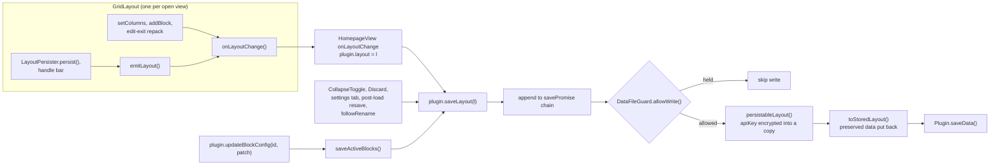

The rules that every flow below relies on:

- `saveLayout` assigns `this.layout = layout` **synchronously**, before it queues the write (`src/main.ts:452`). Any later `activeBlocks()` read sees the new layout at once, before anything reaches disk.
- Writes run one at a time on `savePromise`. Each queued write persists the object it was given, not `this.layout` at run time (`src/main.ts:455-469`). After each write, `lastWrittenJson` records what was written, so the change event of this device's own save can be recognised (§12).
- What is written is `toStoredLayout(persistableLayout(layout))` (`src/main.ts:467`, `src/validation.ts:462`): the blocks and top-level fields that a newer plugin version wrote, which this version keeps aside in `layout.preserved`, go back to the end of their block arrays and to the top level, so a synced device running an older version does not delete them (M58, §1).
- The chain never rejects. On a failure it logs `console.error` with only the error message and shows one Notice until the next success (`src/main.ts:470-485`).
- Platform routing is done by `GridLayout.buildLayoutUpdate` (`src/GridLayout.ts:677-691`) and `saveActiveBlocks` (`src/main.ts:582-587`). Both write `mobileBlocks` when `isMobileActive()` is true (`src/main.ts:395-397`); only `buildLayoutUpdate` also routes a column count, to `mobileColumns`.
- `persistableLayout` first puts back, for each plaintext `apiKey` this device already encrypted or decrypted, that same ciphertext (`withKnownCiphertext`, M57). An unchanged key therefore costs no encryption, no read of `data.json` and no change to the file, so drags and auto-height persists write the same key bytes. Only a key typed since is encrypted, after a read of the file on disk for the refuse-to-downgrade check (`src/utils/apiKeyLayout.ts:31-58`).
- A save does not re-render other open homepage views by itself. A view re-renders through its own `GridLayout`, or through `HomepageView.reload()` (`src/HomepageView.ts:105-109`). `reload()` is called by the settings tab (`src/settings/HomepageSettingTab.ts:45-51`), by the end of another view's edit session (§4.5), by `onExternalSettingsChange` (§12), and by `followRename` after a rename changed a block's config (every view not being edited, §1).

---

## 1. Plugin startup and load

`HomepagePlugin.onload` (`src/main.ts:247-351`):

| # | Step | Cite |
|---|---|---|
| 1 | `registerBlocks()` clears the registry and registers the 17 factories | `src/main.ts:248`, `42-208` |
| 2 | `imageCache.reset()` and `installTagCacheListeners(this)` | `src/main.ts:253`, `257` |
| 3 | A `vault.on('rename')` listener that calls `followRename(oldPath, file.path)`. It is registered before any block exists, so its synchronous `saveLayout` has already rewritten the layout when a mounted block's own rename listener reads `liveConfig()` | `src/main.ts:262` |
| 4 | `raw = await this.loadData()`. Obsidian returns `null` for a missing file and `undefined` for one it cannot read or parse (per the comment) | `src/main.ts:266`, `src/utils/loadRecovery.ts:30-36` |
| 5 | `loadLayoutWithRecovery(raw, dataFilePath(), vault.adapter)`, detailed below. `dataFilePath()` is `<manifest.dir>/data.json` | `src/main.ts:267`, `508-511` |
| 6 | If there is a problem: `console.warn` for `blocks-dropped`, then a 12 s Notice with `loadProblemMessage(problem, backupPath)`. Blocks past the 100-block limit (`MAX_BLOCKS`) count as dropped blocks here, so they are reported and the file is backed up (M8) | `src/main.ts:268-273`, `src/utils/loadRecovery.ts:139-149`, `src/validation.ts:280` |
| 7 | `newerVersionNotice(layout, told)`: a 12 s Notice saying how many blocks need a newer version of the plugin, once per set of kept blocks on each device (`hp-newer-version-told` in local storage). Such blocks are kept in `layout.preserved`, not drawn, and written back on every save (M58) | `src/main.ts`, `src/utils/loadRecovery.ts` |
| 8 | `this.dataGuard = loaded.guard` | `src/main.ts:278` |
| 9 | `decryptApiKeys(validated)` returns a new layout with decrypted copies of `blocks`/`mobileBlocks`; its input is not modified. A key this device cannot decrypt stays ciphertext. A transient `no-key` failure sets `stable = false`; any other failure lists the block id in `unreadable` | `src/main.ts:282`, `src/utils/apiKeyLayout.ts:136-175` |
| 10 | `this.layout = decryptResult.layout`. If not stable, a 10 s Notice | `src/main.ts:283-286` |
| 11 | `announceUnreadableKeys`: a 12 s Notice when a block in the rendered array has a newly unreadable key. It remembers what it announced in the vault-scoped localStorage key `hp-unreadable-api-keys` | `src/main.ts:287`, `369-386`, `src/utils/apiKeyLayout.ts:188` |
| 12 | **If stable: `await this.saveLayout(this.layout)`.** Every normal launch rewrites `data.json` with the migrated, clamped layout, keys re-encrypted only where they changed | `src/main.ts:291-293` |
| 13 | `registerView(VIEW_TYPE, ...)`, the commands `open-homepage`, `toggle-edit-mode` and `add-block`, the ribbon icon, and the settings tab. `toggle-edit-mode` and `add-block` are registered with a `checkCallback` built by `homepageCommand`, so the palette offers them only while a homepage is open (M69) | `src/main.ts:295-317`, `229-236` |
| 14 | The `onLayoutReady` startup hook and the `layout-change` open-when-empty watcher (§2) | `src/main.ts:319-350` |

**`followRename(oldPath, newPath)`** (`src/main.ts:494-510`) runs `followRenameInBlock` (`src/utils/pathRename.ts`) over both `blocks` and `mobileBlocks`. It rewrites every path a block's config names for a renamed file or folder: the embedded note, the folder settings of Gallery, Quick links and Voice notes, Recent files' exclusions, and typed note links of Button grid, Quick links and Bookmarks (M55, M22). A typed link keeps its `[[ ]]`, heading and alias (`renameLink`); a link typed by bare name follows only when that name no longer resolves to another note, which `followRename` checks with `metadataCache.getFirstLinkpathDest` (the `resolves` callback). It first rewrites the Discard snapshot of every open edit session (`HomepageView.mapEditSnapshot`), then saves only when a block changed. After that save it reloads every open homepage view that is not being edited (`view.reload()`, `src/main.ts:504-509`): mounted blocks read their render-time config, so this is what makes a Gallery, Quick links, Voice notes, Recent files, Button grid or Bookmarks block use the new path at once. A view in edit mode keeps its placeholders and its rewritten snapshot. It therefore follows a rename in edit mode and with no homepage open, when no block is mounted to see the event. A mounted `EmbeddedNoteBlock` also finds the new path in `liveConfig()` and re-renders; its own `updateBlockConfig` branch runs only if the plugin missed the event (`src/blocks/EmbeddedNoteBlock.ts:39-48`).

`loadLayoutWithRecovery` (`src/utils/loadRecovery.ts:41-64`):

1. **Unreadable check** (`48-53`). When `raw === undefined` and the file exists, it reads the file once more. A failed `exists()` counts as "exists". If the text does not parse, or the read failed, the problem is `unreadable`. Parseable text becomes `raw`; this covers a transient lock.
2. **Validation** (`54-58`). `validateLayout(raw, onTopLevelCorruption, onBlocksDropped)` records the problem `unusable` or `blocks-dropped` (`src/validation.ts:329-432`). Blocks of a type this version does not know, otherwise well formed, are not dropped: they go to `layout.preserved` with the unknown top-level fields (`readPreserved`, `src/validation.ts:442`). The type is judged after migration, so a legacy type such as `tag-grid` still becomes `button-grid`; a retired type (`insight`, `RETIRED_BLOCK_TYPES`) is dropped and counted, with a backup, since no newer version draws it.
3. **Reporting** (`59-60`). Only the first problem is reported. With no problem, the guard is not pending.
4. **Backup** (`62-63`, `81-104`). With a problem, `backupDataFile` writes the file's text verbatim to `data.json.invalid`, or to `data.json.invalid.<ms>` when that name is taken. The guard is pending only when this copy failed.

`onunload` (`src/main.ts:353-362`) calls `imageCache.destroy()`, `clearPomodoroState()`, `closeSharedAudioCtx()`, `abortActiveLightbox()` and `_resetDeviceKeyCache()`. It does not detach homepage leaves.

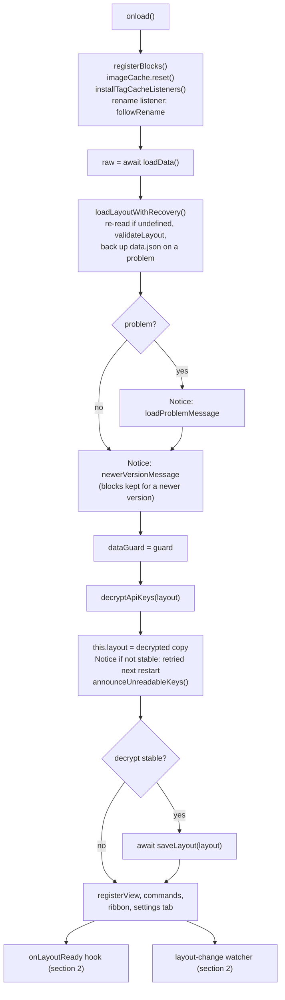

Observed:

- `readPriorLayout` calls `loadData()` again, but only as the apiKey refuse-to-downgrade lookup inside a save that encrypts a new key (`src/main.ts:573-580`). A `data.json` that sync changes after load is loaded again by `onExternalSettingsChange` (§12).
- A missing or `null` `blocks` field silently yields the demo blocks (`src/validation.ts:267`, `45`). A `blocks` or `mobileBlocks` field that is present, not `null` and not an array reports `unusable` (`src/validation.ts:410`).
- While the guard is pending, every `saveLayout` retries the backup first and writes nothing until the backup succeeds or `data.json` no longer exists (`src/utils/loadRecovery.ts:121-135`). The first successful retry shows a Notice (`src/main.ts:460`).
- The view, commands and ribbon are registered only after the awaits in steps 4-12. The rename listener of step 3 is registered before them. A rename that fires before step 10 runs against the default layout the plugin starts with, which holds no embedded note, so it changes and saves nothing and is not followed (*inferred*).

---

## 2. Opening the homepage

### Triggers

| Trigger | Condition | Call | Cite |
|---|---|---|---|
| Command `open-homepage` | – | `openHomepage(activeManualOpenMode())` | `src/main.ts:297-301` |
| Ribbon icon `home` | – | `openHomepage(activeManualOpenMode())` | `src/main.ts:315` |
| `workspace.onLayoutReady` | `activeOpenOnStartup()` | `openHomepage(activeOpenMode())` | `src/main.ts:320-325` |
| `workspace.on('layout-change')` | See the conditions below | `openHomepage('retain')`, always `retain` | `src/main.ts:327-350` |

The `layout-change` trigger opens the homepage only when all of these hold:
- `layoutReady` is set and `activeOpenWhenEmpty()` is true.
- 500 ms have passed without another `layout-change` (debounce).
- No homepage leaf exists.
- At least 2000 ms have passed since this watcher last opened the homepage (`lastEmptyOpen`; the startup open does not set it).
- Every root leaf's view type is `'empty'`.

`onLayoutReady` runs its callback immediately when the layout is already ready (`node_modules/obsidian/obsidian.d.ts:6851-6857`). Enabling the plugin mid-session with open-on-startup on therefore opens the homepage straight away.

Every `active*` startup accessor resolves through `resolveStartup(layout, Platform.isMobile)`. It returns the `mobile*` fields only when `Platform.isMobile && separateStartup` (`src/utils/startupResolver.ts:23-37`, `src/main.ts:418-440`). This gate does not depend on `responsiveMode`; see [data-model.md](data-model.md).

### `openHomepage(mode = 'retain')` (`src/main.ts:622-660`)

1. **A homepage leaf already exists** (`getLeavesOfType(VIEW_TYPE)`, anywhere in the workspace): that leaf is used and not navigated again (`624-628`).
2. **Otherwise** it picks a leaf by mode and calls `setViewState({ type: VIEW_TYPE, active: true })` on it (`629-642`):

   | Mode | Settings label (`src/settings/HomepageSettingTab.ts:18-22`) | Leaf |
   |---|---|---|
   | `retain` | Keep existing tabs (new tab) | `workspace.getLeaf('tab')` |
   | `replace-last` | Replace active tab | `workspace.getLeaf(false)` |
   | `replace-all` | Close all tabs | reuses `workspace.getMostRecentLeaf(workspace.rootSplit)` (falls back to `getLeaf('tab')`) |

3. **`replace-all` only:** every other leaf whose `getRoot() === workspace.rootSplit` is detached, also when the homepage was already open (e.g. restored at startup next to other tabs). The leaves are collected first, then detached (`646-652`). The homepage leaf is chosen before anything closes: detaching every main-area leaf first would leave no tab group, and `getLeaf(true)` then throws "No tab group found." because Obsidian refills an empty main area only later. `getLeaf(true)` would also pick a popout window if one was used last.
4. It calls `revealLeaf(leaf)`, then `setActiveLeaf(leaf, { focus: true })`, then `setPinned(true)` if `activePin()` (`654-659`). Revealed is not active: without `setActiveLeaf`, an already open homepage was shown while the tab active before kept the focus, and Ctrl+W closed that hidden tab (M64).
5. For a new leaf, Obsidian builds the view with the factory registered at `src/main.ts:295`, `new HomepageView(leaf, this)`, and calls `onOpen`, which leads to §3.

**Pin.** `openHomepage` only ever pins. The settings toggle "Pin homepage tab" saves, then calls `leaf.setPinned(plugin.activePin())` on every homepage leaf, which can pin or unpin (`src/settings/HomepageSettingTab.ts:205-222`).

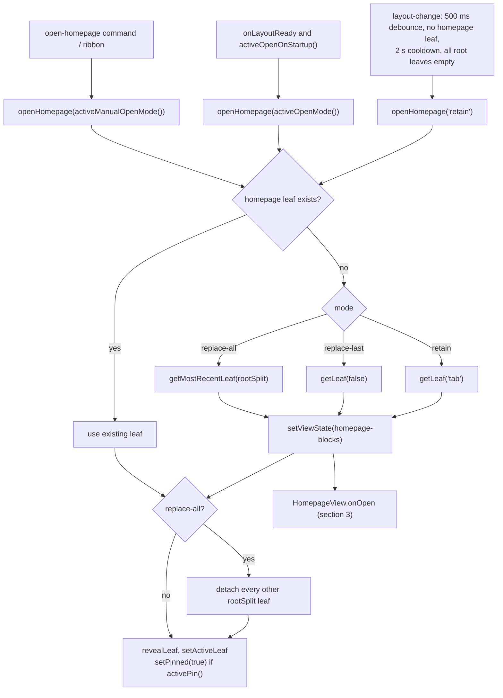

---

## 3. Rendering the grid

### Who calls `GridLayout.render`

| Caller | `isInitial` | Skipped while a block has unsaved inline state? | Cite |
|---|---|---|---|
| `HomepageView.onOpen` (view open, `reload()`) | `true` | no | `src/HomepageView.ts:63` |
| `GridLayout.setEditMode` (enter, Done, Discard) | `false` | no, deliberately | `src/GridLayout.ts:262-269` |
| `GridLayout.addBlock` | `false` | no, deliberately | `src/GridLayout.ts:367-370` |
| `GridLayout.rerender()`, from `setColumns` and `triggerRerender` (duplicate, gear Save, move up/down, removing the last block) | `false` | **yes** | `src/GridLayout.ts:375-384` |

A render with `isInitial = false` keeps what the re-render would otherwise lose: before the teardown, `captureViewState()` records the scroll position of every scrolled element from the grid up to `.homepage-view` and the focused control (its block's `gs-id` and its first class), and puts both back after the new grid is built (M27, M73). Emptying the grid used to scroll the view to the top and drop the focus to `<body>`, so Move up/down left the moved block off-screen (`src/GridLayout.ts:144`, `172`, `179-196`).

### `HomepageView.onOpen` (`src/HomepageView.ts:25-65`)

1. Destroys the previous grid and toolbar, if any (`27-28`).
2. `contentEl.empty()` and adds the class `homepage-view`. Toggles `homepage-no-scrollbar` (`showScrollbar === false`) and `homepage-hover-highlight` (`31-34`).
3. Builds `onLayoutChange`, which sets `plugin.layout` and then calls `saveLayout` (`36-39`).
4. Creates `new GridLayout(contentEl, app, plugin, onLayoutChange)` (`41`); after a `reload(true)` it calls `grid.holdDerivedPersist()` (`42-45`, §12). Creates `new EditToolbar(contentEl, app, plugin, grid, n => grid.setColumns(n), hooks)` with the edit-session hooks of §4.5 (`47-57`).
5. Reorders the DOM to FAB, then toolbar, then grid (`60-61`).
6. Calls `grid.render(activeBlocks(), activeColumns(), true)` (`63`).

### `GridLayout.render(blocks, columns, isInitial)` (`src/GridLayout.ts:141-173`)

1. Unless `isInitial`, `captureViewState()` (above) (`144`).
2. `teardown()` (`387-417`) runs these steps in order:
   1. Flushes a pending `sync` persist.
   2. Sets `phase = Destroyed`, cancels every scheduler timer and rAF, and clears the queued auto-height requests.
   3. Unloads every block.
   4. Destroys GridStack.
   5. Removes `hp-dragging` and the wheel hold of a zoomed drag, removes `homepage-grid--animating` (its `anim` timer was just cancelled, M74), and empties `gridEl`.
   6. Clears the zoom classes and the `--hp-grid-transform` property.
3. Sets `phase = Ready`, `role="list"` and `aria-label` (`146-149`).
4. If `isInitial`: adds `homepage-grid--animating` and schedules the `anim` timeout (500 ms) to remove it (`151-156`).
5. Toggles the `edit-mode` class (`158-162`).
6. With zero blocks: `renderEmptyState` and return. `gridStack` stays `null` and the phase stays `Ready` (`164-167`, `src/grid/BlockWrapper.ts:100-119`). The view-mode hint points at the pencil button; edit mode shows the "Add your first block" button.
7. Otherwise `initGridStack(blocks, columns, isInitial)` (`169`). In edit mode, a zoom below 1 is applied again to the new grid (`GridLayout.zoom`, M71), and the captured scroll and focus are restored (`171-172`).

### `initGridStack` (`src/GridLayout.ts:419-545`)

1. Sets `phase = Initializing` (`424`). This suppresses `dragstop`/`resizestop` persistence while GridStack adjusts during `load()`.
2. Builds widget items with no content (`428-444`):
   - `w = min(instance.w, columns)` and `maxW = columns`.
   - `h = COMPACT_EDIT_H` (2) for auto-height blocks in edit mode (`21`).
   - Otherwise, in view mode, `h = viewModeHeight(instance)`: 1 for a collapsed block, `_expandedH` for a collapsed block whose title is hidden, `instance.h` for the rest (`src/grid/CollapseToggle.ts:33-38`). In edit mode a collapsed block with a visible title keeps its stored `h` (`429-432`).
3. Runs `packRows(items, columns, priority)` when `editMode || layout.compactLayout`. It mutates the item copies only (`450-452`, `src/grid/packing.ts:21-99`).
4. Sets `effectiveColumns = columns` and toggles `hp-single-column` for 1 column in view mode only (`454-457`). In edit mode a one-column grid keeps GridStack's own positioning: the class's flex layout pinned a dragged item to the top, so every drag was saved as "move to top" (M25).
5. `GridStack.init({ column, cellHeight: 80, margin: 8, float: true, animate: true, staticGrid: !editMode || inPopout(), removable: false, handleClass: 'block-move-handle', resizable: { handles: 'e,s,se' } })`, then `load(items)` (`459-473`). `inPopout()` is true when the grid's window is not the main one (§4.1).
6. Calls `mountBlock` for each block (`477-479`, below).
7. With 1 column: puts the items in `(y, x)` order, because flex layout follows DOM order (`483-491`). `orderChildren` (`src/grid/domOrder.ts`) moves only the items out of place and leaves the longest run already in order where it is: re-appending every item reloaded each iframe in it, restarting a playing video (M78).
8. Wires the GridStack events `dragstart`, `dragstop` and `resizestop` (§4) (`501-516`).
9. `responsiveColumns.setup(closest('.homepage-view'), columns)` (§8) (`518-519`).
10. If a block was just added or duplicated: adds `block-just-added` to it, removes it again on `animationend` so the highlight plays once (M75), and calls `scrollIntoView({ behavior: 'smooth', block: 'nearest' })` (`522-535`).
11. On the rAF `initSettle`: `phase = Ready`, unless already `Destroyed` (`541-544`).

### `mountBlock(instance, i, isInitial)` (`src/GridLayout.ts:556-648`)

1. Finds the item by `gs-id`, sets `role="listitem"`, and toggles `is-auto-height` from `shouldAutoHeight` (`557-566`).
2. `buildBlockWrapper` creates the wrapper, the header zone with its chevron, an optional divider, and `.block-content` (`573`, `src/grid/BlockWrapper.ts:19-51`). The header zone gets no role and no Tab stop here: `BaseBlock.renderHeader` makes it a toggle (`role="button"`, `tabindex="0"`, `aria-expanded`) only when it draws a header (M49, §9). On the initial render only, each card gets a staggered animation delay (`572`).
3. **Edit mode:** `renderCompactPlaceholder` shows the title (`_titleLabel`, else the block's default title from `blockTitle()`, else the factory name), the type and `w×h`, and stores `{ block: null }` (`582-585`, `src/grid/BlockWrapper.ts:77-97`).
4. **View mode** (`586-639`):
   1. `factory.create(...)`, then `setHeaderContainer(headerZone)`, then `block.load()`.
   2. For an auto-height block, a `request-auto-height` listener on the grid item (§7).
   3. A skeleton overlay on the initial render only. A `skeleton-cap-<id>` timeout removes it after at most 300 ms (`SKELETON_MAX_MS`), whether the render has settled or not: an Embedded Note waited for every remote image in the note, forever if a host never answered (M77). The auto-height measurement still waits for the whole render (`605-609`).
   4. `block.render(contentEl)` inside try/catch. A synchronous throw is treated as a rejected render.
   5. A rejected render logs `console.error` and shows "Error rendering block. Check console for details.".
   6. After the render settles: `removeSkeleton`. An auto-height block then gets an auto-height request, unless the render rejected.
5. Always `attachCollapseToggle` (§9). In edit mode, also `attachEditHandleBar` (§4) (`641-647`).

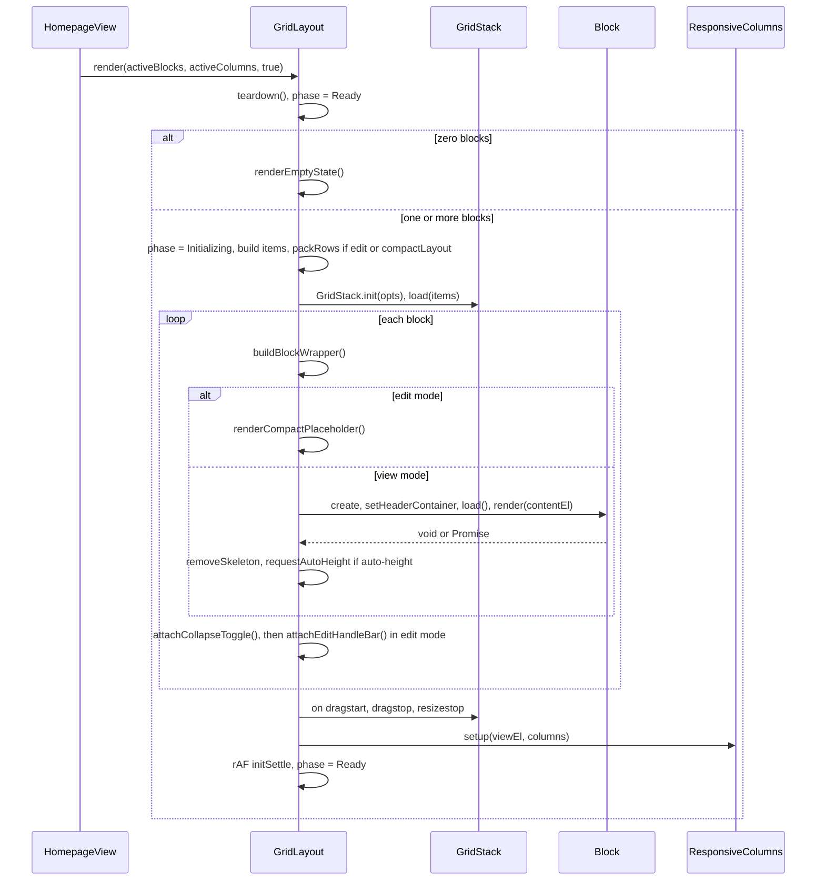

### Phase

`Phase` is an `as const` object, not a TS enum (`src/grid/phase.ts:7-13`).

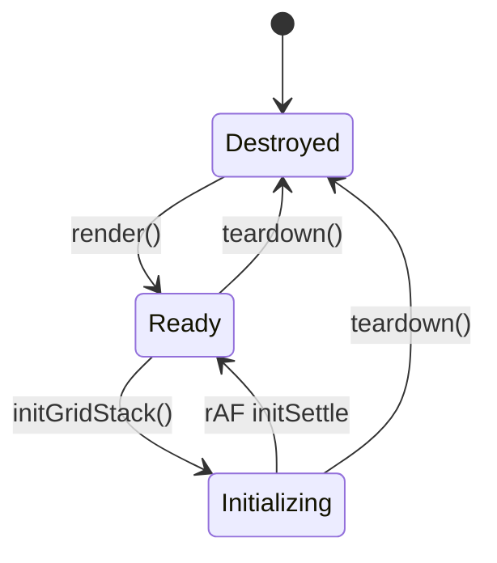

| Gate | Needs | Cite |
|---|---|---|
| `setEditMode`, `setColumns`, `addBlock` | not `Destroyed` | `src/GridLayout.ts:215`, `306`, `360` |
| `dragstop` / `resizestop` persist | `Ready` and `editMode` | `src/GridLayout.ts:508`, `513` |
| `LayoutPersister.persist` | `Ready` and a grid | `src/grid/LayoutPersister.ts:59` |
| Auto-height batch, ResizeObserver callback | not `Destroyed` and a grid; the observer callback also returns in edit mode | `src/grid/AutoHeight.ts:61`, `src/grid/ResponsiveColumns.ts:63-64` |

### Scheduler keys (`src/utils/Scheduler.ts`)

Scheduling a name again cancels the previous callback. `teardown()` cancels all of them (`src/GridLayout.ts:395`).

| Key | Kind | Delay | Set at |
|---|---|---|---|
| `anim` | timeout | 500 ms | `src/GridLayout.ts:153` |
| `initSettle` | rAF | next frame | `src/GridLayout.ts:541` |
| `autoHeight` | rAF | next frame | `src/grid/AutoHeight.ts:56` |
| `sync` | timeout (trailing debounce) | 50 ms | `src/grid/LayoutPersister.ts:131` |
| `skeleton-<n>` | timeout | 200 ms | `src/grid/BlockWrapper.ts:72-73` |
| `skeleton-cap-<id>` | timeout | 300 ms (`SKELETON_MAX_MS`) | `src/GridLayout.ts:609` |

Observed:

- The teardown flush of a pending `sync` goes through `persist()`, which needs `Ready`. A flush during `Initializing`, in the first frame after a render, is dropped (`src/GridLayout.ts:390-394`, `src/grid/LayoutPersister.ts:59`).
- `teardown()` clears the zoom styles, but an edit-mode render applies `GridLayout.zoom` again, the value of the last `setZoom`, so the zoom the toolbar slider shows survives a column change, add, duplicate, move, gear Save and removing the last block (M71, `src/GridLayout.ts:171`, `323-327`). Leaving edit mode sets it back to 1.
- The class `homepage-grid--animating` is removed by the `anim` timer, and by `teardown()`, which cancels that timer: a second render within 500 ms ends the card-enter animation instead of leaving the class on for every later render (M74, `src/GridLayout.ts:151-156`, `411`). Below a 540 px container width the animation is switched off (`styles.css:3265`).
- A block whose `render()` returns `void` while it still renders asynchronously gets its first auto-height request right away (`src/GridLayout.ts:633-637`), which can run before the async content exists. `StaticTextBlock.render` returns its promise, so the grid measures the rendered Markdown (M34, `src/blocks/StaticTextBlock.ts:37-43`).

---

## 4. Edit mode: enter, drag, resize, Done, Discard

Edit mode has two flags: `EditToolbar.editMode` (`src/EditToolbar.ts:19`) and `GridLayout.editMode` (`src/GridLayout.ts:38`). The toolbar sets the grid's flag through `setEditMode`.

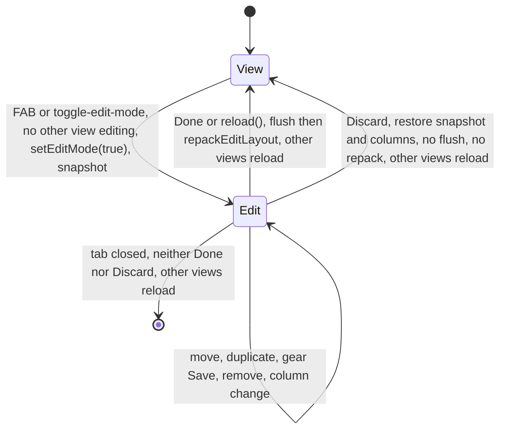

### 4.1 Enter

Triggers:
- the FAB, by click or Enter/Space (`src/EditToolbar.ts:40-43`);
- the `toggle-edit-mode` command, which toggles one homepage view: the active one, else the one being edited, else the first open (`commandTarget`, `src/main.ts:219-223`, `303-307`). The palette offers the command only while a homepage is open (`homepageCommand`, M69).

1. If another homepage view is being edited (`session.canStart()` is false), the Notice "The homepage is already being edited in another tab." is shown and nothing else happens (`src/EditToolbar.ts:54-57`; the hook is wired in `src/HomepageView.ts:53-56`).
2. `editMode = true` (`src/EditToolbar.ts:58`).
3. `grid.setEditMode(true)` (`src/EditToolbar.ts:64`; `src/GridLayout.ts:214-274`):
   1. `derivedPersistHeld` is cleared (`218`, §12).
   2. If a `sync` persist is pending, it is cancelled and run now with `tryPersist('entering edit mode')`, against the current, possibly narrowed, columns (`223-226`).
   3. `editMode = true` and `effectiveColumns = canonicalColumns` (`250-255`). `setStatic(false)` runs on the old grid, or `setStatic(true)` in a pop-out window (`256-258`).
   4. **In a pop-out window**, a Notice says that dragging and resizing don't work there and that the arrow buttons on each block reorder them. GridStack binds its pointer listeners to the main window's document, so a drag there did not work and could leave its drag state stuck for the main window; the grid stays static, and Move up/down still work (M29, `203-205`, `259-261`).
   5. `render(activeBlocks(), activeColumns())` (`269`):
      - auto-height blocks get `h = 2`;
      - the items are always packed;
      - `staticGrid` is false (true in a pop-out window);
      - a one-column grid gets no `hp-single-column` (§3, M25);
      - blocks render as placeholders with handle bars;
      - `setup()` keeps the canonical column count (`src/grid/ResponsiveColumns.ts:83-86`).
   6. The teardown unloads the view-mode blocks. An open Static Text draft is saved into the layout synchronously by `StaticTextBlock.onunload` (see §10).
4. `blocksSnapshot = structuredClone(plugin.activeBlocks())` and `columnsSnapshot = plugin.activeColumns()` (`src/EditToolbar.ts:65-72`). They are taken after the switch, so they already contain what step 3 wrote (the flushed view-mode persist, a saved draft), and Discard does not revert it. A view-mode `updateBlockConfig` still waiting on the save chain at this point lands later; it then also patches this snapshot (§0, M52).
5. `syncVisibility()` hides the FAB, shows the toolbar, removes its `inert` attribute and adds `hp-toolbar-open` to the view. `renderToolbar()` rebuilds the controls and gives the focus back to the control that had it (M73) (`src/EditToolbar.ts:136-155`).
6. On the next frame: `zoomScale = grid.computeFitZoom()`, snapped to 0.05 and clamped to [0.75, 1], then `setZoom` and `renderToolbar()` (`src/EditToolbar.ts:77-81`, `src/GridLayout.ts:348-357`). `computeFitZoom` returns 1 for a single column, which a zoom would shrink into a narrow strip with a blank area below it (M72). This rAF is not checked against a second toggle or a destroy in the same frame.

### 4.2 Operations while editing

| Operation | Handler | Effect | Write route | Rerender |
|---|---|---|---|---|
| Drag | GridStack `dragstart` adds `hp-dragging`; `dragstop` removes it (`src/GridLayout.ts:501-510`). While zoomed, `dragstart` also holds the wheel on the view (a non-passive `wheel` listener that calls `preventDefault`) until `dragstop` or teardown (M26) | node `x`/`y` | `persist()` if `Ready && editMode` | no |
| Resize | `resizestop` (`src/GridLayout.ts:512-516`) | node `w`/`h`. Auto-height blocks resize horizontally only, because CSS hides their `s`/`se` handles (`styles.css:2541-2545`) | `persist()`, then `updateCompactSizeLabels()` | no |
| Move up / down | `swapWithNeighbor` (`src/grid/EditHandleBar.ts:224-254`) | swaps `x`/`y` with the previous or next block in `(y, x)` order of the saved layout; `x` is clamped to `activeColumns() - w` | emit | yes; the scroll position and the focused button are kept (§3) |
| Duplicate | `src/grid/EditHandleBar.ts:74-91` | appends `structuredClone(current)` with a new id at `y + h`. The whole config is copied, `apiKey` included. Refused with a Notice at 100 blocks (`canAddBlock`, M8) | emit | yes, and scrolls to it |
| Remove | `src/grid/EditHandleBar.ts:138-208` | `RemoveBlockConfirmModal` (Cancel is focused), then `removeWidget` and `compact()` in a `batchUpdate`. Writes the compacted node positions: `x,y,w` for auto-height blocks, all four for fixed ones | emit | only when the last block was removed |
| Gear | §6 | config replaced | emit | yes |
| Column select | `setColumns(n)` (`src/GridLayout.ts:305-320`) | flushes an in-flight drag, sets `w = min(w, n)` (**`x` is not clamped**), writes `columns` or `mobileColumns`. The `change` handler does nothing outside edit mode (M30) | emit | yes |
| Zoom slider, 0.1 to 1 | `setZoom` (`src/GridLayout.ts:323-345`) | CSS `transform: scale()` only. The scale is kept in `GridLayout.zoom` and applied again after every edit-mode render (M71). Below 1, GridStack's edge auto-scroll during a drag is turned off (`opts.draggable.scroll = false`): the transform makes the grid the containing block of the fixed drag helper, so a scroll mid-drag moved the block away from the pointer (M26) | none | no |
| `+ Add block` | §5 | | | |

The handle bar wraps onto a second line in a narrow card instead of clipping its controls (`flex-wrap: wrap`, M28, `styles.css:2707`), and the column picker stays visible on narrow screens.

`LayoutPersister.persist()` (`src/grid/LayoutPersister.ts:57-123`):
1. It reads every GridStack node into `posMap`, clamping `w` and `x` to `effectiveColumns`.
2. It writes only if some block changed.
3. In edit mode `effectiveColumns === canonicalColumns`, so it writes `x,y,w` for auto-height blocks and `x,y,w,h` for fixed ones. A collapsed block with a visible title is drawn at its stored `h` in edit mode, so its resize is saved too; in view mode its one-row node height is never written back (`src/grid/LayoutPersister.ts:31-34`, [api/grid.md](api/grid.md) §7).

### 4.3 Done

`✓ done` calls `toggleEditMode()` (`src/EditToolbar.ts:205-206`). `HomepageView.finishEditing()` and `reload()` end a session the same way (`src/EditToolbar.ts:97-99`).

1. `editMode = false`, both snapshots are dropped, and `zoomScale = 1` (`src/EditToolbar.ts:58-63`).
2. `grid.setEditMode(false)`:
   1. **Flush** (`src/GridLayout.ts:235-237`). If `Ready`, `tryPersist('edit-mode exit')` writes the live node positions, including the y values packed for edit mode.
   2. **Repack** (`238-247`). `repackEditLayout(activeBlocks(), canonicalColumns, priority)` re-packs with the real `h` values and emits (`src/grid/packing.ts:107-111`). It reads the flushed positions, because `onLayoutChange` assigned `plugin.layout` synchronously.
   3. `editMode = false`, `setStatic(true)`, a view-mode render, then `setZoom(1)` (`250-273`).
3. `syncVisibility()`, which makes the hidden toolbar `inert` again, so its controls leave the Tab order (M30), and `renderToolbar()`.
4. `session.ended()`: every other homepage view reloads and shows the layout just saved (`src/EditToolbar.ts:83`, `src/HomepageView.ts:55`).

### 4.4 Discard

`✕ discard` calls `discardChanges()` (`src/EditToolbar.ts:102-134`):

1. Returns unless in edit mode.
2. `grid.cancelPendingPersist()` cancels `sync` and clears the queued auto-height requests (`src/GridLayout.ts:299-302`).
3. `restored = grid.buildLayoutUpdate(blocksSnapshot, { columns: columnsSnapshot })`, then `plugin.layout = restored` synchronously, then `void plugin.saveLayout(restored)` (`src/EditToolbar.ts:114-120`). The column count goes to `columns` or `mobileColumns`, like the blocks.
4. `editMode = false` and `zoomScale = 1`.
5. `grid.setEditMode(false, skipRepack = true, flushInFlight = false)`. Nothing is flushed: a flush would re-persist the edited grid. Nothing is repacked: the snapshot is already in view-mode positions. Then a view-mode render.
6. `session.ended()`: the other homepage views reload (`src/EditToolbar.ts:133`).

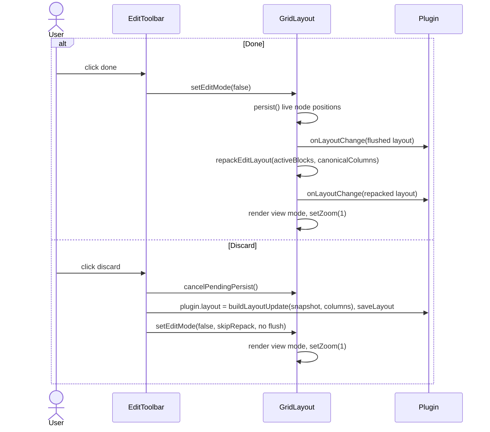

What Discard reverts:

| Change made during the session | Reverted | Why |
|---|---|---|
| Positions and sizes (drag, resize, move, compaction after remove) | yes | They live in the `BlockInstance`s |
| Added, duplicated and removed blocks | yes | The block array is restored |
| Block config saved with the gear | **yes** | Config lives inside `BlockInstance`. The comment at `src/EditToolbar.ts:66` says settings survive; only the other layout-level fields do |
| Column count changed with the toolbar select | **yes** | `columnsSnapshot` is restored with the blocks (`src/EditToolbar.ts:114-117`) |
| Other layout-level fields (startup, display, `layoutPriority`, the other platform's blocks) | no | `buildLayoutUpdate` spreads the current layout (`src/GridLayout.ts:682`) |
| A view-mode persist flushed on entry, or a Static Text draft saved on entry | no | The snapshot is taken after `grid.setEditMode(true)` (`src/EditToolbar.ts:64`, `70-71`) |
| A view-mode config save (`updateBlockConfig`) still queued when the session started | no | It patches the snapshot too when it lands (`src/main.ts:618`, M52) |
| A note or folder renamed during the session | no | `followRename` rewrites the snapshot as well (`src/main.ts:499`, `src/EditToolbar.ts:87-89`) |

### 4.5 Reload, close, and one session at a time

**`HomepageView.reload()`** ends an open session as Done first (`finishEditing`, `src/HomepageView.ts:105-109`), then rebuilds the view. The settings tab reloads the views after Responsive mode, Default columns, Mobile columns, Compact layout, Copy to mobile, Reset and Import; before the save, it ends every open session with `finishEditSessions()` (`src/settings/HomepageSettingTab.ts:59-70`), so the session is saved into the array it was made in, not into the other platform's (§11).

**Closing the tab** mid-session runs `onClose`: the grid is destroyed, then `EditToolbar.destroy()` sets `editMode = false` and calls `session.ended()` (`src/HomepageView.ts:67-71`, `src/EditToolbar.ts:275-282`).
- `setEditMode(false)` never runs, so the exit repack does not happen and the snapshot is lost.
- Positions already written by `dragstop`/`resizestop`, packed for edit mode, stay persisted.
- The other homepage views reload, so they show these positions instead of saving their stale ones over them.

**One edit session at a time.** Two homepage views editing at once would overwrite each other's saves. `HomepageView` wires `EditSessionHooks` into its toolbar (`src/HomepageView.ts:53-56`):
- `canStart()` is false while another homepage view `isEditing()`; entering is then refused with a Notice (§4.1).
- `ended()` reloads every other homepage view. It runs after Done, Discard and a tab closed mid-session.

The commands act on one homepage, chosen by `commandTarget(views, active, forAdd)` (`src/main.ts:219-223`), and the palette offers them only while a homepage is open (`homepageCommand`, `src/main.ts:229-236`, M69): `toggle-edit-mode` on the active homepage, else the one being edited, else the first; `add-block` on the one being edited whatever is active, since a block added to another view would be dropped by that session's Discard. An external `data.json` change is not loaded while a view edits (§12).

---

## 5. Add Block

| Entry point | When available | Cite |
|---|---|---|
| Toolbar `+ Add block` | edit mode. Otherwise the toolbar is collapsed and `inert`, so its controls are out of the Tab order (M30) | `src/EditToolbar.ts:195-198` |
| Empty-state button "Add your first block" | edit mode with zero blocks | `src/grid/BlockWrapper.ts:115-118`, `src/EditToolbar.ts:209` |
| Command `add-block` | any mode while a homepage is open (the palette does not offer it otherwise, M69); opens one picker, on the homepage being edited, else on the active one, else on the first open (`commandTarget`, §4.5) | `src/main.ts:309-313` |

1. `openAddBlockModal()` closes any picker this toolbar still has open, creates an `AddBlockModal`, wraps its `onClose` to clear `openModal`, and opens it (`src/EditToolbar.ts:223-261`).
2. `AddBlockModal.getSuggestions` returns every factory in registration order for an empty query. Otherwise it keeps factories whose lower-cased `"<displayName> <type> <BLOCK_META desc>"` contains the query, a plain substring match (`src/EditToolbar.ts:310-318`). Rows show `BLOCK_META` icon, name and description (`320-329`).
3. A pick calls `onChooseSuggestion`, then `onSelect(type)` (`331-333`). The modal has already closed by then; see the comment at `228-233`. The callback returns early when the toolbar was destroyed in the meantime (`234`).
4. The new instance (`238-250`):
   - `id: newId()`, `x: 0`, `y: 0`;
   - `w: min(defaultSize.w, activeColumns())`, `h: defaultSize.h`;
   - `config: structuredClone(factory.defaultConfig)`, a deep copy, so nested defaults are not shared with the registry.
5. `grid.addBlock(instance)` (`src/GridLayout.ts:359-371`):
   1. Returns if `Destroyed`.
   2. Returns with the Notice "a homepage holds at most 100 blocks" when the active array already holds `MAX_BLOCKS` blocks (`canAddBlock`, `src/grid/blockLimit.ts`): a block past the limit would be saved and then dropped at the next load (M8).
   3. Sets `y = max(b.y + b.h)` over the saved `activeBlocks()`, not over live GridStack nodes.
   4. Appends the block, sets `lastAddedBlockId`, emits `buildLayoutUpdate`, and calls `render(activeBlocks(), activeColumns())` directly. It does not go through `rerender()`, so it draws also while a block holds unsaved input; an open Static Text draft is saved as its block unloads (§10).
6. The render scrolls the new block into view (§3, step 10 of `initGridStack`). In edit mode it shows as a placeholder; Done repacks it.

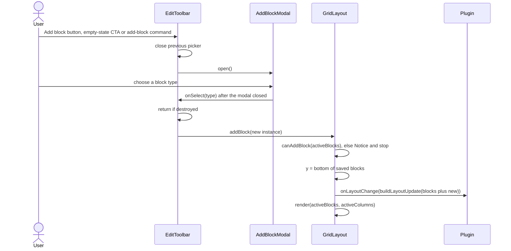

Observed:

- From the command palette in view mode, the new block is drawn at once, even while a typed Vault search query or an open Static Text editor is on the page: the render tears those blocks down. The editor's text is saved by `StaticTextBlock.onunload`; a typed search query is lost (*inferred*).

---

## 6. Block settings commit

Entry: the gear button in the edit-mode handle bar (`src/grid/EditHandleBar.ts:94-135`). Handle bars exist only in edit mode, so `host.blocks.get(id).block` is always `null` and a temporary block is always created.

1. The click handler returns if the block has no `host.blocks` entry. It builds an `onSave` callback (`99-107`).
2. Temporary block: `factory.create(app, instance, plugin)` with the render-time `instance`. It is never `load()`ed (`109-116`).
3. `new BlockSettingsModal(app, instance, block, cfg => { teardownTempBlock(); onSave(cfg); })`. The modal's `onClose` is wrapped to unload the temporary block on Cancel, Esc or X as well (`117-134`).
4. `BlockSettingsModal.onOpen` (`src/modals/BlockSettingsModal.ts:49-124`):
   1. Sets `draft = structuredClone(instance.config)` (`54`), and `blockTitle` to the title the block draws by default (`blockTitle()` in `src/blockMeta.ts`; `''` for Clock, Greeting and Spacer, which draw no header) (`57-58`).
   2. Sets the dirty flags (`60-63`):
      - `accentDirty` is true when `_accentColor` is a non-empty string;
      - `gradDirty` is true when both `_gradientStart` and `_gradientEnd` are `#rrggbb`.
   3. Builds a live preview card that `refreshPreview` restyles with `applyBlockStyling` (`67-92`). The preview hides its header for a block that draws none.
   4. Builds the tab bar Header / Body / Card / Content (`95-109`) and the Save and Cancel buttons (`115-121`).
5. Each tab edits `draft` in place. `switchTab` rebuilds the tab body from `draft` (`126-139`). For a block that draws no header, the Header tab shows only "This block has no title." (M104, `141-146`). The Content tab calls `block.renderContentSettings(body, draft)`; when that renders nothing, it shows "This block has no content settings." (`418-429`).
6. **Save** runs `commit()` (`431-436`):
   1. Sets `_accentColor = ''` unless `accentDirty`.
   2. Sets `_gradientStart = _gradientEnd = ''` unless `gradDirty`.
   3. Calls `onSave(draft)`, then `close()`.
7. `onSave` in the handle bar (`101-107`):
   1. `activeBlocks().map(b => b.id === id ? { ...b, config } : b)` replaces the **whole** config.
   2. `emitLayout(buildLayoutUpdate(...))`, then `triggerRerender()`.
8. **Cancel**, Esc or X calls `close()`. The draft is dropped, and the temporary block is unloaded by the wrapped `onClose`.

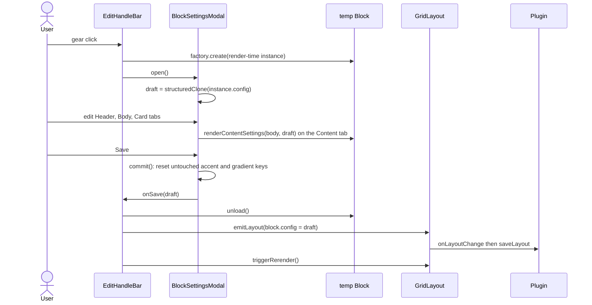

Observed:

- Save writes `_accentColor` as `''` unless it held a non-empty string at open or was picked in the modal, and writes both gradient keys as `''` unless both held `#rrggbb` at open or a gradient color was picked. A config that never had these keys gains them as empty strings.
- **Clear accent color** and **Clear gradient** reset the pickers to their seed colours before they clear the draft: a picker's `setValue` fires its `onChange`, which wrote the seed back and marked the key dirty, so a cleared accent or gradient was saved anyway (M10, `297-301`, `323-325`).
- Changing one gradient colour while the gradient is not yet dirty also takes the colour the other picker shows into the draft, so one changed colour gives the gradient the preview shows instead of none (M105, `265`, `277`).
- Because the whole config is replaced, keys missing from the draft are removed. The draft starts from the config at the last edit-mode render.
- The shared `_` keys, their ranges and defaults are listed in [styling.md](styling.md).

---

## 7. Auto-height measurement

A block auto-sizes only if its factory sets `autoHeight: true` **and** `GridLayout.shouldAutoHeight` agrees (`src/GridLayout.ts:123-134`):

| Type | Auto-height when |
|---|---|
| `image-gallery` | `heightMode !== 'fixed'` |
| `quotes-list` | `heightMode !== 'wrap'` |
| `static-text` | `heightMode !== 'fixed'` |
| `embedded-note` | `heightMode === 'grow'` |
| `button-grid`, `random-note` | always |
| other types | never; only the six types above set `autoHeight: true` (`src/main.ts:83`, `96`, `105`, `114`, `123`, `183`) |

Requests:

| Source | Cite |
|---|---|
| `mountBlock` after a view-mode render: immediately for a sync render, after resolution for an async one | `src/GridLayout.ts:620-637` |
| The DOM event `request-auto-height` (bubbling) caught on the grid item. `BaseBlock.requestAutoHeight()` dispatches it after `scheduleRender` completes (not after a failed re-render, which shows an error hint), from `observeWidthForAutoHeight`'s rAF-throttled ResizeObserver, from `observeSizeForAutoHeight`'s, after a StaticText inline save, and at the end of every `RandomNoteBlock` content render. The listener re-resolves the block from `activeBlocks()` and re-checks `shouldAutoHeight` on every event | `src/blocks/BaseBlock.ts:146-224`, `src/blocks/RandomNoteBlock.ts:188`, `src/GridLayout.ts:596-603` |
| `observeSizeForAutoHeight(el)` on the measured element of Static Text and of an Embedded Note in `grow` mode: any change of its width **or height** after mount, such as an image that loads late, a folded callout opened or a Dataview refresh, asks for a new measurement without a re-render (M34) | `src/blocks/BaseBlock.ts:209-221`, `src/blocks/StaticTextBlock.ts:75`, `src/blocks/EmbeddedNoteBlock.ts:97` |
| Widening back to the canonical column count | `src/grid/ResponsiveColumns.ts:171` |
| Narrowing to two or more columns | `src/grid/ResponsiveColumns.ts:195-201` |

`AutoHeightManager` (`src/grid/AutoHeight.ts`):

1. `request(gsEl, instance)` stores the entry in `pending`, keyed by block id, and schedules the rAF `autoHeight`. Requests made in the same frame share one batch (`54-57`).
2. `runBatch()` (`59-97`):
   1. Returns if the phase is `Destroyed` or there is no grid.
   2. With `effectiveColumns === 1`, clears the queue and returns; flex CSS sizes the blocks (`66-69`).
   3. Snapshots and clears the queue, and lifts `staticGrid` for the batch (`71-76`).
   4. Calls `measureAndResize` for each entry.
   5. If any row count changed: `host.repackGridNodes()`, then `host.persistLayoutDebounced()` (`88-91`).
   6. In `finally`, restores `staticGrid` (`92-96`).
3. `measureAndResize(gsEl, instance)` (`103-168`):
   1. Skips a disconnected item, a `block-collapsed` wrapper, or an item without `[data-auto-height-content]` or `.block-header-zone` (`105-117`).
   2. Adds `hp-no-transition` and `hp-auto-rows` to `.block-content`, so that `grid-template-rows: max-content` applies. It reads `offsetHeight` of the content element and the header zone, removes the classes and forces a reflow (`124-138`).
   3. Returns `false` if the content height is `0` (`140`).
   4. Computes `totalH = headerH + wrapper vertical padding + contentH + gap * (divider ? 2 : 1) + margin * 2 + 4` and `rows = max(1, ceil(totalH / cellHeight))` (`142-158`).
   5. If `rows` differs from the node's `h`, calls `gridStack.update(gsEl, { h: rows })` and returns `true` (`160-166`).
4. `repackGridNodes()` runs non-reflow `packRows` over the live nodes at `effectiveColumns` and applies **only `y`** (`src/GridLayout.ts:733-737`, `src/grid/LayoutPersister.ts:146-161`). It runs whatever the `compactLayout` setting.
5. `persistLayoutDebounced()` returns at once while the grid holds derived persists (a redraw of a `data.json` from another device, §12). Otherwise `persistDebounced()` schedules the `sync` timeout of 50 ms, which calls `persist()` (`src/GridLayout.ts:724-727`, `src/grid/LayoutPersister.ts:130-134`). What it writes is set out in the table below.

| Pane width vs saved columns | Auto-height block, or collapsed block | Other (fixed-height) block | Cite |
|---|---|---|---|
| canonical (`effective === canonical`) | `x, y, w` (never `h`) | `x, y, w, h` | `src/grid/LayoutPersister.ts:100-120` |
| narrowed (`effective !== canonical`) | nothing | `h` only | `src/grid/LayoutPersister.ts:69-75`, `104`, `114-117` |

In view mode a collapsed block's node shows its display height (one row), so the persist keeps its stored `h`, as it does for auto-height blocks (`nodeShowsStoredHeight`, `src/grid/LayoutPersister.ts:31-34`).

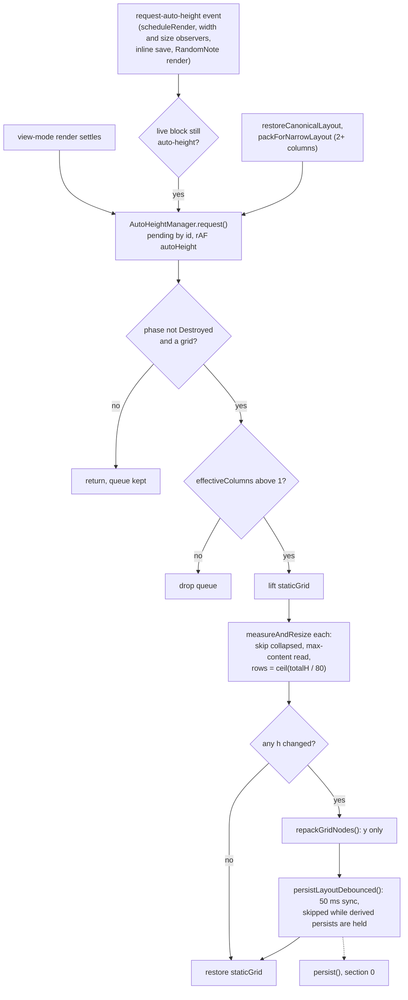

Observed:

- Edit-mode placeholders never request measurement. The listener and requests are wired only in the view-mode branch of `mountBlock` (`src/GridLayout.ts:586-637`). Their height is `COMPACT_EDIT_H`.
- Which element a block marks decides what grows. A single text quote in Quotes (`maxItems: 1`, text source, `heightMode: 'extend'`) marks its card, so it grows like the other quote modes instead of being clipped at 3 rows (M36, `src/blocks/QuotesListBlock.ts:146-151`).
- A gallery measures only after its images settle. A fixed-height gallery is not measured and waits for none of its images or videos; an auto-height one waits at most 8 s per image (`IMAGE_WAIT_MS`), so a host that never answers does not hold the render, and the width observer measures again later (M42, `src/blocks/ImageGalleryBlock.ts:190-201`, `384`, `439`).
- `LayoutPersister` never writes an auto-height block's `h`. Each render starts from the stored `h` and re-measures.
- While `staticGrid` is lifted, a pointer drag could start. `dragstop` persists only in edit mode, so such a drag is not saved (`src/GridLayout.ts:495-510`).
- The name `'request-auto-height'` is a string literal in two places (`src/blocks/BaseBlock.ts:174`, `src/GridLayout.ts:598`). The attribute name is shared as `AUTO_HEIGHT_ATTR` (`src/grid/AutoHeight.ts:13`).

---

## 8. Responsive column reduction

The saved column count (`activeColumns()`) is *canonical*. In view mode the grid may show fewer columns (*effective*), depending on the width of the `.homepage-view` element (`src/grid/ResponsiveColumns.ts:11`, `38-43`):

| View width | Effective columns |
|---|---|
| `< 480` px | 1 |
| `< 768` px | `min(2, canonical)` |
| `< 1024` px | `min(3, canonical)` |
| otherwise | canonical |

The CSS `@container homepage` breakpoints (`styles.css:3065`, `3094`, `3183`, `3204`) are separate and never change the column count. They restyle the toolbar, the FAB, the handle bar and resize handles, grid and card padding, and some block internals; see [styling.md](styling.md).

`setup(viewEl, userCols)` is called at the end of every `initGridStack` (`src/GridLayout.ts:518-519`, `src/grid/ResponsiveColumns.ts:57-94`):

1. Sets `canonicalColumns = userCols` (`57`).
2. Creates the ResizeObserver once per `GridLayout`; it survives rerenders (`60-76`). The callback:
   - ignores the event when the phase is `Destroyed`, when there is no grid, or in edit mode;
   - reads `contentBoxSize[0].inlineSize`, and ignores a width of 0: Obsidian hides a background tab with `display: none`, which is not a narrow pane (`66-69`);
   - calls `apply(next)` when the column count differs from `effectiveColumns`.
3. In edit mode, sets `effectiveColumns = userCols` and returns. Edit mode always shows canonical columns (`82-85`).
4. A view rendered while hidden (`clientWidth` 0) keeps the columns it was built with until the observer reports a real width (`86-88`).
5. Otherwise sets `effectiveColumns = computeEffectiveColumns(viewEl.clientWidth, userCols)`, and calls `apply` if it differs from `userCols` (`89-92`).

`apply(next)` (`105-145`):

1. Sets `effectiveColumns = next`.
2. Cancels the `autoHeight` rAF and the `sync` timeout, and clears the pending measurements. The pending persist is dropped, not flushed (`113-115`).
3. Turns GridStack's animation off for the change (`121-122`). The auto-height requests that `restoreCanonicalLayout` makes are measured on the next frame, and a width still inside GridStack's 0.3 s transition would be measured instead; coming back from one column, the text is then measured too wide and the card saved too short.
4. Toggles `hp-single-column` for `next === 1`. The CSS then lays the grid out as a flex column and overrides GridStack's inline geometry (`126`, `styles.css:2970-3010`).
5. Calls `gridStack.column(next, 'none')` (`130`).
6. Branches on `next`:
   - **Back to canonical:** `restoreCanonicalLayout` (`153-172`). Inside `batchUpdate`, each block gets its saved `x`, `y`, `w` (clamped) and `maxW`. Fixed-height blocks also get `viewModeHeight` (their saved `h`, or one row when collapsed). Every auto-height block is then re-requested.
   - **Narrower:** `packForNarrowLayout` (`176-210`). It clamps `w`/`x` from the live nodes and runs `packRows(..., reflow = true)`, a greedy fill of the lowest column (`src/grid/packing.ts:27-51`). It then updates `w`, `x`, `y` and `maxW`. With 2 or more columns it re-requests every auto-height block at the new width (`196-202`); with 1 column, which CSS sizes, it puts the DOM in `(y, x)` order instead, moving only the items out of place (`orderChildren`, `206-209`, M78).
7. Reads `offsetWidth` so the new geometry is committed with no transition, then restores the animation setting (`137-144`).

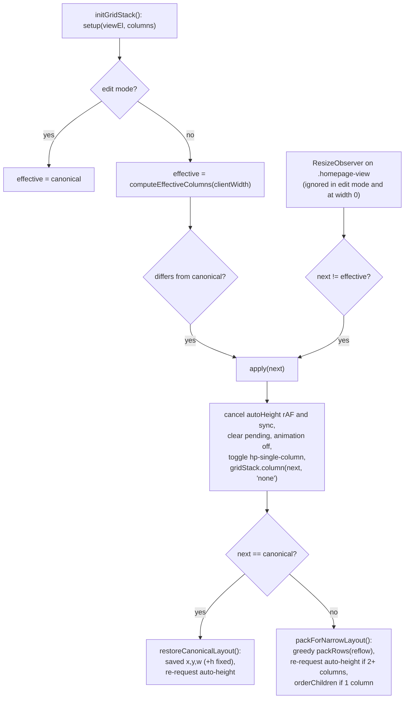

Observed:

- Narrowing is display-only. While narrowed, `persist()` writes only fixed-height `h` values (§7 table), so the canonical positions stay intact.
- `apply()` drops the measurements queued before the change, among them those that synchronous renders queued in `mountBlock` on an initial render in a narrow pane. `packForNarrowLayout` queues them again at the new width, so these blocks are measured without waiting for their own later events (`src/grid/ResponsiveColumns.ts:89-93`, `115-117`, `196-202`; `src/GridLayout.ts:633-637`).
- The two width reads differ: the initial one uses `clientWidth`, which includes padding, and the observer uses the content-box size (`src/grid/ResponsiveColumns.ts:67`, `90`). Near a breakpoint they can disagree.
- A saved count of 1 (mobile) does not go through `apply`. `initGridStack` handles it directly (`src/GridLayout.ts:454-457`, `483-491`); in edit mode it then sets no `hp-single-column` (§3, M25).
- In single column a card has no height of its own. An HTML block in document mode then sizes its frame to its document's height, unscaled, and a video keeps 16:9 (M38); outside single column the document is fitted again whenever its frame changes size, also after it loaded in a hidden tab (M37). In single column only a width change refits it: the frame's height is its own doing there, and refitting on it grew the frame on every round (`src/blocks/HtmlBlock.ts:137-191`, `styles.css:2270-2279`).

---

## 9. Collapse

Preconditions:
- **View mode.** In edit mode the handler returns early, and CSS sets `pointer-events: none` on the header zone (`src/grid/CollapseToggle.ts:64`, `styles.css:2432-2435`).
- **A drawn header.** The header zone is a toggle (`role="button"`, `tabindex="0"`, `aria-expanded`) only while `BaseBlock.renderHeader` draws a header in it; the handler returns when the zone has no `role="button"` (M49, `src/blocks/BaseBlock.ts:77-88`, `src/grid/CollapseToggle.ts:64`). Clock, Greeting and Spacer, and a block with `_showTitle === false`, therefore cannot be collapsed: their zone was a 0 px, unnamed Tab stop whose Enter hid the block with nothing left to expand it. Neither renders collapsed when stored so: `isCollapsible(instance)` is true only for a stored-collapsed block whose type draws a header, and the wrapper and `viewModeHeight` use it together with `_showTitle !== false` (`src/grid/CollapseToggle.ts:22-24`, `src/grid/BlockWrapper.ts:25`).

`attachCollapseToggle` is attached to every block in both modes (`src/GridLayout.ts:642`). A click, or Enter/Space, on `.block-header-zone` runs `toggleCollapse` (`src/grid/CollapseToggle.ts:61-98`):

1. `stopPropagation()`. It returns early in edit mode, and when the zone is not a toggle.
2. Toggles `block-collapsed` on the wrapper and `is-collapsed` on the chevron, and updates `aria-expanded` (`65-68`).
3. **Collapse:**
   1. `liveH = node.h ?? instance.h`.
   2. `gridStack.update(gsEl, { h: 1 })`.
   3. The block becomes `{ collapsed: true, _expandedH: liveH }` (`74-80`).
4. **Expand:**
   1. `origH` is the live block's `_expandedH` when that is a number `>= 1`, else `instance.h` (`83-85`).
   2. `gridStack.update(gsEl, { h: origH })`.
   3. The block becomes `{ collapsed: false, h: origH }`. `_expandedH` is kept (`81-90`).
5. Calls `plugin.saveLayout(buildLayoutUpdate(newBlocks))` directly (`92`).

A collapsed block always shows its chevron, with or without hover highlight (M79), and in single column it keeps no 60 px band below its header.

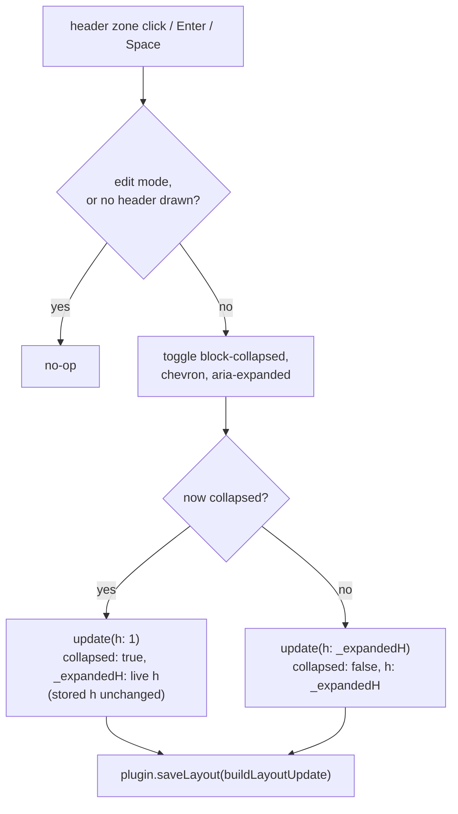

Observed:

- Collapse does not write `h: 1`. The height a collapsed block is drawn at does not depend on it: in view mode both the render and the widen-back to canonical columns use `viewModeHeight`, which gives a collapsed block one row whatever `h` holds (`src/grid/CollapseToggle.ts:33-38`, `src/GridLayout.ts:429-432`, `src/grid/ResponsiveColumns.ts:164-168`). Edit mode draws a collapsed block with a visible title at its stored `h`.
- The row count of 1 never reaches disk. A view-mode persist keeps the stored `h` of a collapsed block, whose node shows the display height (`nodeShowsStoredHeight`, `src/grid/LayoutPersister.ts:31-34`, §7). `h` stays the expanded height, and `_expandedH` holds the height at the last collapse.
- Collapsed wrappers are skipped by auto-height measurement (`src/grid/AutoHeight.ts:112-113`). Expanding requests no measurement, so an auto-height block keeps `_expandedH` rows until its next request.

---

## 10. Inline Static Text edit

The pencil button `.static-text-edit-btn` exists only in view mode; edit mode renders placeholders (`src/blocks/StaticTextBlock.ts:62-69`).

1. **Open** (`enterInlineEdit`, `90-162`):
   1. Reads the text through `liveConfig()` and sets `inlineEditActive = true`, so `hasUnsavedInlineState()` returns `true` (`12-14`, `91-93`).
   2. Hides the rendered content and the pencil with `hp-hidden`, then appends `.static-text-inline-editor`: a textarea (named "Text content") and Save/Cancel buttons (`96-123`). It records the open draft, `{ textarea, original }` (`109`).
   3. Focuses the textarea (`161`).
2. **Save**: the check button or Ctrl/Cmd+Enter (`125-141`, `152-154`):
   1. Disables the textarea and both buttons, and drops the draft record.
   2. Calls `plugin.updateBlockConfig(id, { content })` (`src/main.ts:596-620`):
      - awaits `savePromise`;
      - re-reads `activeBlocks()`;
      - if the id is gone, logs `console.warn` and drops the patch;
      - otherwise shallow-merges the patch into the block's config, applies the same patch to the Discard snapshot of any edit session that started meanwhile (M52), and calls `saveActiveBlocks`, which calls `saveLayout`.
   3. `.finally` sets `inlineEditActive = false`.
   4. `renderContent(el)` re-renders from `liveConfig()`, never from `this.instance`, which still holds the text from before the save (`src/blocks/BaseBlock.ts:42-50`).
   5. `requestAutoHeight()` dispatches `request-auto-height`, which leads to §7.
   6. A failure in the save or the re-render logs `[Homepage Blocks] StaticTextBlock failed to render:` and shows the error hint "Couldn’t render this content." (`showRenderFailure`, `45-48`, `140`).
3. **Cancel**: the x button or Escape. Sets `inlineEditActive = false`, drops the draft record and re-renders the content; a render failure shows the same error hint (`143-147`, `155-157`).
4. **Teardown with the editor open** (entering edit mode, `HomepageView.onOpen`/`reload()`, closing the tab): `StaticTextBlock.onunload` saves the draft with `saveActiveBlocks`, which updates `plugin.layout` synchronously (`15-34`). It skips the save when the text is unchanged, when the block is no longer in the layout, or when the stored text is no longer the one the editor opened with (a Reset, an Import or a `data.json` synced from another device replaced it).

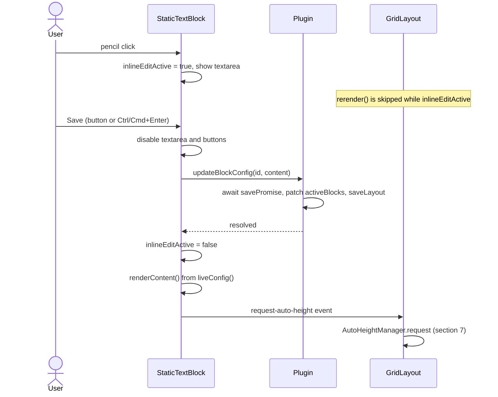

Observed:

- The inline save does not rerender the grid. It goes through `updateBlockConfig`, not `onLayoutChange`, and the block re-renders only itself.
- The `hasUnsavedInlineState` guard protects only against `GridLayout.rerender()`. `setEditMode` (entering edit mode, `src/GridLayout.ts:262-269`), `addBlock` (`:367-370`), `HomepageView.onOpen`/`reload()` (`src/HomepageView.ts:25-28`; a synced reload included, §12) and closing the tab still destroy the editor; step 4 saves its text instead of losing it, and the Discard snapshot is taken after that save (§4.1).
- While the editor is open, the hidden `.static-text-content` keeps its `data-auto-height-content` attribute and comes before the editor in the DOM. A measurement in that state therefore finds the hidden element, reads a height of 0 and changes nothing (`src/blocks/StaticTextBlock.ts:72-76`, `96-105`; `src/grid/AutoHeight.ts:115`, `140`). Its size observer ignores the hidden element, which reports a width of 0 (`src/blocks/BaseBlock.ts:214`).
- A renamed embedded note is followed by `HomepagePlugin.followRename` (§1). `EmbeddedNoteBlock` keeps the `updateBlockConfig` route as a fallback, for a rename the plugin missed (`src/blocks/EmbeddedNoteBlock.ts:39-48`).

---

## 11. Export and import

Both are buttons in the settings tab section "Export / import" (`src/settings/HomepageSettingTab.ts:381-471`). They use the clipboard.

### Export (`src/settings/HomepageSettingTab.ts:384-412`)

1. Without `navigator.clipboard.writeText`, flashes "Clipboard unavailable".
2. `structuredClone(plugin.layout)`: the in-memory layout, with plaintext keys where this device could decrypt them. Its `preserved` data (blocks and fields of a newer plugin version) is deleted: an import would drop it anyway (M58).
3. Deletes `config.apiKey` and `config.customCss` from every block in `blocks` and `mobileBlocks`.
4. `writeText(JSON.stringify(layout, null, 2))`, then flashes "Copied!". Any throw flashes "Copy failed".

The export holds the whole `LayoutConfig`: startup, display and responsive settings, and both block arrays.

### Import (`src/settings/HomepageSettingTab.ts:414-470`)

Each step that can fail flashes its own label on the button (`419-447`):

| Step | Failure | Label |
|---|---|---|
| `navigator.clipboard.readText` missing | – | "Clipboard unavailable" |
| `await readText()` | throws (permission, no focus) | "Clipboard unavailable" |
| `JSON.parse(text)` | throws | "Invalid JSON" |
| `validateLayout(parsed, () => corrupt = true)` | well-formed JSON that is not a layout object | "Not a layout" |

1. Reads the clipboard and parses it (`418-438`).
2. `validateLayout` runs the same migration and clamping as at load; see [data-model.md](data-model.md) (`442-447`).
3. `sanitizeImportedLayout(validated)` rewrites the `config` of each block in both arrays, and deletes `preserved`: blocks of an unknown type and unknown top-level fields cannot be checked, so an import does not carry them in (M58) (`451`, `src/utils/importSanitizer.ts:121-137`):
   - `apiKey` and `customCss` are always stripped.
   - `_` keys with a validator are validated or clamped with `STYLE_RANGES`.
   - Unknown `_` keys are kept if their value is a primitive.
   - Any other key is kept only if the factory's `defaultConfig` declares it and the value's type matches the declared default; a key declared as `undefined` accepts only a string (M61, `src/utils/importSanitizer.ts:20-26`). A kept number is rounded and clamped to its range in `CONFIG_RANGES`, when the key has one (`clampConfigNumber`, `src/utils/importSanitizer.ts:112`, `src/utils/configRanges.ts:10-30`). Blocks clamp again where they read these values (`rangedNumber`).
4. Builds the summary `"<n> block(s): <types>"` from the **desktop** array (`452-460`). It appends " · stripped N unsafe / unknown field(s)" when fields were stripped. It appends " · your saved API key will be removed" when any current block, in either array, has a non-empty `apiKey`, foreign ciphertext included.
5. Opens `ConfirmImportModal(app, summary, findActiveContent(safe), onChoice)` (`463`). The modal lists every block that brings active content: Static Text `content`, HTML `html`, Voice Notes `noteTemplate` and `folder`, and each Bookmarks `url`, Button grid `link` and Quick links `path` whose scheme is not http(s) (`obsidian://` can overwrite a note, an OS handler can run a program; `LINK_LISTS`), with an excerpt. Its buttons are **Import all** (**Import** when nothing is active), **Import without content** (only with active content) and **Cancel** ([api/grid.md](api/grid.md) §16.3).
6. On a choice (`463-468`):
   1. `finishEditSessions()` ends every open edit session as Done, so the session cannot later save its blocks over the imported layout.
   2. `await saveLayout(choice === 'all' ? safe : withoutActiveContent(safe))`. `withoutActiveContent` resets every active-content key to its factory default (`src/utils/importSanitizer.ts:201-219`), and empties the link of each Bookmarks, Button grid and Quick links entry whose scheme is not http(s), keeping the entry. No key needs encrypting, since all were stripped.
   3. `await reloadOpenHomepages()`: `onOpen` runs on every view.
   4. Flashes "Imported!".

   A rejection is logged as `[Homepage Blocks] Import failed:` with only the error message (`src/modals/ConfirmImportModal.ts:47-52`).

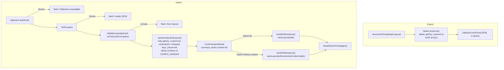

Observed:

- Import replaces the entire `LayoutConfig`, startup and display settings included. Block ids are kept, not re-minted.
- `onBlocksDropped` is not passed, so invalid blocks, and blocks past the 100-block limit, are dropped without a report. So are blocks of an unknown type, which go to `preserved` and are deleted with it. A clipboard holding `null` or `{}` passes validation, and confirming loads the default layout.
- The sanitizer does not check array element contents (`src/utils/importSanitizer.ts:24`). Block-level fields are rebuilt by `validateBlocks`: it keeps `id`, `type`, `x`, `y`, `w`, `h`, `config`, `collapsed` only when it is `true`, and `_expandedH` only as a finite number `>= 1`, rounded. Any other top-level key is dropped (`src/validation.ts:271-287`).
- Other settings-tab actions follow the same pattern: end open edit sessions (`finishEditSessions`, `src/settings/HomepageSettingTab.ts:60-64`), save, then `reloadOpenHomepages()`:
  - Responsive mode, Default columns, Mobile columns and the Compact layout toggle go through `applyLayoutChange(patch)` (`67-71`). Responsive mode then redraws the settings tab.
  - Reset to default layout and Copy to mobile also clear the blocks of a newer version kept for the half they replace (`dropPreserved`, `src/utils/layoutReset.ts:74-77`), which would otherwise come back at their old cells on the newer device. Both first open a `ConfirmActionModal` that names the layout replaced, with Cancel first and focused, so a stray Enter or Space dismisses it (M7, `src/modals/ConfirmActionModal.ts`). Their work runs on **Reset** or **Copy**.
  - Reset to default layout: `buildResetLayout(layout, getDefaultLayout(), isMobileActive())` (`361-377`, `src/utils/layoutReset.ts:53-67`). It resets only the half this device shows: on a phone in Separate mode the mobile half, with the default blocks fitted to the default mobile columns; everywhere else the desktop half (`DESKTOP_LAYOUT_FIELDS`). Every other field survives.
  - Copy desktop layout to mobile: `fitBlocksToColumns(blocks, mobileColumns, newId)` gives every copy a new id, clamps `w`/`x` and packs the copies in reading order with greedy `packRows`, so no two blocks share a cell; `apiKey` is blanked (`283-300`, `src/utils/layoutReset.ts:36-40`).

  Their field-level semantics are in [data-model.md](data-model.md).

---

## 12. External data.json change

Obsidian calls `Plugin.onExternalSettingsChange()` when the plugin's `data.json` changes on disk from outside, typically when a sync client brings another device's layout. `HomepagePlugin` implements it (`src/main.ts:532-564`). Without it, the next save on this device wrote its stale in-memory layout over the newer file.

1. `await this.savePromise`: a write still in flight on this device lands first; `saveSeq`, which every `saveLayout` call increments, is noted (`533-534`).
2. `raw = await this.loadData()` (`535`).
3. **A deleted file** (`raw === null`) is ignored; the next save writes it again (`536`).
4. **This device's own save** is ignored: `JSON.stringify(raw)` equals `lastWrittenJson`, which the save chain records after each write (`537`).
5. `loadLayoutWithRecovery(raw, dataFilePath(), adapter)` validates the file as at load (§1) (`538`). Blocks of a type this version does not know stay in `preserved` and are written back by the next save, as at load. **A file with a problem** (unreadable, not a layout, blocks dropped) is backed up to `data.json.invalid[.<ms>]` like at load; the new `DataFileGuard` replaces the old one; a `console.warn` and a 12 s Notice say the current layout was kept; the in-memory layout is not replaced (`539-545`).
6. **An open edit session** in any homepage view: a 10 s Notice says the layout changed on another device and that leaving edit mode keeps the layout shown here. Nothing is loaded; the session's Done or Discard then writes this device's layout (`546-550`).
7. `decryptApiKeys(loaded.layout)` returns the decrypted copy (`551`). **A local save made meanwhile** (`saveSeq` changed) wins: it is written after the synced file, so adopting the file would leave memory and disk disagreeing, and nothing is loaded (`555`).
8. Each view's queued position save is cancelled (`cancelPendingPersist`), since it was computed against the layout being replaced; the decrypted copy becomes `this.layout` directly, without a save. A key the device store cannot read right now gets the same 10 s Notice as at load, and unreadable keys are announced as at load (`557-562`).
9. Every homepage view runs `reload(true)` in turn (`563`). `reload` ends no session here (none is open), sets `syncReload`, and `onOpen` calls `grid.holdDerivedPersist()` on the new grid (`src/HomepageView.ts:42-45`, `105-109`).

`holdDerivedPersist` keeps the redrawn grid from saving the positions it derives itself: view-mode auto-height measurement and its repack call `persistLayoutDebounced()`, which returns at once while the hold is set (`src/GridLayout.ts:719-727`). Measured heights depend on the pane width, so two running devices with different widths would otherwise rewrite `data.json` after every load, and each write would reload the other device. The hold ends at the next `setEditMode` call, a deliberate edit (`src/GridLayout.ts:218`). Edit-mode writes (`dragstop`, `resizestop`, the handle bar), collapse and settings saves are not held.

A Static Text editor open during the reload is saved by its `onunload`, unless the synced file changed the same text, in which case the draft is dropped (§10, step 4).

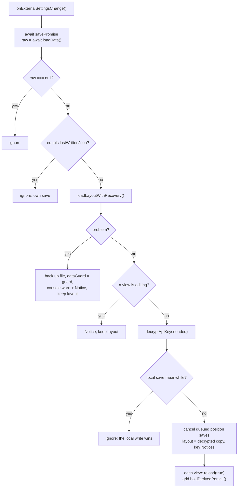
