# Runtime flows

How the plugin behaves at run time, one flow per section: the trigger, the ordered steps with source locations, a diagram, and the non-obvious behaviour a change is likely to trip over. Citations are `path:line` against the current source tree. "Observed" notes describe what the code does; they are not claims about intent.

Related documents:

- [architecture.md](architecture.md) covers modules and ownership.
- [data-model.md](data-model.md) covers `LayoutConfig`, `BlockInstance`, validation and migration.
- [blocks.md](blocks.md) describes the 17 block types.
- [styling.md](styling.md) covers the shared `_` styling keys and CSS.
- The API references are [api/plugin.md](api/plugin.md), [api/blocks.md](api/blocks.md) and [api/grid.md](api/grid.md).

| # | Flow | Main entry points |
|---|---|---|
| 0 | [Write path shared by every flow](#0-the-write-path-shared-by-every-flow) | `HomepagePlugin.saveLayout` |
| 1 | [Plugin startup and load](#1-plugin-startup-and-load) | `HomepagePlugin.onload` |
| 2 | [Opening the homepage](#2-opening-the-homepage) | `HomepagePlugin.openHomepage` |
| 3 | [Rendering the grid](#3-rendering-the-grid) | `HomepageView.onOpen`, `GridLayout.render` |
| 4 | [Edit mode: enter, drag, resize, Done, Discard](#4-edit-mode-enter-drag-resize-done-discard) | `EditToolbar.toggleEditMode`, `GridLayout.setEditMode` |
| 5 | [Add Block](#5-add-block) | `EditToolbar.openAddBlockModal`, `GridLayout.addBlock` |
| 6 | [Block settings commit](#6-block-settings-commit) | `attachEditHandleBar` gear, `BlockSettingsModal.commit` |
| 7 | [Auto-height measurement](#7-auto-height-measurement) | `AutoHeightManager.request` |
| 8 | [Responsive column reduction](#8-responsive-column-reduction) | `ResponsiveColumnsManager.setup` / `apply` |
| 9 | [Collapse](#9-collapse) | `attachCollapseToggle` |
| 10 | [Inline Static Text edit](#10-inline-static-text-edit) | `StaticTextBlock.enterInlineEdit`, `plugin.updateBlockConfig` |
| 11 | [Export and import](#11-export-and-import) | `HomepageSettingTab.renderExportImportSection` |

---

## 0. The write path shared by every flow

Every flow that changes the layout ends in `HomepagePlugin.saveLayout` (`src/main.ts:424-458`). There are three ways in:

| Route | Used by | Cite |
|---|---|---|
| `GridLayout.emitLayout` / `onLayoutChange`, which goes to `HomepageView`'s callback (`plugin.layout = l`) and then `plugin.saveLayout(l)` | `LayoutPersister.persist`, `setColumns`, `addBlock`, edit-mode exit repack, and the handle bar (duplicate, move, gear, remove) | `src/GridLayout.ts:74-76`, `198`, `250`, `286`, `src/HomepageView.ts:34-37` |
| `plugin.saveLayout` directly | CollapseToggle, Discard, the settings tab, the post-load resave in `onload` | `src/grid/CollapseToggle.ts:80`, `src/EditToolbar.ts:82-83`, `src/main.ts:259` |
| `plugin.updateBlockConfig(id, patch)`, then `saveActiveBlocks`, then `saveLayout` | StaticText inline save, EmbeddedNote rename | `src/main.ts:476-510` |

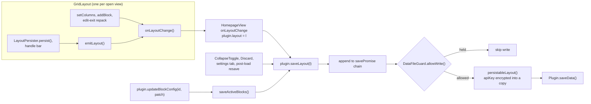

The rules that every flow below relies on:

- `saveLayout` assigns `this.layout = layout` **synchronously**, before it queues the write (`src/main.ts:425`). Any later `activeBlocks()` read sees the new layout at once, before anything reaches disk.
- Writes run one at a time on `savePromise`. Each queued write persists the object it was given, not `this.layout` at run time (`src/main.ts:428-440`).
- The chain never rejects. On a failure it logs `console.error` with only the error message and shows one Notice until the next success (`src/main.ts:441-456`).
- Platform routing is done by `GridLayout.buildLayoutUpdate` (`src/GridLayout.ts:580-594`) and `saveActiveBlocks` (`src/main.ts:476-481`). Both write `mobileBlocks` when `isMobileActive()` is true (`src/main.ts:371-373`); only `buildLayoutUpdate` also routes a column count, to `mobileColumns`.
- `persistableLayout` skips reading the file that is on disk only when no block holds a plaintext `apiKey` (`src/utils/apiKeyLayout.ts:16-37`). A device that decrypted its own key holds plaintext in memory, so there every save reads `data.json` and re-encrypts, drags and auto-height persists included. The comments at `src/main.ts:436-438` and `src/utils/apiKeyLayout.ts:25-27` say otherwise.
- A save does not re-render other open homepage views. A view re-renders only through its own `GridLayout`, or through `HomepageView.reload()` (`src/HomepageView.ts:74-76`), which only the settings tab calls (`src/settings/HomepageSettingTab.ts:45-51`).

---

## 1. Plugin startup and load

`HomepagePlugin.onload` (`src/main.ts:220-332`):

| # | Step | Cite |
|---|---|---|
| 1 | `registerBlocks()` clears the registry and registers the 17 factories | `src/main.ts:221`, `41-207` |
| 2 | `imageCache.reset()` and `installTagCacheListeners(this)` | `src/main.ts:226`, `230` |
| 3 | `raw = await this.loadData()`. Obsidian returns `null` for a missing file and `undefined` for one it cannot read or parse (per the comment) | `src/main.ts:235`, `src/utils/loadRecovery.ts:30-36` |
| 4 | `loadLayoutWithRecovery(raw, <plugin dir>/data.json, vault.adapter)`, detailed below | `src/main.ts:234-236` |
| 5 | If there is a problem: `console.warn` for `blocks-dropped`, then a 12 s Notice with `loadProblemMessage(problem, backupPath)` | `src/main.ts:237-242`, `src/utils/loadRecovery.ts:139-149` |
| 6 | `this.dataGuard = loaded.guard` | `src/main.ts:245` |
| 7 | `decryptApiKeys(validated)` replaces `blocks`/`mobileBlocks` with decrypted copies. A key this device cannot decrypt stays ciphertext. A transient `no-key` failure sets `stable = false`; any other failure lists the block id in `unreadable` | `src/main.ts:249`, `src/utils/apiKeyLayout.ts:115-155` |
| 8 | `this.layout = validated`. If not stable, a 10 s Notice | `src/main.ts:250-253` |
| 9 | `announceUnreadableKeys`: a 12 s Notice when a block in the rendered array has a newly unreadable key. It remembers what it announced in the vault-scoped localStorage key `hp-unreadable-api-keys` | `src/main.ts:254`, `350-367`, `src/utils/apiKeyLayout.ts:168-176` |
| 10 | **If stable: `await this.saveLayout(this.layout)`.** Every normal launch rewrites `data.json` with the migrated, clamped and re-encrypted layout | `src/main.ts:258-260` |
| 11 | `registerView(VIEW_TYPE, ...)`, the commands `open-homepage`, `toggle-edit-mode` and `add-block`, the ribbon icon, and the settings tab | `src/main.ts:262-298` |
| 12 | The `onLayoutReady` startup hook and the `layout-change` open-when-empty watcher (§2) | `src/main.ts:300-331` |

`loadLayoutWithRecovery` (`src/utils/loadRecovery.ts:41-64`):

1. **Unreadable check** (`48-53`). When `raw === undefined` and the file exists, it reads the file once more. A failed `exists()` counts as "exists". If the text does not parse, or the read failed, the problem is `unreadable`. Parseable text becomes `raw`; this covers a transient lock.
2. **Validation** (`54-58`). `validateLayout(raw, onTopLevelCorruption, onBlocksDropped)` records the problem `unusable` or `blocks-dropped` (`src/validation.ts:295-393`).
3. **Reporting** (`59-60`). Only the first problem is reported. With no problem, the guard is not pending.
4. **Backup** (`62-63`, `81-104`). With a problem, `backupDataFile` writes the file's text verbatim to `data.json.invalid`, or to `data.json.invalid.<ms>` when that name is taken. The guard is pending only when this copy failed.

`onunload` (`src/main.ts:334-343`) calls `imageCache.destroy()`, `clearPomodoroState()`, `closeSharedAudioCtx()`, `abortActiveLightbox()` and `_resetDeviceKeyCache()`. It does not detach homepage leaves.

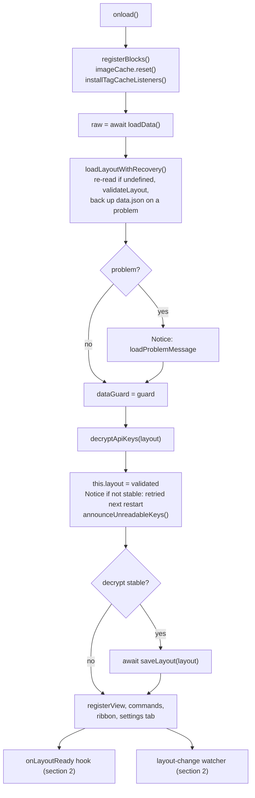

Observed:

- The layout is loaded once. `readPriorLayout` calls `loadData()` again, but only as the apiKey refuse-to-downgrade lookup inside a save (`src/main.ts:467-474`). No `onExternalSettingsChange` handler exists in `src/`. If sync changes `data.json` after load, the next save writes the in-memory layout over it.
- A missing or `null` `blocks` field silently yields the demo blocks (`src/validation.ts:255`, `45`). A `blocks` or `mobileBlocks` field that is present, not `null` and not an array reports `unusable` (`src/validation.ts:375-376`).
- While the guard is pending, every `saveLayout` retries the backup first and writes nothing until the backup succeeds or `data.json` no longer exists (`src/utils/loadRecovery.ts:121-135`). The first successful retry shows a Notice (`src/main.ts:433`).
- The view, commands and ribbon are registered only after the awaits in steps 3-10.

---

## 2. Opening the homepage

### Triggers

| Trigger | Condition | Call | Cite |
|---|---|---|---|
| Command `open-homepage` | – | `openHomepage(activeManualOpenMode())` | `src/main.ts:264-268` |
| Ribbon icon `home` | – | `openHomepage(activeManualOpenMode())` | `src/main.ts:296` |
| `workspace.onLayoutReady` | `activeOpenOnStartup()` | `openHomepage(activeOpenMode())` | `src/main.ts:300-306` |
| `workspace.on('layout-change')` | See the conditions below | `openHomepage('retain')`, always `retain` | `src/main.ts:308-331` |

The `layout-change` trigger opens the homepage only when all of these hold:
- `layoutReady` is set and `activeOpenWhenEmpty()` is true.
- 500 ms have passed without another `layout-change` (debounce).
- No homepage leaf exists.
- At least 2000 ms have passed since this watcher last opened the homepage (`lastEmptyOpen`; the startup open does not set it).
- Every root leaf's view type is `'empty'`.

`onLayoutReady` runs its callback immediately when the layout is already ready (`node_modules/obsidian/obsidian.d.ts:6851-6857`). Enabling the plugin mid-session with open-on-startup on therefore opens the homepage straight away.

Every `active*` startup accessor resolves through `resolveStartup(layout, Platform.isMobile)`. It returns the `mobile*` fields only when `Platform.isMobile && separateStartup` (`src/utils/startupResolver.ts:23-37`, `src/main.ts:394-416`). This gate does not depend on `responsiveMode`; see [data-model.md](data-model.md).

### `openHomepage(mode = 'retain')` (`src/main.ts:512-547`)

1. **A homepage leaf already exists** (`getLeavesOfType(VIEW_TYPE)`, anywhere in the workspace): that leaf is used and not navigated again (`514-518`).
2. **Otherwise** it picks a leaf by mode and calls `setViewState({ type: VIEW_TYPE, active: true })` on it (`519-532`):

   | Mode | Settings label (`src/settings/HomepageSettingTab.ts:18-22`) | Leaf |
   |---|---|---|
   | `retain` | Keep existing tabs (new tab) | `workspace.getLeaf('tab')` |
   | `replace-last` | Replace active tab | `workspace.getLeaf(false)` |
   | `replace-all` | Close all tabs | reuses `workspace.getMostRecentLeaf(workspace.rootSplit)` (falls back to `getLeaf('tab')`) |

3. **`replace-all` only:** every other leaf whose `getRoot() === workspace.rootSplit` is detached, also when the homepage was already open (e.g. restored at startup next to other tabs). The leaves are collected first, then detached (`536-542`). The homepage leaf is chosen before anything closes: detaching every main-area leaf first would leave no tab group, and `getLeaf(true)` then throws "No tab group found." because Obsidian refills an empty main area only later. `getLeaf(true)` would also pick a popout window if one was used last.
4. It calls `revealLeaf(leaf)`, then `setPinned(true)` if `activePin()` (`544-546`).
5. For a new leaf, Obsidian builds the view with the factory registered at `src/main.ts:262`, `new HomepageView(leaf, this)`, and calls `onOpen`, which leads to §3.

**Pin.** `openHomepage` only ever pins. The settings toggle "Pin homepage tab" saves, then calls `leaf.setPinned(plugin.activePin())` on every homepage leaf, which can pin or unpin (`src/settings/HomepageSettingTab.ts:186-203`).

---

## 3. Rendering the grid

### Who calls `GridLayout.render`

| Caller | `isInitial` | Skipped while a block has unsaved inline state? | Cite |
|---|---|---|---|
| `HomepageView.onOpen` (view open, `reload()`) | `true` | no | `src/HomepageView.ts:53` |
| `GridLayout.setEditMode` (enter, Done, Discard) | `false` | no, deliberately | `src/GridLayout.ts:211-218` |
| `GridLayout.rerender()`, from `setColumns`, `addBlock` and `triggerRerender` (duplicate, gear Save, move up/down, removing the last block) | `false` | **yes** | `src/GridLayout.ts:292-301` |

### `HomepageView.onOpen` (`src/HomepageView.ts:23-55`)

1. Destroys the previous grid and toolbar, if any (`25-26`).
2. `contentEl.empty()` and adds the class `homepage-view`. Toggles `homepage-no-scrollbar` (`showScrollbar === false`) and `homepage-hover-highlight` (`29-32`).
3. Builds `onLayoutChange`, which sets `plugin.layout` and then calls `saveLayout` (`34-37`).
4. Creates `new GridLayout(contentEl, app, plugin, onLayoutChange)` (`39`) and `new EditToolbar(contentEl, app, plugin, grid, n => grid.setColumns(n))` (`41-47`).
5. Reorders the DOM to FAB, then toolbar, then grid (`50-51`).
6. Calls `grid.render(activeBlocks(), activeColumns(), true)` (`53`).

### `GridLayout.render(blocks, columns, isInitial)` (`src/GridLayout.ts:134-160`)

1. `teardown()` (`304-331`) runs these steps in order:
   1. Flushes a pending `sync` persist.
   2. Sets `phase = Destroyed`, cancels every scheduler timer and rAF, and clears the queued auto-height requests.
   3. Unloads every block.
   4. Destroys GridStack.
   5. Removes `hp-dragging` and empties `gridEl`.
   6. Clears the zoom classes and the `--hp-grid-transform` property.
2. Sets `phase = Ready`, `role="list"` and `aria-label` (`136-139`).
3. If `isInitial`: adds `homepage-grid--animating` and schedules the `anim` timeout (500 ms) to remove it (`141-146`).
4. Toggles the `edit-mode` class (`148-152`).
5. With zero blocks: `renderEmptyState` and return. `gridStack` stays `null` and the phase stays `Ready` (`154-157`, `src/grid/BlockWrapper.ts:98-116`).
6. Otherwise `initGridStack(blocks, columns, isInitial)` (`159`).

### `initGridStack` (`src/GridLayout.ts:333-452`)

1. Sets `phase = Initializing` (`338`). This suppresses `dragstop`/`resizestop` persistence while GridStack adjusts during `load()`.
2. Builds widget items with no content (`342-358`):
   - `w = min(instance.w, columns)` and `maxW = columns`.
   - `h = COMPACT_EDIT_H` (2) for auto-height blocks in edit mode (`19`).
   - Otherwise, in view mode, `h = viewModeHeight(instance)`: 1 for a collapsed block, `_expandedH` for a collapsed block whose title is hidden, `instance.h` for the rest (`src/grid/CollapseToggle.ts:16-28`). In edit mode a collapsed block keeps its stored `h` (`343-346`).
3. Runs `packRows(items, columns, priority)` when `editMode || layout.compactLayout`. It mutates the item copies only (`364-366`, `src/grid/packing.ts:21-99`).
4. Sets `effectiveColumns = columns` and toggles `hp-single-column` for 1 column (`368-369`).
5. `GridStack.init({ column, cellHeight: 80, margin: 8, float: true, animate: true, staticGrid: !editMode, removable: false, handleClass: 'block-move-handle', resizable: { handles: 'e,s,se' } })`, then `load(items)` (`371-385`).
6. Calls `mountBlock` for each block (`389-391`, below).
7. With 1 column: re-appends the items in `(y, x)` order, because flex layout follows DOM order (`395-405`).
8. Wires the GridStack events `dragstart`, `dragstop` and `resizestop` (§4) (`415-428`).
9. `responsiveColumns.setup(closest('.homepage-view'), columns)` (§8) (`430-431`).
10. If a block was just added or duplicated: adds `block-just-added` to it and calls `scrollIntoView({ behavior: 'smooth', block: 'nearest' })` (`434-442`).
11. On the rAF `initSettle`: `phase = Ready`, unless already `Destroyed` (`448-451`).

### `mountBlock(instance, i, isInitial)` (`src/GridLayout.ts:463-551`)

1. Finds the item by `gs-id`, sets `role="listitem"`, and toggles `is-auto-height` from `shouldAutoHeight` (`464-473`).
2. `buildBlockWrapper` creates the wrapper, the header zone with its chevron, an optional divider, and `.block-content` (`480`, `src/grid/BlockWrapper.ts:17-49`). On the initial render only, each card gets a staggered animation delay (`479`).
3. **Edit mode:** `renderCompactPlaceholder` shows the title (or the factory name), the type and `w×h`, and stores `{ block: null }` (`489-492`, `src/grid/BlockWrapper.ts:75-95`).
4. **View mode** (`494-541`):
   1. `factory.create(...)`, then `setHeaderContainer(headerZone)`, then `block.load()`.
   2. For an auto-height block, a `request-auto-height` listener on the grid item (§7).
   3. A skeleton overlay on the initial render only.
   4. `block.render(contentEl)` inside try/catch. A synchronous throw is treated as a rejected render.
   5. A rejected render logs `console.error` and shows "Error rendering block. Check console for details.".
   6. After the render settles: `removeSkeleton`. An auto-height block then gets an auto-height request, unless the render rejected.
5. Always `attachCollapseToggle` (§9). In edit mode, also `attachEditHandleBar` (§4) (`545-550`).

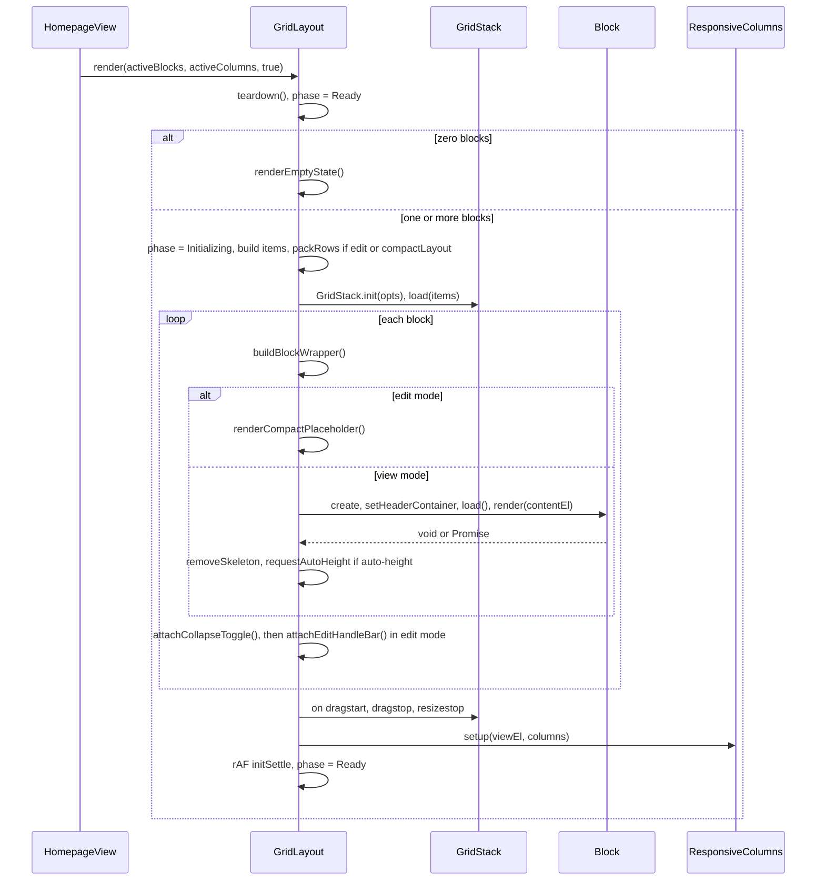

### Phase

`Phase` is an `as const` object, not a TS enum (`src/grid/phase.ts:7-13`).

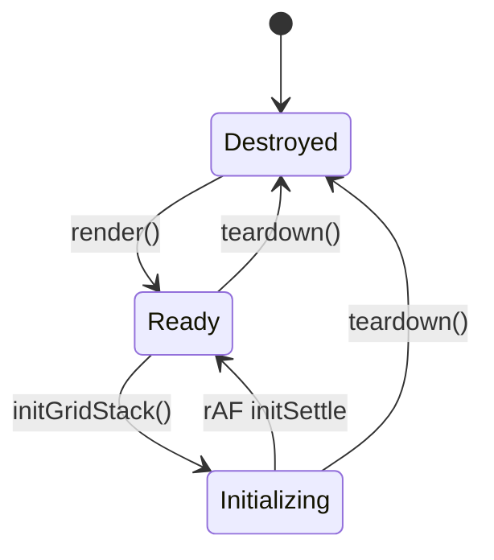

| Gate | Needs | Cite |
|---|---|---|
| `setEditMode`, `setColumns`, `addBlock` | not `Destroyed` | `src/GridLayout.ts:170`, `238`, `281` |
| `dragstop` / `resizestop` persist | `Ready` and `editMode` | `src/GridLayout.ts:420`, `431` |
| `LayoutPersister.persist` | `Ready` and a grid | `src/grid/LayoutPersister.ts:46` |
| Auto-height batch, ResizeObserver callback | not `Destroyed` and a grid; the observer callback also returns in edit mode | `src/grid/AutoHeight.ts:61`, `src/grid/ResponsiveColumns.ts:63-64` |

### Scheduler keys (`src/utils/Scheduler.ts`)

Scheduling a name again cancels the previous callback. `teardown()` cancels all of them (`src/GridLayout.ts:312`).

| Key | Kind | Delay | Set at |
|---|---|---|---|
| `anim` | timeout | 500 ms | `src/GridLayout.ts:143` |
| `initSettle` | rAF | next frame | `src/GridLayout.ts:448` |
| `autoHeight` | rAF | next frame | `src/grid/AutoHeight.ts:56` |
| `sync` | timeout (trailing debounce) | 50 ms | `src/grid/LayoutPersister.ts:117` |
| `skeleton-<n>` | timeout | 200 ms | `src/grid/BlockWrapper.ts:70-71` |

Observed:

- The teardown flush of a pending `sync` goes through `persist()`, which needs `Ready`. A flush during `Initializing`, in the first frame after a render, is dropped (`src/GridLayout.ts:307-311`, `src/grid/LayoutPersister.ts:46`).
- `teardown()` clears the zoom, so any rerender during edit mode resets the visual zoom to 100 %. The toolbar slider keeps showing the old value (`src/GridLayout.ts:327-330`, `src/EditToolbar.ts:128-140`). Rerenders include a column change, add, duplicate, move, gear Save, and removing the last block.
- The class `homepage-grid--animating` is removed only by the `anim` timer. A second render within 500 ms cancels that timer, so the class stays, and every later render replays the card-enter animation (`src/GridLayout.ts:141-146`, `312`; `styles.css:149-152`). Below a 540 px container width the animation is switched off (`styles.css:3129-3132`).
- A block whose `render()` returns `void` while it still renders asynchronously, such as `StaticTextBlock.render` (`src/blocks/StaticTextBlock.ts:36-44`), gets its first auto-height request right away (`src/GridLayout.ts:536-540`). That measurement can run before the async content exists.

---

## 4. Edit mode: enter, drag, resize, Done, Discard

Edit mode has two flags: `EditToolbar.editMode` (`src/EditToolbar.ts:11`) and `GridLayout.editMode` (`src/GridLayout.ts:33`). The toolbar sets the grid's flag through `setEditMode`.

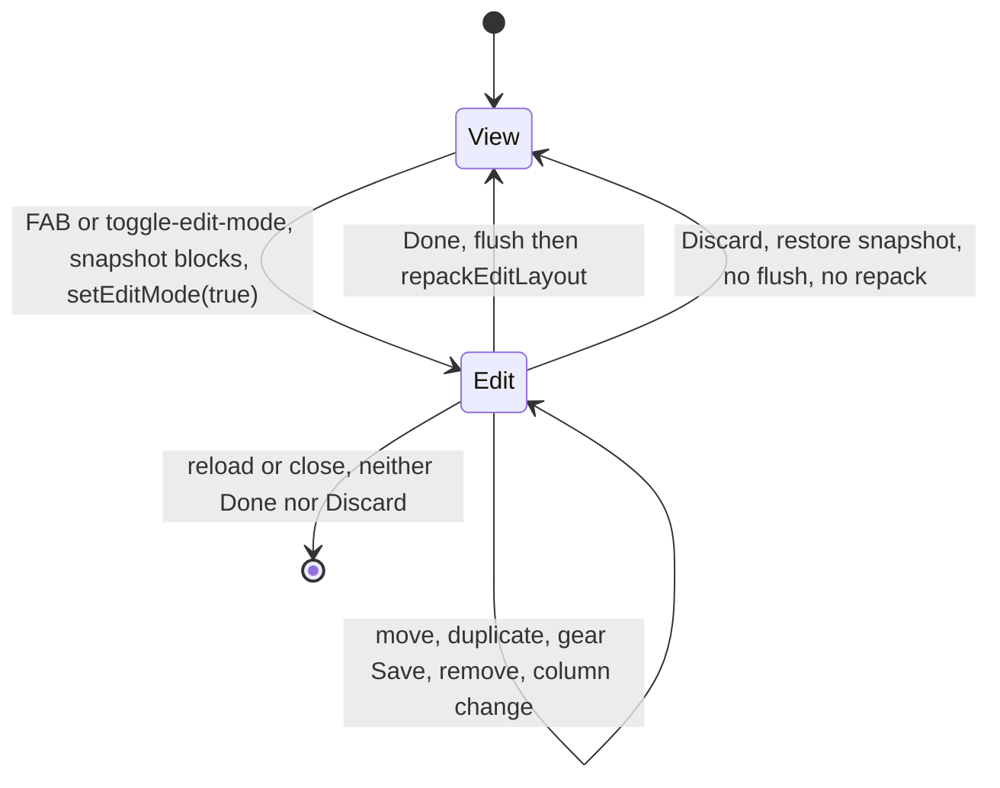

### 4.1 Enter

Triggers:
- the FAB, by click or Enter/Space (`src/EditToolbar.ts:24-32`);
- the `toggle-edit-mode` command, which toggles **every** open homepage view (`src/main.ts:270-281`).

1. `editMode = true` (`src/EditToolbar.ts:42`).
2. `grid.setEditMode(true)` (`src/EditToolbar.ts:47`; `src/GridLayout.ts:169-223`):
   1. If a `sync` persist is pending, it is cancelled and run now with `tryPersist('entering edit mode')`, against the current, possibly narrowed, columns (`175-178`).
   2. `editMode = true` and `effectiveColumns = canonicalColumns` (`202-207`). `setStatic(false)` runs on the old grid (`208-210`).
   3. `render(activeBlocks(), activeColumns())` (`218`):
      - auto-height blocks get `h = 2`;
      - the items are always packed;
      - `staticGrid` is false;
      - blocks render as placeholders with handle bars;
      - `setup()` keeps the canonical column count (`src/grid/ResponsiveColumns.ts:83-86`).
   4. The teardown unloads the view-mode blocks. An open Static Text draft is saved into the layout synchronously by `StaticTextBlock.onunload` (see §10).
3. `blocksSnapshot = structuredClone(plugin.activeBlocks())`, holding blocks only (`src/EditToolbar.ts:48-54`). It is taken after the switch, so it already contains what step 2 wrote (the flushed view-mode persist, a saved draft), and Discard does not revert it.
4. `syncVisibility()` hides the FAB, shows the toolbar and adds `hp-toolbar-open` to the view. `renderToolbar()` rebuilds the controls (`src/EditToolbar.ts:97-158`).
5. On the next frame: `zoomScale = grid.computeFitZoom()`, snapped to 0.05 and clamped to [0.75, 1], then `setZoom` and `renderToolbar()` (`src/EditToolbar.ts:59-63`, `src/GridLayout.ts:270-278`). This rAF is not checked against a second toggle or a destroy in the same frame.

### 4.2 Operations while editing

| Operation | Handler | Effect | Write route | Rerender |
|---|---|---|---|---|
| Drag | GridStack `dragstart` adds `hp-dragging`; `dragstop` removes it (`src/GridLayout.ts:415-422`) | node `x`/`y` | `persist()` if `Ready && editMode` | no |
| Resize | `resizestop` (`src/GridLayout.ts:424-428`) | node `w`/`h`. Auto-height blocks resize horizontally only, because CSS hides their `s`/`se` handles (`styles.css:2541-2545`) | `persist()`, then `updateCompactSizeLabels()` | no |
| Move up / down | `swapWithNeighbor` (`src/grid/EditHandleBar.ts:222-252`) | swaps `x`/`y` with the previous or next block in `(y, x)` order of the saved layout; `x` is clamped to `activeColumns() - w` | emit | yes |
| Duplicate | `src/grid/EditHandleBar.ts:72-89` | appends `structuredClone(current)` with a new id at `y + h`. The whole config is copied, `apiKey` included | emit | yes, and scrolls to it |
| Remove | `src/grid/EditHandleBar.ts:136-206` | `RemoveBlockConfirmModal` (Cancel is focused), then `removeWidget` and `compact()` in a `batchUpdate`. Writes the compacted node positions: `x,y,w` for auto-height blocks, all four for fixed ones | emit | only when the last block was removed |
| Gear | §6 | config replaced | emit | yes |
| Column select | `setColumns(n)` (`src/GridLayout.ts:237-252`) | flushes an in-flight drag, sets `w = min(w, n)` (**`x` is not clamped**), writes `columns` or `mobileColumns` | emit | yes |
| Zoom slider, 0.1 to 1 | `setZoom` (`src/GridLayout.ts:255-267`) | CSS `transform: scale()` only | none | no |
| `+ Add block` | §5 | | | |

`LayoutPersister.persist()` (`src/grid/LayoutPersister.ts:44-109`):
1. It reads every GridStack node into `posMap`, clamping `w` and `x` to `effectiveColumns`.
2. It writes only if some block changed.
3. In edit mode `effectiveColumns === canonicalColumns`, so it writes `x,y,w` for auto-height blocks and `x,y,w,h` for fixed ones.

### 4.3 Done

`✓ done` calls `toggleEditMode()` (`src/EditToolbar.ts:153-154`):

1. `editMode = false`, the snapshot is dropped, and `zoomScale = 1` (`src/EditToolbar.ts:42-46`).
2. `grid.setEditMode(false)`:
   1. **Flush** (`src/GridLayout.ts:187-189`). If `Ready`, `tryPersist('edit-mode exit')` writes the live node positions, including the y values packed for edit mode.
   2. **Repack** (`190-199`). `repackEditLayout(activeBlocks(), canonicalColumns, priority)` re-packs with the real `h` values and emits (`src/grid/packing.ts:107-111`). It reads the flushed positions, because `onLayoutChange` assigned `plugin.layout` synchronously.
   3. `editMode = false`, `setStatic(true)`, a view-mode render, then `setZoom(1)` (`202-222`).
3. `syncVisibility()` and `renderToolbar()`.

### 4.4 Discard

`✕ discard` calls `discardChanges()` (`src/EditToolbar.ts:68-95`):

1. Returns unless in edit mode.
2. `grid.cancelPendingPersist()` cancels `sync` and clears the queued auto-height requests (`src/GridLayout.ts:231-234`).
3. `restored = grid.buildLayoutUpdate(blocksSnapshot)`, then `plugin.layout = restored` synchronously, then `void plugin.saveLayout(restored)`.
4. `editMode = false` and `zoomScale = 1`.
5. `grid.setEditMode(false, skipRepack = true, flushInFlight = false)`. Nothing is flushed: a flush would re-persist the edited grid. Nothing is repacked: the snapshot is already in view-mode positions. Then a view-mode render.

What Discard reverts:

| Change made during the session | Reverted | Why |
|---|---|---|
| Positions and sizes (drag, resize, move, compaction after remove) | yes | They live in the `BlockInstance`s |
| Added, duplicated and removed blocks | yes | The block array is restored |
| Block config saved with the gear | **yes** | Config lives inside `BlockInstance`. The comment at `src/EditToolbar.ts:49` says settings survive; only layout-level fields do |
| Column count | **no** | `setColumns` writes `columns`/`mobileColumns`, and `buildLayoutUpdate` spreads the current layout (`src/GridLayout.ts:250`, `591`) |
| A view-mode persist flushed on entry, or a Static Text draft saved on entry | no | The snapshot is taken after `grid.setEditMode(true)` (`src/EditToolbar.ts:47`, `53`) |

### 4.5 Leaving without Done or Discard

`HomepageView.reload()` and closing the tab both destroy the grid and the toolbar. The settings tab calls `reload()` after the compact-layout toggle, Reset, Copy to mobile and Import. The next view starts in view mode (`src/HomepageView.ts:23-26`).

- `setEditMode(false)` never runs, so the exit repack does not happen and the snapshot is lost.
- Positions already written by `dragstop`/`resizestop`, packed for edit mode, stay persisted.

---

## 5. Add Block

| Entry point | When available | Cite |
|---|---|---|
| Toolbar `+ Add block` | edit mode. The toolbar is collapsed otherwise, but its controls stay in the DOM and are likely still keyboard-reachable ([api/grid.md](api/grid.md) §19, risk N) | `src/EditToolbar.ts:143-146` |
| Empty-state button "Add your first block" | edit mode with zero blocks | `src/grid/BlockWrapper.ts:112-115`, `src/EditToolbar.ts:157` |
| Command `add-block` | any mode; opens one picker per open homepage view | `src/main.ts:283-294` |

1. `openAddBlockModal()` closes any picker this toolbar still has open, creates an `AddBlockModal`, wraps its `onClose` to clear `openModal`, and opens it (`src/EditToolbar.ts:171-208`).
2. `AddBlockModal.getSuggestions` returns every factory in registration order for an empty query. Otherwise it keeps factories whose lower-cased `"<displayName> <type> <BLOCK_META desc>"` contains the query, a plain substring match (`src/EditToolbar.ts:251-259`). Rows show `BLOCK_META` icon, name and description (`257-266`).
3. A pick calls `onChooseSuggestion`, then `onSelect(type)` (`268-270`). The modal has already closed by then; see the comment at `172-177`. The callback returns early when the toolbar was destroyed in the meantime (`178`).
4. The new instance (`182-193`):
   - `id: newId()`, `x: 0`, `y: 0`;
   - `w: min(defaultSize.w, activeColumns())`, `h: defaultSize.h`;
   - `config: { ...factory.defaultConfig }`, a **shallow** copy.
5. `grid.addBlock(instance)` (`src/GridLayout.ts:280-288`):
   1. Returns if `Destroyed`.
   2. Sets `y = max(b.y + b.h)` over the saved `activeBlocks()`, not over live GridStack nodes.
   3. Appends the block, sets `lastAddedBlockId`, emits `buildLayoutUpdate`, and calls `rerender()`.
6. The next render scrolls the new block into view (§3, step 10 of `initGridStack`). In edit mode it shows as a placeholder; Done repacks it.

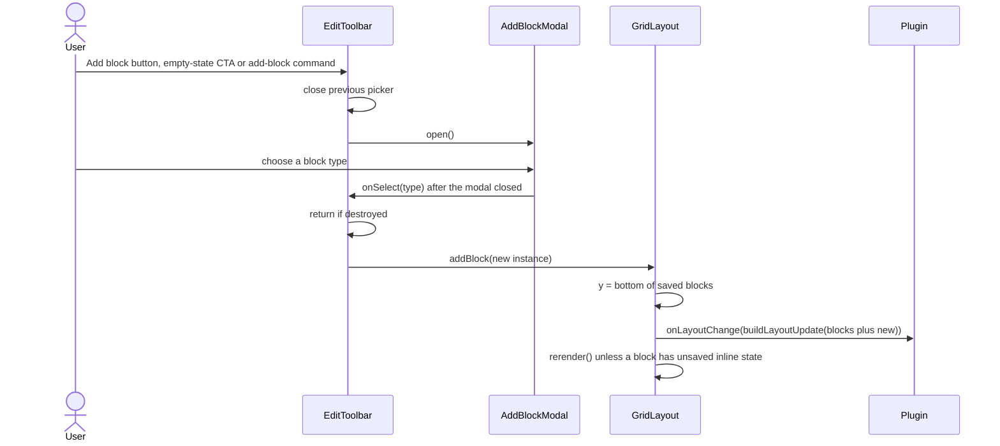

Observed:

- In view mode, `rerender()` is skipped while any block reports `hasUnsavedInlineState()` (`src/GridLayout.ts:297-299`). Examples are an open StaticText editor or a typed VaultSearch query. The block is saved but appears only at the next render.
- The shallow `defaultConfig` copy shares array defaults, such as `links: []` and `items: []` (`src/main.ts:69`, `80`, `145`), with the factory for the rest of the session, until a write deep-copies them: a gear Save does (its draft is a `structuredClone`), `updateBlockConfig` does not (it spreads the config shallowly, `src/main.ts:507`).

---

## 6. Block settings commit

Entry: the gear button in the edit-mode handle bar (`src/grid/EditHandleBar.ts:92-133`). Handle bars exist only in edit mode, so `host.blocks.get(id).block` is always `null` and a temporary block is always created.

1. The click handler returns if the block has no `host.blocks` entry. It builds an `onSave` callback (`97-105`).
2. Temporary block: `factory.create(app, instance, plugin)` with the render-time `instance`. It is never `load()`ed (`107-114`).
3. `new BlockSettingsModal(app, instance, block, cfg => { teardownTempBlock(); onSave(cfg); })`. The modal's `onClose` is wrapped to unload the temporary block on Cancel, Esc or X as well (`115-132`).
4. `BlockSettingsModal.onOpen` (`src/modals/BlockSettingsModal.ts:46-119`):
   1. Sets `draft = structuredClone(instance.config)` (`51`).
   2. Sets the dirty flags (`55-58`):
      - `accentDirty` is true when `_accentColor` is a non-empty string;
      - `gradDirty` is true when both `_gradientStart` and `_gradientEnd` are `#rrggbb`.
   3. Builds a live preview card that `refreshPreview` restyles with `applyBlockStyling` (`62-87`).
   4. Builds the tab bar Header / Body / Card / Content (`90-104`) and the Save and Cancel buttons (`110-116`).
5. Each tab edits `draft` in place. `switchTab` rebuilds the tab body from `draft` (`121-134`). The Content tab calls `block.renderContentSettings(body, draft)`; when that renders nothing, it shows "This block has no content settings." (`401-412`).
6. **Save** runs `commit()` (`414-419`):
   1. Sets `_accentColor = ''` unless `accentDirty`.
   2. Sets `_gradientStart = _gradientEnd = ''` unless `gradDirty`.
   3. Calls `onSave(draft)`, then `close()`.
7. `onSave` in the handle bar (`99-105`):
   1. `activeBlocks().map(b => b.id === id ? { ...b, config } : b)` replaces the **whole** config.
   2. `emitLayout(buildLayoutUpdate(...))`, then `triggerRerender()`.
8. **Cancel**, Esc or X calls `close()`. The draft is dropped, and the temporary block is unloaded by the wrapped `onClose`.

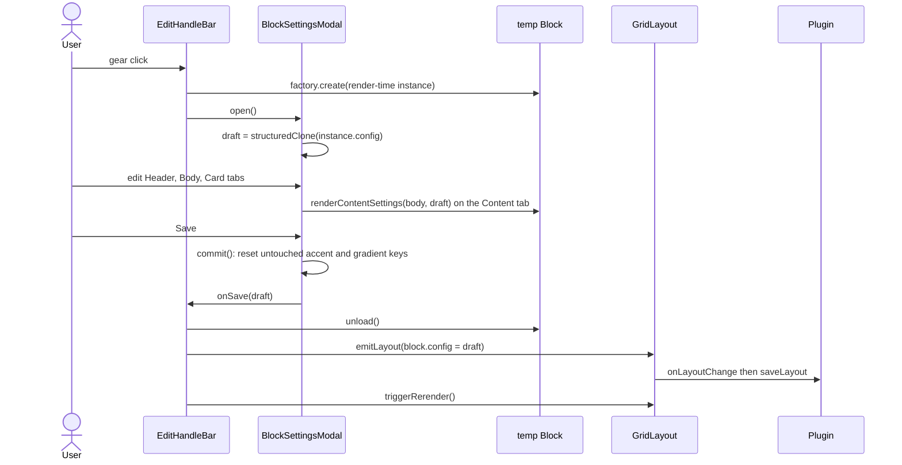

Observed:

- Save writes `_accentColor` as `''` unless it held a non-empty string at open or was picked in the modal, and writes both gradient keys as `''` unless both held `#rrggbb` at open or a gradient color was picked. A config that never had these keys gains them as empty strings.
- Because the whole config is replaced, keys missing from the draft are removed. The draft starts from the config at the last edit-mode render.
- The shared `_` keys, their ranges and defaults are listed in [styling.md](styling.md).

---

## 7. Auto-height measurement

A block auto-sizes only if its factory sets `autoHeight: true` **and** `GridLayout.shouldAutoHeight` agrees (`src/GridLayout.ts:116-127`):

| Type | Auto-height when |
|---|---|
| `image-gallery` | `heightMode !== 'fixed'` |
| `quotes-list` | `heightMode !== 'wrap'` |
| `static-text` | `heightMode !== 'fixed'` |
| `embedded-note` | `heightMode === 'grow'` |
| `button-grid`, `random-note` | always |
| other types | never; only the six types above set `autoHeight: true` (`src/main.ts:82`, `95`, `104`, `113`, `122`, `182`) |

Requests:

| Source | Cite |
|---|---|
| `mountBlock` after a view-mode render: immediately for a sync render, after resolution for an async one | `src/GridLayout.ts:523-540` |
| The DOM event `request-auto-height` (bubbling) caught on the grid item. `BaseBlock.requestAutoHeight()` dispatches it after `scheduleRender` completes, from `observeWidthForAutoHeight`'s rAF-throttled ResizeObserver, after a StaticText inline save, and at the end of every `RandomNoteBlock` content render. The listener re-resolves the block from `activeBlocks()` and re-checks `shouldAutoHeight` on every event | `src/blocks/BaseBlock.ts:129-176`, `src/blocks/RandomNoteBlock.ts:181`, `src/GridLayout.ts:503-510` |
| Widening back to the canonical column count | `src/grid/ResponsiveColumns.ts:171` |

`AutoHeightManager` (`src/grid/AutoHeight.ts`):

1. `request(gsEl, instance)` stores the entry in `pending`, keyed by block id, and schedules the rAF `autoHeight`. Requests made in the same frame share one batch (`54-57`).
2. `runBatch()` (`59-97`):
   1. Returns if the phase is `Destroyed` or there is no grid.
   2. With `effectiveColumns === 1`, clears the queue and returns; flex CSS sizes the blocks (`66-69`).
   3. Snapshots and clears the queue, and lifts `staticGrid` for the batch (`71-76`).
   4. Calls `measureAndResize` for each entry.
   5. If any row count changed: `host.repackGridNodes()`, then `host.persistLayoutDebounced()` (`88-91`).
   6. In `finally`, restores `staticGrid` (`92-96`).
3. `measureAndResize(gsEl, instance)` (`103-168`):
   1. Skips a disconnected item, a `block-collapsed` wrapper, or an item without `[data-auto-height-content]` or `.block-header-zone` (`105-117`).
   2. Adds `hp-no-transition` and `hp-auto-rows` to `.block-content`, so that `grid-template-rows: max-content` applies. It reads `offsetHeight` of the content element and the header zone, removes the classes and forces a reflow (`124-138`).
   3. Returns `false` if the content height is `0` (`140`).
   4. Computes `totalH = headerH + wrapper vertical padding + contentH + gap * (divider ? 2 : 1) + margin * 2 + 4` and `rows = max(1, ceil(totalH / cellHeight))` (`142-158`).
   5. If `rows` differs from the node's `h`, calls `gridStack.update(gsEl, { h: rows })` and returns `true` (`160-166`).
4. `repackGridNodes()` runs non-reflow `packRows` over the live nodes at `effectiveColumns` and applies **only `y`** (`src/GridLayout.ts:624-628`, `src/grid/LayoutPersister.ts:132-147`). It runs whatever the `compactLayout` setting.
5. `persistDebounced()` is the `sync` timeout of 50 ms, which calls `persist()` (`src/grid/LayoutPersister.ts:116-120`). What it writes is set out in the table below.

| Pane width vs saved columns | Auto-height block | Fixed-height block | Cite |
|---|---|---|---|
| canonical (`effective === canonical`) | `x, y, w` (never `h`) | `x, y, w, h` | `src/grid/LayoutPersister.ts:86-106` |
| narrowed (`effective !== canonical`) | nothing | `h` only | `src/grid/LayoutPersister.ts:56-62`, `90`, `100-103` |

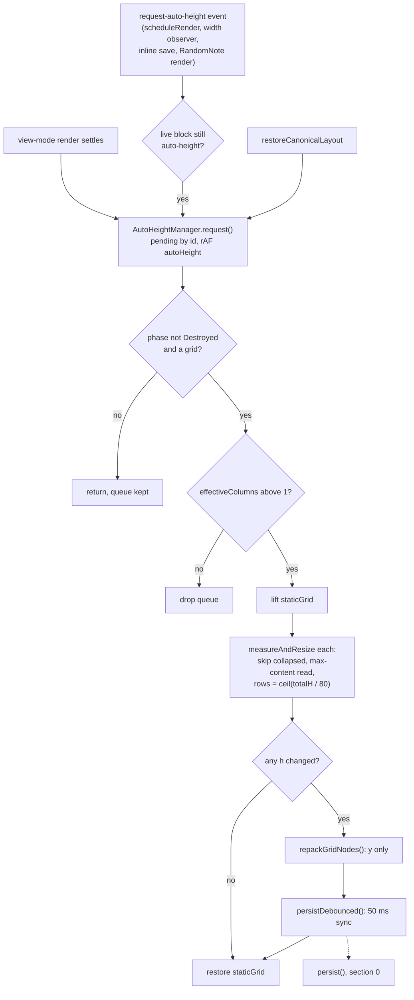

Observed:

- Edit-mode placeholders never request measurement. The listener and requests are wired only in the view-mode branch of `mountBlock` (`src/GridLayout.ts:493-540`). Their height is `COMPACT_EDIT_H`.
- `LayoutPersister` never writes an auto-height block's `h`. Each render starts from the stored `h` and re-measures.
- While `staticGrid` is lifted, a pointer drag could start. `dragstop` persists only in edit mode, so such a drag is not saved (`src/GridLayout.ts:409-422`).
- The name `'request-auto-height'` is a string literal in two places (`src/blocks/BaseBlock.ts:149`, `src/GridLayout.ts:505`). The attribute name is shared as `AUTO_HEIGHT_ATTR` (`src/grid/AutoHeight.ts:13`).

---

## 8. Responsive column reduction

The saved column count (`activeColumns()`) is *canonical*. In view mode the grid may show fewer columns (*effective*), depending on the width of the `.homepage-view` element (`src/grid/ResponsiveColumns.ts:11`, `38-43`):

| View width | Effective columns |
|---|---|
| `< 480` px | 1 |
| `< 768` px | `min(2, canonical)` |
| `< 1024` px | `min(3, canonical)` |
| otherwise | canonical |

The CSS `@container homepage` breakpoints (`styles.css:3065`, `3094`, `3183`, `3204`) are separate and never change the column count. They restyle the toolbar, the FAB, the handle bar and resize handles, grid and card padding, and some block internals; see [styling.md](styling.md).

`setup(viewEl, userCols)` is called at the end of every `initGridStack` (`src/GridLayout.ts:430-431`, `src/grid/ResponsiveColumns.ts:57-94`):

1. Sets `canonicalColumns = userCols` (`57`).
2. Creates the ResizeObserver once per `GridLayout`; it survives rerenders (`60-76`). The callback:
   - ignores the event when the phase is `Destroyed`, when there is no grid, or in edit mode;
   - reads `contentBoxSize[0].inlineSize`, and ignores a width of 0: Obsidian hides a background tab with `display: none`, which is not a narrow pane (`66-69`);
   - calls `apply(next)` when the column count differs from `effectiveColumns`.
3. In edit mode, sets `effectiveColumns = userCols` and returns. Edit mode always shows canonical columns (`82-85`).
4. A view rendered while hidden (`clientWidth` 0) keeps the columns it was built with until the observer reports a real width (`86-88`).
5. Otherwise sets `effectiveColumns = computeEffectiveColumns(viewEl.clientWidth, userCols)`, and calls `apply` if it differs from `userCols` (`89-92`).

`apply(next)` (`105-145`):

1. Sets `effectiveColumns = next`.
2. Cancels the `autoHeight` rAF and the `sync` timeout, and clears the pending measurements. The pending persist is dropped, not flushed (`113-115`).
3. Turns GridStack's animation off for the change (`121-122`). The auto-height requests that `restoreCanonicalLayout` makes are measured on the next frame, and a width still inside GridStack's 0.3 s transition would be measured instead; coming back from one column, the text is then measured too wide and the card saved too short.
4. Toggles `hp-single-column` for `next === 1`. The CSS then lays the grid out as a flex column and overrides GridStack's inline geometry (`126`, `styles.css:2970-3010`).
5. Calls `gridStack.column(next, 'none')` (`130`).
6. Branches on `next`:
   - **Back to canonical:** `restoreCanonicalLayout` (`152-171`). Inside `batchUpdate`, each block gets its saved `x`, `y`, `w` (clamped) and `maxW`. Fixed-height blocks also get their saved `h`. Every auto-height block is then re-requested.
   - **Narrower:** `packForNarrowLayout` (`174-199`). It clamps `w`/`x` from the live nodes and runs `packRows(..., reflow = true)`, a greedy fill of the lowest column (`src/grid/packing.ts:27-51`). It then updates `w`, `x`, `y` and `maxW`. With 1 column it re-appends the DOM in `(y, x)` order.
7. Reads `offsetWidth` so the new geometry is committed with no transition, then restores the animation setting (`137-144`).

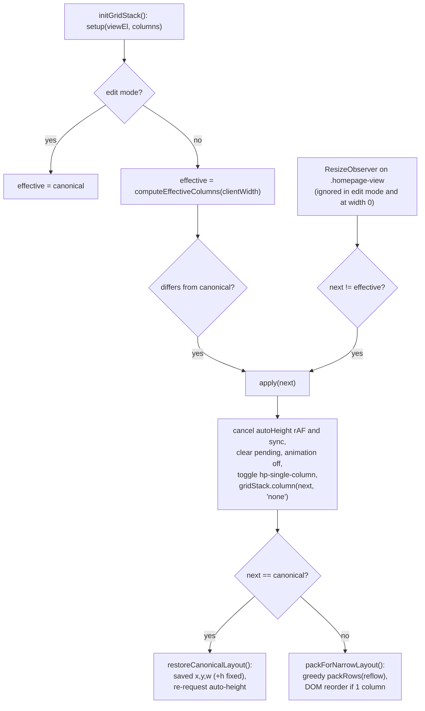

Observed:

- Narrowing is display-only. While narrowed, `persist()` writes only fixed-height `h` values (§7 table), so the canonical positions stay intact.
- `packForNarrowLayout` does not re-request auto-height, and `apply()` has already dropped queued requests. On an initial render in a narrow pane, the measurements that synchronous renders queued in `mountBlock` are lost; an async render's request arrives after `apply()` and survives. The affected blocks recover only through their own later `request-auto-height` events (`src/grid/ResponsiveColumns.ts:90-93`, `113-115`, `174-199`; `src/GridLayout.ts:523-540`).
- The two width reads differ: the initial one uses `clientWidth`, which includes padding, and the observer uses the content-box size (`src/grid/ResponsiveColumns.ts:67`, `89`). Near a breakpoint they can disagree.
- A saved count of 1 (mobile) does not go through `apply`. `initGridStack` handles it directly (`src/GridLayout.ts:368-369`, `401-411`).

---

## 9. Collapse

Preconditions:
- **View mode.** In edit mode the handler returns early, and CSS sets `pointer-events: none` on the header zone (`src/grid/CollapseToggle.ts:53`, `styles.css:2432-2435`).
- **A visible title.** A block with `_showTitle === false` never renders collapsed (`src/grid/BlockWrapper.ts:23`). Its header zone has height 0 but keeps `tabindex="0"` (`styles.css:2419-2425`, `src/grid/BlockWrapper.ts:36-39`).

`attachCollapseToggle` is attached to every block in both modes (`src/GridLayout.ts:545`). A click, or Enter/Space, on `.block-header-zone` runs `toggleCollapse` (`src/grid/CollapseToggle.ts:51-86`):

1. `stopPropagation()`. It returns early in edit mode.
2. Toggles `block-collapsed` on the wrapper and `is-collapsed` on the chevron, and updates `aria-expanded` (`54-57`).
3. **Collapse:**
   1. `liveH = node.h ?? instance.h`.
   2. `gridStack.update(gsEl, { h: 1 })`.
   3. The block becomes `{ collapsed: true, _expandedH: liveH }` (`63-69`).
4. **Expand:**
   1. `origH = activeBlocks()`'s `_expandedH ?? instance.h`.
   2. `gridStack.update(gsEl, { h: origH })`.
   3. The block becomes `{ collapsed: false, h: origH }`. `_expandedH` is kept (`70-77`).
5. Calls `plugin.saveLayout(buildLayoutUpdate(newBlocks))` directly (`80`).

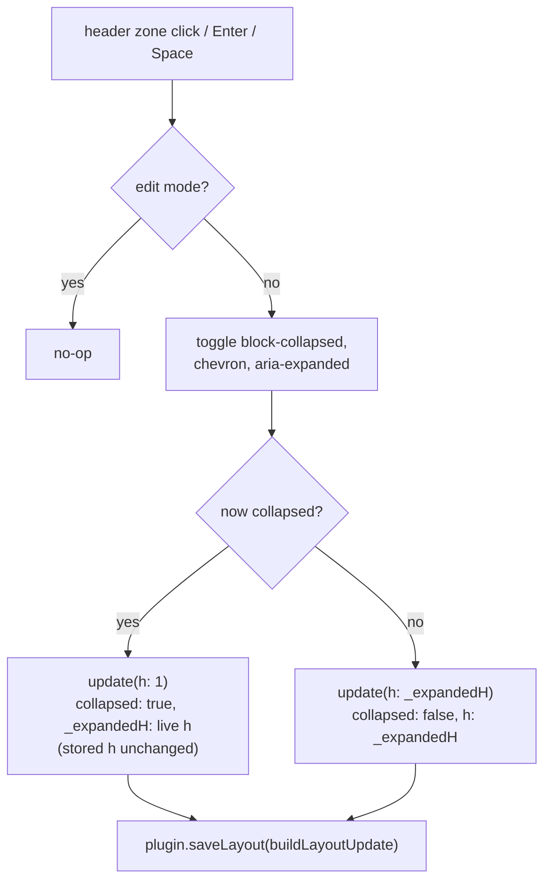

Observed:

- Collapse does not write `h: 1`. The height a collapsed block is drawn at does not depend on it: in view mode both the render and the widen-back to canonical columns use `viewModeHeight`, which gives a collapsed block one row whatever `h` holds (`src/grid/CollapseToggle.ts:16-28`, `src/GridLayout.ts:343-346`, `src/grid/ResponsiveColumns.ts:163-167`). Edit mode draws a collapsed block at its stored `h`.
- The row count of 1 reaches disk only when a later view-mode persist writes the node `h`, and it does so for fixed-height blocks only; the expanded height stays in `_expandedH`.
- Collapsed wrappers are skipped by auto-height measurement (`src/grid/AutoHeight.ts:112-113`). Expanding requests no measurement, so an auto-height block keeps `_expandedH` rows until its next request.

---

## 10. Inline Static Text edit

The pencil button `.static-text-edit-btn` exists only in view mode; edit mode renders placeholders (`src/blocks/StaticTextBlock.ts:58-65`).

1. **Open** (`enterInlineEdit`, `84-156`):
   1. Reads the text through `liveConfig()` and sets `inlineEditActive = true`, so `hasUnsavedInlineState()` returns `true` (`11-13`, `85-87`).
   2. Hides the rendered content and the pencil with `hp-hidden`, then appends `.static-text-inline-editor`: a textarea and Save/Cancel buttons (`90-117`). It records the open draft, `{ textarea, original }` (`103`).
   3. Focuses the textarea (`155`).
2. **Save**: the check button or Ctrl/Cmd+Enter (`119-135`, `146-148`):
   1. Disables the textarea and both buttons, and drops the draft record.
   2. Calls `plugin.updateBlockConfig(id, { content })` (`src/main.ts:490-510`):
      - awaits `savePromise`;
      - re-reads `activeBlocks()`;
      - if the id is gone, logs `console.warn` and drops the patch;
      - otherwise shallow-merges the patch into the block's config and calls `saveActiveBlocks`, which calls `saveLayout`.
   3. `.finally` sets `inlineEditActive = false`.
   4. `renderContent(el)` re-renders from `liveConfig()`, never from `this.instance`, which still holds the text from before the save (`src/blocks/BaseBlock.ts:42-50`).
   5. `requestAutoHeight()` dispatches `request-auto-height`, which leads to §7.
3. **Cancel**: the x button or Escape. Sets `inlineEditActive = false`, drops the draft record and re-renders the content (`137-141`, `149-151`).
4. **Teardown with the editor open** (entering edit mode, `HomepageView.onOpen`/`reload()`, closing the tab): `StaticTextBlock.onunload` saves the draft with `saveActiveBlocks`, which updates `plugin.layout` synchronously (`15-34`). It skips the save when the text is unchanged, when the block is no longer in the layout, or when the stored text is no longer the one the editor opened with (a Reset or Import replaced it).

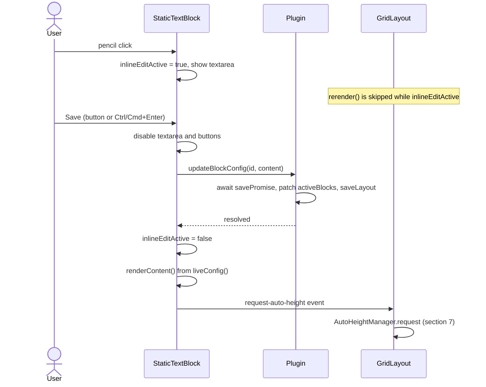

Observed:

- The inline save does not rerender the grid. It goes through `updateBlockConfig`, not `onLayoutChange`, and the block re-renders only itself.
- The `hasUnsavedInlineState` guard protects only against `GridLayout.rerender()`. `setEditMode` (entering edit mode, `src/GridLayout.ts:211-218`), `HomepageView.onOpen`/`reload()` (`src/HomepageView.ts:23-26`) and closing the tab still destroy the editor; step 4 saves its text instead of losing it, and the Discard snapshot is taken after that save (§4.1).
- While the editor is open, the hidden `.static-text-content` keeps its `data-auto-height-content` attribute and comes before the editor in the DOM. A measurement in that state therefore finds the hidden element, reads a height of 0 and changes nothing (`src/blocks/StaticTextBlock.ts:67-70`, `90-99`; `src/grid/AutoHeight.ts:115`, `140`).
- `EmbeddedNoteBlock` uses the same `updateBlockConfig` route to follow a renamed file (`src/blocks/EmbeddedNoteBlock.ts:37-46`).

---

## 11. Export and import

Both are buttons in the settings tab section "Export / import" (`src/settings/HomepageSettingTab.ts:362-437`). They use the clipboard.

### Export (`src/settings/HomepageSettingTab.ts:365-391`)

1. Without `navigator.clipboard.writeText`, flashes "Clipboard unavailable".
2. `structuredClone(plugin.layout)`: the in-memory layout, with plaintext keys where this device could decrypt them.
3. Deletes `config.apiKey` and `config.customCss` from every block in `blocks` and `mobileBlocks`.
4. `writeText(JSON.stringify(layout, null, 2))`, then flashes "Copied!". Any throw flashes "Copy failed".

The export holds the whole `LayoutConfig`: startup, display and responsive settings, and both block arrays.

### Import (`src/settings/HomepageSettingTab.ts:393-436`)

1. Without `navigator.clipboard.readText`, flashes "Clipboard unavailable".
2. `JSON.parse`. A throw anywhere in the handler flashes "Invalid JSON" (`432-434`).
3. `validateLayout(parsed, () => corrupt = true)`. A corrupt result flashes "Not a layout" (`408-413`). The same migration and clamping as at load apply; see [data-model.md](data-model.md).
4. `sanitizeImportedLayout(validated)` rewrites the `config` of each block in both arrays (`417`, `src/utils/importSanitizer.ts:76-136`):
   - `apiKey` and `customCss` are always stripped.
   - `_` keys with a validator are validated or clamped with `STYLE_RANGES`.
   - Unknown `_` keys are kept if their value is a primitive.
   - Any other key is kept only if the factory's `defaultConfig` declares it and the value's type matches the declared default.
5. Builds the summary `"<n> block(s): <types>"` from the **desktop** array (`418-426`). It appends " · stripped N unsafe / unknown field(s)" when fields were stripped. It appends " · your saved API key will be removed" when any current block, in either array, has a non-empty `apiKey`, foreign ciphertext included.
6. Opens `ConfirmPresetModal(app, "Import (
)", onConfirm)`. It shows the heading "Load preset?" and the buttons "Load preset" and "Cancel", wording left over from a removed presets feature (`src/modals/ConfirmPresetModal.ts:18-37`).
7. On confirm (`427-431`):
   1. `await saveLayout(safe)`. No key needs encrypting, since all were stripped.
   2. `await reloadOpenHomepages()`: `onOpen` runs on every view, and an open edit session is dropped (§4.5).
   3. Flashes "Imported!".

   A rejection is logged as `[Homepage Blocks] Preset apply failed:` (`src/modals/ConfirmPresetModal.ts:27-32`).

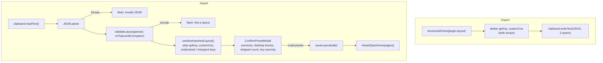

Observed:

- Import replaces the entire `LayoutConfig`, startup and display settings included. Block ids are kept, not re-minted.
- `onBlocksDropped` is not passed, so invalid blocks are dropped without a report. A clipboard holding `null` or `{}` passes validation, and confirming loads the default layout.
- The sanitizer does not check array element contents (`src/utils/importSanitizer.ts:23`). It does not touch block-level fields such as `collapsed`, `_expandedH` or extra keys; they survive through `validateBlocks`' spread (`src/validation.ts:271-272`).
- Other settings-tab actions follow the same pattern of save, then `reloadOpenHomepages()`:
  - Reset to default layout: `buildResetLayout` (`src/settings/HomepageSettingTab.ts:341-359`, `src/utils/layoutReset.ts:61-83`).
  - Copy desktop layout to mobile: new ids, `w`/`x` clamped to the mobile column count, `apiKey` blanked (`src/settings/HomepageSettingTab.ts:259-286`).
  - The Compact layout toggle (`313-323`).

  Their field-level semantics are in [data-model.md](data-model.md).
