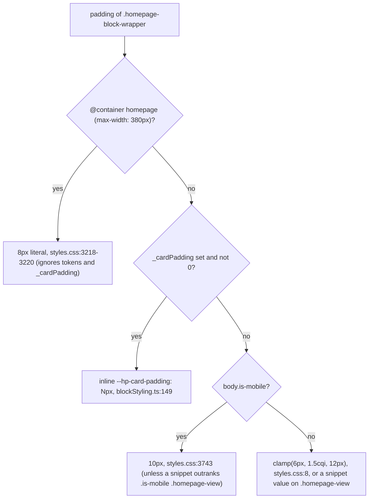
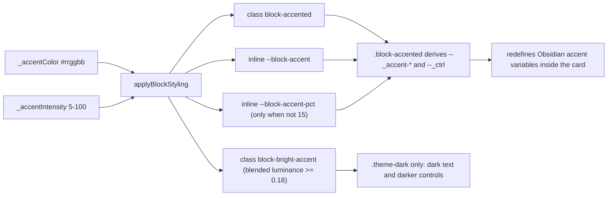

# Styling and theming

How the homepage is styled, what a CSS snippet can override, and how per-block styling keys reach the DOM. It describes branch `xray-remediation` after the X-ray fixes of 2026-10-10. Everything here was read from `styles.css`, `src/utils/blockStyling.ts` and the TypeScript that toggles classes. Statements marked **(inferred)** follow from CSS cascade, `var()` or container rules and have not been checked in a running Obsidian.

Related: [architecture](architecture.md) · [data model](data-model.md) (where the `_` keys live and how they migrate) · [flows](flows.md) · [blocks](blocks.md) · [plugin API](api/plugin.md) · [block API](api/blocks.md) · [grid API](api/grid.md).

## 1. Stylesheet and element tree

- `styles.css` is the only stylesheet. Line 2 is GridStack's core CSS, copied from `gridstack/dist/gridstack.min.css` (`styles.css:1-2`). GridStack sets `--gs-*` variables at runtime; `styles.css` never declares them.
- GridStack runs with `cellHeight: 80`, `margin: 8` (`src/GridLayout.ts:378-381`).

```text
.view-content.homepage-view                 HomepageView.ts:30  (container "homepage", inline-size)
├── .homepage-edit-fab                      EditToolbar.ts:24   (inserted first, HomepageView.ts:51)
├── .homepage-toolbar                       EditToolbar.ts:34
└── .homepage-grid.grid-stack               GridLayout.ts:54
    └── .grid-stack-item [role=listitem] (+ .is-auto-height)          GridLayout.ts:467-473
        └── .grid-stack-item-content
            └── .homepage-block-wrapper.hp-block-<type> [data-block-id]  BlockWrapper.ts:20-28  (the card; inline-size container)
                ├── .block-handle-bar                edit mode only, EditHandleBar.ts:46
                ├── .block-header-zone [role=button] BlockWrapper.ts:36-39
                │   ├── .block-collapse-chevron
                │   └── .block-header (.block-header-h1..h6) > .block-header-emoji + span
                ├── .block-header-divider            only when _showDivider === true
                └── .block-content.<root-class>      render(el) receives this element
```

The block's own root class is added to `.block-content` itself, not to a child. The wrapper class uses the type id; the root class does not always match it:

| Type | Wrapper class | Root class on `.block-content` |
|---|---|---|
| `greeting` | `hp-block-greeting` | `greeting-block` (`GreetingBlock.ts:177`) |
| `clock` | `hp-block-clock` | `clock-block` (`ClockBlock.ts:24`) |
| `folder-links` | `hp-block-folder-links` | `folder-links-block` |
| `button-grid` | `hp-block-button-grid` | `button-grid-block` (`ButtonGridBlock.ts:16`) |
| `quotes-list` | `hp-block-quotes-list` | `quotes-list-block` |
| `image-gallery` | `hp-block-image-gallery` | `image-gallery-block` (`ImageGalleryBlock.ts:226`) |
| `embedded-note` | `hp-block-embedded-note` | `embedded-note-block` |
| `static-text` | `hp-block-static-text` | `static-text-block` |
| `html` | `hp-block-html` | `html-block` |
| `video-embed` | `hp-block-video-embed` | `video-embed-block` |
| `bookmarks` | `hp-block-bookmarks` | **`bookmark-block`** (`BookmarkBlock.ts:22`) |
| `recent-files` | `hp-block-recent-files` | `recent-files-block` |
| `pomodoro` | `hp-block-pomodoro` | `pomodoro-block` (`PomodoroBlock.ts:46`) |
| `spacer` | `hp-block-spacer` | `spacer-block` |
| `random-note` | `hp-block-random-note` | `random-note-block` |
| `voice-dictation` | `hp-block-voice-dictation` | **`voice-block`** (`VoiceDictationBlock.ts:131`) |
| `vault-search` | `hp-block-vault-search` | `vault-search-block` |

`styles.css` itself only uses `hp-block-pomodoro` and `hp-block-voice-dictation` (`styles.css:3044-3045`, `3543-3550`). The others exist for snippets.

**Children of `.block-content` are clipped.** The collapse animation makes `.block-content` a one-row grid and gives every direct child `overflow: hidden; min-height: 0` (`styles.css:2496-2505`). A block whose content must scroll inside its card therefore needs a rule that outranks that clip. Static Text has one for `.static-text-content` (`:2083-2087`). The height modes that scroll have one each (`:2507-2515`):

| Block, height mode | Scrolling element | Rule |
|---|---|---|
| Embedded note, every mode but Grow (the default is Scroll) | `.embedded-note-content` | `.block-content:not(.embedded-note-block--grow) > .embedded-note-content` |
| Quotes, every mode but Extend (Scroll (fixed height), Wrap) | `.quotes-columns` | `.block-content:not(.quotes-list-block--extend) > .quotes-columns` |
| Image gallery, Fixed (scroll) | `.image-gallery.image-gallery--fixed-height` | `.block-content > .image-gallery.image-gallery--fixed-height` |

Each sets `overflow-y: auto` at (0,3,0) or more, against the clip's (0,2,0). The Grow and Extend modes keep the clip; their card grows to fit through auto-height instead. These regions keep their scroll bar when Show scroll bar is off (§11).

## 2. Where a value can be set

Three layers feed the card, from weakest to strongest:

1. **Tokens declared on `.homepage-view`** (§3). A value on `:root` or `body` is shadowed by the declaration. To override, match the element with a selector that outranks `.homepage-view` (0,1,0). This repo does not control whether snippets load before or after plugin CSS, so use `body .homepage-view` (0,1,1) instead of relying on source order.
2. **Hooks read with a `var()` fallback and never declared** (§4). Any ancestor works, `:root` included.
3. **Inline custom properties written by `applyBlockStyling`** on the card (§5). An inline declaration on the card beats any inherited value, so per-block settings override snippets for the same property.

Literal values inside container queries override all three for padding (§8).

On the Obsidian mobile app, `.is-mobile .homepage-view` (0,2,0) redeclares `--hp-padding: 6px` and `--hp-card-padding: 10px` (`styles.css:3741-3745`). According to the comment at `styles.css:3736`, Obsidian sets `.is-mobile` on `<body>`. To override these two tokens there, use `body.is-mobile .homepage-view` (0,2,1).

How card padding is resolved:



**(inferred)** A negative `_cardPadding` makes `padding` invalid at computed-value time, so the card gets padding 0, not negative padding. Only the pomodoro/voice `inset: var(--hp-card-padding)` (`styles.css:3546`) uses the negative value. The Body-tab help text "Negative values allowed" (`BlockSettingsModal.ts:202`) promises more than the card delivers.

**(inferred)** `1.5cqi` in the token is substituted where it is used. For the card and the grid, the nearest ancestor query container is `.homepage-view`, so the default padding is 1.5% of the view width, clamped to 6–12px.

## 3. Tokens declared on `.homepage-view`

Declared at `styles.css:6-32`. The comment at `styles.css:5` reads "Override in snippets/homepage.css via .homepage-view { ... }".

| Token | Default | Consumed at | Notes |
|---|---|---|---|
| `--hp-padding` | `clamp(8px, 1.5cqi, 16px)` | grid `padding` `:50`; toolbar side padding `:2256`, `:2274` | mobile `6px` (`:3742`). Grid padding replaced by literals ≤540px in single-column mode (8px) and ≤380px outside it (4px); the visible toolbar's by `6px 12px` at ≤540px (`:3124`). §8 |
| `--hp-card-padding` | `clamp(6px, 1.5cqi, 12px)` | card `padding` `:125`; skeleton `:596`; pomodoro/voice `inset` `:3546`; `:3153` | mobile `10px` (`:3743`); per-block `_cardPadding` |
| `--hp-content-max-width` | `1400px` | grid `max-width` `:51` | grid is centred (`margin-inline: auto`, `:54`) |
| `--hp-space-1` … `--hp-space-6` | 2, 4, 8, 12, 16, 24px | `--hp-space-4` `:2724`, `--hp-space-1` `:2739` (Add Block rows) | `-2`, `-3`, `-5`, `-6` are never read. The Add Block modal is outside `.homepage-view`, so its fallbacks apply there anyway |
| `--hp-dur-fast` / `-base` / `-slow` | 0.12s / 0.2s / 0.3s | only `--hp-dur-base` (`:2708`, drag dimming) | |
| `--hp-ease` | `cubic-bezier(0.4, 0, 0.2, 1)` | never read | |
| `--hp-ease-out` | `ease-out` | `:2708` | |
| `--hp-elevation-1` / `-2` / `-3` | shadow stacks | `.block-elevation-1..3` (`:3255-3263`) | |
| `--hp-elevation-drag` | shadow stack | dragged card (`:2712-2718`) | |

`.homepage-view` also sets `display: flex; flex-direction: column; height: 100%; overflow: hidden; position: relative; container-type: inline-size; container-name: homepage` (`styles.css:34-40`).

In practice, the tokens a snippet can usefully override are `--hp-padding`, `--hp-card-padding`, `--hp-content-max-width`, `--hp-elevation-1..3` and `--hp-elevation-drag`. The spacing and motion tokens hardly reach anything.

## 4. Hooks read with a fallback (not declared)

A snippet can set these on any ancestor. `applyBlockStyling` writes some of them inline on the card, and the inline value wins for that block.

| Variable | Fallback | Read at | Also written inline by |
|---|---|---|---|
| `--hp-title-gap` | `8px` | card `gap` `:134`; skeleton `:596` | `_titleGap` |
| `--hp-border-radius` | `var(--radius-m, 8px)` | card `:124` | `_borderRadius` |
| `--hp-border-width` | `1px` | card `:126` | `_borderWidth` |
| `--hp-border-style` | `solid` | card `:127` | `_borderStyle` |
| `--hp-backdrop-blur` | `none` | card `backdrop-filter` `:139-140` | `_backdropBlur` |
| `--hp-bg-opacity` | `100%` | `:3267`, `:3270`, only under `.block-custom-opacity` | `_bgOpacity` |
| `--block-accent-pct` | `15%` | `.block-accented` `:188` | `_accentIntensity` |
| `--block-accent` | (none inside `.block-accented`; `var(--color-accent)` elsewhere) | §6 | `_accentColor` |
| `--hp-btn-*` (14 names) | per property | `.button-grid .grid-btn` `:1525-1569` | button-grid `customCss`, §10 |
| `--hp-quote-font` | `inherit` | `:1703` | Quotes font preset class (`:1713-1720`) or custom font (`QuotesListBlock.ts:132`) |
| `--hp-quote-line-height` | `1.6` | `:1724` | handwriting preset (`:1719`) |
| `--hp-quote-valign` | `flex-start` | `:1020` | `QuotesListBlock.ts:109` |
| `--hp-quote-align` | `start` | `:1710` | `QuotesListBlock.ts:110` (Text alignment setting) |
| `--hp-card-anim-delay` | `0ms` | `:151` | `BlockWrapper.ts:31` (initial render only) |

Obsidian theme variables the card reads, which a snippet can re-scope under `.homepage-view` or `.homepage-block-wrapper`:
- `--background-secondary`: card background `:123`, and the base of the accent mix `:189` and of the opacity mix `:3267`
- `--background-modifier-border`, `--background-modifier-border-hover`: `:128`, `:166`
- `--radius-m`, `--radius-s`
- `--color-accent`, `--interactive-accent`
- `--text-normal`, `--text-muted`, `--text-faint`
- `--h1-size` … `--h6-color`: size, weight, line-height, style, font and colour of `.block-header-h1..h6` (`:401-449`)

Variables written by TypeScript that are internal wiring, not hooks: `--hp-grid-cols` (`ButtonGridBlock.ts:29`, `BookmarkBlock.ts:31`, `ImageGalleryBlock.ts:326`), `--hp-masonry-cols` (`ImageGalleryBlock.ts:318`), `--hp-column-count` (`QuotesListBlock.ts:217`), `--hp-quote-color` (`:279`), `--hp-grid-transform` (`GridLayout.ts:268`), `--hp-search-dropdown-top/left/width` (`VaultSearchBlock.ts:217-219`), `--hp-swatch-bg` (`BlockSettingsModal.ts:322`), `--hp-body-width`/`--hp-body-scale` (inside the HTML block's iframe, `HtmlBlock.ts:124-133`). The stylesheet-side caps `--hp-grid-cap`, `--hp-masonry-cap` and `--hp-masonry-gap` are set by the gallery container queries (`styles.css:1849-1878`).

## 5. Per-block styling keys

The shared `_` keys live in each block's `config` (see [data model](data-model.md)). The Header, Body and Card tabs of `BlockSettingsModal` edit them. `applyBlockStyling(el, config)` (`src/utils/blockStyling.ts:83-213`) turns them into classes and inline custom properties. It has two callers:
- `buildBlockWrapper` (`src/grid/BlockWrapper.ts:29`)
- the settings preview card (`BlockSettingsModal.ts:85`)

### 5.1 Ranges: `STYLE_RANGES`

`STYLE_RANGES` (`blockStyling.ts:13-23`) is the one range table. It is used by:
- the sliders (`BlockSettingsModal.ts:184, 204, 222, 232, 272, 335, 359, 380`)
- the render clamps (`clampStyle`, `blockStyling.ts:28-31`)
- the clipboard-import validators (`ranged(key)`, `src/utils/importSanitizer.ts:30-31, 46-62`)

`validateLayout` does **not** clamp `_` keys on load. `src/validation.ts` has no reference to `STYLE_RANGES`, so a hand-edited `data.json` is clamped only at render.

### 5.2 Keys handled by `applyBlockStyling`

The table is in execution order. "0 = default" means that 0 removes the inline property, so the stylesheet fallback applies. That holds for `_cardPadding`, `_titleGap`, `_elevation`, `_borderRadius`, `_backdropBlur` and `_borderWidth`; for `_accentIntensity`, `_bgOpacity` and `_gradientAngle` an explicit 0 is clamped and applied like any other value.

| Key | Accepted | Range | Unset / 0 means | Output on the card | Control |
|---|---|---|---|---|---|
| `customCss` (button-grid only, no `_`) | string | — | nothing | allowlisted `--hp-btn-*` via `setProperty`; key list in `data-hp-custom-css-keys` (`:93-106`) | Content tab textarea, §10 |
| `_accentColor` | `#rrggbb` (`HEX_COLOR_RE`, `:6`) | — | no accent | class `block-accented`; `--block-accent` (`:109-114`) | Card: picker + 11 presets (`BlockSettingsModal.ts:23-26`) |
| `_showHeaderAccent` | boolean | — | shown | `false` → class `block-no-header-accent`, set even without an accent (`:112`) | Header: "Show header bar" |
| `_accentIntensity` | number | 5–100 | unset: 15 (CSS fallback); 0 clamps to 5 | `--block-accent-pct: N%` only when an accent is set and N ≠ 15 (`:117-123`) | Card slider, step 5 |
| (derived) | — | — | — | class `block-bright-accent`, §6 (`:124-135`) | — |
| `_showBorder` | boolean | — | shown | `false` → `block-no-border` (`:143`) | Card toggle |
| `_showBackground` | boolean | — | shown | `false` → `block-no-background` (`:144`); also suppresses the gradient (`:193`) | Body toggle |
| `_cardPadding` | number | −48–48 | token (§2) | `--hp-card-padding: Npx` (`:147-150`) | Body slider, step 4 |
| `_titleGap` | number | 0–48 | 8px | `--hp-title-gap: Npx` (`:153-156`) | Header slider, step 2 |
| `_elevation` | number | 0–3 | none | class `block-elevation-N` (`:159-162`) | Card dropdown None/Subtle/Medium/Elevated (`BlockSettingsModal.ts:391-398`) |
| `_borderRadius` | number | 0–24 | `var(--radius-m, 8px)` | `--hp-border-radius: Npx` (`:165-168`) | Card slider, step 2 |
| `_bgOpacity` | number | 0–100 | unset: 100; 0 = fully transparent | below 100: class `block-custom-opacity` + `--hp-bg-opacity: N%` (`:171-175`) | Body slider, step 5 |
| `_backdropBlur` | number | 0–20 | none | `--hp-backdrop-blur: blur(Npx)` only when N > 0 **and** opacity < 100 (`:178-184`) | Body slider, step 1 |
| `_gradientStart`, `_gradientEnd` | `#rrggbb` | — | no gradient | both valid and background shown → class `block-has-gradient` + `--hp-bg-gradient: linear-gradient(<angle>deg, start, end)` (`:187-199`) | Body pickers (seeds `#667eea`, `#764ba2`) |
| `_gradientAngle` | number | 0–360 | unset: 135; 0 = 0deg | angle of the gradient | Body slider, step 15 |
| `_borderWidth` | number | 0–4 | 1px | `--hp-border-width: Npx` (`:202-205`) | Card slider, step 1 |
| `_borderStyle` | `solid` / `dashed` / `dotted` (`VALID_BORDER_STYLES`, `:45`) | — | `solid` | `--hp-border-style` (`:208-212`) | Card dropdown |

Consequences:
- Because 0 means "default", no per-block setting gives square corners or a 0px border. A snippet can (§13, example B).
- The colour pickers always show a colour (`#888888` for the accent, the two gradient seeds). The modal tracks whether a colour was set: the accent counts as set when it held a non-empty string at open or was picked, the gradient when both colours were `#rrggbb` at open or one was picked. Otherwise Save writes `''` for the accent, or for both gradient keys (`BlockSettingsModal.ts:55-58, 414-416`).
- **(inferred)** An imported fractional `_elevation` (e.g. `2.5`) is clamped but not rounded (`importSanitizer.ts:57`), so it produces the class `block-elevation-2.5`, which matches no rule.

### 5.3 Header keys (not in `applyBlockStyling`)

| Key | Handled by | Effect |
|---|---|---|
| `_titleLabel` | `BaseBlock.renderHeader` (`src/blocks/BaseBlock.ts:60-81`) | Trimmed label, else the block's default title. Edit-mode placeholder uses it untrimmed (`BlockWrapper.ts:82-84`) |
| `_titleEmoji` | same | `span.block-header-emoji` (edit mode: `em`, reset to `font-style: normal` at `styles.css:2759-2765`) |
| `_showTitle` | same | `false`, or an empty label → `hp-header-empty` on the header zone (`BaseBlock.ts:72`), which collapses it to height 0 (`styles.css:2437-2443`). A block with a hidden title is never rendered collapsed (`BlockWrapper.ts:21-24`). The edit-mode placeholder always shows a header (`BlockWrapper.ts:86`) |
| `_titleSize` | same; `TITLE_SIZE_RE = /^h[1-6]$/` (`BaseBlock.ts:5`) | Class `block-header-h1..h6`, which uses Obsidian's heading variables (`styles.css:401-449`). Ignored in the edit placeholder |
| `_showDivider` | `buildBlockWrapper` (`BlockWrapper.ts:44-46`) | Shown only when `=== true`. Hidden when collapsed (`:460`) and in edit mode (`:465`) |

Legacy keys (`_transparent`, `_hideTitle`, `_hideBorder`, `_hideBackground`, `_hideHeaderAccent`) are migrated to the `_show*` keys on load (`src/validation.ts:155-176`); see [data model](data-model.md).

## 6. Accent colour



`.block-accented` (`styles.css:187-208`) derives the card palette from one colour. Every mix is `color-mix(in srgb, …)`:

| Private variable | Value |
|---|---|
| `--_ap` | `var(--block-accent-pct, 15%)` |
| `--_accent-bg` | accent at `--_ap` over `--background-secondary` → card `background` |
| `--_accent-border` / `--_accent-border-hover` | 50% / 70% accent over `--background-modifier-border` |
| `--_accent-header-bg` | 22% accent over transparent → header zone background (`:214-219`) |
| `--_accent-header-text` | 85% accent over `--text-normal` → `.block-header` colour (`:221-223`) |
| `--_accent-divider` | 40% accent over the border colour (`:225-227`) |
| `--_ctrl` / `--_ctrl-hover` | accent mixed 60% / 50% with black |

Inside the card, the following Obsidian variables are redefined from `--_ctrl`: `--interactive-accent(-hover)`, `--color-accent`, `--color-accent-1`, `--color-accent-2`, `--text-accent(-hover)` and `--checkbox-color(-hover)` (`:199-207`). As a result:
- Buttons, links and checkboxes rendered inside an accented block use the darkened accent.
- The edit-mode dashed border (`border: 2px dashed var(--color-accent)`, `:2558-2561`) resolves to the darkened accent on the same element.

**Bright accents** (`blockStyling.ts:124-135`). The code computes `blended = 0.05·(1 − r) + L(accent)·r`, with `r = (intensity || 15) / 100` and `L` the WCAG relative luminance. When `blended ≥ 0.18`, it adds `block-bright-accent`. The code comment gives the examples "yellow at ~25%, white at ~15%". The class is computed for every accented block, but CSS only uses it under `.theme-dark` (`styles.css:232-290`). There it:
- forces `--text-normal: #1a1a1a` and black-alpha muted/faint text
- darkens the controls further (accent mixed 50% / 40% with black)
- re-asserts these on `.block-content` and `.markdown-rendered` so theme rules on those elements cannot shadow them (`:259-275`)
- colours task items, links and `hr` directly (`:279-290`)

**Header bar off** (`_showHeaderAccent: false`). `.block-accented.block-no-header-accent` makes the header zone transparent and sets the title to `--text-normal`, but keeps the card tint and border (`styles.css:293-300`).

**Rules that read the raw accent.** The first three read `var(--block-accent, var(--color-accent))`: undarkened, and falling back to the theme accent when the block has no accent:
- Clock "accent" style: `:888`, `:892`
- voice mic `:1223`, voice saved flash `:1305`
- `.pomodoro-btn.is-primary` `:3650-3652`
- `.block-accented .folder-link-btn:hover` `:1011-1013` reads `var(--block-accent)` with no fallback (it only matches accented blocks). It uses `color-mix(in oklch …)`, which contradicts the "srgb to avoid oklch hue shifts" comment at `:184`.

**Snippet interaction (derived from the CSS above).**
- `--block-accent` is inherited. A snippet value on `.homepage-view` becomes the colour of those raw-accent rules for blocks that have no accent of their own. It does not tint cards, because `block-accented` is only added from config.
- A snippet `--block-accent-pct` applies to accented blocks whose intensity is unset or 15. The bright-accent test in JS still assumes 15%, so the dark-text switch can be wrong at that intensity.

## 7. Background, border and shadow precedence

These are cascade outcomes of rules that are each correct on their own. All are **(inferred)** from specificity and source order.

| Settings combination | Result | Why |
|---|---|---|
| `_showBackground: false` + `_bgOpacity < 100` | background shows semi-transparent, then disappears on hover | `.block-custom-opacity` (0,2,0, `:3266`) comes after `.block-no-background` (0,2,0, `:357`); `.block-no-background:hover` (0,3,0) wins on hover. `applyBlockStyling` does not gate opacity on `_showBackground` (`blockStyling.ts:173`) |
| accent + gradient | gradient shows | `.block-has-gradient` (0,2,0, `:3828`) beats `.block-accented` (0,1,0) |
| accent + gradient + `_bgOpacity < 100` | gradient hidden, translucent accent tint shows | `.block-custom-opacity.block-accented` (0,3,0, `:3269`) beats `.block-has-gradient` |
| no accent + gradient + `_bgOpacity < 100` | opaque gradient; the opacity setting has no effect | `.block-has-gradient` is later than `.block-custom-opacity` at equal specificity |
| `_showBorder: false` + `_elevation > 0` | no shadow | `.homepage-block-wrapper.block-no-border { box-shadow: none }` (0,2,0, `:349-355`) beats `.block-elevation-N` (0,1,0) |
| `_elevation > 0` + hover highlight on | while hovered, the elevation shadow is replaced by the lighter hover shadow | `.homepage-hover-highlight .homepage-block-wrapper:hover` (0,3,0, `:170-172`) |
| `_backdropBlur` with opacity 100 | no blur | not written unless opacity < 100 (`blockStyling.ts:180`) |
| any border settings in edit mode | 2px dashed accent | `border` shorthand at (0,3,0), `:2558-2561`. Two (0,4,0) rules still change its colour: `.block-no-border.block-accented:hover` (`:352`) makes it transparent while an accented block with a hidden border is hovered, and the drag rule (`:2712-2718`) tints it while the card is dragged |

Hover highlight (`hoverHighlight`, default `true`, `src/validation.ts:44`) adds only `box-shadow: 0 2px 10px rgba(0,0,0,.06)` on card hover (`:170-172`) and reveals the collapse chevron (`:2486-2492`). There is no transform. The "lift" wording in the settings description (`HomepageSettingTab.ts:327`), README and CLAUDE.md describes a shadow. The comment at `styles.css:169` calls it "opt-in", but it defaults to on.

## 8. Breakpoints: container queries vs grid columns

Two independent systems react to the width of `.homepage-view`:
- **Container queries** (CSS) adapt the UI.
- **`ResponsiveColumnsManager`** (JS) changes the GridStack column count. It uses a `ResizeObserver` on `.homepage-view` (`src/grid/ResponsiveColumns.ts:62-76`; wired at `GridLayout.ts:430-431`).

| View width | Source | Effect |
|---|---|---|
| ≤ 380px | `@container homepage` `styles.css:3211-3230` | grid `padding: 4px` (0,2,0), which loses to the single-column `padding: 8px` (0,3,0, `:3146-3149`), so it shows only outside single-column mode (in practice edit mode with a canonical count above 1, since view mode below 480px is always single-column); card `padding: 8px`; zoom and column toolbar groups hidden; add-button text hidden |
| < 480px | `computeEffectiveColumns` `ResponsiveColumns.ts:40` | 1 column → single-column mode (§9) |
| ≤ 540px | `styles.css:3122-3208` | toolbar wraps, zoom label hidden; single-column `gap`/`padding: 8px`; entry animation off; folder links as chips; 44px min-heights; quote text 0.9375rem |
| < 768px | `ResponsiveColumns.ts:41` | `min(2, canonical)` columns |
| ≤ 768px | `styles.css:3093-3119` | 44px handle-bar buttons and FAB; larger resize handles |
| < 1024px | `ResponsiveColumns.ts:42` | `min(3, canonical)` columns |
| ≥ 1024px | `ResponsiveColumns.ts:43` | canonical (saved) columns |
| ≥ 1200px | `styles.css:3232-3236` | `.homepage-grid { padding: 32px }`: **never applies**, loses to `.homepage-grid.grid-stack` (0,2,0, `:44-50`) |

- CSS bounds are inclusive (`max-width`); JS bounds are exclusive (`<`). `COLUMN_BREAKPOINTS = { single: 480, double: 768, triple: 1024 }` (`ResponsiveColumns.ts:11`). The two sets are documented as separate at `styles.css:3089-3090` and `ResponsiveColumns.ts:7-9`.
- **Column reduction is suspended in edit mode.** The observer returns early (`ResponsiveColumns.ts:64`), and `setup` pins the canonical count (`:83-85`). Container queries keep firing.
- `.is-mobile` rules (`styles.css:3735-3786`) apply to the mobile app at any width: token overrides, 44px tap targets, folder-link chips, and no hover transforms.

### Containers and block-level queries

| Container | Type | Declared |
|---|---|---|
| `.homepage-view` (`homepage`) | inline-size | `:38-39` |
| `.homepage-block-wrapper` (unnamed) | inline-size | `:138` |
| `.greeting-block`, `.clock-block`, `.voice-block`, `.random-note-block`, `.pomodoro-block` | size | `:646`, `:835`, `:1171`, `:1421`, `:3555` |
| `.button-grid-block`, `.image-gallery-block` | inline-size | `:1513`, `:1750` |

Unnamed `@container` queries resolve against the nearest suitable ancestor:
- greeting: width ≤350 `:701`, height ≤200 `:750`
- clock: height ≤160 `:899`
- voice: width ≤200 `:1334`, height 121–180 `:1345`, height ≤120 with width ≥200 `:1362`
- random note: height ≤160 `:1502`
- button grid / bookmarks: width ≤250 `:1572`
- gallery: width ≤500 / ≤400 / ≤280 `:1849-1878`
- pomodoro: height ≤220 `:3660`, height ≤120 `:3698`

Two exceptions use `@media`:
- the lightbox, `(max-width: 600px)` `:1952`, because it is mounted on `document.body` with no container ancestor (`:1951`)
- `(prefers-reduced-motion: reduce)` `:3792`

Rules in these queries that do not take effect **(inferred)**:
- **Greeting, height query:** `.block-content.greeting-block` (`:751`) targets the size container itself. Its ancestors are inline-size containers only, so a height query cannot match that rule. Its child rules do match. Random note avoids this: the card is `.random-note-body`, a child of the `.random-note-block` size container (`:1420-1428`), so `.random-note-body { gap: 4px }` (`:1504`) matches in a short card.
- **Button grid at ≤250px:** `.button-grid { --hp-grid-cols: 1fr }` (`:1574`) loses to the inline `--hp-grid-cols` on the same element (`ButtonGridBlock.ts:29`), so a 2- or 3-column button grid does not collapse. `.grid-btn { padding; font-size }` (0,1,0, `:1577-1580`) also loses to `.button-grid .grid-btn` (0,2,0).
- **Hover resets at ≤540px:** `.grid-btn:hover` (0,2,0, `:3163`) loses to `.button-grid .grid-btn:hover` (0,3,0). `.bookmark-card:hover` (`:3167`) loses to the later equal-specificity rule at `:3433`. The `.is-mobile` variants (`:3776-3780`) do apply.
- **Gallery grid mode:** `var(--hp-grid-cap, var(--hp-grid-cols))` (`:3872`) replaces the configured column count instead of capping it. From 281 to 400px it is `repeat(2, 1fr)`; from 401 to 500px it is `repeat(auto-fill, minmax(120px, 1fr))`. A 1-column gallery therefore shows more than one column there. Masonry mode does cap, via `min()` (`:3873`).

## 9. Single-column mode

- **Trigger:** the grid gets `hp-single-column` when the effective column count is 1.
  - At init: `GridLayout.ts:376`
  - On resize: `ResponsiveColumns.ts:127`
  - In view mode this means a view narrower than 480px, or a canonical count of 1 (`mobileColumns` can be 1). In edit mode only the canonical count matters.
- **CSS** (`styles.css:2995-3086`):
  - The grid becomes `display: flex; flex-direction: column; gap: 12px`.
  - Items become `position: relative; top/left: auto !important; width: 100% !important; height: auto !important`. The `!important` reclaims GridStack's inline styles (comment `:3005-3008`).
  - Item content, card and `.block-content` get `height: auto`. `.block-content` gets `min-height: 60px`, except the spacer (0).
  - Pomodoro and voice drop the absolute `.block-content` positioning they use in the grid (`:3543-3547`). They become inline-size containers, with a 100px ring (`:3070-3072`) and a 56px mic (`:1415-1417`). Buttons get a 44px min-height.
- **Order:** DOM order becomes visual order, so items are re-appended sorted by `(y, x)`: at init (`GridLayout.ts:400-412`) and when narrowing (`ResponsiveColumns.ts:203-210`).
- **Narrow and mobile tweaks:**
  - ≤540px: `gap: 8px; padding: 8px` (`:3146-3149`). This literal replaces `--hp-padding`.
  - `.is-mobile`: `gap: 6px` plus bottom safe-area padding (`:3783-3786`).
- **(inferred)** Greeting, clock and random note keep `container-type: size` while single-column sets `height: auto`. Size containment gives them no intrinsic height, so their `.block-content` sits at the 60px `min-height`. Their short-card height queries (≤200px, ≤160px) then match, and these blocks render in their compact layouts.
- **Auto-height after narrowing.** When the view narrows to 2 or 3 columns, `ResponsiveColumnsManager` asks every auto-height block to measure again at the new width, since the column change cancelled the measurements queued by the render. One column is sized by this CSS and needs no measurement (`ResponsiveColumns.ts:192-201`).

## 10. Button Grid custom CSS allowlist

`customCss` is a Button Grid config string. It is edited in a full-width textarea `.hp-custom-css-textarea` (`maxLength = 4096`, with an example placeholder; `src/blocks/ButtonGridBlock.ts:81-94`; styled at `styles.css:3370-3402`).

`applyBlockStyling` parses it (`parseAllowlistedCustomCss`, `blockStyling.ts:63-81`):

1. Strip `/* … */` comments.
2. Split on `;`. Split each part at the first `:` and trim both sides.
3. Drop the pair if the key or value is empty, if the key fails `^--hp-btn-[a-z0-9-]+$` (lowercase only, `:52`), if the value matches `\b(?:url|image|image-set|cross-fade|element|paint)\s*\(` (case-insensitive, `:58`), or if the value contains a `\p{Cc}` control character (`:77`).
4. Apply each surviving pair with `el.style.setProperty(key, value)` on the **card**, not on `cssText`, so other inline properties survive. Record the keys in `data-hp-custom-css-keys`, and remove the previous keys first (`:93-106`).

The values cascade from the card to `.button-grid .grid-btn`. Only these 14 names are read (`styles.css:1525-1569`); any other `--hp-btn-*` passes the filter but has no effect:

| Property | Fallback | Applies to |
|---|---|---|
| `--hp-btn-bg` | `var(--background-primary)` | `background` |
| `--hp-btn-border` | `1px solid var(--background-modifier-border)` | `border` |
| `--hp-btn-radius` | `var(--radius-m, 8px)` | `border-radius` |
| `--hp-btn-padding` | `8px 12px` | `padding` |
| `--hp-btn-color` | `var(--text-normal)` | `color` |
| `--hp-btn-shadow` | `none` | `box-shadow` |
| `--hp-btn-gap` | `6px` | gap between emoji and label |
| `--hp-btn-hover-bg` | `var(--background-modifier-hover)` | hover `background` |
| `--hp-btn-hover-border-color` | `var(--background-modifier-border-hover, …)` | hover `border-color` |
| `--hp-btn-hover-transform` | `translateY(-1px)` | hover `transform` |
| `--hp-btn-hover-shadow` | `0 2px 6px rgba(0,0,0,.06)` | hover `box-shadow` |
| `--hp-btn-active-transform` | `translateY(0) scale(0.98)` | `:active` `transform` |
| `--hp-btn-active-shadow` | `none` | `:active` `box-shadow` |
| `--hp-btn-emoji-size` | `1rem` | `.grid-btn-emoji` `font-size` |

Lifecycle:
- Deliberately absent from `defaultConfig` (`src/main.ts:78-80`).
- Stripped on export (`HomepageSettingTab.ts:376-383`) and on import (`importSanitizer.ts:10`).
- Deleted at load from every block type other than `button-grid` (`src/validation.ts:202-208`).

A layout can therefore only carry `customCss` through the user's own input or a hand-edited or synced `data.json`. The comment at `blockStyling.ts:49-51`, which still names "an imported layout" as the source, predates the import strip.

Notes:
- The same 14 names can be set by a snippet on any ancestor as a vault-wide default (§13, example D). Per-block `customCss` wins, because it is declared on the card.
- `setProperty` is called without a priority argument. **(inferred)** A value that ends in `!important` is therefore rejected by CSSOM and silently ignored.
- **Unverified:** the value filter matches literal function names. CSS escapes such as `u\rl(` are not normalised before the test. Whether Chromium would then fetch a resource from such a value has not been tested.

## 11. State classes set from TypeScript

| Class | Element | Set by | CSS |
|---|---|---|---|
| `homepage-no-scrollbar` | `.homepage-view` | `HomepageView.ts:33`; live `HomepageSettingTab.ts:316` | `:371-382` hides the scroll bar of the view and of its `.homepage-grid` only. Scrolling regions inside blocks (§1, the scrolling height modes) keep theirs, because without one nothing shows that they hold more content. |
| `homepage-hover-highlight` | `.homepage-view` | `HomepageView.ts:34`; live `HomepageSettingTab.ts:343` | `:170-178`, `:2486-2492` |
| `hp-toolbar-open` | `.homepage-view` | `EditToolbar.ts:141` | `:2284-2293` (view scrolls, grid gets `margin-top: 12px`) |
| `is-visible` / `is-hidden` | toolbar / FAB | `EditToolbar.ts:136-137` | toolbar sticky at top with accent bottom border |
| `edit-mode` | grid | `GridLayout.ts:150-154` | resize handles, dashed card border, compact placeholders, handle bar (`:2557-2702`) |
| `homepage-grid--animating` | grid | `GridLayout.ts:143-148`, removed by a 500 ms timeout | `hp-card-enter` 0.3s with `--hp-card-anim-delay` (`:149-152`) |
| `hp-single-column` | grid | `GridLayout.ts:376`, `ResponsiveColumns.ts:127` | §9 |
| `hp-dragging` | grid | `GridLayout.ts:420-427` | siblings at opacity 0.5 (`:2706-2709`) |
| `hp-zoomed` + `viewport-fit` | grid | `GridLayout.setZoom` (`GridLayout.ts:259-274`) | `transform: var(--hp-grid-transform)` (`:3815-3819`), `overflow: visible` (`:2553-2555`) |
| `is-auto-height` | `.grid-stack-item` | `GridLayout.ts:476-480` | edit mode hides the `s`/`se` handles (`:2570-2573`) |
| `block-just-added` | card | `GridLayout.ts:446` | `hp-block-appear` 0.4s (`:3239-3252`) |
| `block-collapsed` / `is-collapsed` | card / chevron | `BlockWrapper.ts:24,41`; `CollapseToggle.ts:55-56` | `.block-content` animates `grid-template-rows` 1fr→0fr (`:2496-2521`) |
| `hp-header-empty` | header zone | `BlockWrapper.ts:37`, `BaseBlock.ts:72`, `BlockWrapper.ts:86` | height 0 (`:2437-2443`) |
| `block-accented`, `block-bright-accent`, `block-no-header-accent`, `block-no-border`, `block-no-background`, `block-elevation-N`, `block-custom-opacity`, `block-has-gradient` | card | `applyBlockStyling` | §5–§7 |
| `hp-no-transition`, `hp-auto-rows` | `.block-content` | `src/grid/AutoHeight.ts:126-137` (while measuring) | `!important` (`:3824-3825`) |
| `hp-hidden` | various | e.g. `BlockSettingsModal.ts:78-84` | `display: none` (`:3812`) |

Collapse notes:
- The chevron has opacity 0 unless `homepage-hover-highlight` is on (`:2467-2492`). **With hover highlight off, a collapsed block shows no chevron.**
- The header zone is a `div[role=button]`. The plugin's focus rings only target `button`, `select`, `input` and `textarea` inside `.homepage-view` (`:2535-2548`), so the header zone has no plugin focus style.

The Static Text pencil button (`.static-text-edit-btn`) is hidden (opacity 0) until the block is hovered. It also turns visible on `:focus-visible`, so a keyboard user who tabs onto it sees it (`styles.css:2064-2067`). On the mobile app it stays at opacity 0.6, and edit mode hides it (`:2069-2081`).

## 12. Surfaces outside `.homepage-view`

The `.homepage-view` tokens, the focus rings and the reduced-motion rule (`.homepage-view, .homepage-view *`, `:3792-3809`) do not reach elements mounted elsewhere:

| Surface | Mounted on | Consequence (inferred unless noted) |
|---|---|---|
| Block settings modal, incl. preview card `div.settings-preview-card.homepage-block-wrapper` (`BlockSettingsModal.ts:63-71`) | Obsidian modal | `padding: var(--hp-card-padding)` has no value unless `_cardPadding` ≠ 0, so the preview padding is 0. `.block-elevation-N` resolves to no shadow, so the elevation preview shows nothing. The swatch focus ring promised at `BlockSettingsModal.ts:315-317` is scoped to `.homepage-view` (`styles.css:2536`) |
| Add Block `SuggestModal` | Obsidian modal | `--hp-space-*` fallbacks apply (same values) |
| Gallery lightbox | `doc.body` (`ImageGalleryBlock.ts:45`) | `@media (max-width: 600px)` instead of container queries (`:1951-1952`) |
| Vault-search dropdown | `el.doc.body` (`VaultSearchBlock.ts:62`) | positioned by inline `--hp-search-dropdown-*` |
| HTML block iframe (HTML containing `<style>`) | `srcdoc` iframe | each `var(--x)` referenced in the HTML is resolved against `getComputedStyle(doc.body)` and copied to the iframe's `:root` (`HtmlBlock.ts:54-81`, verified in code). `--hp-*` tokens and the accent overrides on a card are therefore not visible inside the iframe; theme variables are. See [blocks](blocks.md) |

## 13. Worked snippet examples

Save as `.obsidian/snippets/homepage.css` and enable the snippet in Appearance. Each example states the selector reasoning and where the plugin still wins.

**A. Layout tokens (desktop and mobile)**

```css
body .homepage-view {
  --hp-content-max-width: 1800px;
  --hp-padding: 24px;
  --hp-card-padding: 16px;
}
body.is-mobile .homepage-view {
  --hp-padding: 8px;
  --hp-card-padding: 12px;
}
```

- `body .homepage-view` (0,1,1) outranks the declaration on `.homepage-view` (0,1,0).
- `body.is-mobile .homepage-view` (0,2,1) outranks `.is-mobile .homepage-view` (0,2,0).
- Still overridden by:
  - the literal grid padding at ≤540px in single-column mode (8px) and at ≤380px outside single-column mode (4px)
  - on the mobile app, the literal single-column bottom padding (`styles.css:3783-3786`)
  - the literal card padding at ≤380px (8px)
  - any block with `_cardPadding` ≠ 0

**B. Card shape, vault-wide (including square corners)**

```css
body .homepage-view {
  --hp-border-radius: 0;
  --hp-border-width: 2px;
  --hp-border-style: dashed;
  --hp-title-gap: 4px;
}
```

- None of these is declared by the plugin, so `:root` would work too.
- `0` is a real value here, unlike `_borderRadius: 0`, which means "theme default".
- Per-block `_borderRadius`/`_borderWidth`/`_borderStyle`/`_titleGap` still win. Edit mode still draws its own dashed border.

**C. Elevation scale**

```css
body .homepage-view {
  --hp-elevation-1: 0 1px 2px rgba(0, 0, 0, 0.12);
  --hp-elevation-2: 0 6px 16px rgba(0, 0, 0, 0.18);
  --hp-elevation-3: 0 14px 36px rgba(0, 0, 0, 0.24);
}
```

- Affects only blocks whose Elevation setting is Subtle, Medium or Elevated.
- No shadow when the block's border is hidden (§7). While hovered with hover highlight on, the hover shadow replaces it.

**D. Vault-wide "ghost" Button Grid buttons**

```css
body .homepage-view {
  --hp-btn-bg: transparent;
  --hp-btn-border: 1px solid transparent;
  --hp-btn-hover-bg: var(--background-modifier-hover);
  --hp-btn-hover-border-color: transparent;
  --hp-btn-hover-transform: none;
  --hp-btn-hover-shadow: none;
}
```

A block's own `customCss` overrides any of these per property.

**E. Per-block `customCss` (Button Grid → Content tab → Custom CSS)**

```text
--hp-btn-radius: 999px;
--hp-btn-padding: 6px 14px;
--hp-btn-bg: color-mix(in srgb, var(--interactive-accent) 12%, transparent);
--hp-btn-hover-bg: color-mix(in srgb, var(--interactive-accent) 22%, transparent);
--hp-btn-emoji-size: 1.25rem;
```

- Only `--hp-btn-*` declarations survive the allowlist. Declarations only, no selectors or braces.
- **(inferred)** `var(--interactive-accent)` is substituted on the card. On an accented block that is the darkened accent (§6).

**F. Flat cards for one block type (view mode only)**

```css
.homepage-grid:not(.edit-mode) .homepage-block-wrapper.hp-block-clock,
.homepage-grid:not(.edit-mode) .homepage-block-wrapper.hp-block-greeting {
  background: transparent;
  border-color: transparent;
  box-shadow: none;
}
```

- Specificity is (0,4,0). That beats every view-mode background, border and shadow rule on the card, including `.block-custom-opacity.block-accented` (0,3,0) and the hover-highlight shadow (0,3,0), except two it ties with: `.block-no-border.block-accented:hover` and `.block-no-background.block-accented:hover` (0,4,0, `:352`, `:360`), which set the same transparent/none values.
- `:not(.edit-mode)` leaves the edit-mode dashed border alone.
- Use the wrapper classes from §1 (`hp-block-bookmarks`, `hp-block-voice-dictation`, …).

**G. One specific block**

```css
.homepage-block-wrapper[data-block-id="PASTE-ID-HERE"] .block-header {
  text-transform: uppercase;
  letter-spacing: 0.08em;
}
```

- The id is the card's `data-block-id` attribute (`BlockWrapper.ts:27`); read it in DevTools. Ids come from `crypto.randomUUID()`, with an `hp-<random><time>` fallback (`src/utils/ids.ts::newId`).
- (0,3,0) beats `.block-header` (0,1,0).

**H. Always-visible collapse chevron**

```css
.homepage-view .block-collapse-chevron { opacity: 0.5; }
.homepage-view .block-collapse-chevron.is-collapsed { opacity: 1; }
```

- Fixes the missing chevron when hover highlight is off (§11).
- With hover highlight on, the plugin's hover rule (0,4,0, `styles.css:2490-2492`) still raises it to 1.
- Edit mode keeps it hidden. A header hidden with `_showTitle: false` has zero height, so no chevron shows there either.

**I. Default quote font**

```css
body .homepage-view {
  --hp-quote-font: "Iowan Old Style", Georgia, serif;
}
```

Applies to Quotes blocks whose font style is Default and that have no custom font. A preset class or an inline font on the block wins (`styles.css:1713-1720`, `QuotesListBlock.ts:132`).

**J. Disable the card entry animation**

```css
.homepage-view .homepage-grid--animating .homepage-block-wrapper {
  animation: none;
}
```

(0,3,0) beats `.homepage-grid--animating .homepage-block-wrapper` (0,2,0, `styles.css:149`).

**What does not work from a snippet:**
- `--hp-padding` or `--hp-card-padding` on `:root` or `body`: shadowed by the `.homepage-view` declaration.
- `.homepage-grid { padding }` without extra specificity: the plugin's `.homepage-grid.grid-stack` (0,2,0) wins.
- `.homepage-block-wrapper { padding }` without extra specificity: it ties at (0,1,0) with the plugin's own card padding rules (`:122`, `:3152`, `:3218`), so the result depends on stylesheet order, which this repo does not control.
- Tinting cards through `--block-accent` alone: the `block-accented` class comes only from `_accentColor`.

## 14. Drift and known gaps

For maintainers. Each item was checked against the code on disk.

1. The ≥1200px padding rule never applies (§8).
2. `.homepage-grid .grid-stack-item-content { overflow: visible }` (0,2,0, `styles.css:60-62`) loses to GridStack's `.grid-stack>.grid-stack-item>.grid-stack-item-content` (0,3,0, `overflow-x: hidden; overflow-y: auto`). Only the edit-mode rule at `:2565` (0,4,0) takes effect.
3. The elevation-token comment (`styles.css:27-28`) says they drive "every transient shadow (hover, drag, popovers)". Only drag uses them; hover (`:171`), the search dropdown (`:1111`), button hover (`:1559`) and the active toolbar button (`:2407`) use literal shadows. The "prefer these over ad-hoc literals" note (`:12-13`) covers tokens that are unused (§3).
4. The comment "sized from the block wrapper" (`styles.css:1747-1748`) is wrong. The gallery's query container is `.block-content.image-gallery-block` (`:1749-1751`).
5. The `oklch` mix at `:1013` contradicts the srgb rationale at `:184`.
6. "Lifts" (settings description, README, CLAUDE.md) and "opt-in" (`styles.css:169`) misdescribe hover highlight (§7).
7. CLAUDE.md calls the `BlockWrapper.ts` helpers "pure DOM builders". In fact `removeSkeleton` schedules a timer (`:71`) and `renderEmptyState` attaches a click listener (`:115`).
8. `homepage-grid--animating` is removed at 500 ms (`GridLayout.ts:145`). The delays are 0, 50, 100, 140, 170, 195, 215, 230 ms, then 240 ms for every later card (`GridLayout.ts:486`), so from the seventh card on (215 ms delay + 300 ms animation = 515 ms) a card is still animating then and snaps to its final state. **(inferred)**
9. **(inferred)** `.block-accented.block-no-header-accent .block-header-zone` (0,3,0) outranks `.hp-header-empty` (0,2,0) on padding. An accented block with a hidden title and the header bar off therefore keeps 2px + 2px of header-zone padding. Every block with a hidden title also keeps one `--hp-title-gap` above its content, because the zero-height zone is still a flex item of the card (`styles.css:132-134`).
10. The skeleton overlay paints `--background-secondary` (`:599`), not the accent tint, so accented blocks flash an untinted card while loading.
